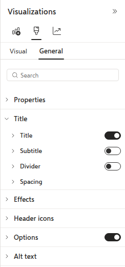
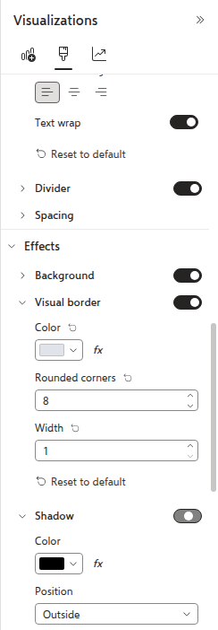

# Visual titles, borders and backgrounds

> **Applies to:** Creators

Every visual sits in a container with a title, a background, a border, a shadow, padding and a header with icons. This
article shows how to format them on the **General** tab of the Format pane.

## Prerequisites

- A report open in edit mode. The steps use the **Sales by country** bar chart on the **Overview** page of the
  built-in sample (**File > New > Sample report**).

## Open the General tab

1. Select the visual.
2. Select **Visualizations > Format visual**, then the **General** tab.

## Title, subtitle and divider

1. Expand **Title**, then the **Title** sub-card.
2. Type the title in **Text**. Leave it empty to keep the automatic title, which Lumen builds from the fields like Power
   BI does (for example *Total Sales and Margin % by Year Month*).
3. Set **Font**, **Font size**, **Bold**, **Italic**, **Underline**, **Text color**, **Background color**, **Horizontal
   alignment** and **Text wrap** as needed. **Heading level** (Normal, Heading 1 to 3) tells screen readers how to
   treat the title.
4. To add a second line, turn on **Subtitle** and type its **Text**.
5. To draw a line under the title area, turn on **Divider** and set its **Color**, **Line style** (Solid, Dashed,
   Dotted), **Width** and **Ignore padding** (the line spans the full width of the visual).
6. Under **Spacing**, turn on **Customize spacing** to set the space between title and content, below the title,
   below the subtitle and below the title area, in pixels.

The title **Text** of a title or subtitle can come from a measure: select **fx** next to it and choose a field. See
[Conditional formatting](conditional-formatting.md#field-value).

Titles are on by default for charts, maps and the AI visuals, and off for tables, matrices, cards, slicers and
elements, as in Power BI Desktop.

## Background, border and shadow

Expand **Effects**.

| Sub-card | Settings |
|---|---|
| **Background** | **Color** (white by default) and **Transparency** (0% by default). Turn the switch off for a transparent visual. |
| **Visual border** | **Color**, **Rounded corners** (0 to 50 px) and **Width** (1 to 10 px). Rounded corners also round the background and the shadow. |
| **Shadow** | **Color** (black), **Position** (Outside, Inside), **Preset** (Bottom right, Bottom, Bottom left, Right, Center, Left, Top right, Top, Top left, Custom), **Transparency** (70%), **Size**, **Blur** (10), **Angle** (45°) and **Distance** (10). |

## Padding, size and position

Expand **Properties**:

- **Size** (**Height**, **Width**, **Lock aspect ratio**) and **Position** (**Horizontal**, **Vertical**), in pixels on
  the page.
- **Padding**: the space between the container edge and the content, per side. When unset, a visual uses 0 px at the top
  and 5 px on the other sides; text boxes, shapes, images and buttons use 5 px on every side.
- **Advanced options**: **Responsive** and **Maintain layer order**. In Lumen, **Responsive** is read by the pie and
  donut charts, the waterfall chart and the slicers to adapt to small sizes; other visuals ignore it. **Maintain layer
  order** is saved for Power BI; Lumen doesn't read it.

## Header icons

When a reader points at a visual, a header with icons appears just above its top edge: drill buttons for visuals with a
hierarchy, the filter icon (lists the filters that apply), focus mode and **More options** (**...**).

Expand **Header icons** to change it:

- **Colors**: turn the header off entirely with its switch, or set **Background**, **Border**, **Icon** color and
  **Transparency**.
- **Icons**: switches for each icon: **Visual information**, **Visual warning**, **Visual error**, **Drill on dropdown**,
  **Drill up**, **Drill down**, **Go to next level**, **Expand to next level**, **Pin**, **Focus mode**, **Filter**,
  **More options** and **Help tooltip** (off by default).
- **Help tooltip**: the **Title**, **Text**, **Font color** and **Background** of the help icon's tooltip, shown when
  **Help tooltip** is on.

## Tooltips and alt text

- The card titled **Options** holds the visual's tooltip settings: **Show**, **Type** (**Default** or **Report page**)
  and **Page**. See [Tooltips](tooltips.md).
- **Alt text** is read by screen readers. Like the title, it can come from a measure with **fx**.

## Set the defaults for all visuals

To give every visual the same background, border, header or tooltip style, edit the theme instead of each visual:
**View > Themes > Customize current theme > Visuals**. See [Themes](themes.md).

## Considerations and limitations

- Lumen's header doesn't draw a **Pin** icon (there is no dashboard to pin to); the **Pin** switch is kept for Power BI.
- The tooltips card is titled **Options** on the General tab, and its **Page** box expects the page's internal name
  (see [Tooltips](tooltips.md)).

## Related content

- [Format a visual](format-a-visual.md)
- [Themes](themes.md)
- [Conditional formatting](conditional-formatting.md)
- [General tab properties reference](../reference/format-properties/general-tab.md)
- [Tooltips](tooltips.md)
