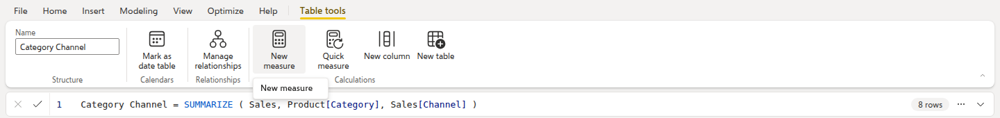

# Create calculated tables

> **Applies to:** Creators · Analysts

A calculated table is a table whose rows come from a DAX table expression instead of a data source. Use one for a date table, a list of scenarios, a bridge between two tables or a summary you want to relate to other tables. This article shows how to create one in Lumen and how its columns are determined.

## Prerequisites

- A report or semantic model open in Lumen.

## Create a calculated table

1. Select **New table**. It is on the **Modeling** tab and the **Table tools** tab in Report view, and on the **Home** tab in Table view and Model view.

   Lumen adds a table named `Table` and puts the cursor in the formula bar after `Table = `.
2. Type a name and a table expression, for example:

   ```dax
   Category Channel = SUMMARIZE ( Sales, Product[Category], Sales[Channel] )
   ```

   While you type, the formula bar shows how many rows the expression returns (`8 rows` for this one).
3. Press Enter to commit.



Lumen evaluates the expression, creates one column per result column with its name and data type (here **Category** and **Channel**, both text), and loads the rows. The table appears in the **Data** pane with a calculated-table icon. When you edit the expression later, Lumen adds, removes or retypes columns to match the new result.

## Examples

Each example is a query you can run in **DAX query view** to see the rows a calculated table with that expression would get. To create the table, use the expression after `EVALUATE` with **New table**.

A summary of one table grouped by columns of related tables, with a measure:

```dax
EVALUATE
ADDCOLUMNS (
    SUMMARIZE ( Sales, Product[Category], Store[Store Type] ),
    "Sales", [Total Sales]
)
ORDER BY Product[Category], Store[Store Type]
```

| Product[Category] | Store[Store Type] | [Sales] |
|---|---|---|
| Accessories | Flagship | $233,623 |
| Accessories | Online | $492,389 |
| Accessories | Outlet | $132,937 |
| Accessories | Standard | $494,747 |
| Bikes | Flagship | $463,360 |
| Bikes | Online | $977,709 |
| Bikes | Outlet | $248,717 |
| Bikes | Standard | $1,021,099 |
| Clothing | Flagship | $189,559 |
| Clothing | Online | $432,331 |
| Clothing | Outlet | $117,412 |
| Clothing | Standard | $450,662 |
| Components | Flagship | $178,801 |
| Components | Online | $446,282 |
| Components | Outlet | $124,931 |
| Components | Standard | $483,439 |

A calendar (first three rows shown):

```dax
EVALUATE
TOPN (
    3,
    ADDCOLUMNS (
        CALENDAR ( DATE ( 2025, 1, 1 ), DATE ( 2025, 12, 31 ) ),
        "Year", YEAR ( [Date] ),
        "Month", FORMAT ( [Date], "mmm" )
    ),
    [Date], ASC
)
ORDER BY [Date]
```

| [Date] | [Year] | [Month] |
|---|---|---|
| 1/1/2025 | 2025 | Jan |
| 1/2/2025 | 2025 | Jan |
| 1/3/2025 | 2025 | Jan |

A small static table typed in DAX:

```dax
EVALUATE
DATATABLE (
    "Band", STRING,
    "Min Price", CURRENCY,
    "Max Price", CURRENCY,
    { { "Low", 0, 100 }, { "Medium", 100, 1000 }, { "High", 1000, 100000 } }
)
```

| [Band] | [Min Price] | [Max Price] |
|---|---|---|
| Low | 0 | 100 |
| Medium | 100 | 1000 |
| High | 1000 | 100000 |

For a table you type or paste by hand, **Home > Enter data** is often simpler; see [Connect and transform data](../connect-and-transform/README.md).

## Calculated tables Lumen creates for you

Some commands create calculated tables with a fixed shape:

- **Modeling > New parameter > Numeric range** creates a `GENERATESERIES` table and a measure; **Fields** creates a field parameter table. See [Field parameters and what-if parameters](field-parameters-and-what-if-parameters.md).
- **Modeling > Calculation group** creates a calculation group table. See [Calculation groups](../model-data/calculation-groups.md).

The formula bar does not open for calculation groups; use their own dialog.

## Considerations and limitations

- Calculated tables are computed when the model is opened, after a refresh and after an edit they depend on, in dependency order together with calculated columns.
- A calculated table that refers to itself, directly or through another calculated object, is a circular dependency and fails.
- `CALENDARAUTO` covers every date in the model's date columns, except calculated columns and calculated tables, as in Power BI. In the sample it runs from 1/1/2015 to 12/31/2025 (4,018 days), because **Store[Open Date]** goes back to 2015. In a model that uses generated sample data, the generated dates decide the range.
- You can add calculated columns and measures to a calculated table, and relate it to other tables, as with any table.

## Related content

- [Create calculated columns](calculated-columns.md)
- [Date tables](../model-data/date-tables.md)
- [Field parameters and what-if parameters](field-parameters-and-what-if-parameters.md)
- [DAX query view](dax-query-view.md)
- [Create and edit relationships](../model-data/create-and-edit-relationships.md)
