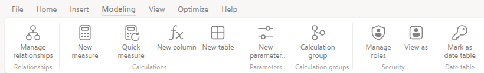

# Create measures

> **Applies to:** Analysts · Creators

A measure is a named DAX formula that is evaluated in the filter context of each cell of a visual, so one formula gives a different value per row, column, slicer selection and total. This article shows how to create, edit, format and organize measures in Lumen.

## Prerequisites

- A report or semantic model open in Lumen. The steps use the built-in sample (**Try a sample** on the start screen).
- The steps work in Report view, Table view and Model view; the formula bar appears in all three.

## Create a measure

1. In the **Data** pane, select the table that should hold the measure. In the sample, select **_Measures**.
2. On the **Home** tab, in the **Calculations** group, select **New measure**. You can also use **Modeling > New measure**, or right-click a table or measure in the **Data** pane and select **New measure**.

   

   Lumen adds a measure named `Measure` to the table of the selected field. When nothing is selected, it uses the model's measure table (a table with measures whose columns are all hidden), or else the first visible table. The cursor is placed in the formula bar after `Measure = `.
3. Replace the text with a name and a formula, for example:

   ```dax
   Online Sales = CALCULATE ( [Total Sales], Sales[Channel] = "Online" )
   ```

   While you type, the editor suggests functions, tables, columns and measures. See [The formula bar and the DAX editor](the-formula-bar-and-dax-editor.md).
4. Press **Enter** (**Ctrl+Enter** when the formula has several lines) or select the check mark (**Commit**) to save the measure. Press **Esc** or select **Cancel** to discard your edits. Moving the focus out of the formula bar also commits, as in Power BI Desktop.

The measure appears in the **Data** pane under its table. On the sample with no filters it evaluates to **$2,348,710** (the formula bar's live value shows `= 2348710.25` until you give the measure a format).

## Check the result in a query

You can test measures without adding them to the model by defining them in a DAX query. Paste this into **DAX query view** and select **Run**:

```dax
DEFINE
    MEASURE _Measures[Online Sales] =
        CALCULATE ( [Total Sales], Sales[Channel] = "Online" )
    MEASURE _Measures[Online Share] =
        DIVIDE ( [Online Sales], [Total Sales] )
EVALUATE
SUMMARIZECOLUMNS (
    'Date'[Year],
    "Total Sales", [Total Sales],
    "Online Sales", [Online Sales],
    "Online Share", FORMAT ( [Online Share], "0.0%" )
)
ORDER BY 'Date'[Year]
```

| Date[Year] | [Total Sales] | [Online Sales] | [Online Share] |
|---|---|---|---|
| 2023 | $1,640,070 | 451319.71 | 27.5% |
| 2024 | $2,181,165 | 785586.05 | 36.0% |
| 2025 | $2,666,761 | 1111804.49 | 41.7% |

`[Total Sales]` shows its model format string; the query-defined `[Online Sales]` has none, so it shows the raw number.

## Edit, rename or move a measure

- **Edit the formula**: select the measure in the **Data** pane; its definition opens in the formula bar. Edit and press **Enter**.
- **Rename**: change the name before the `=` in the formula bar, use **Measure tools > Name**, or right-click the measure and select **Rename**. Lumen renames references to the measure in other measures and in the report's visuals, as Power BI Desktop does.
- **Move to another table**: on the **Measure tools** contextual tab, pick a table in **Home table**. Model view's **Properties** pane has the same setting.
- **Delete**: right-click the measure and select **Delete from model**. Undo (**Ctrl+Z**) restores it.

## Format a measure

When a measure is selected, the **Measure tools** tab shows its **Format** (General, Whole number, Decimal number, Currency, Percentage, Scientific, Date, Time, Text or Custom) and buttons for currency symbol, percentage, thousands separator and decimal places. The format string is saved with the measure and used by visuals, tooltips and DAX query view.

A measure whose format comes from a dynamic format string expression shows **Dynamic** instead of the format controls.

## Organize measures

- **Display folder**: right-click a measure, select **Display folder…** and type a folder name; use `\` for subfolders (for example `Sales\Online`). The sample's measures are organized in folders such as **Time Intelligence** and **Profitability**.
- **Description**: in Model view, select the measure and type in **Properties > General > Description**. The description appears when you hover the measure in the DAX editor.
- **Hide**: right-click the measure and select **Hide**, or turn on **Is hidden** in Model view's **Properties** pane.

## Considerations and limitations

- A measure is saved even if its formula has an error, as in Power BI Desktop. Visuals that use it then show an error. The formula bar keeps showing the error message until you fix it.
- New measures have no format string; set one on **Measure tools** before you use them in visuals.
- Implicit measures (a numeric column dropped into a visual and aggregated) also work. Lumen has no command for the model property **Discourage implicit measures**; it keeps the value saved in the model, and creating a calculation group turns it on after asking you, as in Power BI.

## Related content

- [The formula bar and the DAX editor](the-formula-bar-and-dax-editor.md)
- [Quick measures](quick-measures.md)
- [Evaluation context in Lumen](evaluation-context-in-lumen.md)
- [Troubleshoot a measure](troubleshoot-a-measure.md)
- [Column and table properties](../model-data/column-and-table-properties.md)
