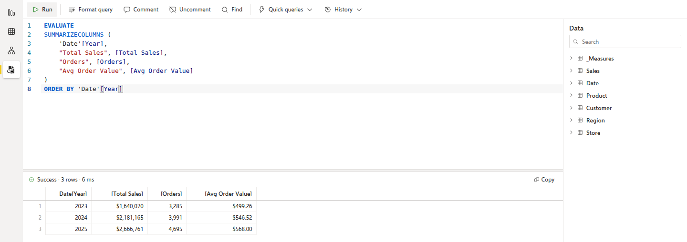

# DAX in Lumen

> **Applies to:** Creators · Analysts · Developers

This article explains what evaluates your DAX in Lumen, how its results are checked against Power BI, and what that means for the numbers and the speed you see. Read it before you compare a Lumen report with the same report in Power BI Desktop.

## Lumen has its own DAX engine

Power BI Desktop evaluates DAX with Microsoft's Analysis Services engine (VertiPaq). Lumen cannot use that engine, so it has its own: a columnar, dictionary-encoded engine written in TypeScript (`src/core/dax/tabular`), built to follow the semantics Microsoft documents for DAX. Every visual, card, slicer, tooltip, conditional-formatting rule, the formula bar's live value and DAX query view go through it.

What this means in practice:

- **Results are expected to match Power BI, not guaranteed to.** The engine implements filter context, row context, context transition, relationship propagation, `ALLSELECTED` shadow contexts, calculation groups, field parameters, row-level security and visual calculations the way Microsoft documents them, and the cases it is known to get differently are listed in [Known differences from the Power BI engine](known-differences-from-the-power-bi-engine.md).
- **Not every function exists.** 289 of the 460 functions in Microsoft's DAX reference are implemented, 8 partially; the financial, INFO and several statistical functions are not. Check [DAX function support](../reference/dax-function-support.md) before you rely on a function. A formula that calls a missing function fails with *The function 'NAME' is not supported by this engine (unknown DAX function)*, and a visual that uses it shows an error instead of a wrong number.
- **Numbers are 64-bit floating point.** Whole numbers, decimal numbers and fixed decimal (currency) values are all held as double-precision floats. Results that Power BI computes in fixed decimal arithmetic can differ in the last digits.
- **One user, one locale.** Format strings and `FORMAT` use en-US conventions; `USERPRINCIPALNAME` and the other user functions return placeholders.

## How accuracy is checked

The engine is tested at several levels. None of them involves Power BI itself (the project has no Windows machine), so a result that matches these checks is still not a certified Power BI result.

| Check | What is compared | Where |
|---|---|---|
| Unit and semantic tests | Each function and language feature against the behaviour Microsoft documents (filter propagation, blank rows of invalid relationships, `ALLSELECTED`, context transition over expanded tables, variable scoping, user-defined function parameter modes, …) | `src/core/dax/tabular/__tests__`, `src/core/engine/__tests__` |
| Differential test | Every golden measure of a reference star schema, evaluated by this engine and by an earlier engine whose measures are verified cell by cell against a DuckDB SQL oracle | `src/core/engine/__tests__/parity-diff.test.ts` |
| Microsoft sample files | Opened from Microsoft's public sample `.pbix` files (real data): every measure evaluates at the grand total without error; grand totals of SUM, MIN, MAX, COUNT and DISTINCTCOUNT of every numeric column, plain aggregation measures and sums grouped through each relationship are recomputed independently in plain JavaScript and compared | `src/core/engine/__tests__/samples.test.ts`, `oracle.test.ts` (run with `LUMEN_SAMPLES_DIR`) |
| Published values | Card values on the sample reports compared with the values Microsoft publishes in its "Take a tour of the … sample" pages | `src/renderer/src/app/sweep/__tests__/samples.test.ts`; results in [SWEEP.md](../SWEEP.md) |

The Microsoft sample checks need the sample files on disk and are skipped otherwise; see [Command line and environment](../reference/command-line-and-environment.md).

## Performance

The engine runs inside Lumen's window process (the renderer), on the same thread as the user interface. Typical report pages evaluate in milliseconds to a few hundred milliseconds. Two limits protect you from runaway queries:

- **Visual queries have a time budget of 15 seconds.** A visual whose query runs longer is stopped and shows partial results with the warning *The query exceeded its time budget (15 s) and was stopped; the results are partial.*
- **DAX query view has no time budget.** A query you run there runs to completion, and the window does not respond until it finishes. There is no cancel button.

Tables and matrices load their rows in windows of 500, and totals come from their own queries, as Power BI does. To see how long each visual takes and the DAX query it ran, use the Performance analyzer; see [Troubleshoot a measure](troubleshoot-a-measure.md).

## Where you write DAX

| Place | Use it for | Article |
|---|---|---|
| Formula bar (Report, Table and Model view) | Measures, calculated columns, calculated tables | [The formula bar and the DAX editor](the-formula-bar-and-dax-editor.md) |
| DAX query view | `EVALUATE` queries, testing measures, `DEFINE FUNCTION` | [DAX query view](dax-query-view.md) |
| Quick measures dialog | Generating a measure from a template | [Quick measures](quick-measures.md) |
| Manage roles dialog | Row-level security filters | [Row-level security](../model-data/row-level-security.md) |
| Calculation group dialog | Calculation items | [Calculation groups](../model-data/calculation-groups.md) |

## A first query

Open the built-in sample, select **DAX query view** in the view switcher on the left, paste this query and select **Run**:

```dax
EVALUATE
SUMMARIZECOLUMNS (
    'Date'[Year],
    "Total Sales", [Total Sales],
    "Orders", [Orders],
    "Avg Order Value", [Avg Order Value]
)
ORDER BY 'Date'[Year]
```

Result:

| Date[Year] | [Total Sales] | [Orders] | [Avg Order Value] |
|---|---|---|---|
| 2023 | $1,640,070 | 3,285 | $499.26 |
| 2024 | $2,181,165 | 3,991 | $546.52 |
| 2025 | $2,666,761 | 4,695 | $568.00 |



## Considerations and limitations

- A report that opens without data uses generated sample data (see [Sample data](../connect-and-transform/sample-data.md)); measures then evaluate correctly over values that are not your real data. Compare numbers only on refreshed or embedded data.
- Opening a Lumen-saved model in Power BI Desktop has not been tested by this project. Lumen writes DAX expressions back as you typed them, so a formula that uses a function Lumen accepts but Power BI does not (see [the Lumen extensions in the function reference](../reference/dax-function-support.md#functions-not-in-microsofts-list)) would fail there.

## Related content

- [Known differences from the Power BI engine](known-differences-from-the-power-bi-engine.md)
- [DAX function support](../reference/dax-function-support.md)
- [Evaluation context in Lumen](evaluation-context-in-lumen.md)
- [DAX query view](dax-query-view.md)
- [Architecture](../ARCHITECTURE.md)
