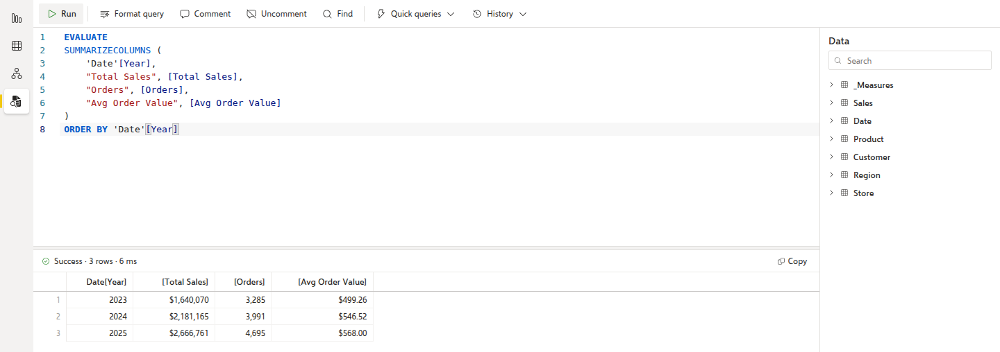
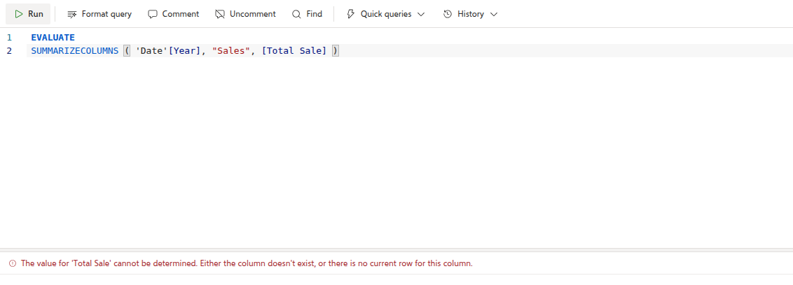
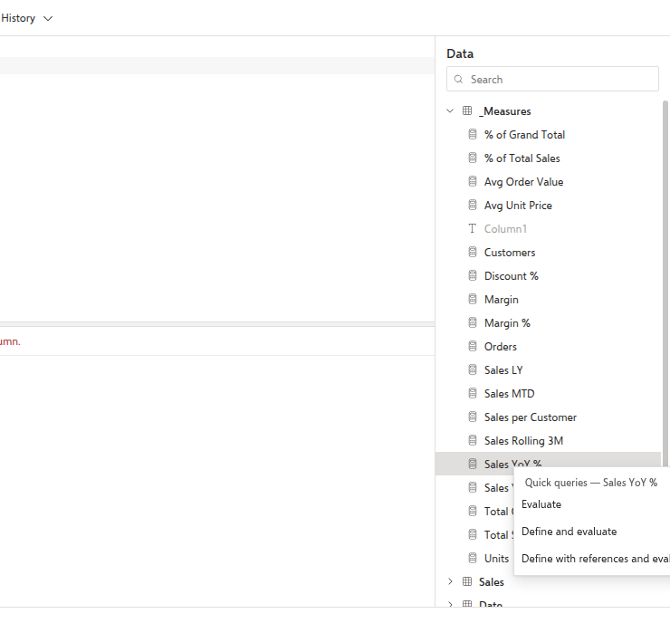
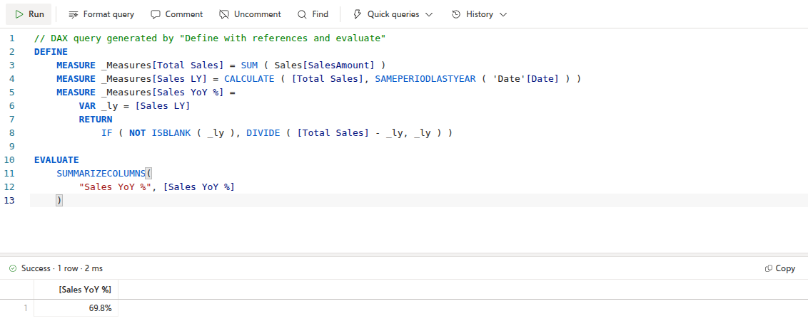

# DAX query view

> **Applies to:** Analysts · Developers

DAX query view lets you write DAX queries against the open model and see their results in a grid, without building a visual. Use it to test a measure, check numbers, inspect a table or run the query a visual sent. This article covers writing and running queries, the results grid, quick queries, query tabs and the view's limits.

## Prerequisites

- A report or semantic model open in Lumen.
- Select **DAX query view** in the view switcher on the left edge of the window (the fourth icon).

## Write and run a query

1. Type or paste a query in the editor. A query starts with `EVALUATE` followed by a table expression; it can start with a `DEFINE` block of `MEASURE`, `VAR`, `TABLE`, `COLUMN` and `FUNCTION` definitions and end with `ORDER BY` and `START AT`:

   ```dax
   EVALUATE
   SUMMARIZECOLUMNS (
       'Date'[Year],
       "Total Sales", [Total Sales],
       "Orders", [Orders],
       "Avg Order Value", [Avg Order Value]
   )
   ORDER BY 'Date'[Year]
   ```

2. Select **Run**, or press F5 or Ctrl+Enter. When text is selected, only the selection runs.

The results appear below the editor:



| Date[Year] | [Total Sales] | [Orders] | [Avg Order Value] |
|---|---|---|---|
| 2023 | $1,640,070 | 3,285 | $499.26 |
| 2024 | $2,181,165 | 3,991 | $546.52 |
| 2025 | $2,666,761 | 4,695 | $568.00 |

The editor is the same DAX editor as the formula bar, with autocomplete, parameter hints, hover help and error underlining; see [The formula bar and the DAX editor](the-formula-bar-and-dax-editor.md). To show a single value, wrap it in braces: `EVALUATE { [Total Sales] }`.

## The results pane

- The status line shows **Success**, the number of rows and the duration, or the error message.
- Values are shown with the format string of the column or measure they come from. Expressions without a format string (for example a measure you define in the query) show unformatted numbers.
- A query with several `EVALUATE` statements returns several results; select **Result 1**, **Result 2**, … above the grid to switch.
- **Copy** copies the active result as tab-separated text with a header row, ready to paste into a spreadsheet.
- Drag the bar between the editor and the results to resize them.

When the query fails, the status line shows the engine's message. If the message contains a position, a **Query (line, column)** link moves the cursor there.



### Several results and START AT

```dax
DEFINE
    VAR _years = { 2024, 2025 }
EVALUATE
SUMMARIZECOLUMNS ( 'Date'[Year], TREATAS ( _years, 'Date'[Year] ), "Total Sales", [Total Sales] )
ORDER BY 'Date'[Year]
EVALUATE
TOPN ( 3, SUMMARIZECOLUMNS ( Store[Store], "Total Sales", [Total Sales] ), [Total Sales], DESC )
ORDER BY [Total Sales] DESC
```

Result 1:

| Date[Year] | [Total Sales] |
|---|---|
| 2024 | $2,181,165 |
| 2025 | $2,666,761 |

Result 2:

| Store[Store] | [Total Sales] |
|---|---|
| Online Store | $2,348,710 |
| Austin Outlet | $407,444 |
| Seattle Flagship | $392,363 |

`START AT` skips the rows before a value of the `ORDER BY` columns:

```dax
EVALUATE
SUMMARIZECOLUMNS ( Product[Subcategory], "Units", [Units] )
ORDER BY Product[Subcategory]
START AT "S"
```

| Product[Subcategory] | [Units] |
|---|---|
| Saddles | 2,060 |
| Shorts | 3,581 |
| Socks | 3,813 |
| Tires and Tubes | 8,406 |
| Touring Bikes | 373 |
| Wheels | 506 |

## Quick queries

The **Data** pane on the right of DAX query view lists the model's tables, columns and measures. Double-click a field to insert its reference at the cursor. Right-click it for queries that Lumen writes for you in a new query tab, with the same wording as Power BI Desktop:

| Right-click on | Quick queries |
|---|---|
| A table | **Show top 100 rows**, **Show column statistics**, **Define all measures in this table**, **Define all measures in this table and references** |
| A column | **Show data preview**, **Show column statistics** |
| A measure | **Evaluate**, **Define and evaluate**, **Define with references and evaluate** |

The same choices are in the toolbar's **Quick queries** menu for the field selected in the **Data** pane.



**Define with references and evaluate** on **Sales YoY %** writes the measure and every measure it uses into a `DEFINE` block, so you can change any of them and run the query without touching the model:



The query returns **69.8%**: with no filters, `[Sales LY]` covers 2023–2024 (the sample's dates shifted back one year), so the growth compares all sales with the sales of the first two years.

## Query tabs and history

- Each query lives in a tab at the bottom of the view. Select **+** (**New query**) to add one; right-click a tab to **Rename**, **Duplicate** or **Delete** it.
- Query text is saved with the model as `DAXQueries/<tab name>.dax` files in the semantic model folder, the location Power BI Desktop uses, so the tabs come back when you reopen a PBIP project or a `.wbi` bundle.
- **History** lists the last 100 queries you ran in this session, with their outcome and time. Select one to put its text back in the editor. History is not saved.
- **Format query** (Shift+Alt+F), **Comment** and **Uncomment** (Ctrl+/) and **Find** (Ctrl+F) work on the current tab.

## Considerations and limitations

- **No time limit and no cancel.** A query runs on the user interface thread until it finishes; the window does not respond meanwhile. Visual queries have a 15-second budget; DAX query view has none. Start with `TOPN` on large tables.
- **The whole result is kept.** Every row of the result is held in memory and the grid shows them all (virtualized). Avoid `EVALUATE` of a large fact table without `TOPN`.
- **Query-scoped tables.** A table defined with `DEFINE TABLE` can be evaluated and used as a table expression, but its columns cannot be referenced as `'Table'[Column]` (Power BI allows that). Use `VAR` and `SELECTCOLUMNS` instead.
- **No "Update model with changes".** Measures defined in a query are not written back to the model; copy the expression into the formula bar.
- **No Copilot.**
- **Row-level security is not applied to queries.** When **Modeling > View as** is active, DAX query view shows the View as banner, but the queries you run there still see every row: with a role that keeps only Europe, `EVALUATE { COUNTROWS ( Region ) }` returns 9, while visuals see 4. Check role filters on report visuals instead.
- Result column names follow the engine's naming: `Table[Column]` for columns and `[Name]` for named expressions.

## Related content

- [The formula bar and the DAX editor](the-formula-bar-and-dax-editor.md)
- [Evaluation context in Lumen](evaluation-context-in-lumen.md)
- [Troubleshoot a measure](troubleshoot-a-measure.md)
- [User-defined functions](user-defined-functions.md)
- [DAX queries on Microsoft Learn](https://learn.microsoft.com/dax/dax-queries)
