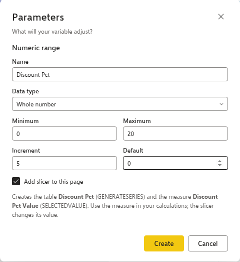
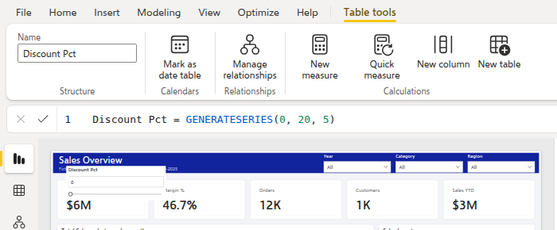
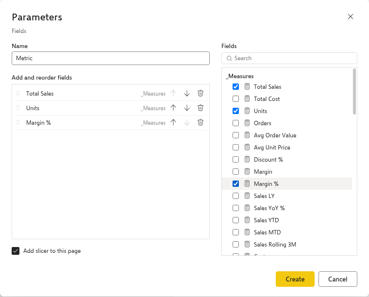
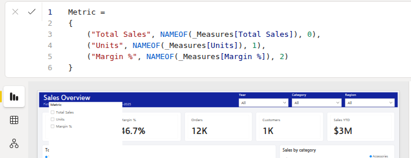

# Field parameters and what-if parameters

> **Applies to:** Creators · Analysts

Parameters let report readers change what a visual shows. A *what-if parameter* (Numeric range) gives a measure a value that the reader picks with a slicer. A *field parameter* (Fields) lets the reader pick which measures or columns a visual uses. In Lumen both are created from **Modeling > New parameter**, with the same table shapes Power BI Desktop writes.

## Prerequisites

- A report open in Report view (the **Modeling** tab is shown in Report view only).
- For the slicer option, a report page selected.

## Create a what-if parameter

1. Select **Modeling > New parameter > Numeric range**.
2. In the **Parameters** dialog, fill in:

   | Field | Example | Notes |
   |---|---|---|
   | **Name** | `Discount Pct` | Name of the new table, its column and its measure |
   | **Data type** | Whole number | **Whole number** or **Decimal number** |
   | **Minimum** | 0 | |
   | **Maximum** | 20 | Must be at least **Minimum** |
   | **Increment** | 5 | Must be greater than 0; at most 1,000,000 values |
   | **Default** | 0 | Optional; the value of the measure when the slicer has no single selection |

   Keep **Add slicer to this page** selected to add a single-value slicer for the parameter.

   

3. Select **Create**.

Lumen creates:

- a calculated table **Discount Pct** with the expression `GENERATESERIES(0, 20, 5)` and one column, **Discount Pct**, holding 0, 5, 10, 15 and 20;
- a measure **Discount Pct Value** = `SELECTEDVALUE('Discount Pct'[Discount Pct], 0)`;
- with the option selected, a slicer on the current page.



### Use the parameter in a measure

Reference the parameter's measure in your own measure:

```dax
Sales after discount = [Total Sales] * ( 1 - [Discount Pct Value] / 100 )
```

With the parameter created as above, this query returns the value for each slicer position (run in Lumen after creating the parameter):

```dax
DEFINE
    MEASURE _Measures[Sales after discount] = [Total Sales] * ( 1 - [Discount Pct Value] / 100 )
EVALUATE
SUMMARIZECOLUMNS ( 'Discount Pct'[Discount Pct], "Sales after discount", [Sales after discount] )
ORDER BY 'Discount Pct'[Discount Pct]
```

| Discount Pct[Discount Pct] | [Sales after discount] |
|---|---|
| 0 | 6487996.03 |
| 5 | 6163596.23 |
| 10 | 5839196.43 |
| 15 | 5514796.63 |
| 20 | 5190396.82 |

## Create a field parameter

1. Select **Modeling > New parameter > Fields**.
2. In **Name**, type a name, for example `Metric`.
3. In the **Fields** list on the right, select the measures or columns to offer, for example **Total Sales**, **Units** and **Margin %**. They appear under **Add and reorder fields**, where you can:
   - edit the display name shown in the slicer,
   - change the order with the up and down arrows,
   - remove a field with the delete button.
4. Keep **Add slicer to this page** selected to add a slicer listing the fields.
5. Select **Create**.



Lumen creates a calculated table with the same shape as Power BI Desktop:

```dax
Metric =
{
    ("Total Sales", NAMEOF(_Measures[Total Sales]), 0),
    ("Units", NAMEOF(_Measures[Units]), 1),
    ("Margin %", NAMEOF(_Measures[Margin %]), 2)
}
```

| Column | Visible | Content |
|---|---|---|
| **Metric** | Yes | The display name; sorted by **Metric Order** |
| **Metric Fields** | Hidden | The field reference, for example `'_Measures'[Total Sales]` |
| **Metric Order** | Hidden | 0, 1, 2 |



Put the **Metric** column into a visual's field well (for example the Y-axis of a column chart). The visual then shows the fields selected in the slicer, in parameter order, or all of them when nothing is selected.

### Edit a field parameter

In Model view, select the parameter table and select **Edit parameter** in the **Properties** pane. The same dialog opens with the current fields. You can also edit the table expression in the formula bar.

## Considerations and limitations

- The slicer is added at a fixed position near the top-left corner of the page, on top of whatever is there. Move it after creating the parameter.
- How visuals expand a field parameter (the selected fields in parameter order; all fields when nothing is selected; selections on the display name or the order column) is covered by the engine's tests. The screenshots in this article show creation only.
- A field parameter whose expression you write by hand is recognised when its hidden fields column carries Power BI's `ParameterMetadata` extended property, as tables created by Power BI Desktop or by this dialog do.

## Related content

- [Create calculated tables](calculated-tables.md)
- [Create measures](create-measures.md)
- [Slicers](../visuals/README.md)
- [DAX query view](dax-query-view.md)
- [Field parameters on Microsoft Learn](https://learn.microsoft.com/power-bi/create-reports/power-bi-field-parameters)
