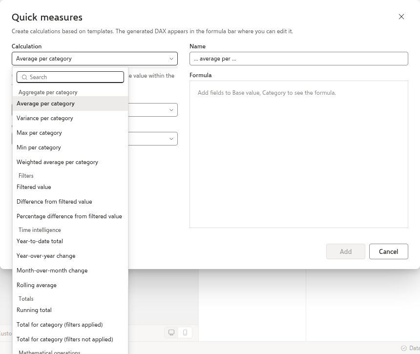

# Quick measures

> **Applies to:** Creators · Analysts

Quick measures write a DAX measure for you from a template: you pick a calculation and the fields it applies to, and Lumen adds the generated measure to the model, where you can read and edit its DAX. This article lists the templates Lumen has and shows one end to end.

## Prerequisites

- A report or semantic model open in Lumen.

## Create a quick measure

1. In the **Data** pane, select the table that should hold the new measure (for example **_Measures** in the sample). When nothing is selected, Lumen uses the model's measure table (a table with measures whose columns are all hidden), or else the first visible table.
2. Select **Quick measure**: on the **Home** or **Modeling** tab, from the right-click menu of a table or measure in the **Data** pane (**New quick measure**), or from the menu of a field in a visual's field well.
3. In **Calculation**, pick a template, for example **Year-to-date total**. A short description appears below the list.
4. Fill in the template's fields. For the year-to-date total:
   - **Base value**: **Total Sales**. When you pick a column instead of a measure, a second list lets you choose its aggregation: **Sum**, **Average**, **Minimum**, **Maximum**, **Count (Not blank)** or **Count (Distinct)**.
   - **Date**: **Date** (from the **Date** table). Only date columns are offered.
5. Check the generated DAX under **Formula** and change **Name** if you want (Lumen proposes `Total Sales YTD`).
6. Select **Add**.

![The Quick measures dialog: Calculation Year-to-date total, Base value Total Sales, Date Date, Name Total Sales YTD and the formula TOTALYTD([Total Sales], 'Date'[Date])](../images/dax/quick-measures-year-to-date.png)

The measure is added and selected, and its definition opens in the formula bar:

```dax
Total Sales YTD = TOTALYTD([Total Sales], 'Date'[Date])
```

Evaluated by month for the first quarter of 2025 in the sample:

```dax
EVALUATE
CALCULATETABLE (
    SUMMARIZECOLUMNS ( 'Date'[Month Number], "YTD", [Total Sales YTD] ),
    'Date'[Year] = 2025,
    'Date'[Month Number] <= 3
)
ORDER BY 'Date'[Month Number]
```

| Date[Month Number] | [YTD] |
|---|---|
| 1 | 147670.14 |
| 2 | 281362.11 |
| 3 | 482606.17 |

(The new measure has no format string yet, so the values are unformatted. Set one on **Measure tools**.)

## Templates



| Group | Calculation | Fields | Generated DAX (outline) |
|---|---|---|---|
| Aggregate per category | Average per category | Base value, Category | `AVERAGEX ( KEEPFILTERS ( VALUES ( category ) ), CALCULATE ( base ) )` |
| Aggregate per category | Variance per category | Base value, Category | `VARX.P` over the same table |
| Aggregate per category | Max per category | Base value, Category | `MAXX` over the same table |
| Aggregate per category | Min per category | Base value, Category | `MINX` over the same table |
| Aggregate per category | Weighted average per category | Base value, Weight, Category | `DIVIDE ( SUMX ( …, base * weight ), SUMX ( …, weight ) )` over the category values |
| Filters | Filtered value | Base value, Filter, **Filter value** | `CALCULATE ( base, KEEPFILTERS ( filter = value ) )` |
| Filters | Difference from filtered value | Base value, Filter, **Filter value** | Base value minus the filtered value |
| Filters | Percentage difference from filtered value | Base value, Filter, **Filter value** | Relative difference from the filtered value |
| Time intelligence | Year-to-date total | Base value, Date | `TOTALYTD ( base, date )` |
| Time intelligence | Year-over-year change | Base value, Date | Change from `DATEADD ( date, -1, YEAR )`, as a percentage |
| Time intelligence | Month-over-month change | Base value, Date | Change from `DATEADD ( date, -1, MONTH )`, as a percentage |
| Time intelligence | Rolling average | Base value, Date, **Periods before** (30), **Periods after** (0) | `AVERAGEX ( DATESBETWEEN ( … ), CALCULATE ( base ) )` |
| Totals | Running total | Base value, Field | `CALCULATE ( base, FILTER ( ALLSELECTED ( field ), ISONORAFTER ( … ) ) )` |
| Totals | Total for category (filters applied) | Base value, Category | `CALCULATE ( base, ALLSELECTED ( category ) )` |
| Totals | Total for category (filters not applied) | Base value, Category | `CALCULATE ( base, ALL ( category ) )` |
| Mathematical operations | Addition, Subtraction, Multiplication, Division | Base value, Second value | `+`, `-`, `*`, `DIVIDE` |
| Mathematical operations | Percentage difference | Base value, Second value | Relative difference, formatted `0.00%` |
| Text | Star rating | Base value, **Number of stars** (5), **Minimum rated value** (0), **Maximum rated value** (100) | `REPT ( UNICHAR ( 9733 ), … )` (★ and ☆ characters) |
| Text | Concatenated list of values | Field, **Number of values before truncation** (3) | `CONCATENATEX` of the values, ending in ", etc." when truncated |

Bold names are parameters you type; the default is in parentheses. A filter value that looks like a number is used as a number, `true` or `false` as a logical value, anything else as text. Each generated measure carries the annotation `PBI_QuickMeasureId` with the template id, as Power BI Desktop writes.

## Considerations and limitations

- Lumen has 22 templates. Power BI Desktop offers more (for example quarter-to-date and month-to-date totals); write those by hand, or start from **Year-to-date total** and replace `TOTALYTD` with `TOTALQTD` or `TOTALMTD`.
- Power BI's rolling average template relies on the automatic date hierarchy (`'Table'[Date].[Date]`). Lumen's version uses `DATESBETWEEN` on the date column itself, so it also works on a model without auto date/time; the results are the same when the date column is continuous.
- Quick measures are ordinary measures once added: editing the DAX does not update the template, and the dialog cannot reopen a quick measure.

## Related content

- [Create measures](create-measures.md)
- [Time intelligence](time-intelligence.md)
- [The formula bar and the DAX editor](the-formula-bar-and-dax-editor.md)
- [Quick measures on Microsoft Learn](https://learn.microsoft.com/power-bi/transform-model/desktop-quick-measures)
