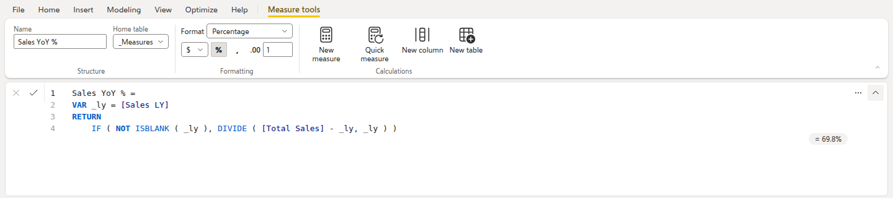
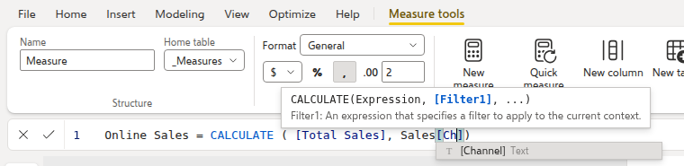
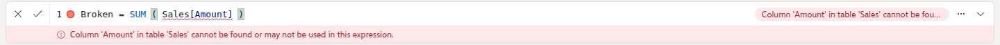

# The formula bar and the DAX editor

> **Applies to:** Analysts · Creators

Lumen has one DAX editor, used by the formula bar, DAX query view and the dialogs that take DAX (row-level security filters, calculation items). This article describes where the formula bar appears, how to commit and cancel, and what the editor does while you type: autocomplete, parameter hints, hover help, error checking and formatting.

## Where the formula bar appears

The formula bar opens when you select a measure, a calculated column or a calculated table, in the **Data** pane or in Model view. It shows the object's definition as `Name = expression`.

| View | Position |
|---|---|
| Report view | Below the ribbon, across the window |
| Table view | Below the ribbon, across the window |
| Model view | Floating over the top of the diagram; the diagram toolbar moves below it |
| DAX query view | No formula bar: the query editor itself is the DAX editor |

Calculation groups do not open in the formula bar; edit their items in the calculation group dialog. Power Query's formula bar (M) is a different editor; see [Power Query editor](../connect-and-transform/power-query-editor.md).

## Commit and cancel

| Action | Keys or control |
|---|---|
| Commit a single-line formula | **Enter**, or the check mark (**Commit**) |
| Commit a formula with several lines | **Ctrl+Enter**, or the check mark |
| New line | **Shift+Enter** (or **Enter** when the formula already has several lines) |
| Cancel your edits | **Esc**, or the cross (**Cancel**) |
| Commit by leaving | Click outside the formula bar: Lumen commits, as Power BI Desktop does |
| Expand or collapse the bar | The chevron at the right end |

Changing the name before `=` renames the object and updates references to it in other formulas and in the report.

A formula that has an error is still saved when you commit it, and the error stays visible under the bar. A name that is already used, or text without `Name =`, is not saved; the bar shows why.

## Autocomplete

While you type, a list suggests DAX functions, tables, columns, measures, variables declared with `VAR`, and keywords. Columns are offered after a table name and `[`; a bare `[` offers measures (and, in a calculated column, the columns of its own table).

- **Tab** or **Enter** inserts the highlighted suggestion. A function is inserted with its opening parenthesis.
- **Esc** closes the list without inserting.
- **Up** and **Down** move through the list.

The function list comes from the editor's catalog of Microsoft's DAX functions. It includes some functions the engine does not implement (financial, some statistical and week-based time intelligence functions); a formula that uses one fails when it is evaluated. The [function support reference](../reference/dax-function-support.md#autocomplete-entries-without-an-implementation) lists them.

## Parameter hints and hover help

- Inside a function call, a hint shows the function's signature with the current parameter highlighted and its description.
- Hovering a function shows its signature, description and, for common functions, an example. Hovering a measure shows its expression, format string, display folder and description; hovering a column shows its data type, table, format, whether it is hidden or calculated, and its description.

## Errors

The editor checks the formula as you type, in two passes:

1. A local check finds unterminated strings, unbalanced brackets and parentheses, unknown functions, and table or column names that do not exist. For a near miss it suggests a fix, for example *Cannot find table 'Sale'. Did you mean 'Sales'?*; the fix is offered on the underlined text.
2. The DAX engine then validates the expression against the model, as Power BI does, and reports errors such as *Column 'Amount' in table 'Sales' cannot be found or may not be used in this expression.*

Errors are underlined in the text, marked in the line-number gutter, and the first one is shown under the formula bar:

## Live value

The formula bar shows the value of the measure you are editing at its right end, updated as you type (about half a second after you stop). This is a Lumen addition; Power BI Desktop has no equivalent.

- For a measure, the value is computed with the filters of the current report page: report and page filters and the page's slicer selections, but no visual's own context. Hover the value to see which filters were used. In Table view and Model view no filters apply.
- For a calculated table, it shows the number of rows the expression returns.
- Calculated columns have no single value, so nothing is shown.
- If the expression fails, the error message appears in place of the value.

Turn it off with **Formula bar options** (**…**) > **Show live value**.

## Format DAX

- **Shift+Alt+F**, or **Formula bar options** (**…**) > **Format DAX**, reformats the formula following the basic DAX Formatter (daxformatter.com) conventions: function names and keywords in upper case, `FUNC ( arg1, arg2 )` spacing, a call longer than 80 characters broken into one argument per line with 4-space indentation, and `VAR` / `RETURN` on their own lines. Only whitespace and the letter case of functions and keywords change.
- **Formula bar options** > **Format on commit** formats every formula when you commit it. Lumen only formats a formula without syntax errors, so a broken formula is never reshaped.
- **Ctrl+/** comments or uncomments the selected lines (`//`).

## Other editing features

Syntax colors close to Power BI's, matching-bracket highlighting, automatic closing of brackets and quotes, automatic indentation after a line break, line numbers, undo and redo inside the editor (**Ctrl+Z**, **Ctrl+Y**), and find (**Ctrl+F**).

## Considerations and limitations

- The live value is not a value Power BI shows anywhere, and it does not include a visual's filters: a measure that depends on what is on a visual's rows (for example `[Sales YoY %]`) shows the value for the whole page.
- Evaluation runs on the user interface thread. A very slow measure makes typing sluggish while the live value is computed; turn **Show live value** off when you edit such a measure.
- The hover examples cover common functions only.

## Related content

- [Create measures](create-measures.md)
- [DAX query view](dax-query-view.md)
- [Troubleshoot a measure](troubleshoot-a-measure.md)
- [DAX function support](../reference/dax-function-support.md)
- [Keyboard shortcuts](../reference/keyboard-shortcuts.md)
