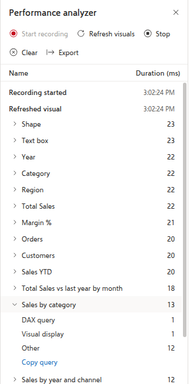

# Troubleshoot a measure

> **Applies to:** Analysts · Creators

When a measure shows an error, a blank, an unexpected number or takes too long, the tools in this article help you find out why: the formula bar's error line and live value, DAX query view's quick queries, and the Performance analyzer with the DAX query each visual sends.

## Prerequisites

- The report open in Lumen, with the measure in a visual.

## A visual shows an error

1. Select the measure in the **Data** pane. The formula bar opens; if the formula has an error, the message is shown under the bar and the faulty text is underlined. See [The formula bar and the DAX editor](the-formula-bar-and-dax-editor.md#errors).
2. Read the message. The common ones:

   | Message | Cause | Fix |
   |---|---|---|
   | *The function 'NAME' is not supported by this engine (unknown DAX function).* | The function is not implemented in Lumen (or is misspelled) | Check [DAX function support](../reference/dax-function-support.md); rewrite with implemented functions |
   | *Column 'Amount' in table 'Sales' cannot be found or may not be used in this expression.* | The column does not exist, or a bare column is used where a row context is needed | Fix the name; aggregate the column (`SUM ( Sales[Amount] )`) or use it inside an iterator |
   | *The value for 'Total Sale' cannot be determined. Either the column doesn't exist, or there is no current row for this column.* | A misspelled measure name, or a column reference without a row context | Fix the name |
   | *A circular dependency was detected while evaluating measure [B] (B -> A -> B -> A -> B -> A).* | Measures that reference each other, directly or through others | Break the cycle |
   | *KMEANSCLUSTERING (the Power BI clustering feature) cannot be recomputed in Lumen…* | The report uses Power BI clustering | Not available in Lumen |

3. If the formula looks right, evaluate it alone in DAX query view: right-click the measure in DAX query view's **Data** pane and select **Define with references and evaluate**. Lumen writes the measure and every measure it depends on into one query, so you can change any of them and run it again without touching the model. See [DAX query view](dax-query-view.md#quick-queries).

## A measure is blank or has an unexpected value

Work from the outside in:

1. **Check the data.** If the report opened without its data, Lumen generated sample data from the model; the status bar then shows a **Sample data** badge. Generated values are plausible, not real; a formula that compares with a specific name or id from your data may stay blank, because Lumen does not copy such values into sample data by default. See [Sample data](../connect-and-transform/sample-data.md).
2. **Check the value without the visual.** The formula bar's live value shows the measure with the page's filters and slicers but without the visual's own rows and columns. If it is right there, the visual's context (its groups, cross-filtering, visual-level filters) changes the result.
3. **Reproduce the visual's context in a query.** In the Performance analyzer, copy the query the visual ran (see below), paste it in DAX query view and run it. Then remove or change one filter at a time.
4. **Check the relationships.** A filter on one table only reaches tables on the many side of its relationships, unless the relationship filters in both directions. Counting rows of a dimension per value of another dimension is a typical case; see [Relationships and cross-filter direction](evaluation-context-in-lumen.md#relationships-and-cross-filter-direction).
5. **Check for blanks hidden by the visual.** Visuals drop rows where every measure is blank. Turn on **Show items with no data** on a field to see them.
6. **Check the known differences.** See [Known differences from the Power BI engine](known-differences-from-the-power-bi-engine.md), for example numeric precision, locale-dependent `FORMAT`, and the user functions.

## A visual is slow

### Find the slow visual and its query

1. Select **View > Performance analyzer** (or the **Performance analyzer** button on the right edge of the window).
2. Select **Start recording**, then **Refresh visuals**. Each visual gets a row with its duration in milliseconds.
3. Select a row to expand it:
   - **DAX query**: time spent in the engine for this visual's queries;
   - **Visual display**: time spent drawing the visual;
   - **Other**: the rest of the time until the page was painted, mostly waiting for the other visuals.
4. Select **Copy query** to copy the DAX the visual ran. Paste it into DAX query view to run it alone and time it.



For the sample's **Sales by category** chart, **Copy query** gives:

```dax
// DAX Query
DEFINE
	VAR __DS0Core = 
		SUMMARIZECOLUMNS (
			'Product'[Category],
			"Total Sales", '_Measures'[Total Sales]
		)

	VAR __DS0PrimaryWindowed = 
		TOPN ( 50000, __DS0Core, 'Product'[Category], 1 )

EVALUATE
	__DS0PrimaryWindowed

ORDER BY
	'Product'[Category]
```

**Export** saves the log as JSON in the shape of Power BI's `PowerBIPerformanceData.json`. **Stop** ends the recording; **Clear** empties the log.

### Make it faster

- Prefer simple filter arguments in `CALCULATE` (`Sales[Channel] = "Online"`) to `FILTER` over a whole table.
- Use variables for values you use more than once.
- Avoid iterating a large fact table row by row with a nested `CALCULATE` when an aggregation over a dimension gives the same result.
- In calculated columns, avoid `FILTER` over the same large table for every row.

### The 15-second budget

A visual whose query runs longer than 15 seconds is stopped. The visual shows the rows computed so far with the warning *The query exceeded its time budget (15 s) and was stopped; the results are partial.* Treat such numbers as incomplete. DAX query view has no budget and no cancel; see [DAX query view](dax-query-view.md#considerations-and-limitations).

## Considerations and limitations

- Lumen's Performance analyzer measures Lumen's engine and renderer, which run in one process: there is no network or service time, and the split between categories approximates Power BI's. Durations are not comparable with Power BI Desktop's.
- Cached queries show as about 0 ms, as in Power BI.
- **Copy query** shows the DAX equivalent of what the visual asked the engine. For most visuals this is Power BI's `SUMMARIZECOLUMNS` form; for visuals with visual calculations it is the `WITH VISUAL SHAPE` form. When Lumen cannot express a request as DAX, it copies the request as JSON instead.

## Related content

- [The formula bar and the DAX editor](the-formula-bar-and-dax-editor.md)
- [DAX query view](dax-query-view.md)
- [Evaluation context in Lumen](evaluation-context-in-lumen.md)
- [Known differences from the Power BI engine](known-differences-from-the-power-bi-engine.md)
- [Troubleshooting](../troubleshooting/README.md)
