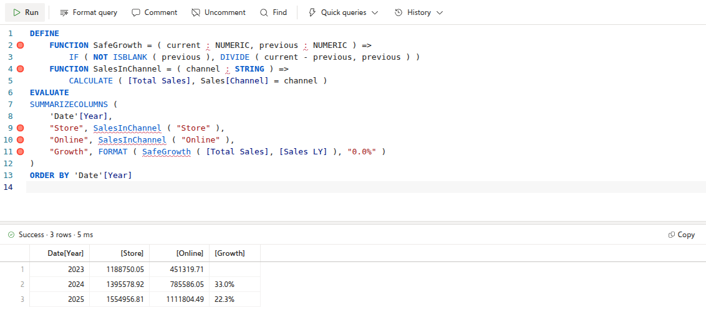

# User-defined functions

> **Applies to:** Analysts · Developers

DAX user-defined functions (UDFs) are named, parameterized DAX expressions you can call like built-in functions. Lumen evaluates functions defined in a DAX query with `DEFINE FUNCTION` and functions stored in a model (`functions.tmdl` in a PBIP semantic model). This article shows both and lists the parameter types the engine accepts.

## Prerequisites

- A report or semantic model open in Lumen.
- For model functions: a PBIP project (or a `.wbi` bundle made from one) whose semantic model defines functions in TMDL.

## Define functions in a query

In DAX query view, declare functions in the `DEFINE` block with `FUNCTION Name = ( parameters ) => body`, then call them anywhere in the query:

```dax
DEFINE
    FUNCTION SafeGrowth = ( current : NUMERIC, previous : NUMERIC ) =>
        IF ( NOT ISBLANK ( previous ), DIVIDE ( current - previous, previous ) )
    FUNCTION SalesInChannel = ( channel : STRING ) =>
        CALCULATE ( [Total Sales], Sales[Channel] = channel )
EVALUATE
SUMMARIZECOLUMNS (
    'Date'[Year],
    "Store", SalesInChannel ( "Store" ),
    "Online", SalesInChannel ( "Online" ),
    "Growth", FORMAT ( SafeGrowth ( [Total Sales], [Sales LY] ), "0.0%" )
)
ORDER BY 'Date'[Year]
```

| Date[Year] | [Store] | [Online] | [Growth] |
|---|---|---|---|
| 2023 | 1188750.05 | 451319.71 |  |
| 2024 | 1395578.92 | 785586.05 | 33.0% |
| 2025 | 1554956.81 | 1111804.49 | 22.3% |

2023 has no previous year in the sample, so `SafeGrowth` returns blank.



> [!NOTE]
> The editor's error check does not understand user-defined functions yet: it underlines the `:` of each type hint and every call to a user-defined function, and marks those lines in the gutter. The query runs correctly regardless. The same false error appears in the formula bar for a measure that calls a model function; the measure is saved and evaluates correctly.

## Reference parameters: pass a measure or a column

A parameter typed `MEASUREREF`, `COLUMNREF` or `TABLEREF` receives a reference, which the body uses where it needs it:

```dax
DEFINE
    FUNCTION AllTime = ( m : MEASUREREF ) => CALCULATE ( m, REMOVEFILTERS ( 'Date' ) )
    FUNCTION ShareOfAllTime = ( m : MEASUREREF ) => DIVIDE ( m, AllTime ( m ) )
EVALUATE
SUMMARIZECOLUMNS (
    'Date'[Year],
    "Units", [Units],
    "Units all time", AllTime ( [Units] ),
    "Share", FORMAT ( ShareOfAllTime ( [Units] ), "0.0%" )
)
ORDER BY 'Date'[Year]
```

| Date[Year] | [Units] | [Units all time] | [Share] |
|---|---|---|---|
| 2023 | 17,123 | 62923 | 27.2% |
| 2024 | 20,754 | 62923 | 33.0% |
| 2025 | 25,046 | 62923 | 39.8% |

## Parameter types and passing modes

A parameter is `name`, optionally followed by `:` and a type, and optionally `= default`.

| Type hint | Accepts |
|---|---|
| (none), `ANYVAL` | Any value |
| `SCALAR`, optionally with a subtype: `VARIANT`, `INT64`, `DECIMAL`, `DOUBLE`, `STRING`, `DATETIME`, `BOOLEAN`, `NUMERIC`. A subtype alone (`NUMERIC`) means `SCALAR NUMERIC`. | A single value; the subtype converts the argument (for example `INT64` rounds half away from zero, `STRING` turns 12 into `"12"`) |
| `TABLE` | A table |
| `ANYREF`, `COLUMNREF`, `MEASUREREF`, `TABLEREF` | A reference of that kind; other arguments are rejected |

Scalar and table parameters can be passed in two modes:

- **`VAL`** (the default): the argument is evaluated once, in the caller's context (including the caller's row context), before the body runs.
- **`EXPR`**: the argument is substituted into the body and evaluated where the body uses it, so it sees the body's filter context (inside `CALCULATE`, an iterator, and so on). Reference types are always passed this way; `VAL` on a reference type is an error.

Other rules the engine follows:

- The body sees the filter context of the call, not the caller's row context or variables.
- A function can call other functions, including ones in the same `DEFINE` block. Recursion is an error: *Recursion is not supported in user-defined functions (…)*.
- A function name cannot reuse a DAX function name. Names can contain dots, for example `My.Finance.Margin`.
- The type-check functions `ISINT64`, `ISDOUBLE`, `ISDECIMAL`, `ISSTRING`, `ISBOOLEAN`, `ISDATETIME` and `ISNUMERIC` work on parameters with type hints.

## Model functions

When a PBIP semantic model defines functions (TMDL `function` objects, usually in `definition/functions.tmdl`), Lumen reads them and makes them callable from measures, calculated columns, calculated tables, DAX queries and visual calculations. The TMDL text of the functions is kept as it was and written back unchanged when you save.

Lumen has no editor for model functions: there is no list of functions in the **Data** pane and no command to create one. Add or change them in the TMDL files, or in Power BI Desktop.

## Considerations and limitations

- The editor's autocomplete does not offer user-defined functions, and its error check marks their syntax and calls as errors (see the note above).
- `CALENDARREF` parameters are accepted by the parser, but calendars are not implemented, so there is nothing to pass to them.
- Opening a model whose functions use Lumen-only DAX functions in Power BI Desktop has not been tested.

## Related content

- [DAX query view](dax-query-view.md)
- [Evaluation context in Lumen](evaluation-context-in-lumen.md)
- [Visual calculations](visual-calculations.md)
- [Known differences from the Power BI engine](known-differences-from-the-power-bi-engine.md)
- [User-defined functions on Microsoft Learn](https://learn.microsoft.com/dax/best-practices/dax-user-defined-functions)
