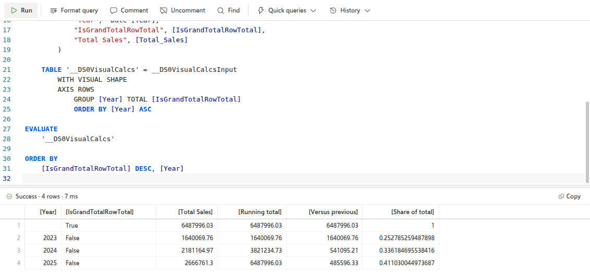

# Visual calculations

> **Applies to:** Analysts · Creators

A visual calculation is a DAX expression that Power BI stores in a visual, not in the model, and evaluates over the visual's own grid of values (its *visual matrix*). This article explains how Lumen evaluates the visual calculations in a report, which functions they can use, and how the window functions `OFFSET`, `INDEX`, `WINDOW`, `RANK` and `ROWNUMBER` with `ORDERBY`, `PARTITIONBY` and `MATCHBY` behave in Lumen.

> [!IMPORTANT]
> Lumen evaluates and displays visual calculations that a report already contains (created in Power BI Desktop). It has no command to add or edit one. You can run them in DAX query view with Power BI's `WITH VISUAL SHAPE` query syntax, as shown below.

## How Lumen evaluates a visual calculation

When a table, matrix or chart has visual calculations, Lumen:

1. Queries the visual's fields at every level it shows: each row group level, each column group level and the totals (totals are real evaluations, as in Power BI).
2. Builds the visual matrix from those cells. Combinations with no data get cells too (Power BI's *densify*), so a calculation such as a running total has a value where the base measure is blank.
3. Evaluates each calculation on every cell, in the order they appear in the visual. A calculation can use the visual's fields (by their names in the visual) and calculations before it, and can call the model's user-defined functions; it cannot reference model measures or columns directly.

The visual shows the calculated values next to its other fields, including in totals and subtotals.

### Functions that only work in visual calculations

| Function | What it does in Lumen |
|---|---|
| `RUNNINGSUM`, `MOVINGAVERAGE` | Running sum and moving average along an axis |
| `PREVIOUS`, `NEXT`, `FIRST`, `LAST` | Value of a neighbouring, the first or the last cell along an axis |
| `RANGE` | A window of cells relative to the current one (use with `CALCULATE`) |
| `COLLAPSE`, `COLLAPSEALL` | Evaluate at the parent level, or at the total |
| `EXPAND`, `EXPANDALL` | Evaluate over the child cells, or the leaf cells |
| `LOOKUP`, `LOOKUPWITHTOTALS` | Value at the cell with given field values |
| `ISATLEVEL` | Whether a field is grouped at the current cell |

`ROWNUMBER`, `RANK`, `INDEX`, `OFFSET` and `WINDOW` also accept an axis inside a visual calculation.

**Axes** are `ROWS`, `COLUMNS`, `ROWS COLUMNS` and `COLUMNS ROWS`. **Reset** (`HIGHESTPARENT`, `LOWESTPARENT`, a number, or a field reference) restarts the calculation at a level of the hierarchy. Lumen traverses cells of the same level along the axis in ascending order of the axis's group values (using a field's sort-by column when it has one).

### Example: the query Power BI sends

Power BI sends a visual with calculations to the engine as a `TABLE … WITH VISUAL SHAPE` query, and Lumen's Performance analyzer shows the same form under **Copy query**. For a visual with **Year** on rows, **Total Sales**, and three calculations:

```dax
DEFINE
	COLUMN '__DS0VisualCalcs'[Running total] = RUNNINGSUM ( [Total Sales] )
	COLUMN '__DS0VisualCalcs'[Versus previous] = [Total Sales] - PREVIOUS ( [Total Sales] )
	COLUMN '__DS0VisualCalcs'[Share of total] = DIVIDE ( [Total Sales], COLLAPSEALL ( [Total Sales], ROWS ) )

	VAR __DS0Core = 
		SUMMARIZECOLUMNS (
			ROLLUPADDISSUBTOTAL ( 'Date'[Year], "IsGrandTotalRowTotal" ),
			"Total_Sales", '_Measures'[Total Sales]
		)

	VAR __DS0VisualCalcsInput = 
		SELECTCOLUMNS (
			__DS0Core,
			"Year", 'Date'[Year],
			"IsGrandTotalRowTotal", [IsGrandTotalRowTotal],
			"Total Sales", [Total_Sales]
		)

	TABLE '__DS0VisualCalcs' = __DS0VisualCalcsInput
		WITH VISUAL SHAPE
		AXIS ROWS
			GROUP [Year] TOTAL [IsGrandTotalRowTotal]
			ORDER BY [Year] ASC

EVALUATE
	'__DS0VisualCalcs'

ORDER BY
	[IsGrandTotalRowTotal] DESC, [Year]
```

Run in DAX query view on the sample:

| [Year] | [IsGrandTotalRowTotal] | [Total Sales] | [Running total] | [Versus previous] | [Share of total] |
|---|---|---|---|---|---|
|  | True | 6487996.03 | 6487996.03 | 6487996.03 | 1 |
| 2023 | False | 1640069.76 | 1640069.76 | 1640069.76 | 0.252785259487898 |
| 2024 | False | 2181164.97 | 3821234.73 | 541095.21 | 0.336184695538416 |
| 2025 | False | 2666761.3 | 6487996.03 | 485596.33 | 0.411030044973687 |



For 2023, `PREVIOUS` has no earlier cell, so it returns blank and `[Versus previous]` equals the year's sales. On the total row the calculations are evaluated at the total level.

### Example: a hierarchy and reset

With **Year** and **Quarter** on rows and these calculations:

| Name | Expression |
|---|---|
| Running total | `RUNNINGSUM ( [Total Sales] )` |
| Running in year | `RUNNINGSUM ( [Total Sales], HIGHESTPARENT )` |
| Share of year | `DIVIDE ( [Total Sales], COLLAPSE ( [Total Sales], ROWS ) )` |

Lumen computes, for the quarters of 2023 and 2024 (the 2025 rows follow the same pattern):

| Year | Quarter | Total Sales | Running total | Running in year | Share of year |
|---|---|---|---|---|---|
| 2023 | Q1 | 276,216 | 276,216.38 | 276,216.38 | 0.17 |
| 2023 | Q2 | 487,465 | 763,681.34 | 763,681.34 | 0.30 |
| 2023 | Q3 | 426,350 | 1,190,031.67 | 1,190,031.67 | 0.26 |
| 2023 | Q4 | 450,038 | 1,640,069.76 | 1,640,069.76 | 0.27 |
| 2024 | Q1 | 366,630 | 2,006,699.98 | 366,630.22 | 0.17 |
| 2024 | Q2 | 616,574 | 2,623,273.53 | 983,203.77 | 0.28 |
| 2024 | Q3 | 586,247 | 3,209,520.90 | 1,569,451.14 | 0.27 |
| 2024 | Q4 | 611,714 | 3,821,234.73 | 2,181,164.97 | 0.28 |

`HIGHESTPARENT` restarts the running sum at each year; `COLLAPSE` evaluates **Total Sales** at the parent (year) level. (Values evaluated with the engine's visual-calculation API on the sample; shares rounded to two decimals.)

## Window functions in measures and queries

`OFFSET`, `INDEX`, `WINDOW`, `RANK` and `ROWNUMBER` also work in ordinary measures and queries, over a relation you pass them. `ORDERBY` sets the order, `PARTITIONBY` restarts the numbering per group, and `MATCHBY` names the columns that identify the current row.

```dax
EVALUATE
VAR _byMonth =
    SUMMARIZECOLUMNS (
        'Date'[Year],
        'Date'[Month Number],
        "Sales", [Total Sales]
    )
RETURN
    ADDCOLUMNS (
        _byMonth,
        "Previous month",
            SELECTCOLUMNS (
                OFFSET ( -1, _byMonth, ORDERBY ( 'Date'[Year], ASC, 'Date'[Month Number], ASC ) ),
                [Sales]
            ),
        "Running in year",
            SUMX (
                WINDOW ( 1, ABS, 0, REL, _byMonth, ORDERBY ( 'Date'[Month Number], ASC ), PARTITIONBY ( 'Date'[Year] ) ),
                [Sales]
            ),
        "Rank in year",
            RANK ( DENSE, _byMonth, ORDERBY ( [Sales], DESC ), PARTITIONBY ( 'Date'[Year] ) )
    )
ORDER BY 'Date'[Year], 'Date'[Month Number]
```

First and last rows of the 36 returned:

| Date[Year] | Date[Month Number] | [Sales] | [Previous month] | [Running in year] | [Rank in year] |
|---|---|---|---|---|---|
| 2023 | 1 | $71,314 |  | 71314.14 | 11 |
| 2023 | 2 | $58,871 | 71314.14 | 130185.33 | 12 |
| 2023 | 3 | $146,031 | 58871.19 | 276216.38 | 8 |
| … | | | | | |
| 2023 | 12 | $187,945 | 162668.55 | 1640069.76 | 1 |
| 2024 | 1 | $97,237 | 187945.02 | 97237.05 | 12 |
| 2024 | 2 | $102,388 | 97237.05 | 199625.15 | 11 |

`OFFSET ( -1, … )` on January 2024 returns December 2023, because the order runs across years; `WINDOW` restarts in January because of `PARTITIONBY`.

`MATCHBY` identifies the current row when the relation's columns would not:

```dax
EVALUATE
VAR _t =
    SUMMARIZECOLUMNS ( Product[Category], "Sales", [Total Sales] )
RETURN
    ADDCOLUMNS (
        _t,
        "Position", ROWNUMBER ( _t, ORDERBY ( [Sales], DESC ), , MATCHBY ( Product[Category] ) ),
        "Top category", SELECTCOLUMNS ( INDEX ( 1, _t, ORDERBY ( [Sales], DESC ) ), Product[Category] )
    )
ORDER BY [Position]
```

| Product[Category] | [Sales] | [Position] | [Top category] |
|---|---|---|---|
| Bikes | $2,710,885 | 1 | Bikes |
| Accessories | $1,353,695 | 2 | Bikes |
| Components | $1,233,453 | 3 | Bikes |
| Clothing | $1,189,963 | 4 | Bikes |

`ORDERBY`, `PARTITIONBY` and `MATCHBY` can only be used as arguments of these functions, as in Power BI. Blank ordering (`BLANKS FIRST` / `BLANKS LAST`, the `blanks` argument) and `DENSE` / `SKIP` ties for `RANK` are implemented.

## Considerations and limitations

- **No authoring.** Lumen cannot add, edit or remove a visual calculation. Edit the report in Power BI Desktop, or edit the visual's PBIR JSON.
- **Small multiples.** A visual with visual calculations and small multiples (a `ROWPAGES` axis) is not supported and shows an error.
- **Order along an axis.** Lumen orders cells by their group values (or the sort-by column). Whether that matches Power BI for a visual sorted by a measure has not been verified.
- **Sorting by a visual calculation** is not supported (Power BI does not support it either).
- **Generated query numbering.** In the query shown by **Copy query**, Lumen numbers the `IsDM<n>Total` flags by the level's position among the visual's columns; Power BI uses its internal projection index, so the names can differ. The results do not depend on it.
- The engine reports errors per calculation (for example a reference to a field that is not in the visual), so one failing calculation does not stop the others from being evaluated.

## Related content

- [Evaluation context in Lumen](evaluation-context-in-lumen.md)
- [DAX query view](dax-query-view.md)
- [Troubleshoot a measure](troubleshoot-a-measure.md)
- [User-defined functions](user-defined-functions.md)
- [Visual calculations on Microsoft Learn](https://learn.microsoft.com/power-bi/transform-model/desktop-visual-calculations-overview)
