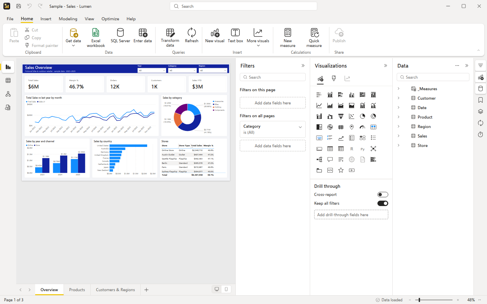
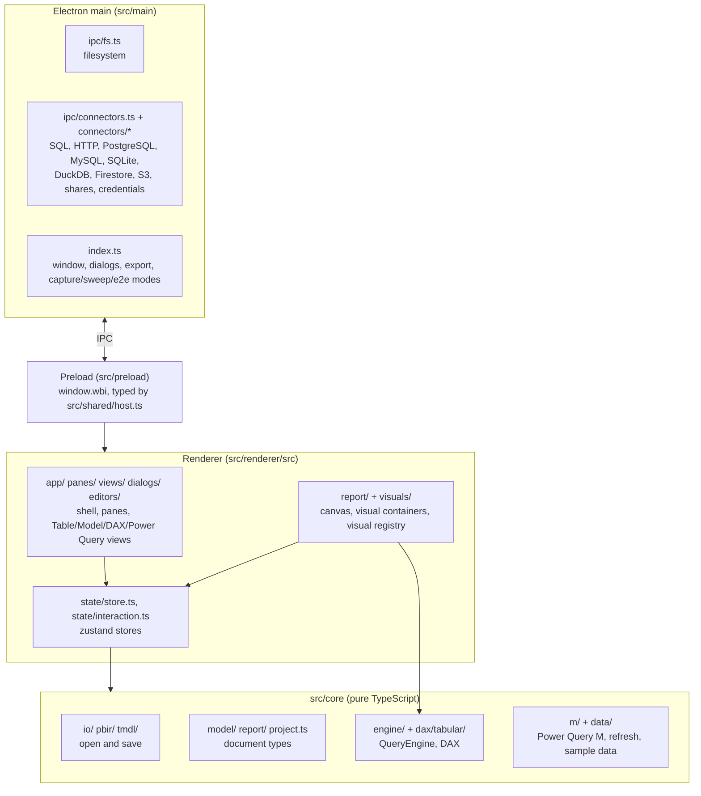
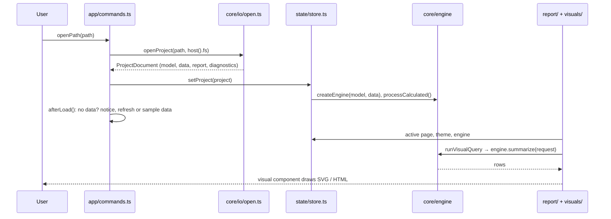

# Architecture overview

> **Applies to:** Developers

This article explains how Lumen is put together: its processes, its source layers and the path a report takes from
a file on disk to pixels on the canvas. Read it first; every other developer article zooms into one part of this
picture. The contract tables in [ARCHITECTURE.md](../ARCHITECTURE.md) list the files that form the integration
surface.

## Processes

Lumen is an Electron application with three kinds of code, each in its own process or context.

| Process | Source | Runs | Responsibilities |
|---|---|---|---|
| **Main** | `src/main/` | Node.js | The frameless window, the native menu (`menu.ts`), file dialogs, the filesystem (`ipc/fs.ts`), every network and database connector and the credential store (`ipc/connectors.ts`, `ipc/connectors/*`), PDF printing and page capture for export, the headless capture, sweep and end-to-end modes. |
| **Preload** | `src/preload/index.ts` | an isolated context of the renderer | Exposes one object, `window.wbi`, typed by `WbiHost` in `src/shared/host.ts`. Each method forwards to an IPC channel (`ipcRenderer.invoke`). |
| **Renderer** | `src/renderer/` | Chromium, React 19 | The whole user interface and all computation: file parsing, the DAX engine, the M engine, query evaluation, rendering, export layout. |

The renderer runs with `contextIsolation: true`, `nodeIntegration: false` and `webSecurity: true`
(`createWindow()` in `src/main/index.ts`). It never touches Node APIs directly; anything that needs the operating
system goes through `window.wbi`. See [The host bridge and IPC](the-host-bridge-and-ipc.md).



> [!NOTE]
> There are no web workers today. The DAX engine, the M engine and the file decoders run on the renderer's main
> thread. `src/core` is kept free of DOM and Node APIs so that it *could* move to a worker, and the engine's query
> budget (15 seconds by default) keeps a runaway query from freezing the window for good.

## Layers



The same picture as text:

```text
 Electron main (src/main)            Preload (src/preload)          Renderer (src/renderer/src)
 ┌──────────────────────────────┐    ┌──────────────────────┐    ┌──────────────────────────────────────┐
 │ index.ts  window, dialogs,   │    │ window.wbi           │    │ app/ panes/ views/ dialogs/ editors/ │
 │           export, capture,   │◄──►│ (WbiHost in          │───►│ state/  store.ts, interaction.ts     │
 │           sweep, e2e modes   │IPC │  src/shared/host.ts) │    │ report/ visuals/  canvas + visuals   │
 │ ipc/fs.ts                    │    └──────────────────────┘    └───────────────────┬──────────────────┘
 │ ipc/connectors.ts + /*       │                                                    │ imports
 └──────────────────────────────┘                                                    ▼
                                    src/core (pure TypeScript, no DOM, no Node)
                                    ┌──────────────────────────────────────────────────────────────┐
                                    │ io/ pbir/ tmdl/      open and save every format              │
                                    │ model/ report/ project.ts   document types                   │
                                    │ engine/ dax/tabular/ QueryEngine and the DAX engine          │
                                    │ m/ data/             Power Query M, refresh, sample data     │
                                    │ format/ icons/       format strings, icon sets               │
                                    └──────────────────────────────────────────────────────────────┘
```

Dependencies point one way: `src/renderer` imports `src/core` and `src/shared`; `src/main` and `src/preload` import
`src/shared`; `src/core` imports nothing from the other layers. `src/core/io/nodefs.ts` is the one file in `src/core`
that uses Node (`node:fs`); tests and scripts use it, the renderer uses `window.wbi.fs` through the same
`FileSystem` interface (`src/core/io/fs.ts`). See [Repository layout](repository-layout.md) for every folder.

## From a file to pixels

This is the path of **File > Open** on a `.pbix`, a PBIP project or a `.wbi` bundle.



As text:

1. **Command.** `openPath()` in `src/renderer/src/app/commands.ts` asks to save unsaved changes, shows a busy
   overlay and calls `openProject(path, host().fs, { onProgress })` from `src/core/io/open.ts`.
2. **Read and decode (IO).** `openProject` detects the format and produces a `ProjectDocument`
   (`src/core/project.ts`): a `SemanticModel` (`src/core/model/types.ts`), a `DataStore` of columnar tables
   (`src/core/model/data.ts`), an optional `ReportDocument` that keeps the PBIR JSON as it is
   (`src/core/report/types.ts`), and diagnostics. A `.pbix` is unzipped, its legacy layout converted to PBIR, and its
   embedded data model decoded (XPress9, ABF, VertiPaq; `src/core/io/pbix/datamodel/`). A PBIP project is read as
   PBIR JSON plus TMDL (`src/core/pbir/`, `src/core/tmdl/`). See [File format IO](file-format-io.md).
3. **Store.** `useApp.getState().setProject(project)` in `src/renderer/src/state/store.ts` stores the document,
   builds the engine with `createEngine(project.model, project.data)` (`src/core/engine/engine.ts`), computes
   calculated tables and columns (`processCalculated()`), resolves the theme and picks the first visible page. See
   [State and store](state-and-store.md).
4. **Missing data.** `afterLoad()` checks for tables without rows. Depending on **Options** it shows a notification
   bar, opens the refresh dialog (the M engine and connectors fetch data; [Data layer](data-layer.md)), or fills
   the tables with generated sample data.
5. **Canvas.** `ReportView` and `PageCanvas` (`src/renderer/src/report/`) lay out the active page. Each visual sits
   in a `VisualContainer` (`report/VisualContainer.tsx`), which draws the Power BI container chrome (background,
   border, title, header) and looks up the visual's definition with `getVisual(visualType)` from the registry
   (`src/renderer/src/visuals/registry.ts`). See [Container chrome and text](container-chrome-and-text.md).
6. **Filters.** The canvas collects the report, page and visual filters, slicer selections and cross-filter
   selections that apply to the visual, all as PBIR SQ filters, into `ctx.filters`.
7. **Query.** The visual's component calls `runVisualQuery()` (`src/renderer/src/visuals/common/query.ts`), which
   turns the field wells (projections) into a `SummarizeRequest` and calls `ctx.engine.summarize(request)`. The
   engine answers with SUMMARIZECOLUMNS semantics through the DAX engine in `src/core/dax/tabular/`. The canvas
   wraps the engine in an LRU cache (`report/cachedEngine.ts`), so moving or resizing a visual runs no query. See
   [Visual query pipeline](visual-query-pipeline.md) and [DAX engine internals](dax-engine-internals.md).
8. **Draw.** The component resolves its formatting through `src/core/report/props.ts` (visual objects, then theme
   `visualStyles`, then the renderer's default) and draws SVG or HTML. When every visual on the page has rendered,
   the renderer sets `document.body.dataset.wbiReady = '1'`, which headless capture, the sweep and end-to-end tests
   wait for.

Edits run the other way: the Format pane, the canvas and the panes call store mutations such as
`mutateReport(label, recipe)` or `mutateModel(label, recipe)`, which produce a new document with immer and push an
undo snapshot; a model change rebuilds the engine. **Save** calls `saveProject()` in `src/core/io/open.ts`, which
writes PBIP or a `.wbi` bundle. See [Saving and round-trip](saving-and-round-trip.md).

## Where state lives

| State | Where | Persisted |
|---|---|---|
| The open document (model, data, report), undo / redo, active view and page, selection | `useApp` in `src/renderer/src/state/store.ts` | in the saved file |
| Runtime interaction: slicer selections, cross-filter, drill, tooltips | `useInteraction` in `src/renderer/src/state/interaction.ts` | slicer state is written back into the report |
| Shell: open panes, ribbon tab, dialogs, options, notices | `useShell` in `src/renderer/src/app/shellState.ts` | options and layout in `localStorage` |
| Recent files | main process, `recent.json` in the Electron profile folder | yes |
| Credentials | main process, encrypted with Electron `safeStorage` | yes, never sent to the renderer |

## Headless modes

The same binary runs in three automation modes, chosen by environment variables read in `src/main/index.ts`:

- **Capture** (`WBI_CAPTURE`): render one route and save a PNG. Used by `scripts/capture.sh`.
- **Sweep** (`WBI_SWEEP`): the renderer opens a report, renders every page and writes status JSON and PNGs. Used by
  `scripts/sweep.sh`. See [The sweep](the-sweep.md).
- **End-to-end** (`LUMEN_E2E=1`): a throwaway profile and test hooks on `window.__lumen`, driven by Playwright. See
  [End-to-end tests](end-to-end-tests.md).

All three wait on the readiness signals in `src/renderer/src/app/readiness.ts` (`body[data-wbi-ready]` and
`body[data-wbi-busy]`). The full list of variables is in
[Command line and environment variables](../reference/command-line-and-environment.md).

## Considerations and limitations

- **Single thread.** Every engine call runs on the renderer's main thread; a slow query blocks input until it
  finishes or reaches its budget.
- **One document per window, one window.** `src/main/index.ts` creates a single `BrowserWindow`; opening a file
  replaces the current project.
- **Two DAX engines in the tree.** The production engine is `src/core/dax/tabular/`. The files directly in
  `src/core/dax/` are an older, vendored engine kept as a reference; the `#/modeling-test` developer route and some
  tests still use it. New work goes into `dax/tabular`.
- **PBIX is read-only.** Lumen cannot write the proprietary DataModel; a `.pbix` is saved as PBIP or `.wbi`.

## Related content

- [Repository layout](repository-layout.md)
- [State and store](state-and-store.md)
- [The host bridge and IPC](the-host-bridge-and-ipc.md)
- [Visual query pipeline](visual-query-pipeline.md)
- [File format IO](file-format-io.md)
- [ARCHITECTURE.md](../ARCHITECTURE.md)
