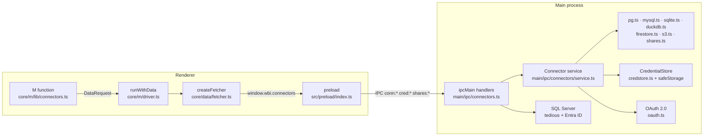

# Connectors

> **Applies to:** Developers

This article explains how Lumen's data connectors are built: the split between the M library in the renderer and
the connector code in the Electron main process, the credential store, Microsoft Entra ID and OAuth sign-in,
cancellation, and how to add a connector and test it, including the live integration tests that run against
Docker containers.

## Architecture

A connector has two halves. The **M half** defines the Power Query function (for example
`PostgreSQL.Database`) in `src/core/m/lib/`, builds navigation tables, folds steps and renders SQL. It never
touches the network: it asks the host for data with a plain `DataRequest`. The **main-process half** in
`src/main/ipc/` performs the request with a native driver and the stored credential. Secrets stay in the main
process.



In words: an M source function issues a `DataRequest` through `MHost.request`. The fetch-and-replay driver passes
cache misses to the fetcher, which calls `window.wbi.connectors` (typed in `src/shared/host.ts`, implemented by
the preload). The preload forwards to `ipcMain.handle` handlers in `src/main/ipc/connectors.ts`. SQL Server is
handled there directly; every other connector is handled by the Electron-free connector service in
`src/main/ipc/connectors/service.ts`, which reads credentials from the encrypted store and calls one driver module
per source. Answers come back as plain data (`HostTable`, file entries, byte arrays) and are cached by the driver.

The bridge itself is described in [the-host-bridge-and-ipc.md](the-host-bridge-and-ipc.md); the driver and
fetcher in [m-engine-internals.md](m-engine-internals.md) and [data-layer.md](data-layer.md).

## Connectors and where they live

| Source | M functions | Request kinds | Main-process module | Library |
|---|---|---|---|---|
| SQL Server, Azure SQL, Fabric SQL endpoints and warehouses | `Sql.Database`, `Sql.Databases`, `Value.NativeQuery` (`lib/sources.ts`) | `sql`, `sql-items`, `sql-databases` | `src/main/ipc/connectors.ts` | `tedious`, `@azure/identity` |
| PostgreSQL | `PostgreSQL.Database` (`lib/connectors.ts`) | `db`, `db-items`, `db-databases` | `connectors/pg.ts` | `pg` |
| MySQL, MariaDB | `MySQL.Database` | `db*` | `connectors/mysql.ts` | `mysql2` |
| SQLite (Lumen extension) | `SQLite.Database` | `db*` | `connectors/sqlite.ts` | `sql.js` (WebAssembly) |
| DuckDB file or lakehouse folder | `DuckDB.Database` | `db*` | `connectors/duckdb.ts` | `@duckdb/duckdb-wasm` |
| Google Cloud Firestore | `Firestore.Collections`, `Firestore.Query` | `firestore-collections`, `firestore-query` | `connectors/firestore.ts` (REST API) | `google-auth-library` |
| Amazon S3 and S3-compatible storage | `AmazonS3.Contents`, `Lakehouse.Folder` / `DeltaLake.Table` on `s3://` | `s3-list`, `s3-object` | `connectors/s3.ts` | `@aws-sdk/client-s3` |
| Web APIs | `Web.Contents`, `OData.Feed` | `http` | `connectors/service.ts` (`http`) | `fetch` |
| Files, folders, network shares | `File.Contents`, `Folder.Files`, `Folder.Contents`, `Lakehouse.Folder` | `file`, `folder` | renderer `fs` bridge; `connectors/shares.ts` resolves and mounts shares | `gio` |

Excel and Parquet decoding (`decode` requests) runs in the renderer (`src/core/data/xlsx.ts`,
`src/core/data/parquet.ts`). The user-facing list, with what each connector supports, is
[connector support](../reference/connector-support.md).

Each driver module documents its type mapping in its header comment. For example `connectors/pg.ts` receives
values in PostgreSQL's text format and converts them explicitly (`int8` to a JavaScript number, `numeric` to a
double, `timestamptz` to UTC), so results do not depend on the session's `DateStyle` or `TimeZone`. The SQLite and
DuckDB modules load the file into memory read-only and reuse the copy until the file's size or modification time
changes; DuckDB native queries are restricted to read-only statements.

## SQL Server and Microsoft Entra ID

`src/main/ipc/connectors.ts` connects with `tedious`. The `SqlAuth.kind` of a source selects the sign-in:

| `kind` | Token source |
|---|---|
| `azure-default` (default) | `ChainedTokenCredential`: the Azure CLI login, else a device-code sign-in |
| `azure-cli` | `AzureCliCredential` |
| `device-code` | `DeviceCodeCredential`; the code is sent to the renderer as a `conn:authPrompt` event |
| `interactive` | `InteractiveBrowserCredential` |
| `token` | A raw access token |
| `sql` | SQL login (user and password) |

Token credentials are cached per kind and tenant for the session. Connections are pooled per server, database and
credential and closed after 120 seconds idle (`IDLE_CLOSE_MS`). `conn:clearCredentials` forgets cached tokens.
Pure helpers (server-string parsing, SQL Server type names, value normalisation, error explanations) live in
`src/core/data/sqlconn.ts` so they can be tested without Electron.

## Credentials and privacy levels

### The credential store

`CredentialStore` in `src/main/ipc/connectors/credstore.ts` keeps one entry per data source key
(`dataSourceKey` in `src/core/data/queries.ts`, for example `postgresql:host:5432;db`). Each entry holds the
`CredentialAuth` (kind, user, TLS mode, OAuth settings), the secrets and the privacy level.

- Secrets (`SECRET_FIELDS` in `src/shared/host.ts`: passwords, tokens, keys, client secrets, refresh tokens,
  service-account JSON) are encrypted with Electron `safeStorage`, which uses the OS keyring. The file is
  `credentials.json` in the app's user-data folder, written atomically with mode `0600`.
- When no keyring is available, secrets are kept in memory for the session only and the file holds the non-secret
  settings. Secrets are never written in clear text.
- The renderer never receives secrets. `cred:list` returns `CredentialInfo`, which lists which secrets are set
  but not their values. The renderer's cache of that information is in
  `src/renderer/src/views/powerquery/credentials.ts`.
- Lookup falls back from the exact key to a broader one (`credentialKeysOf`): server plus database, then server
  only; S3 bucket, then endpoint.

The `Cipher` is injected (`createConnectorService({ store, openExternal })`), which is why the service and its
tests run without Electron: the test harness uses a reversible stand-in cipher.

### Privacy levels

Privacy levels (`None`, `Public`, `Organizational`, `Private`) are stored with the credential. `privacyPlan` in
`src/core/data/fetcher.ts` reads them for every query that combines sources and turns off folding of values from
one source into another (`foldComputed: false`) when Power BI would; the filter then runs in Lumen, and the
preview shows a notice.

### OAuth 2.0 and web credentials

`src/main/ipc/connectors/oauth.ts` implements the authorization-code flow with PKCE through the system browser
and a loopback redirect (`http://127.0.0.1:<random port>/callback`), refresh tokens, and the client-credentials
flow. `Web.Contents` requests get the stored credential of the longest matching URL prefix (`basic`, `bearer`,
`oauth2`, `key`), applied in `http()` in `service.ts`. Firestore accepts a Google service account, application
default credentials, OAuth, an API key, or no credential for the emulator.

When a source has no stored credential, the service raises `ConnectorError` with kind `credentials` and Power BI's
wording ("Credentials are required to connect to the ... source."), which the UI recognises to offer
**Edit credentials…**.

## Cancellation

The renderer tags SQL Server and HTTP requests with a `cancelId`. On abort, the fetcher calls
`connectors.cancel(cancelId)` and the main process aborts the matching `AbortController` (`cancellable` in
`src/main/ipc/connectors.ts`), which stops the SQL request, a pending Entra ID sign-in or the HTTP fetch.

Requests that go through `conn:request` (PostgreSQL, MySQL, SQLite, DuckDB, Firestore, S3) carry no `cancelId`.
When the user cancels, the driver stops waiting at once (`abortable` in `src/core/m/driver.ts`) and the refresh
ends, but the request itself runs to completion in the main process and its answer is discarded.

## Get data user interface

The Get data dialogs generate M and evaluate it with the same driver as refresh, so the Navigator shows what the
loaded query returns.

| File | Role |
|---|---|
| `src/renderer/src/dialogs/getdata/GetDataDialog.tsx` | The **Get data** dialog: categories, searchable source list |
| `src/renderer/src/dialogs/getdata/ConnectorDialogs.tsx` | Connection dialogs (PostgreSQL, MySQL, Firestore, S3, lakehouse folders, network shares, OData, GraphQL and REST templates); they store credentials in the credential store |
| `src/renderer/src/dialogs/getdata/mnav.ts` | Navigator items evaluated as M; previews fold to `LIMIT 50` at the source |
| `src/renderer/src/dialogs/getdata/mcode.ts` | M generation in the shapes Power BI Desktop writes |
| `src/renderer/src/dialogs/getdata/loadTables.ts` | **Load**: adds the table with its M partition and puts the rows in the `DataStore` |

## Add a connector

The steps follow the path of an existing database connector (`PostgreSQL.Database`). Read its code alongside.

### Prerequisites

- A working checkout ([development-environment.md](development-environment.md)).
- A Node library for the source that does not need a native build (`npm install` is coordinated across
  workstreams; see [contributing.md](contributing.md)), or a protocol you can speak with `fetch`.
- For live tests: Docker and a public container image of the server.

### Steps

1. **Request shape.** If an existing request kind fits (a SQL database is usually a new `DbDriver` value for the
   `db`, `db-items` and `db-databases` kinds), extend it; otherwise add a kind to `DataRequest` and its answer type
   to `DataAnswers` in `src/core/m/host.ts`, and a line to `describeRequest` in `src/core/m/driver.ts`. Keep
   requests plain data: they are cache keys and cross IPC.
2. **M function.** Define the source function with `def(...)` in `installConnectors` in
   `src/core/m/lib/connectors.ts` (or a new module installed from `src/core/m/lib/index.ts`):

   ```ts
   // src/core/m/lib/connectors.ts
   def("PostgreSQL.Database", "server, database, ?options", ([s, d, o], ctx) => dbSource(ctx, "postgresql", text(s!), text(d!), o!));
   ```

   Build navigation tables with `navTable` and lazy, foldable reads (`MTable.fold`) so later steps fold. For a SQL
   source, add a dialect to `DIALECTS` in `src/core/m/lib/sqldialect.ts` if none fits.
3. **Request types for the bridge.** If you added a request kind, add it to `ConnectorRequest` in
   `src/shared/host.ts` (the kinds that go through `connectors.request`).
4. **Fetcher.** Route the kind in `createFetcher` (`src/core/data/fetcher.ts`); connector kinds share the
   `connectors.request` branch.
5. **Main-process driver.** Add a module under `src/main/ipc/connectors/` that takes the target, the credential
   and `DbRunOptions` (`maxRows`, `timeoutMs`) and returns a `HostTable`. Convert every value to the normalised
   host shape and document the type mapping in the module header, as `pg.ts` does. Throw `ConnectorError` with
   kind `credentials` or `notFound` where it applies.
6. **Service dispatch.** Call the module from `request()` in `src/main/ipc/connectors/service.ts`, read the
   credential with `required(sourceOfRequest(req))` (extend `sourceOfRequest`), add a connection test to `test()`,
   and close pools in `close()`. The IPC wiring (`conn:request`, `cred:test`) needs no change.
7. **Data source identity.** Add the source to `DataSourceRef`, `dataSourceKey`, `dataSourceLabel` and
   `SOURCE_FUNCS` in `src/core/data/queries.ts`, so Data source settings, credentials and privacy levels see it.
8. **Get data entry (optional).** Add a connection dialog in `ConnectorDialogs.tsx`, a source in
   `GetDataDialog.tsx` and navigator items in `mnav.ts`. A new dialog needs an end-to-end journey
   ([end-to-end-tests.md](end-to-end-tests.md)); `e2e/getdata.e2e.ts` has the existing ones.
9. **Tests**, as described next, then `npm test` and `npm run typecheck`.

## Testing connectors

| Test file | Needs | Covers |
|---|---|---|
| `src/main/ipc/connectors/__tests__/connectors.unit.test.ts` | Nothing | Credential store, value conversions, SQLite end to end (sql.js), Firestore query shapes, share discovery, OAuth PKCE and `Web.Contents` auth presets against a local HTTP server |
| `src/main/ipc/connectors/__tests__/duckdb.test.ts` | Nothing | `DuckDB.Database` end to end on a database file it creates, and on a generated lakehouse folder when the generator runs |
| `src/main/ipc/connectors/__tests__/lakehouse.test.ts` | Nothing | `Lakehouse.Folder` on a lakehouse generated by `datasets/` (`generate starlite --scale tiny`): Delta row counts against the Parquet footers |
| `src/main/ipc/connectors/__tests__/connectors.it.test.ts` | `LUMEN_IT=1` and Docker | Live servers: `postgres:16`, `mysql:8`, MinIO, a Firestore emulator |
| `src/core/m/__tests__/connectors.test.ts`, `driver.test.ts` | Nothing | M side: navigation, folding, rendered SQL, the driver |

`src/main/ipc/connectors/__tests__/harness.ts` evaluates M end to end through `runWithData`, the renderer's
`createFetcher` and the connector service, with no Electron and no IPC, and a credential store in a temporary
folder. `sqlSent` lets a test assert the SQL text that reached the server.

`docker.ts` starts each container on a random `127.0.0.1` port and removes it afterwards:

```ts
// src/main/ipc/connectors/__tests__/connectors.it.test.ts
c = startContainer({ name: 'pg', image: 'postgres:16', port: 5432, env: { POSTGRES_USER: 'lumen', POSTGRES_PASSWORD: 'lumen-pw', POSTGRES_DB: 'shop' } })
```

Run the offline connector tests, then the live ones:

```bash
npx vitest run src/main/ipc/connectors src/core/m
LUMEN_IT=1 npx vitest run src/main/ipc/connectors
```

Without `LUMEN_IT` the live suite is skipped with a message; with `LUMEN_IT` but no reachable Docker daemon it is
skipped with a warning. The MinIO and Firestore-emulator suites also need their images (`bitnamilegacy/minio:latest`,
`mtlynch/firestore-emulator:latest`) to be present locally (`docker pull` them first); otherwise they are skipped. Test data is invented (the
schemas are a fictional shop), and so must yours be.

## Considerations and limitations

- **No cancellation for `conn:request`.** See [Cancellation](#cancellation): database, Firestore and S3 requests
  finish in the main process after the user cancels.
- **Unsupported sources.** `Lakehouse.Contents`, `Fabric.Warehouse`, `Lakehouse.Tables`, `SharePoint.*`,
  `AzureStorage.*`, `Odbc.*`, `OleDb.DataSource`, `AnalysisServices.Database`, `PowerBI.Dataflows`,
  `PowerPlatform.Dataflows`, `Web.Page` and `Excel.CurrentWorkbook` are defined only to raise an error that
  suggests an alternative.
- **Windows authentication.** SQL Server Windows authentication is not available (`windows-unsupported`).
- **Numeric precision.** `int8` / `BIGINT` beyond 2^53 and `numeric` / `DECIMAL` beyond double precision lose
  precision (Power Query's Decimal has 28 digits); the driver headers state this.
- **Row cap.** SQL reads stop at 5,000,000 rows by default (`DEFAULT_MAX_ROWS`).
- **Keyring.** Without an OS keyring, stored secrets last only for the session.

## Related content

- [The host bridge and IPC](the-host-bridge-and-ipc.md)
- [M engine internals](m-engine-internals.md)
- [Data layer](data-layer.md)
- [Testing](testing.md)
- [Connector support](../reference/connector-support.md)
- [Connect and transform data](../connect-and-transform/README.md)
