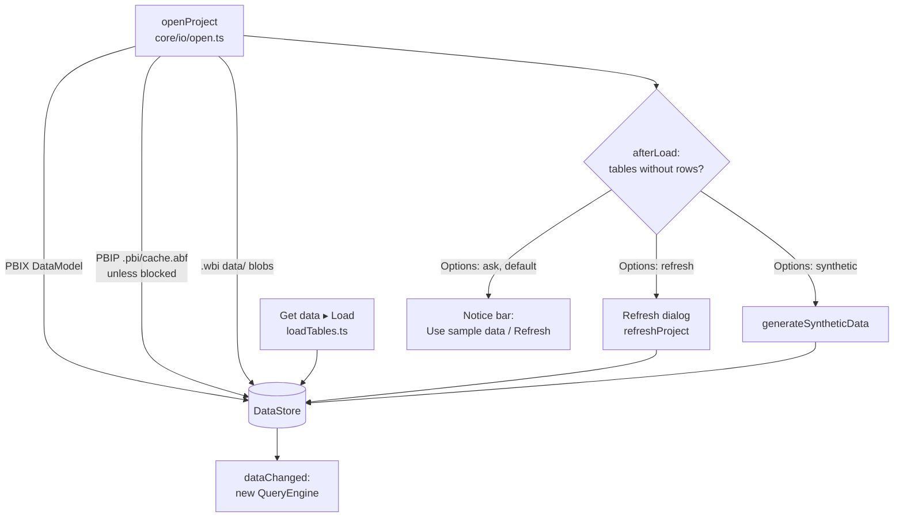

# Data layer

> **Applies to:** Developers

This article describes where a project's rows come from and how they reach the DAX engine: the `DataStore`
contract, data loaded with a file, the refresh pipeline and its fetcher, cancellation, Power Query previews, the
built-in sample project, schema-driven sample data and the stand-ins that keep it private. Read it before you
change anything in `src/core/data` or the code that rebuilds the engine.

## The `DataStore` contract

Every loader writes the same structure, defined in `src/core/model/data.ts` and listed as a contract in
[docs/ARCHITECTURE.md](../ARCHITECTURE.md):

```ts
// src/core/model/data.ts
export interface DataStore {
  tables: Map<string, TableData>
  status: Map<string, TableLoadStatus>
  relationshipKeys?: Map<string, { fromData: TableData; toData: TableData; from: Scalar[]; to: Scalar[] }>
  literalStandIns?: LiteralStandIn[]
}
```

`TableData` is column-oriented (`columns: ColumnData[]`, `rowCount`). Values follow one representation that
every component must respect:

| Data type | JavaScript value |
|---|---|
| BLANK | `null` |
| Text | `string` |
| Whole number, decimal, fixed decimal | `number` (int64 beyond 2^53 loses precision; accepted) |
| True/false | `boolean` |
| Date, date/time | `Date` whose **UTC** fields carry the naive wall-clock value: `new Date(Date.UTC(y, m - 1, d, hh, mm, ss))`. Never use local-time getters. |
| Binary | `Uint8Array` |

`TableLoadStatus` records each table's state: `loaded` (with a `source` of `query`, `cache`, `pbix`, `import`,
`synthetic` or `calculated`, and a row count), `empty`, `error` or `pending`. The status bar's sample-data badge
(`syntheticTables`) and the "no data" notice (`tablesWithoutData`, both in `src/renderer/src/app/commands.ts`)
read it.

The engine never reads the `DataStore` lazily: `createEngine` encodes it into its columnar model when it is built.
So after any change to the data, the renderer calls `useApp.getState().dataChanged()`
(`src/renderer/src/state/store.ts`), which builds a new engine, runs `processCalculated()` and bumps `revision`
so visuals query again. See [state-and-store.md](state-and-store.md).

## Where data comes from



In words: opening a file fills the `DataStore` from data embedded in the file, when there is any. After loading,
`afterLoad` in `src/renderer/src/app/commands.ts` lists the tables without rows and acts on **Options > Data load**:
by default it shows a notice with **Use sample data**; it can instead open the Refresh dialog or generate sample
data automatically. Get data, refresh and sample-data generation all write into the same `DataStore`, and each
ends with `dataChanged()`.

| Source | Code | Status `source` |
|---|---|---|
| PBIX `DataModel` (XPress9 > ABF > VertiPaq) | `src/core/io/pbix/datamodel/` | `pbix` |
| PBIP `.pbi/cache.abf` | `openModelFolder` in `src/core/io/open.ts`, same decoder | `pbix` |
| `.wbi` bundle (one typed blob per column) | `src/core/io/wbi.ts` | as saved |
| Get data **Load** (rows parsed in the renderer, plus an M partition) | `src/renderer/src/dialogs/getdata/loadTables.ts` | `import` |
| Refresh | `src/core/data/refresh.ts` | `query` |
| Built-in sample project | `src/core/data/sample.ts` | `import` |
| Sample data | `src/core/data/synthetic.ts` | `synthetic` |

> [!IMPORTANT]
> Decoding of PBIP `.pbi/cache.abf` files is blocked in every test run (`tests/setup.ts` sets
> `__LUMEN_BLOCK_CACHE_ABF__`) and in app runs started with `WBI_BLOCK_CACHE=1` (passed to the preload, see
> `src/shared/cacheGuard.ts`). A blocked cache leaves the tables empty and adds an info diagnostic. Keep it that way:
> a cache can hold confidential data from real reports.

PBIX decoding also reads VertiPaq's relationship indexes into `DataStore.relationshipKeys`, so the engine joins
keys exactly as Power BI did (for example a text key matched to a whole-number key). They are valid only while the
two `TableData` objects are the current ones; a refresh replaces the tables and the engine re-derives the keys. File
decoding is covered in [file-format-io.md](file-format-io.md).

## The refresh pipeline

`refreshProject(project, host, options)` in `src/core/data/refresh.ts` refreshes import tables one after another:

1. **Choose tables.** `options.tables`, or `refreshableTables(model)`: every table for which `tableQuery` finds
   something to run, that is an M partition, an incremental-refresh policy's source expression, an entity (Direct
   Lake) partition read through its expression source, or a legacy native-query partition (which then fails with
   an explanation).
2. **Find the query.** `tableQuery(model, table)` returns the M text, or an error such as a missing expression
   source. Calculation groups and calculated tables have no query.
3. **Plan incremental refresh.** `incrementalPlan` applies a `refreshPolicy` whose query filters on `RangeStart` /
   `RangeEnd`: the first load reads the rolling window, later loads only the incremental window, merged with the
   rows already loaded. `options.incremental: false` reloads everything.
4. **Plan privacy.** `privacyPlan(sourcesOfQuery(...), host.privacy)` in `src/core/data/fetcher.ts`: when a query
   combines a Private source with another, or Organizational with Public, `foldComputed` is turned off so values from
   one source are not sent to another, and a warning explains it.
5. **Evaluate.** `evaluateTable` runs `evaluateQuery` inside `runWithData` (see
   [m-engine-internals.md](m-engine-internals.md)) with the model's other queries in scope (`queryMap`, minus the
   table itself). The result must be a table.
6. **Map to the model.** `mapToModel(result, table)` maps result columns to the model's data columns by
   `sourceColumn` and coerces values to the column types (`coerceValue`). Cells that evaluate to an error load as
   blank and are counted in `errorCells`.
7. **Store.** The table's `TableData` and status are replaced. Tables of the built-in sample (annotation
   `Lumen_Sample`, or the older `WrapperBI_Sample`) whose query returns no rows keep their generated rows.

The function mutates `project.data` and returns a `RefreshResult` with one entry per table (`ok`, `rows`, `error`,
`ms`, `errorCells`, `skipped`, `incremental`). It never rebuilds the engine; the caller does. In the app the caller
is `src/renderer/src/dialogs/RefreshDialog.tsx`:

```ts
// src/renderer/src/dialogs/RefreshDialog.tsx
refreshProject(p, refreshHost(), {
  tables,
  signal: ctl.signal,
  onProgress: (table, state, detail) => setRows(/* per-table progress row */)
})
  .then((res) => {
    // ...
    useApp.getState().dataChanged()
```

Failure semantics follow Power BI Desktop: tables refresh independently, a failed table keeps the data it had, and
the dialog offers **Edit credentials…** when an error looks like a credential problem.

### The fetcher

`createFetcher(host: RefreshHost)` in `src/core/data/fetcher.ts` is the `DataFetcher` behind refresh and previews.
It turns each `DataRequest` of the M engine into a call on the app host:

| Request kinds | Performed by |
|---|---|
| `file`, `folder` | `host.fs` (the renderer's `window.wbi.fs`). `smb://host/share/...` and `\\host\share\...` paths are resolved to their mounted location with `connectors.shares.resolve` first. |
| `sql`, `sql-items`, `sql-databases` | `connectors.sqlQuery` / `sqlListItems` (SQL Server, Azure SQL, Fabric) with credentials from `host.credentials`, default Microsoft Entra ID (`azure-default`); at most `maxRows` rows (default 5,000,000). |
| `db*`, `firestore-*`, `s3-*` | `connectors.request` (main-process connector service). |
| `http` | `connectors.http` (stored web credentials are applied in the main process). |
| `decode` | `decodeXlsx` (`xlsx.ts`, exceljs) or `decodeParquet` (`parquet.ts`, hyparquet), loaded on demand. |
| `lakehouse-contents`, `sharepoint-files` | Not supported: raise a `DataSource.Error` that suggests an alternative. |

The renderer builds its `RefreshHost` with `refreshHost()` in `src/renderer/src/views/powerquery/credentials.ts`,
so Get data, the Power Query Editor and refresh share one set of credentials and privacy levels. Connector details
are in [connectors.md](connectors.md).

### Cancellation

Cancelling works at three levels:

1. The Refresh dialog aborts its `AbortController`. `refreshProject` checks the signal before each table, and a
   cancelled table keeps its previous data.
2. `runWithData` checks the signal between passes and rejects a pending fetch at once (`abortable` in
   `src/core/m/driver.ts`), so a refresh never waits for a request the host cannot interrupt.
3. For SQL Server and HTTP requests, the fetcher also sends a `cancelId` and calls `connectors.cancel(cancelId)` on
   abort; the main process aborts the request (`cancellable` in `src/main/ipc/connectors.ts`).

### Power Query previews

`QuerySession` in `src/core/data/preview.ts` is one Power Query Editor session: a `DataCache` that lives as long
as the editor is open (clicking through applied steps does not refetch), a fetcher, and
`preview({ source, step, rowLimit, queries, signal })`. A preview materialises up to `PREVIEW_ROW_LIMIT` (1,000)
rows, the size of Power BI's profiling window. **Refresh Preview** calls `clearCache()`; after a credential change
the editor calls `clearErrors()`.

## The built-in sample project

`createSampleProject()` in `src/core/data/sample.ts` returns the "Sample - Sales" project used by the start
screen's sample and by headless captures (`#/?sample=1`). It is deterministic: seeded data
(`sample-random.ts`, mulberry32), stable object names and lineage tags.

| File | Contents |
|---|---|
| `sample-data.ts` | Row generator for a fictional bike and outdoor retailer, 2023 to 2025: growth, seasonality, weekday pattern, skewed popularity, a promotion with deeper discounts |
| `sample-model.ts` | The star schema (`Sales` fact; `Date`, `Product`, `Store`, `Customer`; `Region` snowflaked from `Customer`), the `_Measures` table, M partitions, the `Lumen_Sample` annotation |
| `sample-report.ts` | Three 1280 x 720 PBIR pages: "Overview", "Products", "Customers & Regions" |

Small dimensions embed their rows in their M partition and the Date table computes its calendar, so refreshing them
reproduces the data. `Sales` and `Customer` declare only their schema; refresh keeps their generated rows (step 7
of the pipeline).

## Sample data for models without data

When a model's source is unreachable, `generateSyntheticData(project, options)` in `src/core/data/synthetic.ts`
fills tables from the schema so reports render. The app calls it through `useSampleData()` in
`src/renderer/src/app/commands.ts` (**Use sample data**, the command search, the Data pane menu) and
`regenerateSampleData()` (**Regenerate sample data**, with a new seed).

What the generator guarantees:

- **Deterministic.** A seeded PRNG per table and column (`synthetic-values.ts`); the same seed and model give the
  same rows, and adding a table does not change the others.
- **Relationship-consistent.** Key columns linked by relationships share one key domain; every foreign key value
  exists in every related dimension, also through calculated tables that combine imported ones
  (`synthetic-lineage.ts` resolves their column lineage).
- **Report-aware.** `synthetic-mine.ts` mines literal values from DAX (measures, calculated objects, calculation
  items, role filters) and from the report's SQ filters, so a measure such as
  `CALCULATE ( SUM ( f[amount] ), f[stage] = "Won" )` is not blank. Mined date literals extend the calendar.
  `synthetic-dax.ts` is a small tolerant DAX parser used only for this mining.
- **Dense where the report is sliced.** `mineSliceable()` in `synthetic-slices.ts` reads the report definition for
  the columns its slicers, filter-pane cards and cross-filtering visuals select on, with their saved selections.
  `layoutCoverage()` / `layoutSnapshot()` in `synthetic-coverage.ts` then add *coverage rows* to each fact table, so
  every member of a related sliceable dimension has at least one row in every period of the grain the report's date
  slicers select (one period covering the whole activity window when there is no date slicer). Periodic-snapshot
  facts get every entity on every snapshot day. Coverage rows come on top of the ordinary skewed rows, within a budget
  (`coverageRows`, default `DEFAULT_COVERAGE_ROWS` = 40,000 per fact table and 120,000 shared by all fact tables):
  periods holding a saved selection and the most recent periods are covered fully first, older periods only for
  their most popular members. `SyntheticResult.coverage` reports, per table, the grain, the columns and how many
  periods were covered only partly; the app's sample-data notice says so when older periods are partial.
- **Model content is kept.** "Enter data" tables are decoded from their M partition (`synthetic-enterdata.ts`)
  instead of invented.

| `SyntheticOptions` field | Library default | App setting |
|---|---|---|
| `seed` | `1` | Options > Data load (default 42) |
| `factRows` | `20000` | Options > Data load (default 5000) |
| `replace` | `'empty'` | `'empty'` for Use sample data; `'synthetic'` or `'all'` for Regenerate |
| `coverageRows` | `40000` (`0` turns coverage off) | not exposed |
| `sliceable` | `mineSliceable(project)` | not exposed |
| `identifyingLiterals` | `'never'` | `'reuse'` only when the user allows real values in Options > Data load |

The result lists the tables written, the tables skipped with a reason (`calculated`, `calculationGroup`,
`measureTable`, `noColumns`, `hasData`, `notRequested`), the seed, and counts of withheld literals.

### Privacy: withheld literals and stand-ins

A literal that a formula or report filter compares a name-like, id-like or free-text column to can identify a real
person, organisation or record. With `identifyingLiterals: 'never'` (the default) such literals are never copied
into generated rows; `SyntheticResult.withheld` reports how many, per column, without the values.

So that a visual pinned to such a literal is not empty, the generator picks a generated value as its **stand-in**
and records the pair in `DataStore.literalStandIns`, in memory only, keyed by an opaque hash of the literal
(`literalKey` in `src/core/data/standIns.ts`). `translateFilters` rewrites SQ filters (report, page, visual,
slicer, bookmark, drill-through) before the engine evaluates them, and slicers show a "Sample stand-in" notice. The
report definition is not changed. Stand-ins are not applied to DAX formulas: a measure that compares a column to a
withheld literal stays blank, and the sample-data notice says so.

## Considerations and limitations

- **No partial engine updates.** Any data change rebuilds the whole engine (`dataChanged`). For large models this
  is the dominant cost of a refresh after the fetch.
- **Status of cache data.** Tables read from a PBIP `cache.abf` are recorded with source `pbix`; the `cache` value
  of `TableLoadStatus` is currently not set by any loader.
- **Incremental refresh differs from Power BI Desktop.** Power BI Desktop ignores the refresh policy and loads the
  parameters' values; Lumen applies the policy like the Power BI service, so large sources refresh quickly. This is
  stated in the `refresh.ts` header comment.
- **Unsupported sources.** `Lakehouse.Contents` / `Fabric.Warehouse` / `Lakehouse.Tables` (they need the Fabric
  workspace API) and `SharePoint.Files` / `SharePoint.Contents` raise an error that suggests an alternative.
- **Sample data is invented.** Numbers from generated rows are not real. The app says so in a notice and with the
  status-bar badge; never present them as real results.
- **Stand-ins in formulas.** Measures that compare to a withheld literal stay blank (see above).

## Related content

- [M engine internals](m-engine-internals.md)
- [Connectors](connectors.md)
- [DAX engine internals](dax-engine-internals.md)
- [File format I/O](file-format-io.md)
- [State and store](state-and-store.md)
- [Connect and transform data](../connect-and-transform/README.md)
