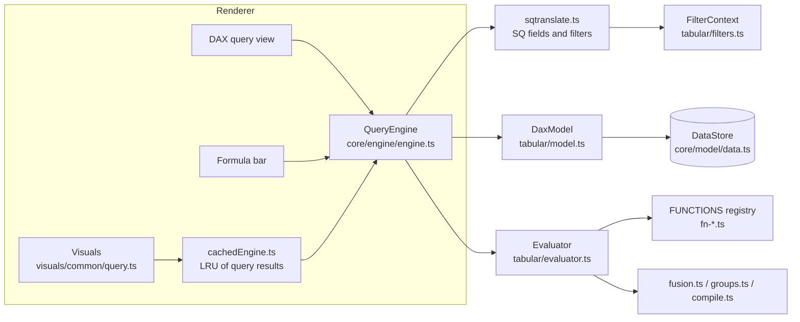

# DAX engine internals

> **Applies to:** Developers

This article explains how Lumen evaluates DAX: the two engines in `src/core/dax`, the `QueryEngine` adapter in
`src/core/engine`, the columnar model, filter context, the optimisations, and how to add a DAX function with tests.
Read it before you change anything under `src/core/dax` or `src/core/engine`.

## Two engines, one in production

`src/core/dax` holds two DAX implementations.

| Engine | Where | Role |
|---|---|---|
| Tabular engine | `src/core/dax/tabular/` | The production engine. Columnar, dictionary-encoded, broad DAX coverage. Everything the app shows goes through it. |
| Vendored reference engine | `src/core/dax/*.ts` (`evaluator.ts`, `model.ts`, `functions.ts`, `grader.ts`, ...) | An earlier, smaller engine vendored from a previous project (the code comments call it "Parity"). It evaluates only the functions in `SUPPORTED_FUNCTIONS` (`src/core/dax/functions.ts`) and refuses the rest. Kept for its golden tests and as a differential oracle (with `lintDax` and the measure grader in `grader.ts`, used by those tests). Outside tests, only the developer-only `#/modeling-test` harness (`src/renderer/src/views/dev/devEngine.ts`) evaluates with it, and the visual gallery's mock engines import its number formatting (`src/core/dax/format.ts`). |

`src/core/dax/index.ts` exports the reference engine and re-exports the production engine as a namespace:

```ts
// src/core/dax/index.ts
/** The production engine (columnar, broad DAX coverage) used by src/core/engine. */
export * as tabular from "./tabular/index.ts";
```

The two engines also differ in style, and both styles are kept as they are: the reference engine uses double
quotes and semicolons, the tabular engine single quotes and no semicolons. Both use relative imports with `.ts`
extensions (they do not use the `@core/*` aliases), which is the vendored-engine convention described in
[conventions.md](conventions.md).

## Where the engine sits

The rest of the app never calls the tabular engine directly. It calls the `QueryEngine` interface in
`src/core/engine/api.ts`, implemented by `createEngine(model, data, options)` in `src/core/engine/engine.ts`.



In words: visuals, the DAX query view and the formula bar call the `QueryEngine`. The canvas wraps it in
`src/renderer/src/report/cachedEngine.ts`, an LRU cache (600 entries) keyed by the request JSON, so moving or
resizing a visual re-runs no query. `engine.ts` translates PBIR SQ field expressions and filters with
`src/core/engine/sqtranslate.ts`, encodes the `SemanticModel` and `DataStore` into a columnar `DaxModel`, and runs
an `Evaluator` whose functions come from the `FUNCTIONS` registry. The optimisation modules plug into the
evaluator.

All engine calls are synchronous and run on the renderer's main thread. There is no worker today; `src/core`
stays free of DOM and Node APIs so that it could move to one.

### The `QueryEngine` contract

`src/core/engine/api.ts` is a contract listed in [docs/ARCHITECTURE.md](../ARCHITECTURE.md): add optional fields and
methods freely, coordinate anything breaking. Its main methods:

| Method | Used for |
|---|---|
| `summarize(req)` | Every visual query. SUMMARIZECOLUMNS semantics: auto-exist, rows whose values are all blank are dropped unless `showItemsWithNoData` or `keepBlankRows`. Totals are extra calls with fewer group-bys. |
| `distinctValues(req)` | Slicer items and filter-pane lists (Power BI's slicer query: the column without a measure). `existsInFacts` is an opt-in approximation used for small multiples. |
| `evaluateScalar(expr, filters)` | Cards, tooltips, conditional formatting expressions. |
| `runDaxQuery(text)` | The DAX query view: `DEFINE ... EVALUATE ... ORDER BY`, several `EVALUATE`s. |
| `validateExpression(expr, ctx)` | Formula bar diagnostics (`src/core/engine/validate.ts`). |
| `processCalculated()` | Calculated columns and tables in dependency order; returns per-object errors. |
| `invalidate()` | Cheap cache invalidation after a model edit. |
| `toDaxQuery(req)`, `toVisualCalcDaxQuery(req)` | Performance analyzer **Copy query**. |
| `evaluateVisualCalculations(req)` | Visual calculations over the visual matrix. |
| `setViewAsRoles(roles)` | Modeling **View as** (row-level security). |

The renderer's document store builds a new engine whenever data or model semantics change
(`buildEngine` in `src/renderer/src/state/store.ts`), and calls `processCalculated()` right after `createEngine`.
See [state-and-store.md](state-and-store.md).

### Options

`EngineOptions` in `src/core/engine/engine.ts`:

| Option | Default | Effect |
|---|---|---|
| `now` | system clock | Clock for `TODAY`, `NOW` and relative date filters. |
| `userPrincipalName`, `userName` | `user@localhost`, `LOCAL\user` (set in `fn-scalar.ts`) | Values of `USERPRINCIPALNAME()` and `USERNAME()`. |
| `maxCombos` | `250000` (in `summarizeColumnsCore`, `fn-table.ts`) | Group combinations evaluated before `summarize` switches to fact-driven auto-exist. A cross join of unrelated tables above `max(maxCombos, 2000000)` combinations fails with a `LIMIT` error. |
| `queryBudgetMs` | `15000` (0 = none) | Time budget of one `summarize`, `distinctValues` or `evaluateScalar` call. |

The budget is enforced by `Evaluator.checkDeadline()`, which throws a `DaxError` with code `TIMEOUT` once
`deadline` has passed. `summarize` catches it and returns the rows computed so far with `truncated: true` and a
warning, so a slow visual never blocks the UI indefinitely.

## Pipeline: text to value

1. **Lexing.** `lex()` in `src/core/dax/tabular/lexer.ts` produces tokens with 0-based offsets, line and column.
2. **Parsing.** `parseExpression()` and `parseQuery()` in `parser.ts` build a `Node` tree. Node kinds are
   `number`, `string`, `bool`, `column`, `ident`, `param`, `call`, `binary`, `unary`, `var`, `tableCtor` and
   `tuple`; every node carries its source span (`s`, `e`). User-defined functions (`DEFINE FUNCTION` and model
   functions) are `FunctionDefinition`s with typed `FunctionParam`s. Parsed expressions are cached
   (`parseCached` in `model.ts`).
3. **Model encoding.** `buildModel(model, data, issues)` in `model.ts` turns the `SemanticModel` and `DataStore`
   into a `DaxModel` of `Tbl` and `Col` objects.
4. **Evaluation.** An `Evaluator` (`evaluator.ts`) evaluates nodes in an `Env` (filter context, row contexts,
   variable scope, applied calculation items). `ev.scalar(node, env)` returns a scalar; `ev.value(node, env)`
   returns a scalar or a `TableValue`.
5. **Queries.** `runQuery(model, text)` in `query.ts` runs `DEFINE` / `EVALUATE` / `ORDER BY` / `START AT` and
   returns `QueryTable`s whose column names follow the DAX query view (`Table[Column]` for model columns,
   `[Name]` for named ones).

Errors are `DaxError` (with a `code` and source offsets) and `DaxSyntaxError` (with line and column), both in
`errors.ts`. An unknown function raises `UNKNOWN_FUNCTION`.

## The columnar model

`src/core/dax/tabular/model.ts` stores every column as dictionary codes:

```ts
// src/core/dax/tabular/model.ts
export class Col {
  readonly id = nextColId++
  codes: Int32Array = new Int32Array(1)
  dict: Scalar[] = [null]
  /** numeric value per dictionary id (dates: OLE serial, booleans 0/1, text/blank NaN) */
  num: Float64Array = new Float64Array([NaN])
```

- Dictionary id 0 is reserved for BLANK.
- A table on the one side of a relationship whose many side has unmatched keys gets a **virtual blank row** at
  index `rowCount` (all codes 0), as VertiPaq does. That is why `COUNTROWS ( Product )` counts one more row when a
  sales row has an orphan key (see the smoke test below).
- Relationship row maps connect many-side rows to one-side rows. When the data came from a PBIX file,
  `DataStore.relationshipKeys` carries VertiPaq's own key matches, which the engine uses so that key matching
  agrees with the file (`src/core/dax/tabular/__tests__/relkeys.test.ts`).

Scalar values follow the app-wide data contract (`src/core/model/data.ts`, restated in
`src/core/dax/tabular/values.ts`): BLANK is `null`; dates are JS `Date` objects whose UTC fields hold the naive
wall-clock value. Never use local-time getters on them.

## Filter context

`src/core/dax/tabular/filters.ts` defines `FilterContext`: a set of filters (each a table of allowed tuples over
model columns), the relationship configuration in effect (`USERELATIONSHIP` / `CROSSFILTER` overrides), the
`ALLSELECTED` shadow filters and the SUMMARIZECOLUMNS group-by scope used by `ISINSCOPE`.

- Filters propagate with **expanded-table semantics**: a table sees every filter on a column of its expanded table
  (itself and everything reachable over many-to-one relationships), plus cross-filtering from bidirectional,
  one-to-one and weak many-to-many relationships.
- Visible rows are computed with bitmaps over dictionary codes and cached posting lists, so the most selective
  filter drives the scan.
- Report, page, visual, slicer, cross-filter and drill filters all arrive as PBIR SQ filters. `engine.ts`
  translates them with `SqResolver.translate` (after `translateFilters` from `src/core/data/standIns.ts` maps
  sample-data stand-ins, see [data-layer.md](data-layer.md)) and passes them to `new FilterContext(dm, { filters,
  secure })`, where `secure` holds the row-level security filters of **View as**.

## Optimisations

The engine is exact first; each optimisation has a differential test that compares it with the plain row-by-row
path.

| Module | What it does | Falls back when |
|---|---|---|
| `compile.ts` | Compiles iterator row expressions (`FILTER`, `SUMX`, `ADDCOLUMNS`, calculated columns) to closures. Hoists row-independent subtrees (`MAX ( 'Date'[Index] )` inside `FILTER ( ALL ( 'Date' ), ... )` runs once), and memoises a predicate per dictionary code when it reads a single column. | A node it does not know is interpreted per row; functions in `ROW_DEPENDENT` are never hoisted. |
| `groups.ts` | Group index: groups a large table's rows by the key arrays a context's predicates read, so predicates run once per group and `SUM`, `COUNT`, `COUNTROWS`, `MIN`, `MAX` read per-group partial aggregates. | The index does not compress well (more than rows / 3 groups). |
| `fusion.ts` | Vertical fusion for SUMMARIZECOLUMNS: simple aggregations (`SUM`, `AVERAGE`, `MIN`, `MAX`, `COUNT`, `COUNTA`, `COUNTROWS`, `DISTINCTCOUNT`, directly or through measures, optionally in a filter-less or constant-filter `CALCULATE`) are computed for every group in one scan of the fact table. Also `TREATAS` row-value fusion. | A group-by table is not reached through regular many-to-one relationships, a bidirectional / one-to-one / weak relationship could carry a filter back, a calculation group applies, or the aggregation depends on more than its group filters. |
| Measure cache (`Evaluator.measureCache`) | A measure's value is shared between cells that differ only by filters that cannot reach the tables it reads. | A calculation item, `SELECTEDMEASURE` or a format-string evaluation is in play. |

Two switches exist for tests: `setFusionEnabled(on)` and `setGroupingEnabled(on)`, exported from
`src/core/dax/tabular/index.ts`. The differential tests that guard these paths are
`src/core/engine/__tests__/optimizations.test.ts` (a 60,000-row fact table with rolling windows, time
intelligence and a bidirectional variant), `src/core/dax/tabular/__tests__/caching.test.ts` and
`fusion-treatas.test.ts`.

## Calculated objects

`processCalculated` in `src/core/dax/tabular/process.ts` computes calculated columns and calculated tables
(including field parameters, `DATATABLE` and `CALENDAR` tables) in dependency order. Errors are collected per
object and the failed object is left blank.

`TabularEngine` in `engine.ts` adds Power BI's refresh behaviour on top: calculated objects keep the values stored
with the data (PBIX, cache, `.wbi`) until their definition or one of their inputs changes. Each object has a
fingerprint over its expression, the measures it references, the identity of the data tables it reads and its
calculated dependencies. Expressions that match the `VOLATILE` pattern (`TODAY`, `NOW`, `UTCNOW`, `UTCTODAY`,
`RAND`, `RANDBETWEEN`, `USERNAME`, `USERPRINCIPALNAME`, `CUSTOMDATA`) are treated as always out of date. Computed
values are written back into the `DataStore` so the Table view and exports see them.

## Visual calculations

`src/core/dax/tabular/visualcalc.ts` evaluates PBIR `NativeVisualCalculation` projections. The visual matrix
(one row per cell of the visual's lattice, totals included) becomes the only table of a small `DaxModel`, so visual
calculations are ordinary DAX over that table. `RUNNINGSUM`, `MOVINGAVERAGE`, `PREVIOUS`, `NEXT`, `FIRST`, `LAST`,
`RANGE`, the window functions with an axis, `COLLAPSE`, `EXPAND`, `LOOKUP` and `ISATLEVEL` are registered there.
`ORDERBY` / `PARTITIONBY` / `MATCHBY` handling for the window functions is in `window-order.ts` and
`fn-window.ts`.

## How functions are registered

Functions live in a global registry in `src/core/dax/tabular/registry.ts`:

```ts
// src/core/dax/tabular/registry.ts
export type FnImpl = (ev: Evaluator, a: Node[], env: Env, node: CallNode) => Val

export interface FnMeta {
  /** returns a table */
  table?: boolean
  /** argument columns are not row-context references (aggregators, filter functions) */
  context?: boolean
  min?: number
  max?: number
}

export function defineFn(names: string | string[], impl: FnImpl, meta: FnMeta = {}): void {
```

- An implementation receives the **unevaluated** argument nodes. It evaluates what it needs with `ev.scalar(...)`
  or `ev.value(...)`, which is how `IF`, `SWITCH` and the filter functions control evaluation order and context.
- `min` and `max` are enforced twice: by the evaluator before the call (`Evaluator.arity`) and by the formula bar
  validator (`src/core/engine/validate.ts`), which reports "Wrong number of arguments".
- `table: true` marks a table function; `context: true` tells the row compiler that column arguments are not
  row-context reads.
- Several names can share one implementation (`defineFn(['IF', 'IF.EAGER'], ...)`).

The `fn-*.ts` modules register their functions as a side effect of being imported, and `evaluator.ts` imports
them all:

```ts
// src/core/dax/tabular/evaluator.ts
import './fn-scalar.ts'
import './fn-aggregate.ts'
import './fn-table.ts'
import './fn-filter.ts'
import './fn-time.ts'
import './fn-window.ts'
import './visualcalc.ts'
```

| Module | Contents |
|---|---|
| `fn-scalar.ts` | Logical, information, math, text, date and time functions |
| `fn-aggregate.ts` | Aggregations and iterators (`SUM`, `SUMX`, `DISTINCTCOUNT`, statistical functions) |
| `fn-table.ts` | Table functions (`SUMMARIZECOLUMNS`, `ADDCOLUMNS`, `TOPN`, `UNION`, ...) |
| `fn-filter.ts` | `CALCULATE`, `ALL*`, `KEEPFILTERS`, `TREATAS`, relationship functions |
| `fn-time.ts` | Time intelligence |
| `fn-window.ts` | `OFFSET`, `INDEX`, `WINDOW`, `RANK`, `ROWNUMBER` |
| `visualcalc.ts` | Visual-calculation-only functions |

Which functions exist is listed in [DAX function support](../reference/dax-function-support.md), generated from
this registry.

## Add a DAX function

The steps below were checked by adding a throwaway function and running its tests; they are the complete set of
places a new function touches.

### Prerequisites

- A working checkout ([development-environment.md](development-environment.md)).
- The function's documented semantics on Microsoft Learn, including how it treats BLANK, errors and data types.

### Steps

1. **Pick the module** by category (table above). Add the implementation with `defineFn`. A one-argument scalar
   function looks like this:

   ```ts
   // in src/core/dax/tabular/fn-scalar.ts
   defineFn('MYFUNC', (ev, a, env) => {
     const v = ev.scalar(a[0], env)
     return v === null ? null : toNumber(v) * 2
   }, { min: 1, max: 1 })
   ```

   Use the conversion helpers in `values.ts` (`toNumber`, `toText`, `toBool`, `toDate`, `compare`) so coercion
   and BLANK handling match the rest of the engine. Throw `DaxError` for DAX errors.
2. **Tell the row compiler about row-dependence.** If the function observes the row context, performs a context
   transition, or is non-deterministic, add its name to `ROW_DEPENDENT` in `src/core/dax/tabular/compile.ts`.
   Otherwise the compiler may hoist the call out of an iterator and evaluate it once.
3. **Volatile functions.** If the result depends on the clock, randomness or the user, add the name to the
   `VOLATILE` pattern in `src/core/engine/engine.ts`, so calculated columns that use it are recomputed.
4. **Editor catalogue.** Add a `d(...)` entry to `DAX_FUNCTIONS` in `src/renderer/src/editors/dax/functions.ts`
   (category, parameters, return type, description). This feeds completion, signature help and hover. The
   validator itself reads the engine registry, so a function missing here is still accepted, just not
   suggested.
5. **Tests.** Engines need a test for every function ([Conventions](conventions.md#tests-next-to-code)). Model the test on
   `src/core/dax/tabular/__tests__/smoke.test.ts`, which builds a model with the `build()` helper from
   `src/core/dax/tabular/__tests__/build.ts` (neutral, invented names only). Test BLANK, wrong arity and the
   edge cases from the documentation. For behaviour that depends on filter context, add a case to
   `src/core/engine/__tests__/features.test.ts`, which goes through `createEngine`.
6. **Run the tests and the type check.**

   ```bash
   npx vitest run src/core/dax src/core/engine
   npm run typecheck
   ```

7. **Regenerate the reference table** described in [DAX function support](../reference/dax-function-support.md).

### Example test

This excerpt from `src/core/dax/tabular/__tests__/smoke.test.ts` shows the pattern: build a model, process
calculated objects, evaluate expressions in an empty filter context.

```ts
function scalar(m: ReturnType<typeof star>, expr: string) {
  const ev = new Evaluator(m)
  return ev.scalar(parseExpression(expr), ev.rootEnv(new FilterContext(m)))
}

describe('tabular smoke', () => {
  it('evaluates basic measures', () => {
    const m = star()
    expect(scalar(m, '[Total Amount]')).toBe(152)
    expect(scalar(m, 'COUNTROWS ( Product )')).toBe(4) // blank row for orphan key 9
```

To test through the public contract instead, create an engine and call `evaluateScalar`:

```ts
const { model, data } = build({ tables: { T: { columns: { x: 'int64' }, rows: [[1], [2]] } } })
const engine = createEngine(model, data)
expect(engine.evaluateScalar('SUM ( T[x] )').value).toBe(3)
```

## Accuracy checks

| Test | What it compares | Runs |
|---|---|---|
| `src/core/dax/__tests__/golden.test.ts` | Reference engine against an independent SQL implementation of the golden measures (`oracle.ts`), cell by cell | Always |
| `src/core/engine/__tests__/parity-diff.test.ts` | Tabular engine against the reference engine over the same star schema, several grids and slicer states | Always |
| `src/core/engine/__tests__/optimizations.test.ts` | Optimised paths against the plain path | Always |
| `src/core/engine/__tests__/oracle.test.ts` | Engine totals and grouped sums against values recomputed in JavaScript from the raw columns of Microsoft's sample PBIX files | With `LUMEN_SAMPLES_DIR` |
| `src/core/engine/__tests__/samples.test.ts` | Every measure of the sample files evaluates; every visual query stays within a budget (1,000 ms, or 300 ms with `LUMEN_PERF_STRICT=1`) | With `LUMEN_SAMPLES_DIR` |
| `src/core/engine/__tests__/corpus.test.ts` | Every expression of a private PBIP corpus parses, uses known functions and evaluates on synthetic data; generic assertions only | With `LUMEN_CORPUS_DIR` |
| `src/core/engine/__tests__/perf.test.ts` | Summarize over a 200,000-row fact table (1 million with `WBI_PERF=1`) | Always |

See [testing.md](testing.md) and [performance.md](performance.md) for how these fit into the suite.

## Considerations and limitations

- **Main-thread evaluation.** The engine runs synchronously in the renderer. The query budget keeps a slow query
  from hanging the app, but the UI is busy while a query runs.
- **Truncated results are partial.** When the budget is exceeded, `summarize` returns the rows computed so far with
  `truncated` set; callers must show that the result is incomplete rather than present it as complete.
- **Culture.** `USERCULTURE()` returns `en-US` and `format()` uses en-US by default.
- **User functions.** `USERPRINCIPALNAME()`, `USERNAME()` and `USEROBJECTID()` return fixed local placeholders
  unless the engine is created with explicit values.
- **Two engines.** Fixing a semantic bug in the tabular engine does not fix the reference engine, and the reference
  engine refuses functions outside `SUPPORTED_FUNCTIONS`. `parity-diff.test.ts` skips cases the reference engine
  refuses.
- **Integers.** int64 values beyond 2^53 lose precision (accepted in the data contract).

## Related content

- [Architecture overview](architecture-overview.md)
- [Visual query pipeline](visual-query-pipeline.md)
- [Data layer](data-layer.md)
- [Performance](performance.md)
- [DAX function support](../reference/dax-function-support.md)
- [DAX in Lumen](../dax/README.md)
