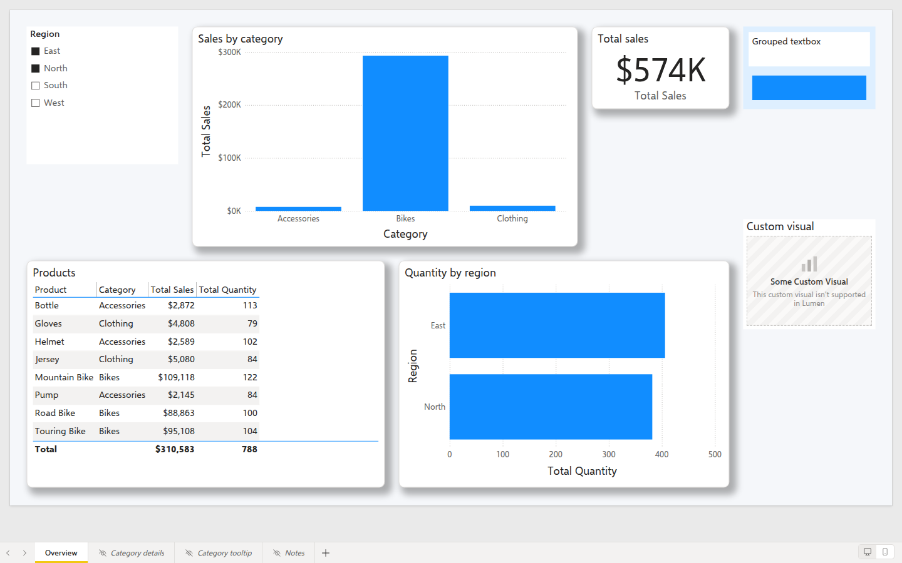

# Debugging

> **Applies to:** Developers

This article lists the tools for finding out why Lumen does something: the developer tools, where log output goes,
headless screenshots with `scripts/capture.sh`, the route options and developer routes that put the app in a known
state, and the failure signatures you are most likely to meet.

## Developer tools

The main window is frameless and has no visible menu, so the developer shortcuts are handled in the main process
(`src/main/index.ts`):

| Shortcut | Effect | Available |
|---|---|---|
| **F12** or **Ctrl+Shift+I** | toggle Chromium's developer tools for the renderer | always, including built and installed runs |
| **Ctrl+R** | reload the renderer | only under `npm run dev` |

Under `npm run dev`, electron-vite serves the renderer with hot module replacement, so most renderer edits apply
without a reload. Changes to `src/main` or `src/preload` restart or rebuild those parts; reload the window when a
preload change does not show.

Useful starting points in the developer tools console of a normal run:

- the readiness signals: `document.body.dataset.wbiReady`, `document.body.dataset.wbiBusy`
  (see [End-to-end tests](end-to-end-tests.md#readiness-signals));
- the route: `location.hash` (setting it switches to a developer route, see below).

The stores (`useApp`, `useShell`, `useInteraction`) are exposed as `window.__lumen` only when the app starts with
the route option `e2e=1`. To inspect them by hand, start a capture-free run with that option, for example
`WBI_ROUTE='#/?e2e=1&sample=1' npm start`, and read `__lumen.useApp.getState()` in the console.

## Where output goes

| Process | Output |
|---|---|
| Main process | the terminal that started Lumen (`npm run dev`, `npm start`, `scripts/lumen.sh`). The main process itself writes almost nothing. |
| Renderer | the developer tools console. In headless modes it is also written to a file: `<out>.png.log` for `scripts/capture.sh`, `<outdir>/<report>/console.log` for the sweep, and the `errors` list of `window.__lumen` in the end-to-end journeys (saved as `<test>.log` on failure). |

Renderer messages use a bracketed prefix that names the area, so you can filter the console:
`[export]`, `[sweep]`, `[sample]`, `[icons]`, `[mobile]`, `[canvas]`, `[model]`, `[launch]`, `[gallery]`, and
`[visual <visualType>]` for a visual that threw while rendering. There is no logging framework or log level
setting; use `console.info`, `console.warn` and `console.error` with a prefix in the same style.

## Capture a screenshot headlessly

`scripts/capture.sh` renders the built app on a private Xvfb display and saves a PNG plus a `.log` file with the
renderer console:

```bash
npm run build
scripts/capture.sh /abs/out.png ['#/route'] [path-to-open] [WxH]
scripts/capture.sh /tmp/sample.png '#/?sample=1&panes=performance&perf=1' '' 1440x900
```

The capture waits until `wbiReady` is `1` and `wbiBusy` is not `1` on two consecutive polls, waits another 600 ms,
then calls `capturePage`. If the app never becomes ready within `WBI_TIMEOUT` (default 60,000 ms), it captures
anyway and writes `[capture] timed out waiting for document.body.dataset.wbiReady` to the log. A crash of the
renderer is logged as `[crash] <reason>`.

| Variable | Default | Effect |
|---|---|---|
| `WBI_TIMEOUT` | `60000` | how long to wait for readiness, in ms |
| `WBI_USE_DESKTOP` | unset | show the window on your desktop instead of a private Xvfb display |
| `WBI_BLOCK_CACHE` | `1` | never decode a PBIP `.pbi/cache.abf`; set `0` to allow it |
| `WBI_CAPTURE_PROFILE` | unset | `keep` reuses your real profile; by default each capture uses a fresh one, so pane state from one capture does not leak into the next |

The full list is in [Command line and environment](../reference/command-line-and-environment.md).

### Route options

Options after `#/?` put the app shell into a state before the capture (`applyRouteOptions` in
`src/renderer/src/app/App.tsx`):

| Option | Effect |
|---|---|
| `sample=1` | open the built-in sample report |
| `start=1`, `start=0` | show or hide the start screen |
| `page=<n or name>` | go to a page by 1-based index, page name or display name |
| `view=<view>` | switch view: `report`, `data` (Table view), `model`, `dax` or `powerquery` |
| `panes=<ids>`, `collapse=<ids>` | open only these panes (comma-separated ids such as `filters`, `performance`); open collapsed |
| `select=<visual names>` | select visuals |
| `vizTab=build\|format\|analytics`, `formatTab=visual\|general`, `tab=<ribbon tab>` | pane and ribbon tabs |
| `field=Table`, `field=Table.Column`, `field=Table.[Measure]` | select a field |
| `dialog=<id>`, `backstage=<page>` | open a dialog or a File menu page |
| `cmd=<modeling command>`, `formula=<Name = expression>` | run a modeling command; commit a formula to the selected field |
| `data=sample` | fill the open model with sample data |
| `perf=1` | start a Performance analyzer recording and refresh the visuals |
| `notice=1` | show the "no data" notice |
| `export=pdf\|pptx\|png\|html&exportPath=/abs/file` | scripted export after opening (`pngScale=<n>` for PNG) |
| `e2e=1` | install the end-to-end hooks on `window.__lumen` |

### Developer routes

The hash router (`src/renderer/src/app/Router.tsx`) has routes outside the app shell, each loaded lazily:

| Route | Content |
|---|---|
| `#/gallery` | the visuals gallery: every registered gallery entry rendered over a mock model (`visuals/gallery/`) |
| `#/canvas-test` | the report canvas on an in-code fixture (`report/dev/CanvasTest.tsx`, `fixture.ts`) with the real engine; options `page=overview\|details\|tooltip\|hidden`, `edit=0`, `select=`, `focus=`, `spotlight=`, `cross=1`, `tip=1`, `menu=1`, `print=1` |
| `#/modeling-test` | the Table, Model and DAX query views on a small invented star schema (`views/dev/`); options `view=data\|model\|dax`, `field=`, `dialog=`, `query=<DAX>&run=1`, `complete=1` |
| `#/print` | the export print layout |



> [!NOTE]
> The developer routes never clear the busy signal (the shell's launch hold is taken when the shell module loads
> and released only by the shell itself), so `scripts/capture.sh` on these routes always waits the full
> `WBI_TIMEOUT` and logs a timeout, then captures a correct image. Set `WBI_TIMEOUT=10000` to shorten the wait.

`src/renderer/src/report/dev/devMain.tsx` is a standalone entry that renders `CanvasTest` without the shell; no
build configuration references it.

## Common failure signatures

| What you see | Cause and fix |
|---|---|
| `SyntaxError: The requested module 'electron' does not provide an export named 'BrowserWindow'` | Electron started with `ELECTRON_RUN_AS_NODE=1` (VS Code terminals set it), so it runs as plain Node. Use the npm scripts or `env -u ELECTRON_RUN_AS_NODE`. |
| `capture failed` from `scripts/capture.sh` | No PNG was written: usually no build in `out/` (run `npm run build`), or Electron could not start (run the command without `>/dev/null` to see why). |
| `[capture] timed out waiting for document.body.dataset.wbiReady` in the `.log` | The screen never signalled ready: a view that does not set `wbiReady`, a busy hold that is never released, or a developer route (see the note above). The PNG may still be correct; check it. |
| A visual shows **Can't display this visual** with **See details** | The visual's component threw. `VisualErrorBoundary` (`report/VisualContainer.tsx`) shows the message and logs `[visual <type>]` with the component stack. |
| A visual shows **Can't display the visual.** | The visual's query failed (`VisualError` in `visuals/common/VisualState.tsx`); the details hold the engine's message. Reproduce the query in the DAX query view or a test. |
| **Something's wrong with one or more fields** | The visual references a column or measure the model does not have, as in Power BI. |
| A visual stays at **Loading…** | A query that never resolves, or a promise that is never settled. The Performance analyzer and the sweep's `loading-stuck` state help to find which. |
| Sweep line ends with `STUCK on page <name>` | The renderer hung on that page; `report.json` `inProgress` names it, `console.log` has the last messages. |
| Sweep line ends with `(cache guard OFF!)` or `report.json` shows `cacheBlocked: false` | The app ran without the `.pbi/cache.abf` guard; the sweep refuses to open projects in that state. |
| `no report.json (crash or timeout; see console.log)` | The sweep's renderer crashed or exceeded `WBI_TIMEOUT`. |
| `Lumen did not launch` in a journey | The app failed in `beforeAll`: usually no build in `out/e2e` (run `e2e/run.sh` without `--no-build`) or a crash at start. |
| `[e2e] failure artifacts: …png / .log` | A journey failed; open the screenshot first. |
| A journey sees old behaviour | `--no-build` reused a stale `out/e2e/`. Rebuild. |

## Considerations and limitations

- There is no in-app log viewer and no persistent log file; renderer output exists only in the developer tools or
  in the headless modes' log files.
- The developer routes are part of every build (they load lazily); they are tools, not user features.

## Related content

- [Development environment](development-environment.md)
- [End-to-end tests](end-to-end-tests.md)
- [Performance](performance.md)
- [The sweep](the-sweep.md)
- [Command line and environment](../reference/command-line-and-environment.md)
