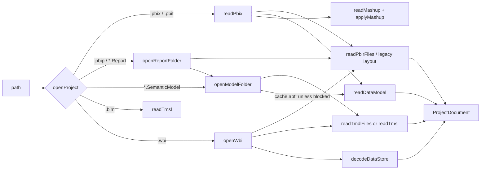

# File format input and output

> **Applies to:** Developers

This article explains how Lumen reads and writes Power BI files: the PBIX and PBIT containers, the embedded
DataModel and its compression layers, legacy report layouts, PBIP projects (PBIR report + TMDL or `model.bim`
semantic model) and Lumen's own `.wbi` bundle. Read it before you change anything under `src/core/io`,
`src/core/pbir` or `src/core/tmdl`.

For what a user can open and save, see [Files and compatibility](../files-and-compatibility/README.md) and the
[file format support reference](../reference/file-format-support.md). For the save path in detail, see
[Saving and round-trip](saving-and-round-trip.md).

## The one entry point: `openProject`

Every loader produces a `ProjectDocument` (`src/core/project.ts`): the semantic model, its data, the report and
the loader's diagnostics.

```ts
// src/core/project.ts
export interface ProjectDocument {
  id: string
  name: string
  source: ProjectSource
  model: SemanticModel
  data: DataStore
  /** absent when only a semantic model was opened */
  report?: ReportDocument
  /** loader diagnostics shown in a notification area */
  diagnostics: Array<{ level: 'info' | 'warning' | 'error'; message: string }>
  /** true when edited since last save */
  dirty: boolean
}
```

`openProject(path, fs, opts)` in `src/core/io/open.ts` decides what was opened and dispatches. It takes a
`FileSystem` (`src/core/io/fs.ts`), an async interface with `readFile`, `readText`, `writeFile`, `list`, `exists`,
`stat`, `mkdirp` and `remove`. In the app it is `window.wbi.fs` (see
[The host bridge and IPC](the-host-bridge-and-ipc.md)); in tests and scripts it is `nodeFs` from
`src/core/io/nodefs.ts`. All IO code is pure TypeScript, so the same loaders run in Node (vitest) and in the renderer
(and could run in a worker; none is used today).

| What is opened | `ProjectSource.kind` | Reader |
|---|---|---|
| `.pbix` | `pbix` | `readPbix` (`src/core/io/pbix/container.ts`) |
| `.pbit` (has `DataModelSchema`, no `DataModel`) | `pbit` | `readPbix` |
| `.pbip` file | `pbip` | `openPbipFile` > `openReportFolder` |
| `*.Report` folder, or a folder with `definition.pbir` | `pbir-folder` | `openReportFolder` |
| `*.SemanticModel` folder, or a folder with `definition.pbism` / `model.bim` | `semantic-model-folder` | `openModelFolder` |
| `.bim` file | `semantic-model-folder` | `readTmsl` (`src/core/tmdl/tmsl.ts`) |
| `.wbi` | `wbi` | `openWbi` > `readWbi` (`src/core/io/wbi.ts`) |
| A folder that contains one `.pbip`, one `*.Report` or one `*.SemanticModel` | as above | recursive dispatch |

`OpenOptions` carries an `onProgress(fraction, message)` callback (the busy overlay uses it) and `loadData`
(default `true`; `false` reads definitions only).



*Diagram in words:* `openProject` looks at the path. A PBIX or PBIT goes to `readPbix`, which reads the report
files, decodes the DataModel and reads the Power Query package. A PBIP file or report folder goes to
`openReportFolder`, which reads the PBIR files and follows `definition.pbir` to the semantic model folder. A
semantic model folder is read from TMDL or `model.bim`, plus the data cache when allowed. A `.wbi` bundle contains
a PBIP project and the data. Every path ends in one `ProjectDocument`.

## Working on file maps

The PBIR and PBIP code works on in-memory *file maps* (`FileMap = Record<string, Uint8Array>` for input,
`OutFileMap = Record<string, Uint8Array | string>` for output, both in `src/core/pbir/pbir.ts`), keyed by paths
relative to the `*.Report` or `*.SemanticModel` folder. That is why one reader serves four containers:

- a PBIP `*.Report` folder, read with `readTree(fs, dir, skip)`;
- the `Report/` entries of a PBIX file (PBIR-enabled files have `Report/definition/**`);
- the `project/<Name>.Report/` entries of a `.wbi` bundle;
- the legacy `Report/Layout` entry of an older PBIX, mapped to `report.json`.

Text is decoded with `decodeText` (`src/core/pbir/pbir.ts`), which handles UTF-8 with or without a BOM and
UTF-16LE with or without a BOM. PBIX layout and schema entries are UTF-16LE.

## PBIX and PBIT

A PBIX file is an OPC zip. `readPbix` unzips it with `fflate` and handles the entries this way:

| Entry | Handling |
|---|---|
| `Report/definition/**` | PBIR report, read by `readPbirFiles(files, 'pbix-pbir')` |
| `Report/Layout` | legacy layout, converted by `convertLegacyLayout` (origin `pbix-legacy`) |
| `Report/StaticResources/**` | report resources (images, themes) |
| `Report/LinguisticSchema` | skipped (Q&A linguistic schema, not part of the report definition) |
| `DataModelSchema` | TMSL JSON (PBIT), read by `readTmsl`; the model has no data until refreshed |
| `DataModel` | VertiPaq backup, decoded by `readDataModel` (next section) |
| `Connections` | live connection: the report gets a `byConnection` dataset reference and no local model |
| `DataMashup` | Power Query package, read by `readMashup` (`src/core/io/pbix/mashup.ts`) |
| `DiagramLayout`, `DAXQueries/**` | kept as semantic model sidecar files (`diagramLayout.json`, `DAXQueries/...`) |
| `Version` | returned as `PbixReadResult.version` |

Older PBIX files store `SELECT * FROM [Query]` partitions and keep the M code only in the DataMashup's
`Formulas/Section1.m`. `applyMashup` (`src/core/io/pbix/container.ts`) replaces those partitions with M
partitions and adds the remaining queries as shared expressions, the way Power BI Desktop upgrades them, and adds
an `info` diagnostic with the count.

## The DataModel and its compression layers

`readDataModel` (`src/core/io/pbix/datamodel/index.ts`) decodes the `DataModel` entry of a PBIX file and the
`.pbi/cache.abf` file of a PBIP semantic model. The pipeline has four layers:

1. **Container framing** (`container.ts`, `detectCompression`, `decompressDataModel`): the stream is either an
   uncompressed Analysis Services backup (ABF), a single-threaded XPress9 stream, or a multi-threaded XPress9
   stream made of independent sessions.
2. **XPress9** (`xpress9.ts`): LZ77 plus canonical Huffman, a TypeScript port of the decoding half of Microsoft's
   Xpress9 library. A session is decoded into one contiguous buffer.
3. **ABF backup** (`abf.ts`): a header, a virtual directory and a backup log that maps logical file names to
   storage. When the header sets `ApplyCompression` (older files and SSAS backups), each logical file is also
   XPress8-compressed (`xpress8.ts`).
4. **Model and columns**: `metadata.sqlitedb` (the persisted Tabular Object Model) is read with sql.js
   (`sqlite.ts`, `metadata.ts`) into a `SemanticModel`; each column's `.idf` / `.idfmeta` / `.dictionary` files are
   decoded by `vertipaq.ts` and turned into `Scalar[]` by `columns.ts`.

Column values follow the value contract in `src/core/model/data.ts`: BLANK is `null`; date-times are JS `Date`
objects whose UTC fields carry the wall-clock value. `columns.ts` converts OLE Automation dates and divides
fixed-decimal (currency) values by 10,000.

sql.js needs its WASM binary. Node finds it automatically; the renderer calls `setSqlJsFactory`
(`sqlite.ts`) once with a bundled `.wasm` URL (in `src/renderer/src/main.tsx`).

### What is reported, not thrown

`readDataModel` adds a diagnostic instead of failing the whole open when one column does not decode (the column is
filled with BLANK), when row counts disagree between columns, or when a DirectQuery table has no stored rows (its
status becomes `empty`). If every column of a table fails, the table status is `error`. If the whole decode fails,
`readPbix` keeps the report and an empty model and adds an `error` diagnostic.

### The cache guard

`openModelFolder` never decodes a PBIP `.pbi/cache.abf` when `globalThis.__LUMEN_BLOCK_CACHE_ABF__ === true`. The
vitest setup file (`tests/setup.ts`) sets it for every test run, and the app sets it when started with
`WBI_BLOCK_CACHE=1` (see `src/shared/cacheGuard.ts` and
[The host bridge and IPC](the-host-bridge-and-ipc.md#the-cache-guard)). The project then opens with an `info`
diagnostic and no data. PBIX DataModel decoding is not affected.

## Legacy report layouts

Reports saved before PBIR (a PBIX `Report/Layout` entry, or a PBIR-legacy `*.Report` folder with a single
`report.json`) are converted on load by `convertLegacyLayout` (`src/core/pbir/legacy.ts`). The module comment
lists the full mapping; the main points:

- `sections[]` become pages, ordered by `ordinal`;
- each visual container's `config` string becomes a `visual.json`: position from layout 0, `mobile.json` from
  layout 1, projections plus `prototypeQuery` become `visual.query.queryState`, `vcObjects` become
  `visualContainerObjects`;
- report, page and visual filters become `filterConfig.filters`;
- `config.bookmarks` become bookmark files; `config.modelExtensions` becomes `reportExtensions.json`.

Lossy spots (dropped settings, projections without a query select, unknown filter or resource types, any report
extension after the first) are reported as diagnostics. A legacy layout without a base theme renders with the
pre-2019 Classic palette (`legacyDefaultBaseTheme` in `src/core/report/themes/builtin.ts`).

## PBIR (report folders)

`readPbirFiles(files, origin)` (`src/core/pbir/pbir.ts`) builds a `ReportDocument` from this layout:

```
definition.pbir                          dataset reference (byPath / byConnection)
definition/version.json, report.json, reportExtensions.json
definition/pages/pages.json
definition/pages/<page>/page.json
definition/pages/<page>/visuals/<visual>/visual.json   (+ mobile.json)
definition/bookmarks/bookmarks.json, bookmarks/<name>.bookmark.json
StaticResources/SharedResources/BaseThemes/*.json, StaticResources/RegisteredResources/*
```

Pages follow `pages.json` `pageOrder`; pages missing from the order are appended by name. Visuals are sorted by
folder name (z-order lives in `position.z`). Every file under `StaticResources/` becomes a `ResourceFile`; every
other file the reader does not model goes to `extraFiles` and is written back unchanged. Themes are resolved from
the resources at read time (`resolveThemes`). See [The report document model](the-report-document-model.md).

`openReportFolder` skips the report's `.pbi/` folder (per-user state such as `localSettings.json`) and follows
`definition.pbir`:

- `byPath`: the semantic model folder is opened relative to the report folder;
- `byConnection`: a warning says the report is connected live and has no local model or data;
- neither: a warning says the report has no dataset reference.

## Semantic models: TMDL and `model.bim`

`readSemanticModelFiles` (`src/core/io/pbip.ts`) reads `definition/**/*.tmdl` with `readTmdlFiles`
(`src/core/tmdl/read.ts`) or, when there is no TMDL, `model.bim` with `readTmsl`. A model read from `model.bim` is
marked `extra['@pbipFormat'] = 'bim'` so it is saved in the same format. Every other file in the folder except
`.pbi/cache.abf` and per-user `.pbi/*` files (but including `.pbi/editorSettings.json`) is kept as text in
`model.sidecarFiles`: `diagramLayout.json`, `DAXQueries/**`, `.platform`, `definition.pbism` and Lumen's
`diagramLayout.lumen.json`.

TMDL parse errors become `error` diagnostics with the file and line (`TMDL <file>:<line>: <message>`).

The TMDL parser records *formatting hints* (`src/core/tmdl/hints.ts`): property order and the exact source lines of
each entry, kept in a `WeakMap` beside the model objects. The writer reuses the original lines for entries whose
canonical text has not changed, which is what makes untouched TMDL files save byte-identically.

## The `.wbi` bundle

A `.wbi` file is a deflated zip (`src/core/io/wbi.ts`):

```
manifest.json                         { format: 'wbi', version: 1, name, savedAt, generator: 'Lumen', source }
project/<Name>.pbip
project/<Name>.Report/**
project/<Name>.SemanticModel/**
data/tables.json                      [{ name, rowCount, status, columns: [{ name, type, encoding, file, dict? }] }]
data/<t>/<c>.bin                      one typed blob per column
```

The project part is exactly what a PBIP save writes (`pbipProjectFiles`). Each column picks an encoding from its
values: `i32`, `f64`, `date` (epoch milliseconds of the UTC wall clock), `bool`, `dict` (indices into a string
table stored in `tables.json`) or `json` (tagged values for mixed or binary columns). Nulls are a bitmap at the
start of each blob.

`readWbi` refuses a file without `manifest.json`, with another `format`, or with a `version` above
`WBI_FORMAT_VERSION` (currently `1`), so an older Lumen does not misread a newer bundle.

## Writing PBIX and PBIT (experimental)

The writers live in `src/core/io/pbix/write/` and are pure TypeScript like the readers. `saveProject(project, path,
fs, { format: 'pbix' | 'pbit' })` (`src/core/io/open.ts`) calls `writePackage` (`package.ts`). **No file they write
has been opened in Power BI Desktop yet.** Each write path has a flag in `VERIFIED_IN_DESKTOP` (`package.ts`). While
a flag is `false`, the Save dialog (`src/renderer/src/app/savePackage.tsx`) labels that path "Experimental: not yet
verified in Power BI Desktop". Flip a flag only after the matching file of the test kit opens in Power BI Desktop.

### Write paths

`planPackage(kind, { project, source })` chooses a path, and the Save dialog shows it before anything is written:

| Path | When | What is written |
|---|---|---|
| `pbit` | Any project with a local model | `DataModelSchema` (TMSL from `writeTmsl`, through `dataModelSchema()`), the report, `DiagramLayout`, `Settings`, `Metadata`; no data |
| `pbix-original-model` | The project was read from a `.pbix`, the file on disk is the one that was read (path, size and mtime), the data is unchanged and the model equals the model in that file | The source `DataModel` part byte for byte; the report rewritten; every other part copied as raw zip entries |
| `pbix-metadata` | As above, but measures were added, deleted or changed | The source `metadata.sqlitedb` edited in place (`metadataWrite.ts`), the ABF rebuilt (`abfwrite.ts`) and compressed again (`datamodelwrite.ts`) |
| `pbix-lumen-data` | Any other project with a local model whose features `freshModelSupport` accepts and whose tables have data loaded (a PBIP project after a refresh, the built-in sample, a `.pbix` whose data or model changed) | The whole `DataModel` written by Lumen from the in-memory model and data (`fresh/`, see [Writing a DataModel](#writing-a-datamodel-stage-e)); the report and the template's parts around it |

A model with a feature the stage E writer lacks gets no path: the dialog shows `CANNOT_WRITE_DATA` and lists each
feature ("Not supported by Lumen's data model writer: ..."). The paths that keep the source data model are preferred
when they apply, because they keep Desktop's own bytes.

How Lumen detects a change:

- **Model:** `classifyModelChanges` (`metadataEdit.ts`) compares the TMSL of the model read again from the source
  file with the TMSL of the document's model. Measure differences become `MeasureChange`s. Any other difference, or
  a change to a measure's KPI, dynamic format string, detail rows or changed-property list, is a blocker.
- **Data:** the PBIX loader records the `TableData` objects it produced (`origin.ts`, `rememberPackageData`). Every
  data change in Lumen (refresh, **Enter data**, sample data) replaces a table's `TableData` object, so a table whose
  object differs counts as changed. Calculated tables and calculation groups are excluded: their definitions are
  part of the model comparison. A store with no record counts as changed.

### The package (OPC zip)

`opc.ts` writes the zip the way the Desktop-saved files on hand are shaped: Microsoft's samples from 2017 to 2023
and a file saved by Power BI Desktop in November 2025.

| Aspect | Observed in Desktop's files | Written |
|---|---|---|
| Headers | version needed 2.0, made by 4.5 / MS-DOS, flags 0, no data descriptor, no comment | Same |
| Local extra field | `0xA220` padding ("growth hint", System.IO.Packaging) | Not written (optional) |
| Compression | every part deflated except `DataModel` (stored) | Same |
| Text parts | `Version`, `DataModelSchema`, `DiagramLayout`, `Report/Layout`, `Settings`, `Metadata`: UTF-16LE without BOM | Same |
| `[Content_Types].xml` | UTF-8 with BOM; `<Default Extension="json" ContentType="" />`; one empty-type `<Override>` per extension-less part, `application/json` for `/Settings` and `/Metadata` | Same, plus a `Default` per other extension used (Desktop's older files list `png` this way) |
| Part order (November 2025) | `Version`, `[Content_Types].xml`, `DiagramLayout`, `Report/Layout`, `Settings`, `Metadata`, `Connections`, `Report/CustomVisuals/**`, `Report/StaticResources/**`, `SecurityBindings`, `DataModel` | Templates: `Version`, `[Content_Types].xml`, `DataModelSchema`, `DiagramLayout`, `Report/Layout`, `Settings`, `Metadata`, report resources. `.pbix`: the source's order, with regenerated report parts in place of the source's |
| Part names | percent-encoded part URIs | Same (`encodePartName`) |
| `Version` | `1.28` (November 2025), `1.25` (2023), `1.11` (2017) | `1.28` in templates; copied in `.pbix` |

A `.pbix` keeps the source's raw entries (compressed bytes, CRC, timestamps) for every part it does not rewrite, so
those parts are byte-identical. `SecurityBindings` is never written. That optional part holds data source permission
settings encrypted with the Windows data protection API for one user, so a package written on another machine cannot
carry a meaningful one, and templates have none. Power BI Desktop asks the person opening the file to confirm data
source permissions.

### The report inside a package

The November 2025 file stores its report as the legacy `Report/Layout`, not as PBIR. Every Power BI Desktop
version reads that form, while PBIR inside a `.pbix` needs a recent version (and, for some versions, the PBIR preview
setting). So Lumen writes `Report/Layout` by default. `reportToLegacyLayout` (`src/core/pbir/toLegacy.ts`) is the
inverse of `convertLegacyLayout`. It writes JSON-string members, Desktop's enum numbers and `prototypeQuery` with
`From` aliases.

When it gets the source layout as `base`, it changes only what changed:

- objects whose PBIR conversion is unchanged are written back exactly, including Desktop's cached `query` and
  `dataTransforms`;
- changed objects keep the keys Lumen does not model;
- an unchanged report keeps the source part's exact bytes.

A `.pbix` whose source used PBIR (`Report/definition/**`) is written as PBIR again. `{ reportFormat: 'pbir' }` forces PBIR.
A report with no legacy layout to start from gets `useNewFilterPaneExperience: true` and layout version `5.65`.
PBIR-only report or visual settings that have no legacy form are listed as save diagnostics. The Save dialog shows
them as "Saved, with notes".

### The template model

`dataModelSchema(model)` is `writeTmsl` with one adjustment. A model without `defaultPowerBIDataSourceVersion` (the
2017 files, whose queries lived in `DataMashup`) is written as `powerBI_V3` at compatibility level 1550 or higher,
because a template carries no `DataMashup`, so every import partition must hold its M expression. The PBIX reader
upgrades those files' legacy query partitions to M partitions; it recognises both `SELECT * FROM [Query]` and
`SELECT [Query].* FROM [Query]`. A partition left as a legacy query is reported, because Power BI Desktop could not
load it.

### The DataModel container (ABF + XPress9)

The DataModel writers mirror the readers:

- **`xpress9enc.ts`**: Lumen's own XPress9 compressor, derived from the decoder port: hash-chain LZ77 with MTF
  references and canonical Huffman tables limited to 12 bits.
  - Each 2 MiB block carries the header the decoder reads, including the CRC-32C of header bytes 0 to 27 at offset 28. Desktop's files carry it too, though the decoder port does not check it.
  - The block flags match Desktop's blocks (window 2^22, 4 MTF entries).
  - Output is deterministic.
- **`datamodelwrite.ts`**: the framing current Desktop writes:
  - the UTF-16LE signature "This backup was created using XPress9 compression." with a NUL (102 bytes);
  - then `[u32 uncompressed][u32 compressed][block]` per 2 MiB, all blocks one session.

  No Desktop file on hand uses the multithreaded framing, so Lumen does not write it.
- **`abfwrite.ts`**: rebuilds an ABF from a parsed archive, with replaced inner files:
  - It copies every byte and patches only the sizes and offsets that must change: the header's `m_cbOffsetHeader` and `DataSize`, and in the VirtualDirectory and backup log each file's `Size` and `m_cbOffsetHeader`.
  - Without replacements it reproduces every Desktop file's ABF byte for byte.
  - In archives with `ApplyCompression` (2017 files) a replaced file is written as XPress8 stored chunks, a chunk kind those files also contain. Such sources keep their bare-ABF framing.

### Writing a DataModel (stage E)

`writeFreshDataModel(model, data)` (`src/core/io/pbix/write/fresh/datamodel.ts`) writes a complete `DataModel` with no
bytes from any source file. The pieces, in the order they run:

| Module | Writes |
|---|---|
| `vertipaq/dictionary.ts` | Hash encoding: the distinct values of a column as a `.dictionary` and one data id per row (3 + index, 2 = BLANK). Text values that differ only in case are one value, spelled as first seen (Power BI's default collation is case-insensitive) |
| `vertipaq/idf.ts`, `idfmeta.ts` | `.idf` segments (hybrid RLE + bit packing) and their `.idfmeta`; row-number columns |
| `vertipaq/hierarchy.ts`, `sort.ts` | System tables: attribute hierarchies (`H$`, POS_TO_ID / ID_TO_POS), user hierarchies (`U$`, MULTI_LEVEL_ID / PARENT_POS / FIRST_CHILD_POS / CHILD_COUNT), relationship indexes (`R$`, INDEX) |
| `fresh/model.ts` | Every `metadata.sqlitedb` row: the model objects (Model, Culture, QueryGroup, Expression, Table, Column, Partition, Measure, FormatStringDefinition, Hierarchy, Level, Relationship, CalculationGroup, CalculationItem, Role, TablePermission, Annotation, ExtendedProperty) and the storage rows (TableStorage, ColumnStorage, DictionaryStorage, PartitionStorage, SegmentMapStorage, ColumnPartitionStorage, SegmentStorage, AttributeHierarchy(Storage), HierarchyStorage, RelationshipStorage, RelationshipIndexStorage, StorageFolder, StorageFile) |
| `fresh/schema.ts` | The `metadata.sqlitedb` schema of current Desktop (`SCHEMAVERSION` 115), generated from the catalog of a November 2025 file: table and column names only, which are the `TMSCHEMA_*` rowsets of Microsoft's [MS-SSAS-T] specification plus the engine's storage tables |
| `fresh/abf.ts` | A new ABF: header, blobs, VirtualDirectory, backup log, the database's `.db.xml` |
| `datamodelwrite.ts` | The XPress9 framing (as for stage D) |

Every column is hash-encoded. Power BI also value-encodes some numeric columns; those carry a `.hidx` hash index and a
POS_TO_ID-only attribute hierarchy. Hash encoding is valid for every data type in the files on hand, so Lumen writes
one encoding and no `.hidx`. Tables are stored as processed (`State` 1 everywhere), with every structure the engine
keeps for a processed table, the way a file saved after a refresh holds them.

#### Rules measured on real files

The writers take only values and model metadata as input. Each rule below was checked by regenerating the real files'
structures from their decoded values (the scratch harness lives in the tests; numbers from the seven Microsoft samples
and a November 2025 Desktop file, 1,600+ column streams):

| Structure | Rule | Reproduction |
|---|---|---|
| `.dictionary` layout | Parse and write of every field | Byte-identical round trip of every dictionary (470) |
| `.idfmeta` layout | Parse and write of every field, including the segment data objects block of 2019+ files | Byte-identical round trip of every file (1,884) |
| Column segments | Runs of 64 or more equal ids become RLE entries, the rest is bit-packed at the smallest of 1-10, 12, 16, 21, 32 bits from base 2 (with BLANKs) or 3; RLE area `max(32, nextPow2(used + 3))` units; one extra word | Segment metadata identical for every data and row-number column of the 2023 samples; the `.idf` differs only in the unused tail of the RLE area, which Desktop leaves uninitialised |
| `bookmarkBits` | 1 below 64 rows, else `floor(log2(rows)) - 6` (every 2017-2023 file); the November 2025 file uses a per-column value Lumen does not derive | As stated |
| Empty and all-BLANK segments | Empty: one empty bit-packed entry, min = max = 2, `othersRleRuns` 1; all BLANK: `originalMinSegmentDataId` 0x80000000 | Identical |
| Attribute hierarchies | Sort positions over the distinct values (BLANK first), by the sort-by column's values when there is one, text by `compareText`; `values + 3` rows in segments of `n` rows; 32-bit packing with an extra word | Byte-identical `.idf` and `.idfmeta` for every hash-encoded column of the files with segment data objects whose sort key Lumen can read (the rest: text order differences in a few punctuation cases, see `sort.ts`) |
| User hierarchies | Distinct level paths breadth first, children in their level column's sort order; positions stored + 1 (0 = none) | Byte-identical for every user hierarchy whose level columns are hash-encoded |
| Relationship indexes | One row per from-column data id: `1 + row` of the matching to-table row, 0 when none | Checked through Lumen's reader on every sample (relationship keys) |
| Storage rows | Values per column kind as in the November 2025 file (key columns of relationships: `ColumnFlags` 11, usage 0; row numbers: value-encoded, `ColumnFlags` 31; empty tables: hash row number, `TableStorage.Settings` 4097) | Row by row against that file's model rewritten by Lumen: identical except the fields listed below |

#### Fields written without an established meaning

| Field | Written | Why |
|---|---|---|
| `0.CryptKey.bin` (database key file) | Not written; `.db.xml` lists no `DataFileList` | A key container encrypted for the engine instance that created the database. Every Desktop file has one; test kit file 5c tells whether Desktop accepts a database without it (5c-key carries one) |
| `DictionaryStorage.Size` | Fitted formula (`dictionarySize`) | An in-memory size statistic; within 1% of the November 2025 file |
| `DataVersion` / file name prefix | 1 everywhere | Desktop's values count processing operations; any positive value appears in real files |
| `Measure.DataType` | 20 (Variant) unless the model gives a type | As for stage D |
| `TableStorage.Settings` | 4353, 4097 for empty tables | One fact table of the November 2025 file has 4097; the rule is not derived |
| `bookmarkBits` of the newest files | The 2017-2023 rule | See above |
| String dictionary pages | One uncompressed page | Desktop compresses large dictionaries; both forms occur in the same files |
| `LinguisticMetadata` | Not written (Culture with id 0) | Q&A data; Desktop generates it |
| Model annotation `__PBI_TimeIntelligenceEnabled` | `0` when the model has none | Lumen writes no auto date/time tables, and this keeps Desktop from expecting them |

#### Refused (a `.pbit` or PBIP is offered instead)

`freshModelSupport` (`fresh/model.ts`) names each of these: more than one partition per table; DirectQuery, dual or
Direct Lake storage; incremental refresh policies; tables without loaded data; binary or variant columns; auto
date/time variations; KPIs and detail rows expressions; many-to-many and one-to-one relationships; perspectives;
translations; DAX user-defined functions. A calculation group's selection expressions are listed as a save note and
not written.

### Measure edits in metadata.sqlitedb

`editMetadataDb` opens the source database with sql.js and edits it in place, so every row Lumen does not own keeps
its value:

- **New and changed measures:** it writes `Measure` rows and their `Annotation` rows (ObjectType 8).
- **Deleted measures:** it deletes the rows that refer to the measure. These are its Annotation, ObjectTranslation,
  ExtendedProperty, ChangedProperty, FormatStringDefinition and DetailRowsDefinition rows, its KPI and its
  PerspectiveMeasure rows.
- **IDs:** new IDs are above `DBPROPERTIES.MAXID` and every existing ID, and `MAXID` is raised.
- **Commit markers:** `LASTCOMMITTED`, `LASTCUBESCHEMACHANGE` and `LASTMETADATACHANGEFORSYNCCOMMITTED` move just after
  the edit time, as real files keep them at or after their newest `ModifiedTime`.
- **New rows:** `State` 1 and `IsSimpleMeasure` 0, as every measure in the files on hand.
- **Data type:** Lumen does not evaluate result types, so a new or re-expressed measure is stored as `DataType` 20
  (Variant), a value real files use. This is an approximation and the likeliest reason for Power BI Desktop to
  object.

The edit ends with `PRAGMA integrity_check`.

### Tests

| Test | Covers |
|---|---|
| `src/core/io/pbix/write/xpress9enc.test.ts`, `abfwrite.test.ts`, `datamodelwrite.test.ts` | Round trips of generated buffers. With `LUMEN_SAMPLES_DIR`, for every sample: identity ABF rebuild, XPress9 round trip, the reader on the repacked stream, and replacing `metadata.sqlitedb` with a larger file |
| `src/core/pbir/__tests__/toLegacy.test.ts` | Invented layouts. With `LUMEN_SAMPLES_DIR`, every sample's `Report/Layout` through PBIR and back (same PBIR) and an unchanged report with its source as base (same layout) |
| `src/core/io/pbix/write/package.test.ts` | A built-in sample template (parts, encodings, content types, reopened model and report, determinism); the MIT fixture `data-profiling-demo.pbix` (original DataModel bytes and untouched parts kept, unchanged report reproduced, measure edits with SQLite integrity and schema checks, data and model changes refused). With `LUMEN_SAMPLES_DIR`, the same for every Microsoft sample |
| `src/core/io/pbix/write/vertipaq/vertipaq.test.ts` | Invented columns of every data type through the encoders and Lumen's decoders; with `LUMEN_SAMPLES_DIR`: byte-identical round trip of every `.dictionary` and `.idfmeta`, segment metadata and attribute / user hierarchies regenerated from each sample's values |
| `src/core/io/pbix/write/fresh/fresh.test.ts` | A model of every data type, BLANKs, Unicode beyond the BMP, a long string, a relationship and a user hierarchy; the built-in sample; refusals. Each written and read back by Lumen's reader: same data |
| `e2e/pbix.e2e.ts` | **File > Save as** `.pbit` and `.pbix` in the app: the dialog's path and experimental label, the refusal text, the written files reopened, the built-in sample as a `.pbix` with data written by Lumen |

### Headless export

`scripts/export-pbix.sh <input> <output.pbix|output.pbit> [--refresh]` runs the app headlessly (after
`npm run build`), opens the input, optionally refreshes it from its sources, and saves with the same code as
**Save as**. It drives the route option `export=pbix|pbit&exportPath=…&refresh=1`. A PBIP project can always be
written as a `.pbit`. With `--refresh`, a PBIP project whose features stage E supports is written as a `.pbix` with
data written by Lumen; otherwise the export fails with the features named.

## Considerations and limitations

- **PBIX and PBIT writing is experimental and not verified in Power BI Desktop.** Lumen's reader accepting a file
  Lumen wrote proves only that writer and reader agree; the reproduction against Desktop's own files is the evidence
  for the format, and only Power BI Desktop can confirm a file. The stage E writer covers import models without the
  features listed under [Refused](#refused-a-pbit-or-pbip-is-offered-instead).
- **Pre-2017 models** whose ABF has no `metadata.sqlitedb` (XML metadata) are not supported; the decode fails with
  "Unsupported data model".
- **Live-connected reports** open with an empty model; there is nothing to query locally.
- **DirectQuery tables** carry no rows in the file; they need a refresh from the source.
- **Large integers**: `int64` values beyond 2^53 lose precision (stated in `src/core/model/data.ts`).
- **The `.wbi` format** is Lumen's own. Power BI Desktop does not open it; save as PBIP to hand a project to Power
  BI.
- Third-party origins of the DataModel decoders (Microsoft's Xpress9 and Xpress libraries, pbixray, xmhuffman, all
  MIT) are listed (the XPress9 encoder is Lumen's own, derived from the format as the ported decoder reads it) in `src/core/io/pbix/datamodel/THIRD_PARTY.md` and the repository's `THIRD_PARTY_NOTICES.md`.

## Related content

- [Saving and round-trip](saving-and-round-trip.md)
- [The report document model](the-report-document-model.md)
- [Data layer](data-layer.md)
- [The host bridge and IPC](the-host-bridge-and-ipc.md)
- [File format support reference](../reference/file-format-support.md)
- [Architecture reference](../ARCHITECTURE.md)
