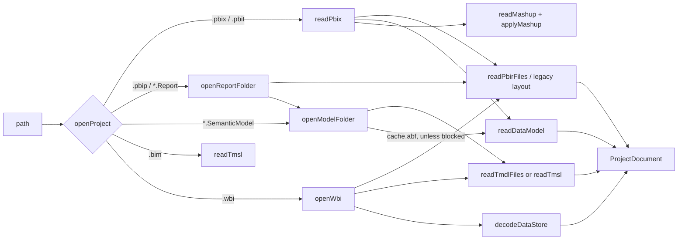

# File format input and output

> **Applies to:** Developers

This article explains how Lumen reads and writes Power BI files: the PBIX and PBIT containers, the embedded
DataModel and its compression layers, legacy report layouts, PBIP projects (PBIR report + TMDL or `model.bim`
semantic model) and Lumen's own `.wbi` bundle. Read it before you change anything under `src/core/io`,
`src/core/pbir` or `src/core/tmdl`.

For what a user can open and save, see [Files and compatibility](../files-and-compatibility/README.md) and the
[file format support reference](../reference/file-format-support.md). For the save path in detail, see
[Saving and round-trip](saving-and-round-trip.md).

## The one entry point: `openProject`

Every loader produces a `ProjectDocument` (`src/core/project.ts`): the semantic model, its data, the report and
the loader's diagnostics.

```ts
// src/core/project.ts
export interface ProjectDocument {
  id: string
  name: string
  source: ProjectSource
  model: SemanticModel
  data: DataStore
  /** absent when only a semantic model was opened */
  report?: ReportDocument
  /** loader diagnostics shown in a notification area */
  diagnostics: Array<{ level: 'info' | 'warning' | 'error'; message: string }>
  /** true when edited since last save */
  dirty: boolean
}
```

`openProject(path, fs, opts)` in `src/core/io/open.ts` decides what was opened and dispatches. It takes a
`FileSystem` (`src/core/io/fs.ts`), an async interface with `readFile`, `readText`, `writeFile`, `list`, `exists`,
`stat`, `mkdirp` and `remove`. In the app it is `window.wbi.fs` (see
[The host bridge and IPC](the-host-bridge-and-ipc.md)); in tests and scripts it is `nodeFs` from
`src/core/io/nodefs.ts`. All IO code is pure TypeScript, so the same loaders run in Node (vitest) and in the renderer
(and could run in a worker; none is used today).

| What is opened | `ProjectSource.kind` | Reader |
|---|---|---|
| `.pbix` | `pbix` | `readPbix` (`src/core/io/pbix/container.ts`) |
| `.pbit` (has `DataModelSchema`, no `DataModel`) | `pbit` | `readPbix` |
| `.pbip` file | `pbip` | `openPbipFile` > `openReportFolder` |
| `*.Report` folder, or a folder with `definition.pbir` | `pbir-folder` | `openReportFolder` |
| `*.SemanticModel` folder, or a folder with `definition.pbism` / `model.bim` | `semantic-model-folder` | `openModelFolder` |
| `.bim` file | `semantic-model-folder` | `readTmsl` (`src/core/tmdl/tmsl.ts`) |
| `.wbi` | `wbi` | `openWbi` > `readWbi` (`src/core/io/wbi.ts`) |
| A folder that contains one `.pbip`, one `*.Report` or one `*.SemanticModel` | as above | recursive dispatch |

`OpenOptions` carries an `onProgress(fraction, message)` callback (the busy overlay uses it) and `loadData`
(default `true`; `false` reads definitions only).



*Diagram in words:* `openProject` looks at the path. A PBIX or PBIT goes to `readPbix`, which reads the report
files, decodes the DataModel and reads the Power Query package. A PBIP file or report folder goes to
`openReportFolder`, which reads the PBIR files and follows `definition.pbir` to the semantic model folder. A
semantic model folder is read from TMDL or `model.bim`, plus the data cache when allowed. A `.wbi` bundle contains
a PBIP project and the data. Every path ends in one `ProjectDocument`.

## Working on file maps

The PBIR and PBIP code works on in-memory *file maps* (`FileMap = Record<string, Uint8Array>` for input,
`OutFileMap = Record<string, Uint8Array | string>` for output, both in `src/core/pbir/pbir.ts`), keyed by paths
relative to the `*.Report` or `*.SemanticModel` folder. That is why one reader serves four containers:

- a PBIP `*.Report` folder, read with `readTree(fs, dir, skip)`;
- the `Report/` entries of a PBIX file (PBIR-enabled files have `Report/definition/**`);
- the `project/<Name>.Report/` entries of a `.wbi` bundle;
- the legacy `Report/Layout` entry of an older PBIX, mapped to `report.json`.

Text is decoded with `decodeText` (`src/core/pbir/pbir.ts`), which handles UTF-8 with or without a BOM and
UTF-16LE with or without a BOM. PBIX layout and schema entries are UTF-16LE.

## PBIX and PBIT

A PBIX file is an OPC zip. `readPbix` unzips it with `fflate` and handles the entries this way:

| Entry | Handling |
|---|---|
| `Report/definition/**` | PBIR report, read by `readPbirFiles(files, 'pbix-pbir')` |
| `Report/Layout` | legacy layout, converted by `convertLegacyLayout` (origin `pbix-legacy`) |
| `Report/StaticResources/**` | report resources (images, themes) |
| `Report/LinguisticSchema` | skipped (Q&A linguistic schema, not part of the report definition) |
| `DataModelSchema` | TMSL JSON (PBIT), read by `readTmsl`; the model has no data until refreshed |
| `DataModel` | VertiPaq backup, decoded by `readDataModel` (next section) |
| `Connections` | live connection: the report gets a `byConnection` dataset reference and no local model |
| `DataMashup` | Power Query package, read by `readMashup` (`src/core/io/pbix/mashup.ts`) |
| `DiagramLayout`, `DAXQueries/**` | kept as semantic model sidecar files (`diagramLayout.json`, `DAXQueries/...`) |
| `Version` | returned as `PbixReadResult.version` |

Older PBIX files store `SELECT * FROM [Query]` partitions and keep the M code only in the DataMashup's
`Formulas/Section1.m`. `applyMashup` (`src/core/io/pbix/container.ts`) replaces those partitions with M
partitions and adds the remaining queries as shared expressions, the way Power BI Desktop upgrades them, and adds
an `info` diagnostic with the count.

## The DataModel and its compression layers

`readDataModel` (`src/core/io/pbix/datamodel/index.ts`) decodes the `DataModel` entry of a PBIX file and the
`.pbi/cache.abf` file of a PBIP semantic model. The pipeline has four layers:

1. **Container framing** (`container.ts`, `detectCompression`, `decompressDataModel`): the stream is either an
   uncompressed Analysis Services backup (ABF), a single-threaded XPress9 stream, or a multi-threaded XPress9
   stream made of independent sessions.
2. **XPress9** (`xpress9.ts`): LZ77 plus canonical Huffman, a TypeScript port of the decoding half of Microsoft's
   Xpress9 library. A session is decoded into one contiguous buffer.
3. **ABF backup** (`abf.ts`): a header, a virtual directory and a backup log that maps logical file names to
   storage. When the header sets `ApplyCompression` (older files and SSAS backups), each logical file is also
   XPress8-compressed (`xpress8.ts`).
4. **Model and columns**: `metadata.sqlitedb` (the persisted Tabular Object Model) is read with sql.js
   (`sqlite.ts`, `metadata.ts`) into a `SemanticModel`; each column's `.idf` / `.idfmeta` / `.dictionary` files are
   decoded by `vertipaq.ts` and turned into `Scalar[]` by `columns.ts`.

Column values follow the value contract in `src/core/model/data.ts`: BLANK is `null`; date-times are JS `Date`
objects whose UTC fields carry the wall-clock value. `columns.ts` converts OLE Automation dates and divides
fixed-decimal (currency) values by 10,000.

sql.js needs its WASM binary. Node finds it automatically; the renderer calls `setSqlJsFactory`
(`sqlite.ts`) once with a bundled `.wasm` URL (in `src/renderer/src/main.tsx`).

### What is reported, not thrown

`readDataModel` adds a diagnostic instead of failing the whole open when one column does not decode (the column is
filled with BLANK), when row counts disagree between columns, or when a DirectQuery table has no stored rows (its
status becomes `empty`). If every column of a table fails, the table status is `error`. If the whole decode fails,
`readPbix` keeps the report and an empty model and adds an `error` diagnostic.

### The cache guard

`openModelFolder` never decodes a PBIP `.pbi/cache.abf` when `globalThis.__LUMEN_BLOCK_CACHE_ABF__ === true`. The
vitest setup file (`tests/setup.ts`) sets it for every test run, and the app sets it when started with
`WBI_BLOCK_CACHE=1` (see `src/shared/cacheGuard.ts` and
[The host bridge and IPC](the-host-bridge-and-ipc.md#the-cache-guard)). The project then opens with an `info`
diagnostic and no data. PBIX DataModel decoding is not affected.

## Legacy report layouts

Reports saved before PBIR (a PBIX `Report/Layout` entry, or a PBIR-legacy `*.Report` folder with a single
`report.json`) are converted on load by `convertLegacyLayout` (`src/core/pbir/legacy.ts`). The module comment
lists the full mapping; the main points:

- `sections[]` become pages, ordered by `ordinal`;
- each visual container's `config` string becomes a `visual.json`: position from layout 0, `mobile.json` from
  layout 1, projections plus `prototypeQuery` become `visual.query.queryState`, `vcObjects` become
  `visualContainerObjects`;
- report, page and visual filters become `filterConfig.filters`;
- `config.bookmarks` become bookmark files; `config.modelExtensions` becomes `reportExtensions.json`.

Lossy spots (dropped settings, projections without a query select, unknown filter or resource types, any report
extension after the first) are reported as diagnostics. A legacy layout without a base theme renders with the
pre-2019 Classic palette (`legacyDefaultBaseTheme` in `src/core/report/themes/builtin.ts`).

## PBIR (report folders)

`readPbirFiles(files, origin)` (`src/core/pbir/pbir.ts`) builds a `ReportDocument` from this layout:

```
definition.pbir                          dataset reference (byPath / byConnection)
definition/version.json, report.json, reportExtensions.json
definition/pages/pages.json
definition/pages/<page>/page.json
definition/pages/<page>/visuals/<visual>/visual.json   (+ mobile.json)
definition/bookmarks/bookmarks.json, bookmarks/<name>.bookmark.json
StaticResources/SharedResources/BaseThemes/*.json, StaticResources/RegisteredResources/*
```

Pages follow `pages.json` `pageOrder`; pages missing from the order are appended by name. Visuals are sorted by
folder name (z-order lives in `position.z`). Every file under `StaticResources/` becomes a `ResourceFile`; every
other file the reader does not model goes to `extraFiles` and is written back unchanged. Themes are resolved from
the resources at read time (`resolveThemes`). See [The report document model](the-report-document-model.md).

`openReportFolder` skips the report's `.pbi/` folder (per-user state such as `localSettings.json`) and follows
`definition.pbir`:

- `byPath`: the semantic model folder is opened relative to the report folder;
- `byConnection`: a warning says the report is connected live and has no local model or data;
- neither: a warning says the report has no dataset reference.

## Semantic models: TMDL and `model.bim`

`readSemanticModelFiles` (`src/core/io/pbip.ts`) reads `definition/**/*.tmdl` with `readTmdlFiles`
(`src/core/tmdl/read.ts`) or, when there is no TMDL, `model.bim` with `readTmsl`. A model read from `model.bim` is
marked `extra['@pbipFormat'] = 'bim'` so it is saved in the same format. Every other file in the folder except
`.pbi/cache.abf` and per-user `.pbi/*` files (but including `.pbi/editorSettings.json`) is kept as text in
`model.sidecarFiles`: `diagramLayout.json`, `DAXQueries/**`, `.platform`, `definition.pbism` and Lumen's
`diagramLayout.lumen.json`.

TMDL parse errors become `error` diagnostics with the file and line (`TMDL <file>:<line>: <message>`).

The TMDL parser records *formatting hints* (`src/core/tmdl/hints.ts`): property order and the exact source lines of
each entry, kept in a `WeakMap` beside the model objects. The writer reuses the original lines for entries whose
canonical text has not changed, which is what makes untouched TMDL files save byte-identically.

## The `.wbi` bundle

A `.wbi` file is a deflated zip (`src/core/io/wbi.ts`):

```
manifest.json                         { format: 'wbi', version: 1, name, savedAt, generator: 'Lumen', source }
project/<Name>.pbip
project/<Name>.Report/**
project/<Name>.SemanticModel/**
data/tables.json                      [{ name, rowCount, status, columns: [{ name, type, encoding, file, dict? }] }]
data/<t>/<c>.bin                      one typed blob per column
```

The project part is exactly what a PBIP save writes (`pbipProjectFiles`). Each column picks an encoding from its
values: `i32`, `f64`, `date` (epoch milliseconds of the UTC wall clock), `bool`, `dict` (indices into a string
table stored in `tables.json`) or `json` (tagged values for mixed or binary columns). Nulls are a bitmap at the
start of each blob.

`readWbi` refuses a file without `manifest.json`, with another `format`, or with a `version` above
`WBI_FORMAT_VERSION` (currently `1`), so an older Lumen does not misread a newer bundle.

## Considerations and limitations

- **PBIX and PBIT are read-only.** The DataModel format is proprietary and has no writer here. Saving a PBIX or
  PBIT always goes through **Save as** to PBIP or `.wbi`.
- **Pre-2017 models** whose ABF has no `metadata.sqlitedb` (XML metadata) are not supported; the decode fails with
  "Unsupported data model".
- **Live-connected reports** open with an empty model; there is nothing to query locally.
- **DirectQuery tables** carry no rows in the file; they need a refresh from the source.
- **Large integers**: `int64` values beyond 2^53 lose precision (stated in `src/core/model/data.ts`).
- **The `.wbi` format** is Lumen's own. Power BI Desktop does not open it; save as PBIP to hand a project to Power
  BI.
- Third-party origins of the DataModel decoders (Microsoft's Xpress9 and Xpress libraries, pbixray, xmhuffman, all
  MIT) are listed in `src/core/io/pbix/datamodel/THIRD_PARTY.md` and the repository's `THIRD_PARTY_NOTICES.md`.

## Related content

- [Saving and round-trip](saving-and-round-trip.md)
- [The report document model](the-report-document-model.md)
- [Data layer](data-layer.md)
- [The host bridge and IPC](the-host-bridge-and-ipc.md)
- [File format support reference](../reference/file-format-support.md)
- [Architecture reference](../ARCHITECTURE.md)
