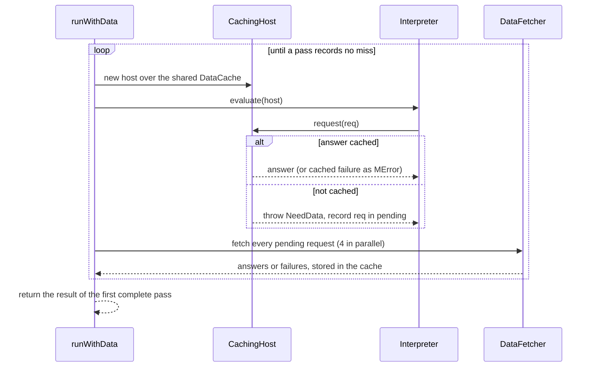

# M engine internals

> **Applies to:** Developers

This article explains how Lumen evaluates Power Query M: the lexer, parser and interpreter in `src/core/m`, lazy
values and tables, the host interface and the fetch-and-replay driver that connects a synchronous interpreter to
asynchronous data sources, query folding, and how to add a library function with tests.

## Overview

The M engine is pure TypeScript with no DOM or Node dependency. It was vendored from an earlier project (the code
comments call it "Parity") and extended in place; like the vendored DAX engine it uses relative imports with `.ts`
extensions and its own formatting style (double quotes, semicolons). Keep that style when you edit it.

| File | Role |
|---|---|
| `lexer.ts`, `parser.ts`, `ast.ts` | Tokens, the expression and section-document grammar, the syntax tree (`Expr`, `SectionDocument`) |
| `interpreter.ts` | `Interpreter` and `Env`: evaluates `Expr` nodes, function calls, `let`, `each`, `try`, `meta`, field and item access |
| `values.ts` | The value model: `MList`, `MRecord`, `MTable`, `MFunction`, `MType`, `MBinary`, date and time classes, `Lazy` |
| `engine.ts` | Public entry points: `createSession`, `evaluate`, `evaluateQuery`, `evaluateParameter`, `evaluateSection`, `preview`, `toJs` |
| `host.ts` | `MHost` and the `DataRequest` / `DataAnswers` types: every external read the engine can make |
| `driver.ts` | `runWithData`, `CachingHost`, `DataCache`, `NeedData`: the fetch-and-replay driver |
| `lib/*.ts` | The standard library (`createLibrary` in `lib/index.ts`) |
| `lib/fold.ts`, `lib/sqldialect.ts` | Query folding and SQL rendering per dialect |
| `editor.ts` | Applied-steps helpers for the Power Query Editor: `outlineQuery`, `insertStep`, `deleteStep`, `renderQuery`, `stepRef` |
| `convert.ts`, `culture.ts`, `calendar.ts` | Type conversion, culture-aware parsing and formatting, date arithmetic |

## Values and laziness

M is lazy: a `let` binding, a record field or a table row is computed only when something reads it. The engine
models this with `Lazy` (`src/core/m/values.ts`), a cell that holds a thunk until forced and then caches either a
value or an error. A `Cell` is an `MValue` or a `Lazy`.

- `Lazy.of(value)` wraps a value that is already known; `Lazy.failed(error)` holds an error, which is how one bad
  cell becomes an error cell instead of failing a whole step.
- `MTable` takes either a row array or a thunk that produces it (`rows: Cell[][] | (() => Cell[][])`). A
  navigation read such as `Source{[Schema="dbo",Item="Sales"]}[Data]` is a table whose rows have not been read
  yet. It carries `fold` information so later steps can be pushed to the source (see [Query folding](#query-folding)).
- `MError` (`src/core/m/errors.ts`) is a Power Query error value with `reason`, `message` and optional `detail`,
  printed as `Reason: Message`. `MSyntaxError` adds a source position.

`evaluateQuery(source, options)` in `engine.ts` treats a top-level `let` as Applied Steps: each binding becomes a
`StepResult` with a preview, and a step that is never used by the result never fails the query. The Power Query
Editor's step list comes from this, and `outlineQuery` in `editor.ts` gives the step names and formulas without
evaluating.

## The library

`createLibrary(ctx)` in `src/core/m/lib/index.ts` builds the global environment by calling one installer per
module:

```ts
// src/core/m/lib/index.ts
const lib = new Library(ctx);
installCore(lib);
installText(lib);
installDateTime(lib);
installTable(lib);
installSources(lib);
installConnectors(lib);
installExtra(lib);
```

followed by `installEvaluate` and `installFolding`. Later installers can replace an earlier definition of the same
name (entries are a `Map`).

Functions are defined with `Library.def(name, signature, impl)` in `src/core/m/lib/util.ts`. The signature is a
comma-separated parameter list; a `?` prefix makes a parameter optional. The wrapper pads missing optional
arguments with `null`, and the interpreter checks the argument count against the declared parameters:

```ts
// src/core/m/lib/util.ts
/** `sig` is a comma-separated parameter list; prefix optional ones with `?`. */
def(name: string, sig: string, impl: Impl): void {
```

`util.ts` also holds the argument helpers that raise Power Query's conversion errors: `text`, `textOrNull`,
`num`, `numOr`, `bool`, `list`, `record`, `table`, `fn`, `type`, `cultureArg`, `flag` (read an option from an
options record) and `cell(f)`, which turns an `MError` or a data miss into an error cell.

`KNOWN_UNSUPPORTED` in `lib/index.ts` lists real Power Query function names. Any of them that no installer
defines is registered as "unsupported": referring to it raises
`Expression.Error: <name> is a real Power Query function, but it is not supported in Lumen yet.` instead of an
unknown-identifier error. Names that are defined are skipped, so the list can contain functions that have since
been implemented.

The M editor's completion list (`src/renderer/src/editors/m-lang/completion.ts`) reads the library from
`createSession()` directly, so a new function appears in completion without a separate catalogue.

## Host and requests

The interpreter is synchronous, but files, SQL, HTTP and decoding are asynchronous. All external access goes through
one synchronous method:

```ts
// src/core/m/host.ts
export interface MHost {
  request<K extends DataRequest["kind"]>(req: Extract<DataRequest, { kind: K }>): DataAnswers[K];
  now(): Date;
  localOffsetMinutes?: number;
  foldComputed?: boolean;
  folding?: boolean;
}
```

`DataRequest` is a union of plain, structured-cloneable request objects: `file`, `folder`, `sql`, `sql-items`,
`sql-databases`, `db`, `db-items`, `db-databases` (PostgreSQL, MySQL, SQLite, DuckDB), `firestore-collections`,
`firestore-query`, `s3-list`, `s3-object`, `http`, `decode` (xlsx and Parquet) and two in-process-only kinds.
`DataAnswers` maps each kind to its answer type. Because requests are plain data, a stable cache key can be derived
from them (`requestKey` in `driver.ts`) and they can cross IPC unchanged.

Values that cross this boundary use the normalised shape documented at the top of `host.ts`: `null`, booleans,
numbers, strings, `Date` with the wall clock in its UTC fields, typed text for dates and times, `Uint8Array` for
binaries.

## The fetch-and-replay driver

`runWithData(evaluate, fetch, options)` in `src/core/m/driver.ts` runs a synchronous evaluation against
asynchronous sources:



In words: each pass creates a `CachingHost` over a shared `DataCache` and evaluates from scratch. A cache hit returns
the answer (or rethrows a cached failure as an `MError`). A miss records the request and throws `NeedData`. Library
code that evaluates per cell may swallow that exception into an error cell, so the driver does not rely on it
propagating: any pass that recorded a miss is discarded. The driver then fetches all recorded requests, caches
answers or failures, and evaluates again. The clock is frozen for the whole run, so passes are deterministic.

| `DriverOptions` field | Default | Meaning |
|---|---|---|
| `cache` | new `DataCache` | Shared across runs: the Power Query Editor keeps one per session, refresh one per run |
| `now` | now | Frozen clock |
| `maxPasses` | `512` | Paged APIs fetch one page per pass; beyond this a `DriverError` asks to simplify the query |
| `concurrency` | `4` | Parallel fetches per pass |
| `signal` | none | Aborts between passes and rejects a pending fetch at once (`abortable`) |
| `onFetch`, `onRequest` | none | Progress ("Waiting for ...") and the list of sources a query read |
| `foldComputed` | `true` | `false` keeps filters whose values come from another source local (privacy levels) |

`DataCache.clearErrors()` forgets failures only, which is what a retry after entering credentials needs.
`staticHost(answers)` gives a synchronous host over a fixed answer function for tests and pure previews.

The `DataFetcher` used by the app is `createFetcher(host)` in `src/core/data/fetcher.ts`; it maps each request
kind to the filesystem or to a connector over IPC. See [data-layer.md](data-layer.md) and
[connectors.md](connectors.md).

## Query folding

`src/core/m/lib/fold.ts` pushes steps applied directly to a foldable source read to the source:

- `Table.SelectColumns`, `Table.RemoveColumns` become a column list.
- `Table.SelectRows` with a simple `each` predicate becomes a filter: comparisons with constants, `and` / `or` /
  `not`, `= null`, `List.Contains({...}, [c])`, `Text.StartsWith` / `EndsWith` / `Contains` with a constant.
- `Table.Sort` becomes `ORDER BY` (earlier keys become tie-breakers, as M's sort is stable).
- `Table.Skip(n)` and `Table.FirstN(n)` become `OFFSET` and `TOP` / `LIMIT`.
- `Table.NestedJoin` of two reads of the same server and database, followed by `Table.ExpandTableColumn`, becomes
  one `SELECT ... JOIN ... ON ...`.

`installFolding` implements this by wrapping the already installed table functions: the wrapper tries a folding
fast path when the host supports folding and the input table carries `fold` information, and otherwise calls the
original implementation. A source can declare what it cannot fold through `fold.caps` (`FoldSource` in
`values.ts`). Anything after a step that does not fold runs locally. The predicate is kept as a structured `FoldPred`, and each
source renders it: SQL sources through the dialects in `src/core/m/lib/sqldialect.ts` (`tsql`, `postgresql`,
`mysql`, `sqlite`, `duckdb`), Firestore as a structured query. The M side renders the whole SQL statement, so a
connector only executes text and tests can assert exactly what was sent.

Folded text comparisons follow the server's collation, as in Power BI. A host that does not set `folding: true`
receives unfolded reads.

## Using the engine from code

```ts
import { evaluate, evaluateQuery, toJs } from '@core/m/engine.ts'

toJs(evaluate('Text.Upper("ab") & Text.Lower("CD")'))  // "ABcd"

const q = evaluateQuery('let a = 1, b = a + 1 in b')
q.steps.map((s) => s.name)                              // ["a", "b"]
```

`evaluate` returns the raw `MValue` and throws `MError`; `evaluateQuery` never throws and returns step previews and a
`QueryResult`. Pass `{ host, queries, parameters }` to give the query a host, other queries by name (the model's
shared expressions and partitions) and parameter values. To read external data, wrap the evaluation in
`runWithData`, as `src/core/data/refresh.ts` and `src/core/data/preview.ts` do.

## Add a library function

These steps were checked by adding a throwaway function and running its test.

### Prerequisites

- A working checkout ([development-environment.md](development-environment.md)).
- The function's documented behaviour on Microsoft Learn: null handling, optional parameters, culture, errors.

### Steps

1. **Pick the module** by category: `lib/text.ts`, `lib/datetime.ts`, `lib/table.ts`, `lib/core.ts` (lists,
   records, numbers, logical), `lib/sources.ts` (files, web, SQL Server), `lib/connectors.ts` (other databases,
   Firestore, S3, lakehouse folders), `lib/extra.ts` (the rest).
2. **Define it** inside the module's `install*` function with `lib.def`, or with the module's helper. In
   `lib/text.ts`, `nullSafe` returns `null` for a `null` first argument, as most `Text.*` functions do:

   ```ts
   // src/core/m/lib/text.ts, inside installText
   nullSafe("Text.Upper", "text, ?culture", (s) => s.toUpperCase());
   nullSafe("Text.Length", "text", (s) => s.length);
   ```

   A function with no helper is a plain `def`; this one is in `lib/extra.ts`:

   ```ts
   lib.def("Text.Reverse", "text", ([t]) => (t === null ? null : [...text(t!)].reverse().join("")));
   ```

   Convert arguments with the `util.ts` helpers so wrong types raise the same `Expression.Error` as Power Query.
   Throw `MError(reason, message, detail)` for errors.
3. **External data.** A function that reads outside data must call `ctx.host.request(...)` with a `DataRequest`.
   If you need a new request kind, add it to `DataRequest` and `DataAnswers` in `host.ts`, describe it in
   `describeRequest` (`driver.ts`), answer it in `createFetcher` (`src/core/data/fetcher.ts`), and add the source
   function to `SOURCE_FUNCS` in `src/core/data/queries.ts` so Data source settings and privacy levels see it. See
   [connectors.md](connectors.md).
4. **Remove it from `KNOWN_UNSUPPORTED`** in `lib/index.ts` if it was listed (optional: defined names are skipped,
   but the list documents what is missing).
5. **Tests.** Add cases to the matching file in `src/core/m/__tests__/` (`stdlib.test.ts` for library functions,
   `driver.test.ts` for anything that reads data). Use invented data only. The pattern:

   ```ts
   // src/core/m/__tests__/stdlib.test.ts
   const js = (src: string) => toJs(evaluate(src));
   ...
   expect(js('Text.Upper("ab") & Text.Lower("CD") & Text.Proper("hELLO wORLD")')).toBe("ABcdHello World");
   ```

   Test `null` input, wrong argument types (`expect(() => js(...)).toThrow(MError)`), optional parameters and
   culture where relevant. For data-reading functions, `driver.test.ts` defines a `world(files, sql)` fake fetcher
   that records every request, so you can assert both the result and what was fetched.
6. **Run the tests and the type check.**

   ```bash
   npx vitest run src/core/m
   npm run typecheck
   ```

7. **Regenerate the reference table** described in [M function support](../reference/m-function-support.md).

## Considerations and limitations

- **Re-evaluation per pass.** Every driver pass evaluates the query from the start, and `createSession` builds the
  library each time. Queries that fetch per row (a web call inside `Table.AddColumn`) need several passes; more than
  512 stops with a `DriverError` that suggests `Table.Buffer`.
- **Errors in cells.** A data miss inside a per-cell function becomes an error cell during the discarded passes;
  only the final pass is visible. If you catch exceptions in library code, use `cell()` so `NeedData` is handled
  the same way.
- **Unsupported functions.** Functions listed in `KNOWN_UNSUPPORTED` and not implemented raise an
  `Expression.Error` at evaluation time; some sources (for example `Web.Page`, `Odbc.DataSource`,
  `AzureStorage.Blobs`) are defined only to raise a message that suggests an alternative.
- **Integer precision.** Values beyond 2^53 lose precision when they become JavaScript numbers (Parquet INT64 is
  documented as an accepted gap in `src/core/data/parquet.ts`).
- **Collation.** Folded text comparisons follow the server's collation and can differ from M's case-sensitive
  comparison when the same step runs locally.

## Related content

- [Data layer](data-layer.md)
- [Connectors](connectors.md)
- [The host bridge and IPC](the-host-bridge-and-ipc.md)
- [Testing](testing.md)
- [M function support](../reference/m-function-support.md)
- [Connect and transform data](../connect-and-transform/README.md)
