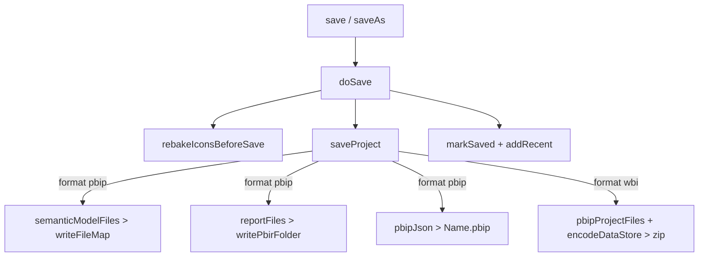

# Saving and round-trip

> **Applies to:** Developers

This article describes what Lumen writes when a project is saved, which files are left byte-for-byte untouched,
which Lumen-only data it adds to Power BI files, and what is known about schema validity. Read it before you change
`saveProject`, a serializer, or anything that writes a new property into PBIR or TMDL.

## From the Save command to the disk

The renderer's **Save** and **Save as** commands live in `src/renderer/src/app/commands.ts`:

1. `save()` picks a default format from `project.source.kind`: `wbi` for a bundle; `pbip` for a PBIP project, a
   report folder or a semantic model folder. Anything else (`pbix`, `pbit`, `new`) has no save target, so `save()`
   falls through to `saveAs()`.
2. `saveAs(preferred?)` shows the native save dialog with two filters, **Power BI project files (\*.pbip)** and
   **Lumen bundle with data (\*.wbi)**. The extension the user picks decides the format.
3. `doSave()` re-bakes theme-coloured icons (`rebakeIconsBeforeSave`, see [ICONS.md](../ICONS.md)), calls
   `saveProject(project, target, host().fs, { format })`, then `useApp.getState().markSaved(...)`, adds the file to
   the recent list and shows a toast. An exception becomes a **Couldn't save** dialog.

`saveProject` (`src/core/io/open.ts`) is pure TypeScript and takes the same `FileSystem` as the loaders, so tests
call it with `nodeFs`.

*Diagram in words:* the Save commands end in `doSave`, which re-bakes icons and calls `saveProject`. For PBIP,
`saveProject` writes the semantic model folder, the report folder and the `.pbip` file. For `.wbi`, it builds the
same PBIP file map plus the encoded data and writes one zip. Then the store is marked saved.

## What a PBIP save writes

Given `<dir>/<Name>.pbip` (or a directory, in which case the project name is used), `saveProject` writes:

| Path | Content | Writer |
|---|---|---|
| `<Name>.SemanticModel/definition/**.tmdl` | the model as TMDL (default) | `writeTmdlFiles` (`src/core/tmdl/write.ts`) |
| `<Name>.SemanticModel/model.bim` | the model as TMSL, when it was read from `model.bim` | `writeTmsl` (`src/core/tmdl/tmsl.ts`) |
| `<Name>.SemanticModel/<sidecar>` | every file in `model.sidecarFiles` (`diagramLayout.json`, `DAXQueries/**`, `.pbi/editorSettings.json`, `diagramLayout.lumen.json`) | `semanticModelFiles` (`src/core/io/pbip.ts`) |
| `<Name>.SemanticModel/.platform`, `definition.pbism` | kept when present, created otherwise; `definition.pbism` `version` raised to `4.2` when TMDL needs at least `4.0` | `semanticModelFiles` |
| `<Name>.Report/definition.pbir` | dataset reference rewritten to `{ byPath: { path: '../<Name>.SemanticModel' } }`; `version` raised to `4.0` when lower | `reportFiles` |
| `<Name>.Report/definition/**` | `version.json`, `report.json`, `pages/pages.json`, every `page.json`, `visual.json`, `mobile.json`, bookmarks, `reportExtensions.json` | `pbirToFiles` (`src/core/pbir/pbir.ts`) |
| `<Name>.Report/StaticResources/**` | every report resource, bytes unchanged | `pbirToFiles` |
| `<Name>.Report/<other>` | every file in `report.extraFiles`, unchanged | `pbirToFiles` |
| `<Name>.pbip` | the existing file kept, with `artifacts` set to the report folder; created otherwise | `pbipJson` |

A report connected live (`byConnection`, no tables) writes no semantic model folder and keeps its connection.

### Deletions

PBIP saves are differential. After writing, the savers delete:

- report files under `definition/` and `StaticResources/` that are no longer produced (removed pages, visuals,
  bookmarks and resources; whole page and visual folders go at once), and a PBIR-legacy `report.json`, because the
  definition is now written in PBIR (`writePbirFolder`);
- `definition/**.tmdl` files of deleted tables, roles or cultures, a superseded `model.bim` when saving as TMDL, and
  `diagramLayout.lumen.json` when the diagram has nothing custom left (`saveProject`).

Files that Lumen does not own are never deleted: the report's `.pbi/` folder, a PBIP `.pbi/cache.abf`, and
anything outside those lists stay where they are.

### Data is never written into PBIP

A PBIP save writes definitions only. Imported data is not written (Lumen does not produce a `.pbi/cache.abf`).
Reopening a saved PBIP gives a model without data: the user refreshes it, or Lumen generates sample data. To keep
the data, save a `.wbi` bundle (see [File format input and output](file-format-io.md#the-wbi-bundle)).

## What is preserved byte-for-byte

Three mechanisms keep diffs minimal, so a PBIP project under git shows only the files a user changed:

1. **Unchanged files are not rewritten.** `writeFileMap` (`src/core/pbir/pbir.ts`) compares each output with the
   file on disk. Equal bytes are skipped; for `.json`, `.pbir`, `.pbism`, `.pbip` and `.platform` files, equal
   *parsed JSON* is also skipped, so a file whose only difference would be whitespace or key formatting keeps its
   original bytes.
2. **TMDL formatting hints.** The TMDL reader records the exact source lines of each entry
   (`src/core/tmdl/hints.ts`); the writer reuses them for entries whose canonical text has not changed. The store's
   `mutateModel` uses immer structural sharing so untouched model objects keep their identity, and with it their
   hints (see [State and store](state-and-store.md)).
3. **Unmodelled content is carried verbatim.** PBIR JSON is held as-is in the `ReportDocument` (no parallel model),
   unknown report files sit in `extraFiles`, resources keep their bytes, and unknown semantic model files travel in
   `sidecarFiles`.

A check run for this article: the built-in sample was saved as PBIP, reopened, and saved again in place without
edits. None of the 61 files changed.

> [!NOTE]
> Sidecar files are held as decoded text and written back as UTF-8. A non-JSON sidecar stored in another encoding
> (for example UTF-16) would be rewritten in UTF-8 on save, even without edits. JSON sidecars are protected by the
> parsed-JSON comparison above.

## Lumen-only data in saved files

Lumen adds data of its own only where Power BI's formats leave room for it, and only when a user used the feature:

| Data | Where | Written when |
|---|---|---|
| Layout guides (page margin, gutter) | `report.json` `objects.lumenLayout` (`src/renderer/src/report/layoutGuides.ts`) | guides are not the default; removed again when reset |
| Slicer options (dropdown summary, counts, sort, date presets) | `visual.json` `objects.lumenSlicer` (`src/renderer/src/visuals/slicers/index.ts`) | a Lumen option is set in the Format pane |
| Built-in icon reference | visual `annotations` entry named `Lumen_Icon` (JSON string) and image resources named `LumenIcon_*.svg` (`src/core/icons/bake.ts`) | an icon from Lumen's icon sets is used |
| Model diagram customisations | `diagramLayout.lumen.json` beside `diagramLayout.json` (`src/core/io/diagramSidecar.ts`) | lines, groups or styles were customised; removed when nothing custom is left |
| Sample-table marker | table annotation `Lumen_Sample = true` | tables of the built-in sample project only |
| Classic base theme | `report.json` `themeCollection.baseTheme = { name: 'Classic', type: 'SharedResources' }` plus `StaticResources/SharedResources/BaseThemes/Classic.json` | a legacy layout without a base theme is saved as PBIR |

Unknown report objects and visual annotations are designed to be ignored by Power BI Desktop. That Power BI Desktop
opens these files and ignores the additions is **not verified**: the project has not tested a Lumen-saved report in
Power BI Desktop. See [ICONS.md](../ICONS.md) for the icon format and
[ARCHITECTURE.md](../ARCHITECTURE.md#model-diagram-sidecar-diagramlayoutlumenjson) for the diagram sidecar.

## Schema validation status

Every PBIR and PBIP JSON file Lumen writes carries a `$schema` URL from `src/core/pbir/schemas.ts`. The repository
does not contain the schema files themselves and does not validate during save or in the unit tests.

For this article, the built-in sample (`createSampleProject()` in `src/core/data/sample.ts`) was saved as PBIP with
`saveProject` and every JSON file was validated with Ajv against the schema its `$schema` names, downloaded from
`developer.microsoft.com/json-schemas/fabric`. Result:

| File | Result |
|---|---|
| `Sample - Sales.pbip` | valid |
| `.platform` (report and semantic model), `definition.pbir`, `definition.pbism` | valid |
| `definition/version.json`, `pages/pages.json`, 3 `page.json` | valid |
| 40 `visual.json` | valid |
| `definition/report.json` | **invalid**: `/themeCollection/baseTheme must have required property 'reportVersionAtImport'` |

The cause is the base theme reference `{ "name": "CY24SU10", "type": "SharedResources" }`, written without
`reportVersionAtImport`. The same reference is produced for a new blank report (`emptyReport()` in
`src/core/report/types.ts`, validated separately with the same result), and the Classic base theme written for
legacy layouts has the same shape. A custom theme applied from **View > Themes** does get
`reportVersionAtImport` (`setReportTheme` in `src/renderer/src/app/themes/index.ts`).

Two related observations from the same check:

- The base theme's JSON file is not written into `StaticResources/SharedResources/BaseThemes/`, and `report.json`
  gets no `resourcePackages` entry for it. Lumen itself resolves `CY24SU10` from its bundled copy, but reopening the
  saved sample adds the warning *Theme 'CY24SU10' not found in the report resources* to the project diagnostics.
- TMDL has no JSON schema; the TMDL files were not validated against Power BI's parser.

Whether Power BI Desktop opens these files despite the schema error is not verified.

## The `.wbi` save

`saveProject(..., { format: 'wbi' })` calls `pbipProjectFiles(name, model, report)` (the same file map a PBIP save
produces, but in memory) and `writeWbi(name, files, data, { kind })`, which adds `manifest.json` and the encoded
`DataStore`, and zips everything. A `.wbi` save always writes the whole file; there is no differential update.

## Testing a change to the save path

- `src/core/io/__tests__/io.test.ts` covers fresh PBIP save and reopen, `.wbi` save and reopen with data, and
  `model.bim` models.
- `src/core/io/__tests__/samples.test.ts` opens, saves and reopens Microsoft's sample PBIX files when
  `LUMEN_SAMPLES_DIR` is set, and checks that the Classic palette of a legacy layout without a base theme survives
  a PBIP round trip (one case uses a repository fixture and runs without the variable).
- `e2e/saveexport.e2e.ts` drives **File > Save as** to PBIP and to `.wbi` in the real app and reopens the result.
- `src/core/io/__tests__/corpus.test.ts` and `src/core/tmdl/__tests__/corpus.test.ts` round-trip a private corpus
  when `LUMEN_CORPUS_DIR` is set; their assertions are generic.

When you add a property Lumen writes, add a test that an untouched project still saves byte-identically. See
[Testing](testing.md).

## Considerations and limitations

- **PBIX and PBIT cannot be written.** Their **Save** opens **Save as** for PBIP or `.wbi`.
- **The report and model folder names follow the project name.** A PBIP save always writes `<Name>.Report` and
  `<Name>.SemanticModel` next to `<Name>.pbip` and points `definition.pbir` at `../<Name>.SemanticModel`. A project
  whose report references a model folder with another name (for example, several reports sharing one model) gets a
  new `<Name>.SemanticModel` folder on save, and its reference is rewritten to it.
- **A model opened from a `.bim` file** is saved by `save()` as `<folder>/model.bim.pbip` (the file name is not
  stripped of `.bim` in `saveTarget`), which creates a new `model.bim.SemanticModel` folder rather than updating the
  `.bim` file. This is read from the code; use **Save as** to choose the target.
- **Schema validity** of `report.json` fails on the base theme reference, as described above.
- **Power BI Desktop compatibility** of saved files is designed for but not verified.

## Related content

- [File format input and output](file-format-io.md)
- [The report document model](the-report-document-model.md)
- [State and store](state-and-store.md)
- [Themes and text classes](themes-and-text-classes.md)
- [File format support reference](../reference/file-format-support.md)
- [Files and compatibility](../files-and-compatibility/README.md)
