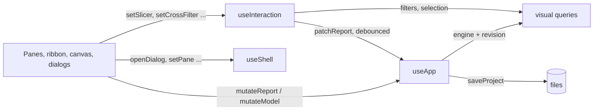

# State and store

> **Applies to:** Developers

This article explains where the renderer keeps its state, how an edit to the report or the model is made so that
it can be undone, saved and re-queried, and how dialogs are opened. Read it before you add a command, a pane
control or a dialog that changes the open project.

## Three stores

The renderer uses [zustand](https://github.com/pmndrs/zustand) stores. Each has one job:

| Store | File | Holds | Persisted |
|---|---|---|---|
| `useApp` | `src/renderer/src/state/store.ts` | the document: open `ProjectDocument`, the `QueryEngine` built from it, resolved theme, active view and page, edit selection, undo and redo stacks, canvas zoom | in the project files, on save |
| `useInteraction` | `src/renderer/src/state/interaction.ts` | runtime report interaction: slicer selections, cross-filter, drill state, drill-through and the Back stack, focus mode, spotlight, tooltip, context menu, applied bookmark | partly (see below) |
| `useShell` | `src/renderer/src/app/shellState.ts` | UI-only shell state: backstage page, ribbon tab, pane layout, the open dialog, data notices, user options, Performance analyzer log | user options and pane layout in `localStorage` (`lumen.options`, `lumen.panes`) |

A few feature modules keep small stores of their own (for example `useModelingDialogs` in
`src/renderer/src/dialogs/modeling/host.tsx`, and the Model view's per-user diagram preferences in
`src/renderer/src/views/model/diagramPrefs.ts`). The rule is the same: document state goes in `useApp`, never in a
feature store.



*Diagram in words:* user interface code edits the document through `useApp`, runtime interaction through
`useInteraction`, and shell layout through `useShell`. Interaction state that Power BI persists in the report
(slicer selections) is copied into the document through `useApp.patchReport`. Visual queries read the engine and
`revision` from `useApp` and the filters and selection from `useInteraction`.

## The document store: rules

The module comment of `store.ts` states the rules:

- Mutate the report only through `mutateReport` and the model only through `mutateModel`. Both are undoable and
  keep `dirty` and the engine in sync.
- Runtime interaction state lives in `interaction.ts`, not in the document store.
- Extend the store by adding documented fields and actions.

A typical edit, from `src/renderer/src/report/PageTabs.tsx`, where `mutate` is `useApp`'s `mutateReport`:

```ts
mutate('Rename page', (r) => renamePage(r, p.name, v))
```

The first argument is the undo label. The mutator receives a draft of the `ReportDocument` and changes it in place.
Pure helpers such as `renamePage`, `addVisual` and `groupVisuals` (`src/renderer/src/report/editOps.ts`) take a
`ReportDocument` or `PageDocument` and mutate it, so they work on a draft and in unit tests alike.

## How `mutateReport` works

```ts
// src/renderer/src/state/store.ts
const immer = new Immer({ autoFreeze: false })
```

1. The current `report` and `model` are captured as an undo snapshot, by reference.
2. `immer.produce` runs the mutator on a draft. If nothing changed, the call returns and nothing is recorded.
3. Structural sharing keeps the identity of every untouched page and visual object, so the canvas re-renders and
   re-queries only what changed. `autoFreeze` is off because loaders and engines annotate some objects in place;
   `produce` never mutates the previous report, so snapshots stay valid.
4. If the edit replaced `report.theme`, the theme is re-resolved and every registered *theme follower* runs on the
   produced report in the same undo step (`onReportThemeChange`; Lumen icons drawn in theme colours use it to
   re-bake).
5. The snapshot is pushed (the stack keeps the last 100), the redo stack is cleared, `dirty` is set and `revision`
   is incremented.

**Coalescing.** `mutateReport(label, fn, { coalesce: key })` merges consecutive edits with the same key that happen
less than one second apart (`COALESCE_MS`) into one undo step. Keyboard nudges and repeated resizes use it, so one
**Undo** restores the state before the whole burst.

## Drafts, deep copies and failed edits

Inside `mutateReport`, `mutateModel`, `patchReport` and `mutateModelSidecars`, every object the mutator reads from
the document is an immer draft (a Proxy), including objects reached through a spread such as `{ ...draft }`.

- **Deep copies.** `structuredClone` throws `DataCloneError` on a draft. Use `cloneDeep` from `src/core/clone.ts`
  (`import { cloneDeep } from '@core/clone'`), which unwraps drafts at any depth. `src/core/clone.test.ts` fails if
  `structuredClone(` or `JSON.parse(JSON.stringify(` appears anywhere under `src/`.
- **Failed edits.** A mutator that throws changes nothing: no undo step is recorded and the document stays as it was.
  The store reports the failure once with `reportMutationError` (`src/renderer/src/state/store.ts`): an error toast
  titled *Couldn't complete "<label>"* with "Nothing was changed." and the error message, plus a console entry.
  Callers do not catch; they continue as after an edit that changed nothing (menus close, for example).
- **Audit.** `src/renderer/src/report/__tests__/draftAudit.test.ts` runs every exported edit operation of the
  edit-op modules on a draft, and fails on a new export until it is exercised or classified.

The contract is in [ARCHITECTURE.md](../ARCHITECTURE.md).

## How `mutateModel` works

`mutateModel(label, mutator)` also uses `immer.produce`, for a second reason: the TMDL writer remembers each
object's source formatting by identity (a `WeakMap`, `src/core/tmdl/hints.ts`), so untouched tables and measures
must stay the same objects to save byte-identically (see [Saving and round-trip](saving-and-round-trip.md)).

After the mutator runs:

- `withReconciledSidecars(prev, next)` (`src/core/io/diagramSidecar.ts`) renames or drops references to renamed
  and deleted tables and relationships in Lumen's diagram sidecar, in the same undo step;
- the engine is rebuilt: `createEngine(model, data)`, then `engine.processCalculated()` for calculated tables and
  columns, then the active **View as** roles are re-applied;
- an engine build error is stored in `engineError` rather than thrown.

## Other mutators

| Action | Undoable | Rebuilds engine | Use for |
|---|---|---|---|
| `mutateReport(label, fn, opts?)` | yes | no | every report edit |
| `mutateModel(label, fn)` | yes | yes | every semantic model edit |
| `mutateModelSidecars(label, fn)` | yes | no | Model view layout edits (`diagramLayout.json`, `diagramLayout.lumen.json`); several files in one step |
| `patchModelSidecar(path, content)` | no | no | a non-semantic sidecar write; `null` removes the file |
| `patchReport(fn)` | no | no | runtime state Power BI persists in the document (slicer selections, bookmark application, icon re-bakes) |
| `dataChanged()` | no | yes | data was refreshed or imported |
| `setViewAsRoles(roles)` | no | no (re-applies to the engine) | **Modeling > View as** |
| `markSaved(source?, name?)` | no | no | after a successful save |

`undo()` and `redo()` swap the `report` and `model` references with the snapshot. They rebuild the engine only when
the two models differ in more than `sidecarFiles` (`sameModelSemantics`), so undoing a layout-only step is cheap.
The renderer's **Undo** command (`undo()` in `src/renderer/src/app/commands.ts`) first checks whether a text input
or code editor has focus and, if so, lets the browser undo the typing instead.

## `revision` and query caching

`revision` increases on every change that can affect query results. Components memoise their queries on it. The
canvas also wraps the engine in an LRU query cache (`src/renderer/src/report/cachedEngine.ts`); because the store
creates a new engine on data and model changes, the cache is dropped with it.

## Interaction state and persistence

`useInteraction` answers immediately, so the UI responds while persistence is batched. Slicer selections are the
main example: `setSlicerFilter` in `src/renderer/src/report/runtime.ts` sets a *pending* selection, then after a
debounce writes the filter into the slicer's `visual.json` with `useApp.getState().patchReport(...)`, including the
slicers synchronised with it. Because `patchReport` is not undoable, selecting slicer items does not fill the undo
stack, but it does mark the project dirty (Power BI Desktop also saves slicer state).

Cross-filter selection, drill state, focus mode, tooltips and the context menu are not persisted. `reset()` clears
the store when a project is opened.

## How dialogs open

There are four mechanisms. Use the one that matches the dialog's owner:

1. **Shell dialogs** (`useShell().openDialog(id)`): the `DialogId` union in `shellState.ts` lists them (`getData`,
   `enterData`, `customizeTheme`, `options`, `about`, `refresh`, `unsaved`, `pageSettings`, `dataSources`).
   `DialogsHost` (`src/renderer/src/dialogs/DialogsHost.tsx`) renders the one selected; `openDialog(null)` closes
   it. To add one, extend `DialogId` and add a `case` to `DialogsHost`.
2. **Modeling dialogs** (`showModelingDialog(close => <X onClose={close} />)` in
   `src/renderer/src/dialogs/modeling/host.tsx`): a stack of imperatively opened dialogs. It mounts its own host on
   first use if the shell has not mounted one, so modeling commands work from any view.
3. **Prompts** (`confirmDialog({ title, message, buttons })` in `src/renderer/src/app/ui/Modal.tsx`, which resolves
   to the index of the button pressed, and `alertDialog`). The unsaved-changes prompt (`confirmDiscard` in
   `commands.ts`) uses `confirmDialog`.
4. **Backstage pages** (`useShell().openBackstage(page)`): the **File** menu pages (`home`, `new`, `open`, `save`,
   `saveAs`, `export`, `options`, `about`).

Native file dialogs go through the host bridge (`window.wbi.dialog`); see
[The host bridge and IPC](the-host-bridge-and-ipc.md).

## Observing state in tests

Unit tests import the stores directly and call their actions. End-to-end journeys run the app with the route
option `e2e=1`; `src/renderer/src/app/e2eHooks.ts` then exposes `useApp`, `useShell` and `useInteraction` on
`window.__lumen` so a journey can wait on precise state (for example the undo stack depth) instead of sleeping. The
hooks are never installed in normal runs. See [End-to-end tests](end-to-end-tests.md).

## Considerations and limitations

- Undo history is limited to the last 100 steps and is cleared when a project is opened.
- Undo snapshots hold the whole `report` and `model` by reference; memory stays low only because of structural
  sharing. A mutator that replaces large subtrees wholesale (instead of editing them) defeats the sharing and makes
  every untouched object look edited to the TMDL writer.
- `patchReport` and `patchModelSidecar` edits are not undoable by design. Do not use them for user edits.
- `mutateModel` rebuilds the whole engine. Batch related model edits in one mutator so the rebuild happens once.

## Related content

- [Architecture overview](architecture-overview.md)
- [The report document model](the-report-document-model.md)
- [Saving and round-trip](saving-and-round-trip.md)
- [Format pane internals](format-pane-internals.md)
- [End-to-end tests](end-to-end-tests.md)
- [Architecture reference](../ARCHITECTURE.md)
