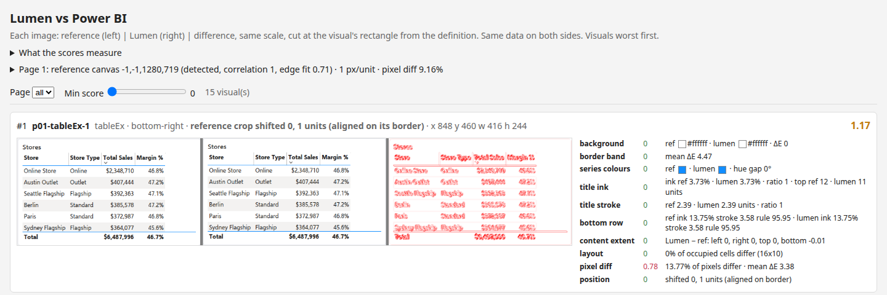

# The compare tool

> **Applies to:** Developers

`scripts/compare.sh` puts a Power BI reference image of a report page next to Lumen's render of the same page,
cuts both into one crop per visual, and scores the differences that survive different data. Use it to find
fidelity problems systematically instead of comparing whole pages by eye. This article is an overview;
[COMPARE.md](../COMPARE.md) documents every option, the alignment method and each score.

## Workflow

1. In Power BI Desktop, produce a reference: **File > Export > Export to PDF** is best (every visible page, vector
   text, no window chrome). A screenshot of one page also works; see "Producing good references" in
   [COMPARE.md](../COMPARE.md).
2. Run the comparison against the same report in Lumen:

   ```bash
   scripts/compare.sh <reference.png|.jpg|.pdf> <report> <outdir> [--page p] [--same-data] [--sample-data [--private]] [--crop x,y,w,h] [--lumen <sweep dir>]
   ```

   The script renders the pages with [the sweep](the-sweep.md) (or reuses a sweep folder given with `--lumen`),
   finds the page in the reference, aligns it, and scores each visual.
3. Open `<outdir>/pages/pNN-rects.png` first. It draws the definition's visual rectangles over the reference: if
   the boxes do not sit on Power BI's containers, the alignment is wrong; re-run with `--crop`.
4. Open `<outdir>/index.html` (a local page, no network). Visuals are listed worst first, each with the reference
   crop, Lumen's crop, a difference panel with `--same-data`, and its scores.
5. For each visual worth a look, follow the [fidelity workflow](fidelity-workflow.md): find what Power BI's
   definition and documented defaults say before you change the renderer.



The picture above is a self-comparison: a page of the built-in sample compared with the sweep's own PNG of it.
The detected rectangle came out one pixel off (`-1,-1,1280,719`), so the difference panels outline every edge and
the table scores 1.17. Re-running with `--crop 0,0,1280,720` brings every score to 0. Treat low scores as noise and
check the detected rectangle before trusting pixel differences.

## Outputs

| File | Content |
|---|---|
| `index.html` | the review page |
| `compare.json` | everything: per page the detected rectangle, colour cast and quality warnings; per visual its rectangle, offset and scores |
| `summary.tsv` | one row per visual, worst first |
| `pages/`, `visuals/` | page side-by-sides, rectangle overlays, one image per visual |
| `lumen/` | the sweep output, when the tool rendered it |

Visuals are named by page, type and index (`p01-tableEx-1`), never by title, because titles can be confidential.
`--titles` adds titles when you know they are safe to show.

## Requirements

- `pdftoppm` (from poppler-utils) for PDF references.
- JPEG and other non-PNG images are decoded through Electron (`scripts/compare-electron.mjs`).
- All other image work is plain Node in `scripts/compare-lib.mjs`, with its tests in
  `scripts/compare-lib.test.mjs` (part of `npm test`).

## Considerations and limitations

- The tool cannot tell whether numbers are right: with different data on purpose, it scores only what survives
  the difference (backgrounds, borders, palette, title weight, layout, extent).
- Tooltips, hover states and other pages than the ones exported are not compared.
- Thresholds are heuristics. A high score means "look at this", not proof of a defect; the ranking matters more
  than the numbers.
- Screenshots that went through chat apps or image editors are re-encoded and colour-shifted; the tool detects
  and partly corrects a colour cast, but such references are weak evidence.
- Automatic page detection can be off by a pixel even on a perfect reference (see the example above); `--crop`
  removes that error.

## Related content

- [COMPARE.md](../COMPARE.md)
- [The sweep](the-sweep.md)
- [Fidelity workflow](fidelity-workflow.md)
- [VISUAL_DEFAULTS.md](../VISUAL_DEFAULTS.md)
- [Scripts](../reference/scripts.md)
