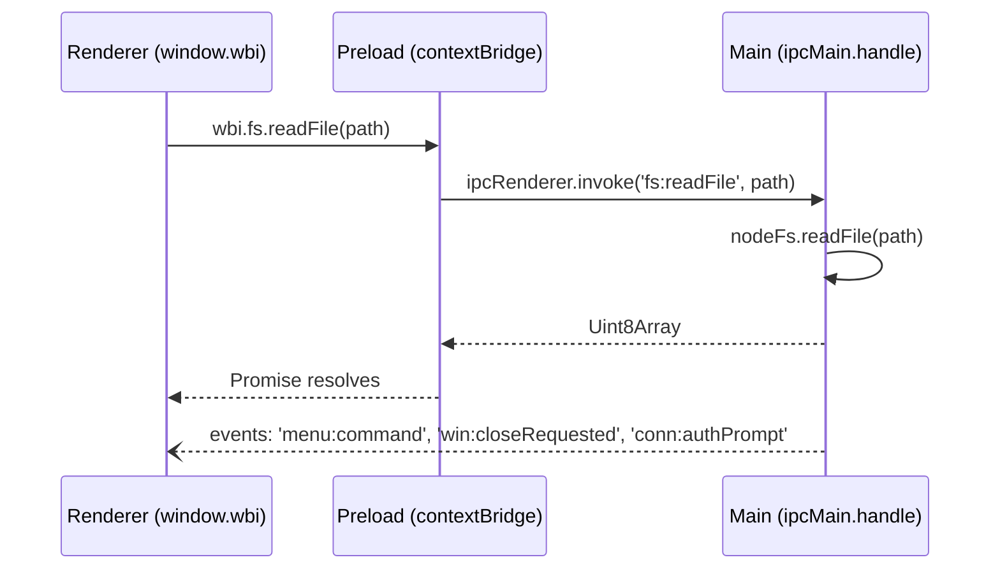

# The host bridge and IPC

> **Applies to:** Developers

This article explains how the renderer reaches the operating system: the `window.wbi` host bridge, the preload
script that exposes it, the IPC handlers in the Electron main process, connector requests with their credentials
and cancellation, and the cache guard. Read it before you add a capability that needs the filesystem, the network,
a native dialog or a native driver.

## Three processes, one typed bridge

Lumen is an Electron app with the usual split:

| Process | Entry | Can use |
|---|---|---|
| Main | `src/main/index.ts` | Node, Electron main APIs, native drivers (`tedious`, `pg`, `mysql2`, ...), `safeStorage` |
| Preload | `src/preload/index.ts` (built as `out/preload/index.cjs`) | `contextBridge`, `ipcRenderer` |
| Renderer | `src/renderer/src/main.tsx` | the DOM and `window.wbi` only |

The window is created with `contextIsolation: true`, `nodeIntegration: false` and `webSecurity: true` (and
`sandbox: false`). The renderer has no Node access; everything it needs
from the system goes through one object, `window.wbi`, whose type is `WbiHost` in `src/shared/host.ts`:

```ts
// src/shared/host.ts
export interface WbiHost {
  fs: FileSystem
  dialog: { openFile(...); openDirectory(...); saveFile(...); message(...) }
  app: { platform; version; getPath(...); getRecent(); addRecent(...); openExternal(...); showItemInFolder(...); setTitle(...); getLaunchFiles() }
  window: { minimize(); toggleMaximize(); close(); isMaximized(); onMaximizeChange(cb); onMenuCommand(cb); onCloseRequested(cb); confirmClose(allow) }
  connectors: { sqlQuery(...); sqlListItems(...); http(...); onAuthPrompt?(cb); cancel?(id); clearCredentials?(tenantId?); request?(req); credentials?: {...}; shares?: {...} }
  exporter: { printToPDF(opts); capturePng(rect?) }
}
```

(Signatures shortened; see the file for parameter and result types.) All methods are async. Binary payloads are
`Uint8Array`, which Electron's structured clone carries across IPC without base64.



*Diagram in words:* a renderer call such as `wbi.fs.readFile` is a preload function that invokes an IPC channel;
the main process handles it and returns the result, which resolves the renderer's promise. Events flow the other
way: the main process sends menu commands, close requests and sign-in prompts, and the preload forwards them to
callbacks the renderer registered.

## Channels

The preload maps each method to one channel; the main process registers one `ipcMain.handle` per channel.

| Area | Channels | Main-process handler |
|---|---|---|
| Filesystem | `fs:readFile`, `fs:readText`, `fs:writeFile`, `fs:list`, `fs:exists`, `fs:stat`, `fs:mkdirp`, `fs:remove` | `registerFsIpc` in `src/main/ipc/fs.ts` (delegates to `nodeFs`, `src/core/io/nodefs.ts`) |
| Dialogs | `dialog:openFile`, `dialog:openDirectory`, `dialog:saveFile`, `dialog:message` | `registerAppIpc` in `src/main/index.ts` |
| App | `app:getPath`, `app:getRecent`, `app:addRecent`, `app:openExternal`, `app:showItemInFolder`, `app:setTitle`, `app:getLaunchFiles` | `registerAppIpc` |
| Window | `win:minimize`, `win:toggleMaximize`, `win:close`, `win:isMaximized`, `win:confirmClose` | `registerAppIpc` |
| Export | `export:printToPDF`, `export:capturePng` | `registerAppIpc` (`webContents.printToPDF`, `capturePage`) |
| SQL Server and HTTP | `conn:sqlQuery`, `conn:sqlListItems`, `conn:http`, `conn:cancel`, `conn:clearCredentials` | `registerConnectorIpc` in `src/main/ipc/connectors.ts` |
| Other connectors | `conn:request` | `registerConnectorIpc` > connector service |
| Credentials | `cred:status`, `cred:list`, `cred:set`, `cred:clear`, `cred:signIn`, `cred:test` | `registerConnectorIpc` > connector service |
| Network shares | `shares:list`, `shares:mount`, `shares:resolve` | `registerConnectorIpc` > connector service |

Events from main to renderer: `win:maximized`, `menu:command` (the hidden application menu in `src/main/menu.ts`
forwards a few commands as `MenuCommand` strings), `win:closeRequested` and `conn:authPrompt`.

`app.version` is read in the preload from `npm_package_version`, with `0.1.0` as the fallback.
`app:getLaunchFiles` returns `WBI_OPEN` when set, otherwise the command-line arguments that look like Power BI
files or folders (`.pbix`, `.pbit`, `.pbip`, `.wbi`, `*.Report`, `*.SemanticModel`). See the
[command line and environment reference](../reference/command-line-and-environment.md).

### Closing the window

The main process intercepts `close`, sends `win:closeRequested`, and waits. The renderer's `handleCloseRequest`
(`src/renderer/src/app/commands.ts`) asks about unsaved changes and answers with `confirmClose(ok)`; only
`confirmClose(true)` closes the window. Capture, sweep and end-to-end modes skip the prompt.

## How core code reaches the host

`src/core` never touches `window`. Code that needs the host takes it as a parameter:

- loaders and savers take a `FileSystem` (`src/core/io/fs.ts`), which is `window.wbi.fs` in the app and `nodeFs` in
  tests;
- the refresh pipeline takes a `RefreshHost` (`src/core/data/fetcher.ts`) with `fs`, `connectors` and
  credential and privacy callbacks.

In the renderer, call sites use a small accessor such as `const host = () => window.wbi` in
`src/renderer/src/app/commands.ts`, so tests can replace `window.wbi`.

## Connector requests

The M engine describes every external read as a `DataRequest` (`src/core/m/host.ts`). `createFetcher` in
`src/core/data/fetcher.ts` performs it over the host:

| Request kinds | Host call | Main-process implementation |
|---|---|---|
| `file`, `folder` | `fs.*` (network-share paths resolved first) | `nodeFs` |
| SQL Server, Azure SQL, Fabric endpoints | `connectors.sqlQuery`, `sqlListItems` | `tedious` with Microsoft Entra ID tokens from `@azure/identity` or a SQL login, in `connectors.ts` |
| `Web.Contents` | `connectors.http` | the connector service, applying stored web credentials by URL prefix |
| `db`, `db-items`, `db-databases` (PostgreSQL, MySQL, SQLite), `firestore-*`, `s3-*` | `connectors.request` | `createConnectorService` in `src/main/ipc/connectors/service.ts` |

The connector service has no Electron dependency, so its integration tests drive it directly against Docker
containers (`src/main/ipc/connectors/__tests__/`, enabled by `LUMEN_IT=1`). See [Connectors](connectors.md).

### Credentials never reach the renderer

The credential store (`src/main/ipc/connectors/credstore.ts`) keeps one entry per data source key in
`<userData>/credentials.json`, written atomically with mode 0600. Secrets are encrypted with Electron
`safeStorage` (the OS keyring). When no keyring is available, secrets are kept in memory for the session only and
never written in clear text.

The renderer sees a `CredentialInfo`: the auth settings with every field in `SECRET_FIELDS` removed, plus a
`secrets` list naming the ones that are set. When it updates a credential, a secret left `undefined` keeps its
stored value and `''` clears it.

### Sign-in prompts

A Microsoft Entra ID device-code sign-in raises an `AuthPrompt` (`kind: 'device-code'`, the message to show, the
user code and verification URL). The main process sends it on `conn:authPrompt` to the renderer that made the
request; a later prompt with `state: 'done'` or `'failed'` closes it.

### Cancellation

A refresh can be cancelled. The mechanism:

1. When the fetcher runs with an `AbortSignal`, it gives each SQL and HTTP request a `cancelId`
   (`r<time>-<seq>`) and, on abort, calls `connectors.cancel(cancelId)`.
2. In the main process, `cancellable(cancelId, f)` keeps an `AbortController` per id in the `inflight` map;
   `conn:cancel` aborts it.
3. The abort reaches the work in progress: a pending Entra ID sign-in is abandoned, a queued SQL request never
   runs, a running one is stopped with `tedious`' `cancel()` (an attention packet), and an HTTP fetch is aborted.
   The promise rejects with an `AbortError`, *The request was cancelled.*

```ts
// src/main/ipc/connectors.ts
ipcMain.handle('conn:cancel', (_e, cancelId: string) => {
  inflight.get(cancelId)?.abort()
})
```

Unknown ids are ignored, so cancelling a request that already finished is harmless.

## The cache guard

When Lumen opens a corpus whose PBIP `.pbi/cache.abf` files must not be decoded, start it with `WBI_BLOCK_CACHE=1`.
The guard crosses all three processes (`src/shared/cacheGuard.ts`):

1. Main: `blockCacheArgs(process.env)` adds the switch `--wbi-block-cache` to the renderer's
   `webPreferences.additionalArguments` when `WBI_BLOCK_CACHE` is set to anything except `''`, `0` or `false`.
2. Preload: `blockCacheFromArgv(process.argv)` sees the switch and exposes `__LUMEN_BLOCK_CACHE_ABF__ = true` in
   the page with `contextBridge`, before any page script runs. The exposed property is read-only for the page.
3. Core: `openModelFolder` in `src/core/io/open.ts` reads the flag and skips the cache, adding an `info`
   diagnostic.

Unit tests set the same global in `tests/setup.ts`, so no test ever decodes a PBIP cache.

## Adding a host capability

1. Add the method to `WbiHost` in `src/shared/host.ts`. Make it optional (`method?()`) if older preloads or test
   doubles may lack it; this keeps the change additive (see [Conventions](conventions.md)).
2. Implement it in `src/preload/index.ts` as an `invoke('<area>:<name>', ...)` call, or an `on(...)` subscription
   for events.
3. Register the handler with `ipcMain.handle` in `src/main/index.ts` or the matching file under `src/main/ipc/`.
   Validate arguments there: the renderer is less trusted than the main process.
4. Call it from the renderer through `window.wbi`, checking for presence if it is optional. Pass it into core code
   as a parameter rather than reading `window` there.
5. Test the main-process logic without Electron where you can (as the connector service does), and cover the
   user-facing path with an end-to-end journey (see [End-to-end tests](end-to-end-tests.md)).

## Considerations and limitations

- `conn:request` (PostgreSQL, MySQL, SQLite, Firestore, S3) takes no `cancelId`. Cancelling a refresh stops the
  refresh in the renderer, but a request already sent to one of these connectors runs to completion in the main
  process.
- The filesystem channels accept any path the user's account can reach; there is no path allow-list. Treat any new
  channel that writes or executes as security-relevant.
- The renderer runs with `sandbox: false`. The preload relies on Node's `process` object (`process.argv` for the
  cache guard, `process.env` for the version); keep that in mind if you turn the sandbox on.
- SQL Server authentication with Windows integrated security is not available on Linux: `SqlAuth.kind`
  `'windows-unsupported'` makes the main process throw a message that suggests a SQL login or Entra ID instead.

## Related content

- [Architecture overview](architecture-overview.md)
- [Connectors](connectors.md)
- [Data layer](data-layer.md)
- [File format input and output](file-format-io.md)
- [Command line and environment reference](../reference/command-line-and-environment.md)
- [Debugging](debugging.md)
