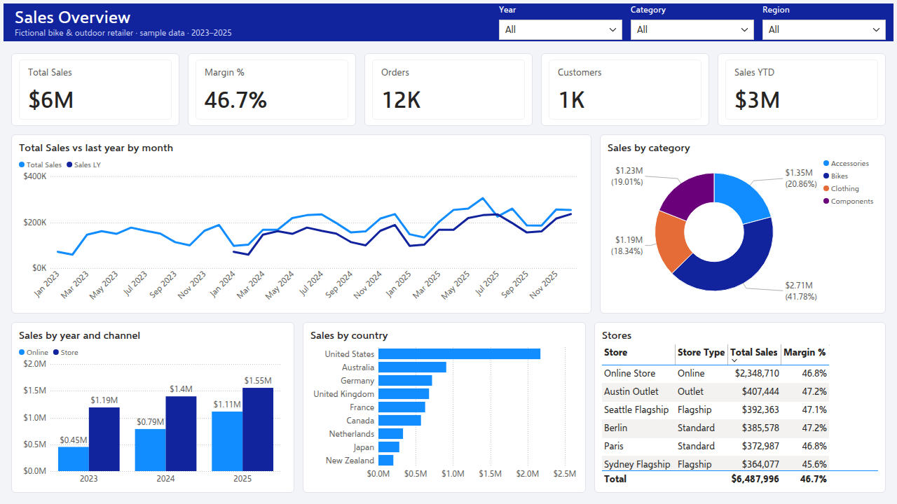

# The sweep

> **Applies to:** Developers

The sweep renders every page of one or more reports in the real app, saves a PNG per page and records a status
for every visual. Use it to find what renders wrong across many reports at once, and to check that a change did not
break pages you were not looking at. This article is an overview; [SWEEP.md](../SWEEP.md) holds the full option
list, the classification rules and the triage log.

## When to use it

- After a change to a shared part of the renderer (container chrome, props resolution, the visual query, a theme),
  to see its effect on every page of a report set.
- To triage a report that opens with broken visuals: the per-visual record names the state, the message and the
  live filter context.
- As the first half of a comparison with Power BI (see [The compare tool](the-compare-tool.md)).

## Run a sweep

```bash
npm run build      # sweep.sh rebuilds by itself when src/ is newer than out/
scripts/sweep.sh <file-or-folder> <outdir> [--sample-data [--private | --app-defaults]] [--selections] [--pages a,b] [--size WxH] [--dax 'EVALUATE …'] [--no-build]
node scripts/sweep-summary.mjs <outdir> [--cards] [--all] [--json]
```

`<file-or-folder>` is a `.pbix`, `.pbit`, `.pbip` or `.wbi` file, a `*.Report` folder, or a folder searched four
levels deep for `.pbix`, `.pbit` and `.wbi` files and `*.Report` folders. Each report runs in its own Electron
process on a private Xvfb display.

For example, sweeping a `.wbi` bundle saved from the built-in sample:

```text
$ scripts/sweep.sh Sales.wbi /tmp/sweep --no-build
Sales: 3 page(s) in 8s  {"ok":40}
$ node scripts/sweep-summary.mjs /tmp/sweep
## Sales  open 138 ms  {"ok":40}
 - Overview  {"ok":15}
 - Products  {"ok":11}
 - Customers & Regions  {"ok":14}
```



## What it produces

| Path | Content |
|---|---|
| `<outdir>/<report>/NN-<page>.png` | the page as rendered, at 100 % zoom (or fitted when larger) |
| `<outdir>/<report>/report.json` | per page and per visual: state, visible text, rectangle from the definition, engine probe (query time, warnings, errors, totals); rewritten after each page |
| `<outdir>/<report>/console.log` | the renderer console |
| `<outdir>/<report>/electron.log` | Electron's own standard output and error |
| `<outdir>/summary.tsv` | one line per report with counts per state; with `--selections` also `selections`, `sel_emptied` (selection x visual pairs) and `sel_emptied_selections` |

A visual's state is one of `ok`, `blank`, `noitems`, `error`, `nodata`, `loading-stuck`, `unsupported`, `empty`,
`hidden` or `not-rendered`; [SWEEP.md](../SWEEP.md) defines each.

### Selection audit (`--selections`)

`--selections` adds `selections=1` to the route. For each page, `auditPageSelections()` in
`src/renderer/src/app/sweep/selectionAudit.ts` takes every slicer that offers items (list, dropdown, tile, button and
hierarchy slicers; range, relative-date and text slicers are skipped) and applies a deterministic sample of its items
one at a time on top of the page's saved state: all items when there are 8 or fewer, otherwise the first, middle and
last item plus three pseudo-random ones seeded with the app's sample-data seed. Every data-bound visual is queried
again through the engine probe (no re-render); a visual that had rows under the saved state and has none under the
selection counts as *emptied*. The audit stops at 60 selections or 60 seconds per page (`capped`). Results go to
`report.json` (`pages[].selections`, with the first 40 trials, and `selectionTotals`) and to the `sel_*` columns of
`summary.tsv`; `sweep-summary.mjs` lists each selection that empties a visual. Combined with
`--sample-data --private`, it measures whether sample data stays populated under the report's own selections.

## How it works

`scripts/sweep.sh` launches Electron with `WBI_SWEEP=1` and a route `#/?sweep=<outdir>&open=<path>…`. The renderer
drives itself (`src/renderer/src/app/sweep/sweep.ts`): it holds busy, opens the project, optionally generates
sample data, switches to reading view, and for each page waits for the readiness signals described in
[End-to-end tests](end-to-end-tests.md#readiness-signals), then captures the page through
`window.wbi.exporter.capturePng`. `probe.ts` runs each visual's fields through the engine under the live filter
context; `slicerItems.ts` counts what each slicer offers. The main process forwards the console to
`WBI_SWEEP_LOG` and enforces `WBI_TIMEOUT` (default 15 minutes per report).

`WBI_BLOCK_CACHE=1` is always set: PBIP `.pbi/cache.abf` files are never decoded, and the renderer refuses to open
anything if the guard is missing (`report.json` then shows `cacheBlocked`).

## The engine-level regression

`src/renderer/src/app/sweep/__tests__/samples.test.ts` runs the same probe without Electron:

```bash
LUMEN_SAMPLES_DIR=/path/to/pbix-samples npx vitest run src/renderer/src/app/sweep
```

It opens each Microsoft sample, probes every visual and checks card values against the figures Microsoft publishes
for the samples. With `LUMEN_CORPUS_DIR` it runs over a private PBIP corpus with sample data and fails when more
than 25 % of a report's data-bound visuals fail or come back empty. `LUMEN_SWEEP_DUMP=<dir>` writes the probe
JSON per report; `LUMEN_SWEEP_TRACE=1` logs each visual as it is probed.

## Considerations and limitations

- The sweep shows its window on the private Xvfb display (never focused). A hidden Electron window stops producing
  frames, and the capture would return a stale image.
- The PNGs show what Lumen draws, not whether it matches Power BI; pair the sweep with the compare tool or a
  reference image for that.
- With `--sample-data`, numbers are synthetic: judge layout and "renders at all", not values.
- [SWEEP.md](../SWEEP.md) contains a triage log of the Microsoft samples and of a private corpus, referred to only
  as C01 to C19; its status columns describe the state when each row was written.

## Related content

- [SWEEP.md](../SWEEP.md)
- [The compare tool](the-compare-tool.md)
- [Fidelity workflow](fidelity-workflow.md)
- [End-to-end tests](end-to-end-tests.md)
- [Scripts](../reference/scripts.md)
