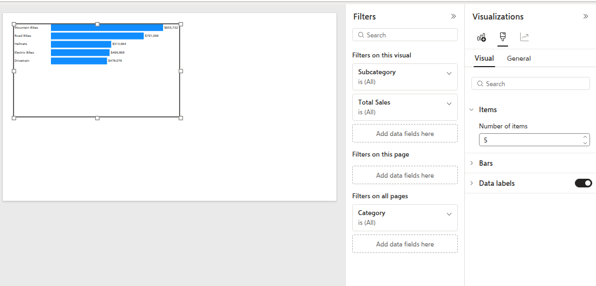

# Tutorial: add a visual

> **Applies to:** Developers

In this tutorial you add a new visual type to Lumen end to end: its definition, data query, renderer, Format pane cards and defaults, a gallery fixture, unit tests and an end-to-end journey. Read [The visual contract](visual-contract.md) first if you have not.

The example is a **rank list**: the top N categories of one measure, drawn as labelled horizontal bars, with an **Items** card to choose N. It is deliberately small, but it touches every part a real visual touches. The code below was built and run against this repository: the unit tests, the gallery smoke and Format pane tests, `npm run typecheck` and the end-to-end journey all pass.

> [!NOTE]
> The rank list is a teaching example and is not part of Lumen. Its visual type, `lumenRankList`, is invented: Power BI Desktop has no such type. A real addition implements a type Power BI writes, with Power BI's role and object names (see [Before you open a pull request](#before-you-open-a-pull-request)).

## What you build

| File | Purpose |
|---|---|
| `src/renderer/src/visuals/ranklist/rankListModel.ts` | Pure code: format resolution and the data query. |
| `src/renderer/src/visuals/ranklist/RankList.tsx` | The React component that draws the content area. |
| `src/renderer/src/visuals/ranklist/index.ts` | The `VisualDefinition`: roles, format cards, defaults, registration. |
| `src/renderer/src/visuals/ranklist/gallery.ts` | A fixture for the dev gallery and the shared visual tests. |
| `src/renderer/src/visuals/ranklist/rankList.test.tsx` | Unit tests. |
| `src/renderer/src/visuals/index.ts` | One import line so the family registers. |
| `e2e/ranklist.e2e.ts` | An end-to-end journey in the real app. |



## Prerequisites

- A working development setup ([Development environment](development-environment.md)): Node 20.19 or later, `node_modules` installed, `npm test` passing.
- For the end-to-end journey: `xvfb-run` (Debian / Ubuntu package `xvfb`) or a desktop session; see [End-to-end tests](end-to-end-tests.md).

## Step 1: Decide the type, the roles and the objects

Write down three things before any code:

1. **The visual type**: the PBIR `visualType` string. For the example, `lumenRankList`.
2. **The field wells**: a `Category` well (a grouping column, at most one) and a `Values` well (a measure, at most one), shown as **Category** and **Value**. Use Power BI's own role names when you implement a Power BI visual: the role name is what a `.pbix` or PBIP file stores in `visual.query.queryState`.
3. **The formatting objects and properties**: `rankList.maxItems` (an integer, default 5), `dataPoint.fill` (bar color, default the theme's first data color) and `labels.show` / `labels.fontSize` / `labels.color` (value labels, defaulting to the theme's `label` text class). Object and property names are what the visual's `objects` bag stores, so again, reuse Power BI's names for a Power BI visual.

## Step 2: Write the pure model

Keep format resolution and the query in a file without React, so the unit tests and the Format pane can run them.

- `readRankListFormat()` reads every property through `FormatReader` (`visuals/common/fmtProps.ts`), which resolves explicit value > theme `visualStyles` > the fallback you pass. **Pass every default as the fallback argument**: that is what lets the Format pane show it (Step 4).
- `queryRankList()` calls `runVisualQuery()` (`visuals/common/query.ts`), which reads the wells, expands field parameters, applies the visual's own sort if it has one and calls `engine.summarize` with the visual's filters. The rank list asks for a default sort by the measure, descending, and a row limit.

`src/renderer/src/visuals/ranklist/rankListModel.ts`:

```ts
/**
 * Rank list (tutorial visual): the top N categories of one measure as labelled horizontal bars.
 * Pure: format resolution and the data query, no React (unit-tested in rankList.test.tsx).
 */
import type { Scalar } from '@core/model/data'
import type { ResolvedTheme } from '@core/report/theme'
import type { DataPointIdentity } from '@core/report/sq'
import type { VisualHostContext } from '../contract'
import { FormatReader } from '../common/fmtProps'
import { getProjections, labelOf, runVisualQuery, valueId } from '../common/query'
import { textClassDefaults } from '../common/textStyle'

export const RANK_LIST_TYPE = 'lumenRankList'

export interface RankListFormat {
  maxItems: number
  barColor: string
  showValues: boolean
  labelSizePt: number
  labelColor: string
}

/** Every property the renderer reads, with the default it falls back to (also run by `formatDefaults`). */
export function readRankListFormat(visualJson: any, theme: ResolvedTheme): RankListFormat {
  const f = new FormatReader(visualJson, theme)
  const label = textClassDefaults(theme, 'label', 9)
  return {
    maxItems: Math.max(1, Math.round(f.num('rankList', 'maxItems', 5))),
    barColor: f.color('dataPoint', 'fill', theme.dataColors[0]),
    showValues: f.bool('labels', 'show', true),
    labelSizePt: f.num('labels', 'fontSize', label.size),
    labelColor: f.color('labels', 'color', label.color)
  }
}

export interface RankRow {
  label: string
  value: number | null
  text: string
  identity: DataPointIdentity
}

export interface RankListData {
  rows: RankRow[]
  /** largest value shown (bar length 100%) */
  max: number
  measureLabel: string
}

/** True when both wells hold a field (otherwise the visual shows its empty state). */
export function hasRankListFields(visualJson: any): boolean {
  const roles = getProjections(visualJson)
  return (roles.Category?.length ?? 0) > 0 && (roles.Values?.length ?? 0) > 0
}

/** Category × measure, sorted by the measure (descending) unless the visual has its own sort, top `maxItems`. */
export function queryRankList(visualJson: any, ctx: VisualHostContext, maxItems: number): RankListData {
  const value = getProjections(visualJson).Values?.[0]
  const q = runVisualQuery(visualJson, ctx, {
    groupRoles: ['Category'],
    valueRoles: ['Values'],
    limit: maxItems,
    defaultSort: value ? [{ target: { value: valueId(value) }, direction: 'desc' }] : undefined
  })
  const group = q.groups[0]
  const measure = q.values[0]
  const fmt = q.result.columns[q.valueIndex[0]]?.formatString
  const rows = q.result.rows.map((r): RankRow => {
    const key: Scalar = r[q.groupIndex[0]]
    const v = r[q.valueIndex[0]]
    const value = typeof v === 'number' ? v : null
    return {
      label: key === null ? '(Blank)' : ctx.format(key),
      value,
      text: value === null ? '' : ctx.format(value, fmt),
      identity: { fields: [{ expr: group.expr, value: key }] }
    }
  })
  const max = Math.max(0, ...rows.map((r) => r.value ?? 0))
  return { rows, max, measureLabel: measure ? labelOf(ctx, measure) : '' }
}
```

The identity of each row (`{ fields: [{ expr, value }] }`) is what selection and cross-filtering use: the canvas turns a selected identity into an SQ `In` filter on that column for the other visuals of the page.

## Step 3: Write the renderer

The component receives the content-area size and the host context. It never draws a title, border or background: the container does that (see [Container chrome and text](container-chrome-and-text.md)).

- `useVisualQuery()` (`visuals/common/VisualState.tsx`) runs the query once per change of the visual JSON, engine, theme, filters, highlights or drill state, and catches errors.
- `EmptyVisual`, `VisualError` and `NoData` are the shared empty, error and "No data available" states.
- Clicking a row calls `ctx.select()`; Ctrl+click adds to the selection. Rows outside the selection are dimmed.

`src/renderer/src/visuals/ranklist/RankList.tsx`:

```tsx
/** Rank list renderer: one row per category, a bar scaled to the largest value, the value label at its end. */
import type { VisualProps } from '../contract'
import { getVisual } from '../registry'
import { EmptyVisual, NoData, VisualError, useVisualQuery } from '../common/VisualState'
import { identityKey } from '@core/report/sq'
import { ptToPx } from '../common/text'
import { hasRankListFields, queryRankList, readRankListFormat, RANK_LIST_TYPE } from './rankListModel'

export function RankList({ visual, width, height, ctx }: VisualProps) {
  const fmt = readRankListFormat(visual.json, ctx.theme)
  const filled = hasRankListFields(visual.json)
  const q = useVisualQuery(visual.json, ctx, () => (filled ? queryRankList(visual.json, ctx, fmt.maxItems) : undefined))
  if (!filled) return <EmptyVisual icon={getVisual(RANK_LIST_TYPE)?.icon} width={width} height={height} />
  if (!q.ok) return <VisualError error={q.error} height={height} />
  const data = q.data!
  if (!data.rows.length) return <NoData height={height} />

  const fontPx = ptToPx(fmt.labelSizePt)
  const rowH = Math.max(fontPx + 8, Math.min(32, height / data.rows.length))
  const labelW = Math.min(width * 0.4, 140)
  const selected = new Set(ctx.selection.map(identityKey))
  return (
    <svg width={width} height={height} role="list" aria-label={`Top ${data.rows.length} by ${data.measureLabel}`}>
      {data.rows.map((r, i) => {
        const y = i * rowH
        const barW = data.max > 0 && r.value !== null ? ((width - labelW - 60) * Math.max(0, r.value)) / data.max : 0
        const dim = selected.size > 0 && !selected.has(identityKey(r.identity))
        return (
          <g
            key={i}
            role="listitem"
            className="wbi-ranklist__row"
            opacity={dim ? 0.4 : 1}
            style={{ cursor: 'pointer' }}
            onClick={(e) => ctx.select([r.identity], { multi: e.ctrlKey || e.metaKey })}
            onPointerMove={(e) => ctx.showTooltip({ x: e.clientX, y: e.clientY, items: [{ label: r.label, value: r.text }] })}
            onPointerLeave={() => ctx.showTooltip(null)}
          >
            <text x={0} y={y + rowH / 2} dominantBaseline="middle" fontSize={fontPx} fill={fmt.labelColor} fontFamily="'Segoe UI', sans-serif">
              {r.label}
            </text>
            <rect x={labelW} y={y + 3} width={barW} height={rowH - 6} fill={fmt.barColor} />
            {fmt.showValues && (
              <text x={labelW + barW + 4} y={y + rowH / 2} dominantBaseline="middle" fontSize={fontPx} fill={fmt.labelColor} fontFamily="'Segoe UI', sans-serif">
                {r.text}
              </text>
            )}
          </g>
        )
      })}
    </svg>
  )
}
```

## Step 4: Register the definition

The definition ties everything together. Two members deserve attention:

- `formatDefaults` runs `readRankListFormat()` without data. The Format pane runs it under `recordFallbacks` (`core/report/props.ts`) and shows, for every property set nowhere, the fallback the reader passed. Without it, the **Number of items** box would be empty instead of showing 5. See [Format pane internals](format-pane-internals.md#renderer-defaults).
- `getData` feeds **Show as a table** and **Export data** in the visual's context menu.

The format cards carry no `default` values: the pane takes the defaults from `formatDefaults`, so there is one source of truth.

`src/renderer/src/visuals/ranklist/index.ts`:

```ts
/** Registers the rank list (tutorial visual). */
import { registerVisual } from '../registry'
import type { FormatCardDef } from '../contract'
import { RankList } from './RankList'
import { queryRankList, readRankListFormat, RANK_LIST_TYPE } from './rankListModel'

const ICON =
  '<svg xmlns="http://www.w3.org/2000/svg" viewBox="0 0 20 20" width="20" height="20" fill="currentColor">' +
  '<rect x="2" y="3" width="14" height="3" rx="0.5"/><rect x="2" y="8.5" width="10" height="3" rx="0.5" opacity=".7"/>' +
  '<rect x="2" y="14" width="6" height="3" rx="0.5" opacity=".45"/></svg>'

const formatCards: FormatCardDef[] = [
  {
    object: 'rankList',
    displayName: 'Items',
    properties: [{ name: 'maxItems', displayName: 'Number of items', type: 'integer', min: 1, max: 20 }]
  },
  {
    object: 'dataPoint',
    displayName: 'Bars',
    properties: [{ name: 'fill', displayName: 'Color', type: 'color' }]
  },
  {
    object: 'labels',
    displayName: 'Data labels',
    toggle: 'show',
    properties: [
      { name: 'show', displayName: 'Show', type: 'bool' },
      { name: 'fontSize', displayName: 'Font size', type: 'fontSize' },
      { name: 'color', displayName: 'Color', type: 'color' }
    ]
  }
]

registerVisual({
  type: RANK_LIST_TYPE,
  displayName: 'Rank list',
  category: 'chart',
  icon: ICON,
  roles: [
    { name: 'Category', displayName: 'Category', kind: 'grouping', max: 1 },
    { name: 'Values', displayName: 'Value', kind: 'measure', max: 1 }
  ],
  formatCards,
  component: RankList,
  inGallery: true,
  supportsHighlight: false,
  defaultSize: { width: 320, height: 200 },
  getData(visual, ctx) {
    const fmt = readRankListFormat(visual.json, ctx.theme)
    const d = queryRankList(visual.json, ctx, fmt.maxItems)
    return { columns: ['Category', d.measureLabel], rows: d.rows.map((r) => [r.label, r.value]) }
  },
  formatDefaults(visualJson, theme) {
    readRankListFormat(visualJson, theme)
  }
})
```

Then import the family in `src/renderer/src/visuals/index.ts`, after the existing families:

```ts
import './custom'
import './ranklist'
```

The gallery in the **Build visual** tab lists registered types after Power BI's catalog of core visuals (`galleryItems()` in `panes/visualizations/BuildTab.tsx`), so the new tile appears at the end with the icon you gave it.

## Step 5: Add a gallery fixture

A `gallery.ts` file in a family folder is picked up automatically: `visuals/gallery/Gallery.tsx` (the dev page at `#/gallery`) and two shared test files load every `visuals/*/gallery.ts` with `import.meta.glob`:

- `visuals/charts/smoke.test.tsx` server-renders every fixture and fails on a render error;
- `panes/visualizations/effectiveDefaults.test.tsx` renders every fixture with its formatting removed, records the fallbacks the renderer reads and checks that the Format pane shows exactly those values.

Non-chart families use the deterministic sample model in `visuals/common/sampleData.ts` (fact table `Sales`, measures in `_m`) through `registerNonChartEntries()`.

`src/renderer/src/visuals/ranklist/gallery.ts`:

```ts
/** Dev-gallery fixtures for the rank list (sample model: common/sampleData.ts). */
import { registerNonChartEntries } from '../gallery/entries-nonchart'
import type { NonChartGalleryEntry } from '../common/nonchartGallery'
import { S, proj } from '../common/sampleData'

export const galleryEntries: NonChartGalleryEntry[] = [
  {
    id: 'lumenRankList-default',
    title: 'Rank list — top 5 products by sales',
    width: 320,
    height: 180,
    visualJson: {
      name: 'gallery-ranklist',
      visual: {
        visualType: 'lumenRankList',
        query: {
          queryState: {
            Category: { projections: [proj(S.col('Product'), 'Sales.Product')] },
            Values: { projections: [proj(S.m('Total Sales'), '_m.Total Sales')] }
          }
        },
        objects: {}
      }
    }
  }
]

registerNonChartEntries('Rank list', galleryEntries)
```

## Step 6: Write unit tests

Tests live next to the code. These cover the registration, the query (top 5, sorted), explicit formatting, the defaults the pane shows, and rendering with a selection. `createMockHost()` (`visuals/common/mockHost.ts`) builds a `VisualHostContext` around any engine; `createSampleEngine()` is a small in-memory engine over the sample rows.

`src/renderer/src/visuals/ranklist/rankList.test.tsx`:

```tsx
import { describe, expect, it } from 'vitest'
import { renderToStaticMarkup } from 'react-dom/server'
import { resolveTheme } from '@core/report/theme'
import { recordFallbacks } from '@core/report/props'
import { createMockHost, createMockState } from '../common/mockHost'
import { createSampleEngine } from '../common/sampleData'
import { getVisual } from '../registry'
import { galleryEntries } from './gallery'
import { queryRankList, readRankListFormat } from './rankListModel'
import './index'

const theme = resolveTheme()
const engine = createSampleEngine()
const json = galleryEntries[0].visualJson

describe('rank list', () => {
  it('is registered with its wells and format cards', () => {
    const def = getVisual('lumenRankList')!
    expect(def.roles.map((r) => r.name)).toEqual(['Category', 'Values'])
    expect(def.formatCards.map((c) => c.object)).toEqual(['rankList', 'dataPoint', 'labels'])
  })

  it('returns the top 5 categories, largest first', () => {
    const ctx = createMockHost({ engine, theme })
    const d = queryRankList(json, ctx, 5)
    expect(d.rows).toHaveLength(5)
    const values = d.rows.map((r) => r.value!)
    expect([...values].sort((a, b) => b - a)).toEqual(values)
    expect(d.max).toBe(values[0])
    expect(d.measureLabel).toBe('Total Sales')
  })

  it('resolves explicit formatting over the defaults', () => {
    const lit = (v: string) => ({ expr: { Literal: { Value: v } } })
    const styled = structuredClone(json)
    styled.visual.objects = {
      rankList: [{ properties: { maxItems: lit('3L') } }],
      dataPoint: [{ properties: { fill: { solid: { color: lit("'#E66C37'") } } } }]
    }
    const f = readRankListFormat(styled, theme)
    expect(f.maxItems).toBe(3)
    expect(f.barColor).toBe('#E66C37')
    expect(f.showValues).toBe(true)
  })

  it('reports the defaults the Format pane shows', () => {
    const seen: Record<string, unknown> = {}
    recordFallbacks((o, p, v) => (seen[`${o}.${p}`] = v), () => getVisual('lumenRankList')!.formatDefaults!(json, theme))
    expect(seen).toEqual({
      'rankList.maxItems': 5,
      'dataPoint.fill': theme.dataColors[0],
      'labels.show': true,
      'labels.fontSize': 10,
      'labels.color': '#252423'
    })
  })

  it('renders one row per item and dims unselected rows', () => {
    const ctx0 = createMockHost({ engine, theme })
    const first = queryRankList(json, ctx0, 5).rows[0]
    const ctx = createMockHost({ engine, theme, state: createMockState({ selection: [first.identity] }) })
    const Comp = getVisual('lumenRankList')!.component
    const html = renderToStaticMarkup(<Comp visual={{ name: 'v', json }} pageName="p" width={320} height={180} ctx={ctx} />)
    expect(html.match(/role="listitem"/g)).toHaveLength(5)
    expect(html.match(/opacity="0.4"/g)).toHaveLength(4)
  })
})
```

Run them together with the two shared suites your fixture joined:

```bash
npx vitest run src/renderer/src/visuals/ranklist \
  src/renderer/src/visuals/charts/smoke.test.tsx \
  src/renderer/src/panes/visualizations/effectiveDefaults.test.tsx
npm run typecheck
```

## Step 7: Write an end-to-end journey

A new UI feature needs a journey in `e2e/*.e2e.ts`. The journey launches the built app on the built-in sample report (`route: { sample: '1' }`), inserts the visual from the gallery, binds the wells by dragging fields from the Data pane, checks the rows and edits a Format pane property. It waits on readiness signals and DOM conditions (`waitIdle`, `settle`, `expect.poll`), never on fixed sleeps. The sample report's model has a `Product` table and a `Total Sales` measure in the `Sales` display folder of `_Measures`.

`e2e/ranklist.e2e.ts`:

```ts
/** Rank list (tutorial visual): insert it from the gallery, bind two fields, check the rows and a Format pane edit. */
import { describe, expect, it } from 'vitest'
import { useLumen, settle, lumenEval, dataPaneRow, waitIdle } from './harness'

describe('rank list', () => {
  const lumen = useLumen({ route: { sample: '1' } })

  it('shows the top 5 categories and follows Number of items', async () => {
    const { page } = lumen()
    // a new blank page
    await page.evaluate(() => (document.body.dataset.wbiReady = '0'))
    await page.locator('.wbi-tab-add').click()
    await waitIdle(page)
    // insert from the Visualizations gallery
    await page.getByRole('tab', { name: 'Build visual' }).click()
    await page.getByRole('listbox', { name: 'Visual types' }).getByRole('option', { name: 'Rank list', exact: true }).click()
    const vc = page.locator('.wbi-page .wbi-vc[data-type="lumenRankList"]')
    await expect.poll(() => vc.count()).toBe(1)
    // bind the wells: drag a column onto Category and a measure onto Value
    const well = (title: string) => page.locator('.wbi-well').filter({ has: page.locator('.wbi-well__title', { hasText: new RegExp(`^${title}$`) }) }).first().locator('.wbi-well__drop')
    await (await dataPaneRow(page, ['Product', 'Subcategory'])).dragTo(well('Category'))
    await (await dataPaneRow(page, ['_Measures', 'Sales', 'Total Sales'])).dragTo(well('Value'))
    await settle(page)
    await expect.poll(() => vc.locator('[role="listitem"]').count()).toBe(5)
    // Format pane ▸ Visual ▸ Items: the unset property shows the renderer's default (5); set it to 3
    await page.getByRole('tab', { name: 'Format visual' }).click()
    await page.locator('.wbi-fmt__pivot').getByRole('tab', { name: 'Visual' }).click()
    const items = page.locator('.wbi-fmt__cards .wbi-card').filter({ has: page.locator('.wbi-card__title', { hasText: /^Items$/ }) })
    await items.locator('.wbi-card__header').click()
    const box = items.locator('[data-prop="maxItems"] .wbi-spin input')
    await expect(box.inputValue()).resolves.toBe('5')
    await box.fill('3')
    await box.press('Enter')
    await settle(page)
    await expect.poll(() => vc.locator('[role="listitem"]').count()).toBe(3)
    // the value is written to the visual's objects (the pane writes every number as a PBIR double literal)
    const stored = await lumenEval(page, (l) => {
      const s = l.useApp.getState()
      const v = s.project!.report!.pages.find((p) => p.name === s.activePage)!.visuals.find((x) => x.json.visual?.visualType === 'lumenRankList')!
      return v.json.visual.objects.rankList[0].properties.maxItems
    })
    expect(stored).toEqual({ expr: { Literal: { Value: '3D' } } })
  })
})
```

Run it (the script builds the app into `out/e2e/` first; pass `--no-build` to reuse that build):

```bash
e2e/run.sh ranklist
```

> [!NOTE]
> The Format pane writes every number as a PBIR double literal (`3D`), whatever the control type, through `wrapFor()` in `panes/visualizations/PropEditor.tsx`. `FormatReader.num()` reads integer and double literals alike.

## Step 8: Look at it

Start the app with `npm run dev`, select **Try a sample** on the start screen, add a page and insert **Rank list** from the **Build visual** tab. To see only your fixture in the dev gallery, open the route `#/gallery?filter=rank` (for example with `scripts/capture.sh /abs/out.png '#/gallery?filter=rank'` after `npm run build`).

## Before you open a pull request

For a real visual, also check the following:

- **Fidelity.** Match Power BI Desktop's rendering and defaults, and record each default and its evidence in [VISUAL_DEFAULTS.md](../VISUAL_DEFAULTS.md). Where you approximate, say so in a code comment and, where it matters, in the UI. See [Fidelity workflow](fidelity-workflow.md).
- **PBIR names.** Role, object and property names must be the ones Power BI writes, or files will not round-trip.
- **Category.** `category` decides container defaults: `chart` and `map` show the title by default when the type matches `TITLE_ON_BY_DEFAULT` in `report/chrome.ts`; other categories, and chart types that do not match it (such as `lumenRankList`), start with the title off.
- **Interactions.** Set `supportsHighlight` only if the visual draws `highlightFilters` (cross-highlighting); otherwise other visuals filter it. Set `supportsDrill` and `drillable` roles only if it implements drill.
- **Reference documentation.** Add the visual to the visual support reference ([visual-support.md](../reference/visual-support.md)) and to the creator articles in [../visuals/](../visuals/README.md).

## Considerations and limitations

- The rank list's identity uses the bound column expression directly. A visual that accepts hierarchy levels must resolve each level to its column first, as `fieldRef()` in `visuals/common/categorical.ts` does.
- `limit` in a summarize request trims the result after the engine has evaluated every group, so it bounds the rows drawn, not the cost. Tables and matrices use the windowed queries in `visuals/tables/windowQuery.ts` for that.
- The rank list uses the theme `label` text class only for its default size and color, and a fixed Segoe UI stack for the face; a production visual should also read the font family (`resolveFont` in `visuals/common/text.ts`).
- The **Bars** card's color row gets an **fx** button, because color properties support conditional formatting by default, but the rank list does not evaluate an fx value. A production visual either evaluates it or sets `conditional: false` on the property; see [Format pane internals](format-pane-internals.md#conditional-formatting-targets).
- Whether Power BI Desktop opens a report containing a visual type it does not know, and how it shows it, has not been verified in this project.

## Related content

- [The visual contract](visual-contract.md)
- [The visual query pipeline](visual-query-pipeline.md)
- [Format pane internals](format-pane-internals.md)
- [Testing](testing.md)
- [End-to-end tests](end-to-end-tests.md)
- [Fidelity workflow](fidelity-workflow.md)
