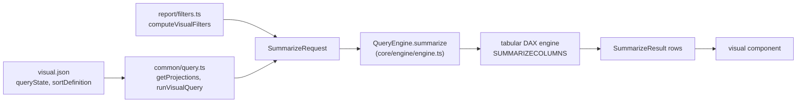

# The visual query pipeline

> **Applies to:** Developers

This article follows the data of one visual from its field wells to the rows it draws: how the canvas computes the visual's filters, how the shared query helpers turn wells into an engine request, and the specialised paths for charts, tables and matrices, and slicers. Read it before you change how a visual gets its data.

## Overview



In words: a visual reads its field wells from `visual.json`, builds a `SummarizeRequest` with the shared helpers in `src/renderer/src/visuals/common/query.ts`, adds the filters the canvas computed for it, and calls `ctx.engine.summarize()`. The engine (`src/core/engine/engine.ts`) translates the SQ expressions and filters, evaluates them with SUMMARIZECOLUMNS semantics on the tabular DAX engine (`src/core/dax/tabular/`) and returns rows. Everything is synchronous.

## Field wells in PBIR

A visual's field wells are `visual.query.queryState`: one bucket per role, each with a list of projections.

```json
"query": {
  "queryState": {
    "Category": { "projections": [{ "field": { "Column": { "Expression": { "SourceRef": { "Entity": "Product" } }, "Property": "Category" } }, "queryRef": "Product.Category", "active": true }] },
    "Y": { "projections": [{ "field": { "Measure": { "Expression": { "SourceRef": { "Entity": "_Measures" } }, "Property": "Total Sales" } }, "queryRef": "_Measures.Total Sales" }] }
  },
  "sortDefinition": { "sort": [{ "field": { "Measure": { "Expression": { "SourceRef": { "Entity": "_Measures" } }, "Property": "Total Sales" } }, "direction": "Descending" }], "isDefaultSort": true }
}
```

`field` is an **SQ expression** (PBIR's semantic-query language): `Column`, `Measure`, `Aggregation` (an implicit measure such as Sum of a column), `HierarchyLevel` or a visual calculation. `core/report/sq.ts` holds the types and helpers: `fieldInfo()` classifies an expression, `fieldKey()` gives a stable `Table.Field` key, `columnExpr()` / `measureExpr()` / `aggregationExpr()` build them. The Build pane edits these buckets through the pure functions in `panes/visualizations/wells.ts`; "Show items with no data" is the bucket-level `showAll: true`.

## Step 1: the visual's filters

The canvas, not the visual, decides which filters apply. `computeVisualFilters()` in `src/renderer/src/report/filters.ts` (pure, unit-tested) assembles them for one target visual:

1. report filters and page filters (`pageScopeFilters()`, with drill-through cards replaced by the active drill-through);
2. the visual's own filter cards, including visual-level Include and Exclude;
3. slicers on the page, except the visual itself, subject to the page's `visualInteractions` (`interactionKind()`); range slicers on the same column keep their own bounds;
4. the cross-filter selection of another visual: as a filter, or as a **highlight filter** when the interaction is Highlight and the target's definition has `supportsHighlight`;
5. drill paths of other visuals, then this visual's own drill path (each drilled identity adds a filter);
6. extra filters (report-page tooltips: the hovered point and the source visual's context).

Every filter is an SQ filter (`{ Version, From, Where }` JSON as PBIR stores it) and is normalized: alias `Source` references are rewritten to `Entity`. The result arrives in the visual as `ctx.filters` and `ctx.highlightFilters` (built in `report/host.ts`).

## Step 2: from wells to a request

`src/renderer/src/visuals/common/query.ts` is the shared layer. Its file comment asks you to extend it rather than fork it.

| Function | What it does |
|---|---|
| `getProjections(visualJson)` | Reads every role's projections into `Projection` objects (`role`, `expr`, `queryRef`, `displayName`, `active`, `info`, `isMeasure`, `raw`). Measures, aggregations and visual calculations count as values. |
| `expandParameters(projections, ctx)` | Replaces a field-parameter projection by the fields currently selected in it (`engine.resolveFieldParameter`). |
| `projectionsForRole(all, level)` | For a hierarchical role, keeps the projection of the current drill level. |
| `sortSpecs(visualJson, groups, values)` | Translates `sortDefinition` into `SortSpec`s over the request's groups and values. |
| `labelOf(ctx, p)` | Header or legend label: the visual-level rename, else the field's display name. |
| `valueId(p)` | `role|queryRef`: unique even when one field sits in two roles. |
| `runVisualQuery(visualJson, ctx, opts)` | Does all of the above and calls `engine.summarize`. |

`runVisualQuery` builds the request like this:

```ts
const req: SummarizeRequest = {
  groupBy: groups.map((g) => ({ kind: 'sq', expr: g.expr })),
  values: values.map((v) => ({ id: valueId(v), expr: valueExprOf(v) })),
  filters: [...ctx.filters, ...(opts.extraFilters ?? [])],
  orderBy: (() => {
    const s = sortSpecs(visualJson, groups, values)
    return s.length ? s : opts.defaultSort
  })(),
  limit: opts.limit,
  showItemsWithNoData: opts.showItemsWithNoData,
  highlightFilters: opts.highlight ? ctx.highlightFilters : undefined
}
```

When any value is a visual calculation (a PBIR `NativeVisualCalculation`), it calls `summarizeWithVisualCalcs()` (`common/visualCalcs.ts`) instead, which evaluates the calculations over the visual's result lattice through `engine.evaluateVisualCalculations`.

## Step 3: the engine

`SummarizeRequest` and `SummarizeResult` are defined in `src/core/engine/api.ts`, the contract between visuals and the engine:

| Request field | Meaning |
|---|---|
| `groupBy` | Group-by columns, with SUMMARIZECOLUMNS semantics: auto-exist across related tables. |
| `values` | `{ id, expr }`, where `expr` is a model measure, an aggregate of a column, a DAX expression or a raw SQ expression. |
| `filters` | Applied as CALCULATE-style filter context. |
| `showItemsWithNoData`, `keepBlankRows` | Keep combinations whose values are all blank (SUMMARIZECOLUMNS drops them by default). |
| `orderBy`, `limit` | Sort, then keep the first N rows. |
| `highlightFilters` | Also compute every value under these filters, returned as `result.highlights`. |

`createEngine(model, data)` in `src/core/engine/engine.ts` implements the interface. `summarize()` resolves each SQ field with `SqResolver` (`core/engine/sqtranslate.ts`, which also translates SQ filters, including relative dates, TopN subqueries and measure conditions), builds the filter context and calls `summarizeColumnsCore()` from `core/dax/tabular/fn-table.ts`. Rows that a measure condition rejects are dropped, dynamic format strings are evaluated per row, and errors in one value become a warning and a blank instead of failing the visual.

Two engine options matter for visuals: `maxCombos` (beyond it, auto-exist switches to a fact-driven scan) and `queryBudgetMs` (default 15 000 ms): a call that runs out of time returns the rows computed so far with `truncated` and a warning instead of blocking the UI indefinitely. See [DAX engine internals](dax-engine-internals.md).

The engine a visual receives is wrapped twice in `report/host.ts`: `cachedEngine()` (`report/cachedEngine.ts`) answers identical requests from a 600-entry LRU cache per engine instance, so moving or resizing a visual re-runs no query, and `meteredEngine()` (`report/perf.ts`) times each call for the Performance analyzer. The store builds a new engine whenever the model or data changes, which drops the cache.

The engine can also print the request as the DAX query Power BI would send: `toDaxQuery(req)` (and `toVisualCalcDaxQuery` for visual calculations). The Performance analyzer's **Copy query** uses it. See [Performance](performance.md).

## Charts: the categorical model

Charts do not use `runVisualQuery` directly. `buildCategorical()` in `visuals/common/categorical.ts` produces a `CategoricalData`: categories (the category axis, one drill level at a time), series (one per measure, or per legend value when a `Series` role is bound), tooltip values and highlight values. Its `CategoricalOptions` name the roles (`categoryRole`, `seriesRole`, `splitRoles`, `unsplitRoles`, `tooltipRole`) and the data reduction (`maxCategories`, `sampling: 'highDensity'` for line charts, `maxSeries`). Conditional formatting inputs (`dataPoint.fill`, `labels.color` by default) become extra query values. Sorting follows Power BI: the visual's `sortDefinition`, else the chart's `defaultSort` (`measureDesc` or `categoryAsc`).

`categoricalTable()` flattens the model for `getData`. `pointIdentity()` gives the `DataPointIdentity` of a category and series for selection.

## Tables and matrices: windowed queries

Tables and matrices can have far more rows than fit on screen. `visuals/tables/windowQuery.ts` implements Power BI's data windowing: `ROW_WINDOW = 500` rows at a time, and for matrix columns `COLUMN_GROUP_LIMIT = 100` column groups. Because the engine evaluates every group before applying `limit`, each window runs in two phases:

1. a probe: group-by only (plus the sort value when the visual is sorted by a value), sorted and limited to the window plus one row;
2. the real query, restricted to the window's groups with an `In` filter per group column, then put in probe order.

Totals and subtotals are separate, unrestricted queries, so they stay exact. When a value uses ALLSELECTED (directly or through a calculation item), the restriction would change its result, so the full query runs and only the window is kept.

`visuals/tables/matrixQuery.ts` maps the matrix's Rows, Columns and Values wells, drill level, expansion state (`common/expansion.ts`) and field parameters to the set of summarize calls its layout needs. Calculation-group columns are evaluated one item at a time with an explicit `In` filter on the calculation-group column.

## Slicers: distinct values

Slicer items come from `engine.distinctValues()`, not `summarize`. `visuals/slicers/slicerData.ts` calls it with the slicer's field, `ctx.filters`, an optional `search` and a `limit`. As in Power BI, this is the SUMMARIZECOLUMNS of the column without a measure, so two slicers on dimensions that share a fact table do not filter each other; a visual-level measure filter on the slicer keeps only items with data. Field parameters are not expanded in slicers. A slicer's selection is written back with `ctx.setSlicerFilter()` and persisted in `visual.objects.general.filter`. When the data is generated sample data, a saved selection of a value that was withheld from the generated rows reads as its generated stand-in (`core/data/standIns.ts`).

## Considerations and limitations

- All queries run synchronously on the renderer thread. The `QueryEngine` comment anticipates a Web Worker, and inputs and outputs are kept structured-clonable for that, but the engine does not run in a worker today.
- `limit` bounds the rows returned, not the work done; only the table and matrix windowing bounds the cost.
- The `existsInFacts` option of `distinctValues` is an approximation of "has data", used only for small multiples.

## Related content

- [The visual contract](visual-contract.md)
- [Tutorial: add a visual](tutorial-add-a-visual.md)
- [DAX engine internals](dax-engine-internals.md)
- [The report document model](the-report-document-model.md)
- [Performance](performance.md)
- [ARCHITECTURE.md: key semantics](../ARCHITECTURE.md#key-semantics)
