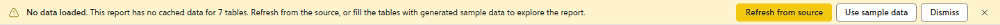
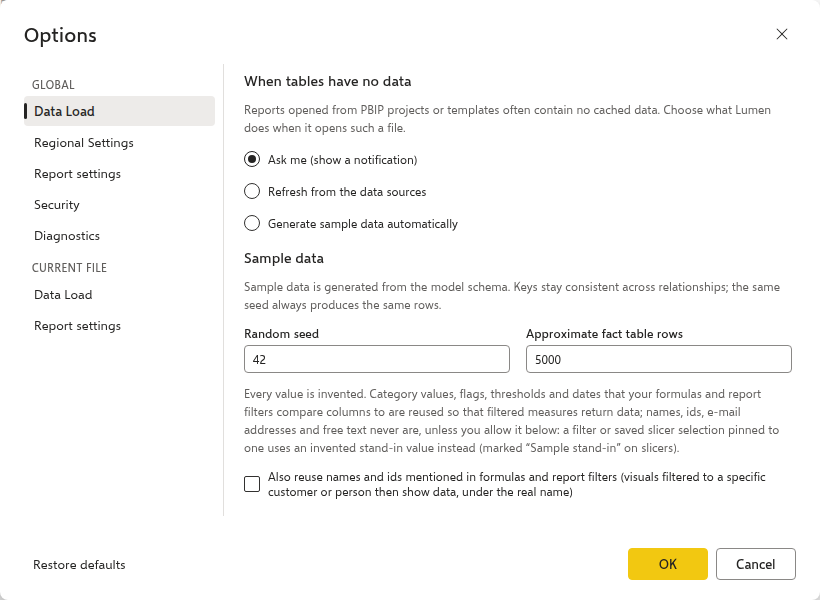
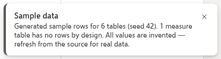
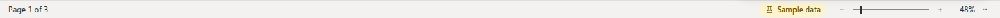

# Reports without data and sample data

> **Applies to:** Creators · Analysts

This article explains why a report can open in Lumen without data, what your options are, and how Lumen's
generated sample data works, including what it does to keep real names and identifiers out of the data. Read it
when a report shows **(Blank)** everywhere or when you see the **Sample data** badge.

## Why a report has no data

A Power BI report shows what its semantic model returns, and the model shows the data it imported. Where that data
lives depends on the file:

| File | Data in the file? |
|---|---|
| `.pbix` | Yes, in the compressed model (DirectQuery tables excepted). Lumen decodes it. |
| `.pbit` template | No, by design. |
| PBIP project | No: a project holds definitions only. Power BI Desktop can leave a local copy of the data in `.SemanticModel/.pbi/cache.abf`; when that file is present, Lumen reads it (see [Supported file formats](supported-file-formats.md#pbip-projects)). Projects shared through Git normally do not include it. |
| `.wbi` bundle | Yes, the data that was loaded when it was saved. |
| A report connected live to a service model | No local model at all. |

When at least one import table has no rows, Lumen shows the **No data loaded** notice under the ribbon and the
status bar says **n table(s) without data**.

## Your options

| Option | When to use it | Result |
|---|---|---|
| **Refresh from source** | You can reach the data sources from this computer (files, databases, web APIs) and have credentials | Real data, loaded by Lumen's Power Query engine. See [Connect and transform data](../connect-and-transform/README.md). |
| **Use sample data** | The sources are not reachable (a different network, a cloud service you cannot sign in to) and you want to work on the report's layout and formatting | Generated values that look plausible and are consistent across relationships. |
| **Dismiss** | You only want to read the definitions, or will refresh later | Empty tables; visuals show (Blank) or "No data available". |

You can change what Lumen does by default in **File > Options and settings > Options > Data Load**, under
**When tables have no data**: **Ask me (show a notification)** (the default), **Refresh from the data sources**, or
**Generate sample data automatically**.

## How sample data is generated

**Use sample data** fills every import table that has no rows with generated rows. The generator reads only the
definitions of the model and the report, never a data source, and it is designed so that the report's visuals have
data to show:

- **Keys match across relationships.** Every foreign key in a fact table exists in the related dimension tables, so
  relationships, slicers and cross-filtering behave as in a real model.
- **Columns get values that fit their names and types**: names, places, statuses, amounts, counts, dates, flags,
  ratings. Date tables get a continuous calendar, and fact dates follow a trend with seasonality and never lie after
  today.
- **Values that the report filters on are reused.** When a measure or a report filter compares a column to a
  category, status, flag, number or date (for example `CALCULATE ( [Sales], Product[Category] = "Bikes" )`), that
  value appears in the generated data so the filtered measure is not blank.
- **Data is dense where the report is sliced.** Every member of a dimension that the report's slicers, filter cards
  or visuals select on gets fact rows in every period at the grain the report's date slicers use (for example every
  month), within a row budget. Saved slicer selections and recent periods come first; when the budget runs out,
  older periods are only partly covered and the confirmation message says so.
- **It is repeatable.** The same seed gives the same rows. The seed and the approximate number of fact-table rows are
  set in **Options > Data Load > Sample data** (defaults: seed 42, about 5,000 fact rows).

Tables that are not filled: calculated tables (Lumen's DAX engine computes them from the generated tables),
calculation groups, tables without stored columns, and tables that already have data. Tables created with
**Enter data** keep their own embedded rows; an empty one, such as a table that only holds measures, stays empty.

After a run Lumen shows a message that says how many tables it filled and with which seed:

## The Sample data badge

While any table holds generated rows, the status bar shows a **Sample data** badge.

Select the badge for:

- **Regenerate sample data**: draws a new random seed (and stores it in Options, so you can reproduce the data) and
  generates new rows for every table that holds sample data or none. If some tables hold data loaded from a source,
  Lumen asks whether to replace **Sample tables only** or **All tables**.
- **Sample data options…**: opens **Options > Data Load**.
- **Refresh from the source…**: opens the refresh dialog to load real data.

**Regenerate sample data** is also in the **Data** pane's **…** menu and in the title-bar search (type "sample").

> [!NOTE]
> The generator runs when you ask for sample data. Rows already generated in an open report stay as they are until
> you select **Regenerate sample data**, also after you update Lumen.

## Privacy: names and identifiers are not copied

Sample data is meant for reports whose real data you may not be allowed to see or share. By default:

- Values that formulas or report filters compare to **name-like, identifier-like or free-text columns** (people,
  organisations, e-mail addresses, phone numbers, addresses, ids, GUIDs, notes) are **never** copied into the
  generated data. An invented value that happens to equal one of them is replaced.
- Category values, flags, thresholds and dates are reused, as described above, because filtered measures need them
  and they do not identify anyone.
- When a filter or a saved slicer selection is pinned to a withheld value (for example a page filtered to one
  customer's name), Lumen uses an invented **stand-in** value in memory instead, so the visuals under that filter
  still show data. Such slicers are marked **Sample stand-in**. A formula that compares to the withheld value stays
  blank. The confirmation message names the columns concerned and the number of values, never the values.

To allow real names and ids from the definitions in the generated data, select
**Also reuse names and ids mentioned in formulas and report filters** in **Options > Data Load**. Visuals filtered to
a specific customer or person then show data under the real name.

> [!WARNING]
> Every generated value is invented. Use sample data to design and check a report's layout, formatting and
> interactions. Never read business numbers from it, and do not present it as real. Some results look implausible
> (for example a margin percentage far above anything real), because related columns such as price and cost are
> generated independently.

## Keeping sample data

A PBIP project never stores data, so generated rows are lost when you save as PBIP and reopen. To keep them, save
as a `.wbi` bundle: it stores the rows that are loaded, generated ones included, and the **Sample data** badge comes
back when you reopen it. See [The .wbi bundle](the-wbi-bundle.md).

## Considerations and limitations

- The generator does not evaluate calculated date tables (`CALENDAR(...)`); facts related to them use the default
  date range.
- Relationships between values in different tables (for example an order date after the customer's creation date)
  are not modelled.
- The DAX engine evaluates measures over generated data exactly as it would over real data: the numbers are correct
  for the invented rows and meaningless for the business.
- For the generator's details see [Sample data](../connect-and-transform/sample-data.md) and
  `src/core/data/synthetic.ts`.

## Related content

- [Sample data](../connect-and-transform/sample-data.md)
- [Quickstart: open a report](../get-started/quickstart-open-a-report.md)
- [The .wbi bundle](the-wbi-bundle.md)
- [Refresh and connection problems](../troubleshooting/refresh-and-connection-problems.md)
- [Working with PBIP projects](working-with-pbip-projects.md)
