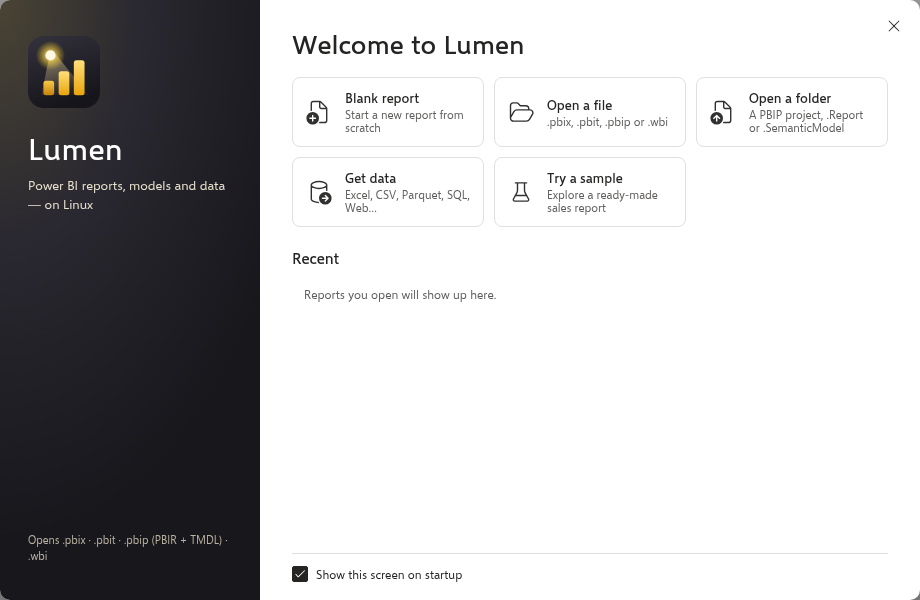
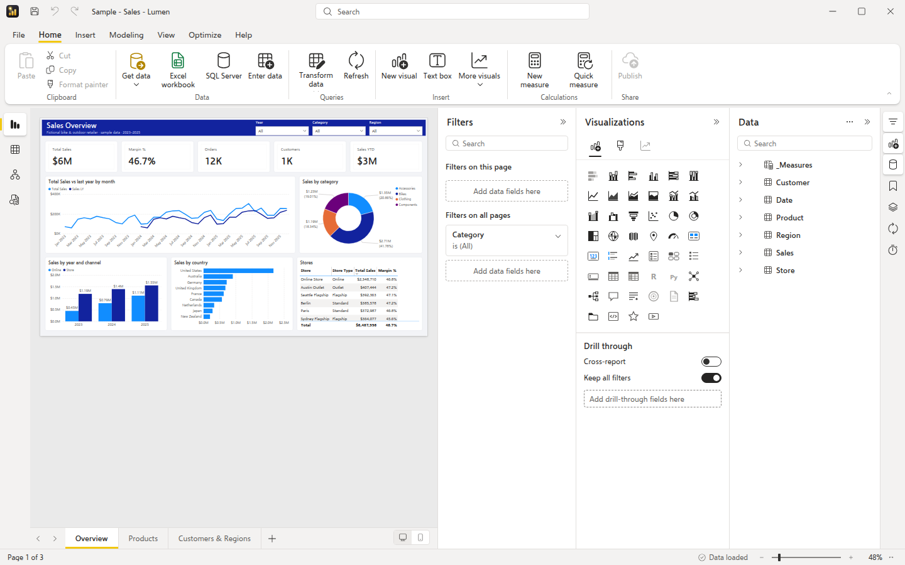
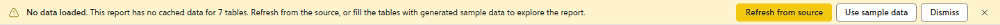
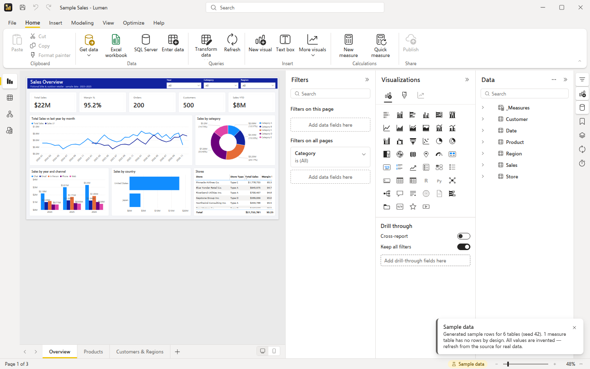

# Quickstart: open a report

> **Applies to:** Creators · Analysts

In this quickstart you open the built-in sample report, then a report of your own: a `.pbix` file or a Power BI
project (PBIP). You also learn what the yellow notice bar means when a report opens without data, and what each of
its buttons does. It takes about ten minutes.

## Prerequisites

- Lumen is installed and starts. See [Install Lumen on Linux](install-on-linux.md).
- For the second part: a `.pbix` file or a PBIP project folder of your own. If you have none, the sample is enough.

## Open the built-in sample report

When Lumen starts without a file, it shows the **Welcome to Lumen** screen.

1. Select **Try a sample**.

   Lumen opens **Sample - Sales**, a fictional sales report with three pages: **Overview**, **Products** and
   **Customers & Regions**. Its data is generated inside Lumen and is already loaded, so every visual shows numbers
   straight away. The status bar at the bottom right says **Data loaded**.

2. Select a page tab at the bottom of the canvas, such as **Products**, to move between pages.

3. On the **Overview** page, open the **Year** slicer in the dark header band and choose a year. The cards and
   charts on the page update to that year. To see all years again, hover over the slicer and select its
   **Clear selections** (eraser) icon.

> [!TIP]
> If the welcome screen is closed, open the sample from **File > Home > Sample report** or
> **File > New > Sample report**. To stop the welcome screen from appearing at start, clear
> **Show this screen on startup**.

## Open a .pbix or .pbit file

1. Select **File > Open > Browse this device**, or press Ctrl+O. On the welcome screen, the same action is
   **Open a file**.
2. Choose a `.pbix` or `.pbit` file and select **Open**.

Lumen shows its progress while it reads the file ("Reading file", "Reading data model", …). A large `.pbix` can take
a while: Lumen decompresses and decodes the data stored in the file. When it finishes, the first page of the report
appears.

- A **`.pbix`** file normally contains its data, so the visuals fill in and the status bar says **Data loaded**.
- A **`.pbit`** template has no data. The notice bar described [below](#when-a-report-opens-without-data) appears.
- A `.pbix` file that is **connected live** to a semantic model in the Power BI service has no local model or data.
  Lumen opens the report layout and warns that "This report is connected live to … there is no local model or
  data". Its visuals stay empty.

## Open a PBIP project

A PBIP project is a folder with a `<Name>.pbip` file, a `<Name>.Report` folder and usually a `<Name>.SemanticModel`
folder. You can open it from any of these:

- **File > Open > Browse this device** and choose the `.pbip` file.
- **File > Open > Open a folder** (or **Open a folder** on the welcome screen) and choose the project folder, the
  `*.Report` folder, or a `*.SemanticModel` folder to open only the model.

A PBIP project normally holds definitions only, no data, so it usually opens with the notice bar. (When Power
BI Desktop left a data cache file in the project, Lumen reads the data from it.)
[Working with PBIP projects](../files-and-compatibility/working-with-pbip-projects.md) explains the folder layout.

## When a report opens without data

When some tables of the model have no rows (a PBIP project, a `.pbit` template, a model whose data you have not
loaded yet), Lumen shows a yellow notice bar under the ribbon:

The visuals show **(Blank)** or **No data available** and the status bar says how many tables have no data, such as
**7 table(s) without data**.

| Button | What it does |
|---|---|
| **Refresh from source** | Runs the model's Power Query queries to load the real data from its sources (databases, files, web). You need access to those sources; Lumen may ask you to sign in. See [Refresh and connection problems](../troubleshooting/refresh-and-connection-problems.md). |
| **Use sample data** | Fills the empty tables with generated values, consistent across relationships, so that the visuals have something to show. Nothing is read from the sources. A **Sample data** badge then appears in the status bar. See [Reports without data and sample data](../files-and-compatibility/reports-without-data-and-sample-data.md). |
| **Dismiss** | Closes the bar and leaves the tables empty. You can still refresh later with **Home > Refresh**. |

> [!IMPORTANT]
> Sample data is invented. Use it to work on the layout and formatting of a report, never to read numbers from it.
> The **Sample data** badge stays in the status bar as long as any table holds generated rows.

To choose what happens automatically when a report opens without data, select **File > Options and settings >
Options > Data Load** and pick **Ask me (show a notification)** (the default), **Refresh from the data sources** or
**Generate sample data automatically**.

## If the report opens with errors

Problems found while reading a file appear as an error notification ("Problem while opening") or as warnings in the
report. A file Lumen cannot read at all shows "Couldn't open the file" with the reason. See
[A report opens with errors or empty visuals](../troubleshooting/a-report-opens-with-errors-or-empty-visuals.md).

## Clean up

Close the report with **File > Close**. If you changed anything, Lumen asks whether to save your changes. Opening
the sample again always gives you the original version.

## Next steps

- [Tour of the interface](tour-of-the-interface.md)
- [Tutorial: build your first report](tutorial-build-your-first-report.md)

## Related content

- [Supported file formats](../files-and-compatibility/supported-file-formats.md)
- [Reports without data and sample data](../files-and-compatibility/reports-without-data-and-sample-data.md)
- [Working with PBIP projects](../files-and-compatibility/working-with-pbip-projects.md)
- [A report opens with errors or empty visuals](../troubleshooting/a-report-opens-with-errors-or-empty-visuals.md)
