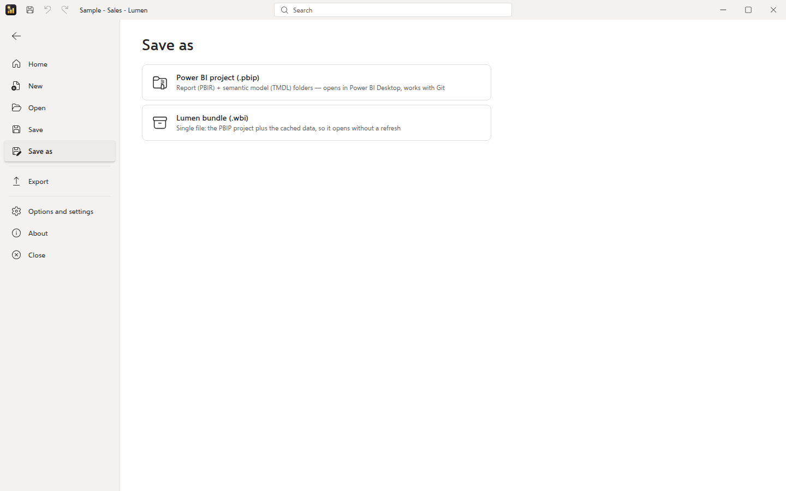

# Save your work and file types

> **Applies to:** Creators · Analysts · Developers

This article explains what **Save** and **Save as** do in Lumen, which file formats Lumen can write, and which it can
only open. Read it before you save a report that you opened from a `.pbix` file.

## What Lumen can open and what it can save

| Format | Open | Save |
|---|---|---|
| Power BI project (`.pbip` with a `*.Report` and a `*.SemanticModel` folder) | Yes | **Yes** |
| A `*.Report` or `*.SemanticModel` folder on its own | Yes | **Yes**, as a PBIP project (see below) |
| Lumen bundle (`.wbi`) | Yes | **Yes** |
| Power BI Desktop file (`.pbix`) | Yes, with its data | No |
| Power BI template (`.pbit`) | Yes, without data | No |
| Tabular model file (`model.bim` on its own) | Yes, model only | No (only inside a PBIP project) |

Lumen writes two formats:

- **Power BI project (PBIP)**: a `<Name>.pbip` file, a `<Name>.Report` folder with the report in the PBIR format and
  a `<Name>.SemanticModel` folder with the model in the TMDL format (or as `model.bim` when the model was opened from
  one). It holds definitions only, no data. It is the format Power BI Desktop uses for source control, and it suits
  Git. See [Working with PBIP projects](../files-and-compatibility/working-with-pbip-projects.md).
- **Lumen bundle (`.wbi`)**: one file that contains the same PBIP project plus the data currently loaded in Lumen, so
  the report reopens with its data and without a refresh. Only Lumen opens it. See
  [The .wbi bundle](../files-and-compatibility/the-wbi-bundle.md).

> [!IMPORTANT]
> Lumen cannot write `.pbix` or `.pbit` files. The data model inside a `.pbix` file is stored in a proprietary
> format that Lumen can read but not produce. To continue in Power BI Desktop with work you did in Lumen, save as
> PBIP and open the `.pbip` file in Power BI Desktop. That path is designed to work but not verified by this
> project; see [Round-trip with Power BI Desktop](../files-and-compatibility/round-trip-with-power-bi-desktop.md).

## Save

Select **Save** in the title bar, **File > Save**, or press Ctrl+S. What happens depends on where the report came
from:

| The report was opened from | Save writes to |
|---|---|
| A `.pbip` file | The same project, in place |
| A project folder or a `*.Report` folder | The `<Name>.pbip` next to the `*.Report` folder, and the `*.Report` and `*.SemanticModel` folders, in place |
| A `*.SemanticModel` folder | The same folder, in place (no `.pbip` file or report is written, because there is no report) |
| A `.wbi` bundle | The same bundle, replaced |
| A `.pbix` or `.pbit` file, the sample report, a blank report | Nothing yet: **Save** opens **Save as** |
| A standalone `model.bim` file | A new project named after the file, `model.bim.pbip` (see [Considerations and limitations](#considerations-and-limitations)) |

When Lumen saves a PBIP project in place, it rewrites only the files whose content changed. Files you did not
touch keep their exact bytes, which keeps Git diffs small. Files of pages, visuals, bookmarks or tables you deleted
are removed. Lumen never writes data into a PBIP project.

## Save as

1. Select **File > Save as**, or press Ctrl+Shift+S.
2. Choose the format:
   - **Power BI project (.pbip)**: "Report (PBIR) + semantic model (TMDL) folders — opens in Power BI Desktop,
     works with Git".
   - **Lumen bundle (.wbi)**: "Single file: the PBIP project plus the cached data, so it opens without a refresh".

   (Ctrl+Shift+S skips this choice and opens the file dialog with both formats in its file-type list.)
3. In the file dialog, choose a folder and a name, and select **Save**.

For PBIP, the name you type becomes the project name: Lumen writes `<Name>.pbip`, `<Name>.Report` and
`<Name>.SemanticModel` into the chosen folder, and points the report at `../<Name>.SemanticModel`. If you type a name
without the `.pbip` extension, Lumen adds it.

After a successful save Lumen shows "Saved to <path>", adds the file to the recent list, and from then on **Save**
writes to the new location.

**File > Export > Power BI project (.pbip)** does the same as **Save as > Power BI project (.pbip)**: the open report
then points at the new project.

## Unsaved changes

An asterisk after the report name in the title bar marks unsaved changes. When you open another file, create a new
report, close the report or close the window with unsaved changes, Lumen asks
"Do you want to save your changes to "<Name>"?" with **Save**, **Don't save** and **Cancel**.

> [!WARNING]
> Lumen does not save automatically and has no recovery of unsaved work after a crash. The option
> **Store auto-recovery information** in **File > Options and settings > Options > Report settings** is stored, but
> nothing in this version uses it. Save often.

## Which format to choose

| You want to | Choose |
|---|---|
| Keep the report in Git, review changes, work with others | PBIP |
| Continue in Power BI Desktop | PBIP (designed to open there; not verified) |
| Reopen the report in Lumen with its data, without the sources | `.wbi` |
| Hand someone a single file that opens in Lumen | `.wbi` |
| Keep a report that uses generated sample data together with that data | `.wbi` |

## Considerations and limitations

- No `.pbix`, `.pbit` or standalone `model.bim` output.
- PBIP output contains no data: a reopened project shows the **No data loaded** notice until you refresh or use
  sample data. Files that Power BI Desktop keeps in the project's `.pbi` folders, such as a data cache, are left on
  disk untouched; Lumen does not update them.
- A model opened from a standalone `model.bim` file has no PBIP location yet. Use **Save as**. In this version
  **Save** (Ctrl+S) on such a model does not open **Save as**: it saves to a project named after the file,
  `model.bim.pbip`, which writes a new `model.bim.SemanticModel` folder next to the `.bim` file.
- The model folder is always named after the project: `<Name>.SemanticModel`. If a report you opened points at a
  model folder with a different name (for example a model shared by several reports), saving in place writes a new
  `<Name>.SemanticModel` folder and points the report at it; the original model folder is left as it was.
- Saving a report that was connected live to a service model writes the report folder only.

## Related content

- [Supported file formats](../files-and-compatibility/supported-file-formats.md)
- [Working with PBIP projects](../files-and-compatibility/working-with-pbip-projects.md)
- [The .wbi bundle](../files-and-compatibility/the-wbi-bundle.md)
- [Round-trip with Power BI Desktop](../files-and-compatibility/round-trip-with-power-bi-desktop.md)
- [File format support reference](../reference/file-format-support.md)
