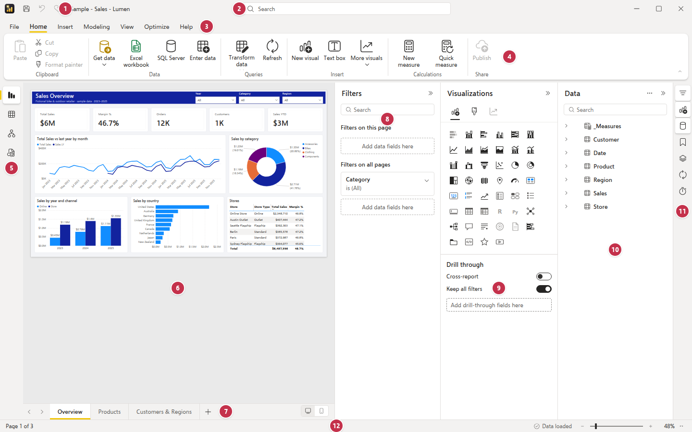
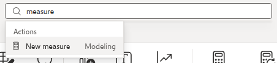
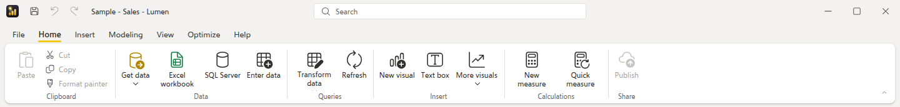
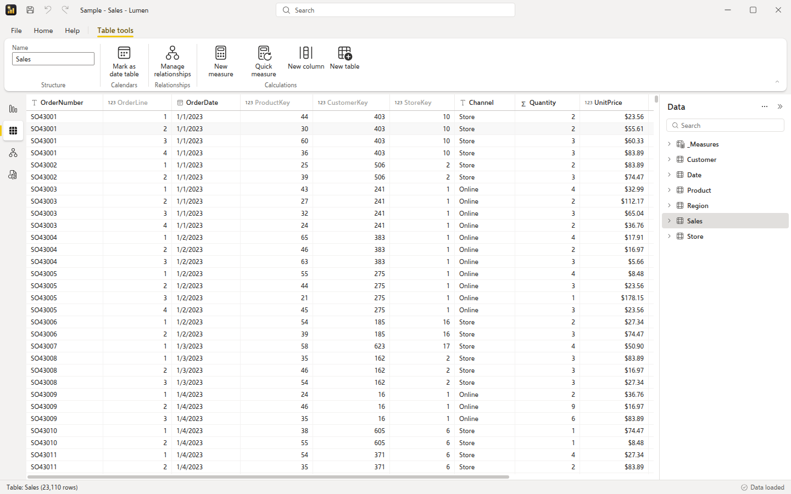
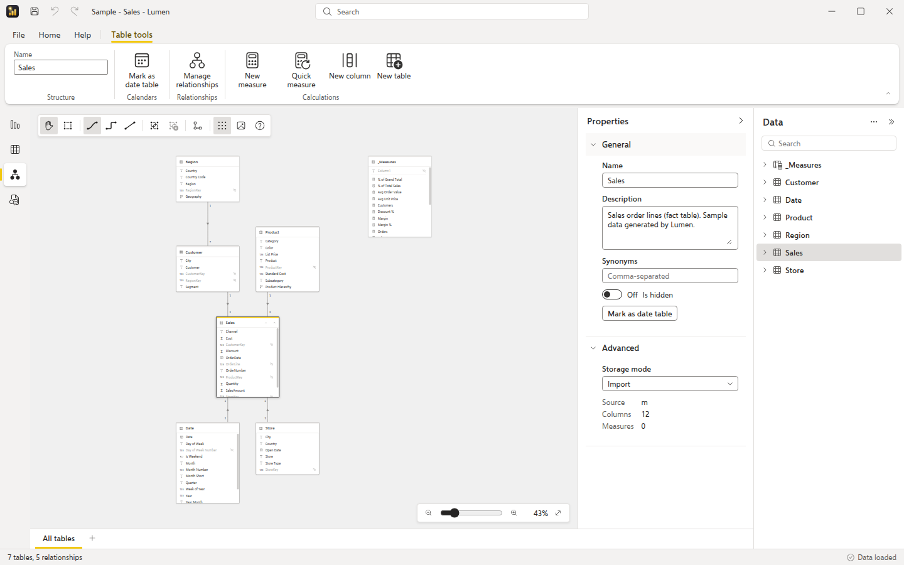
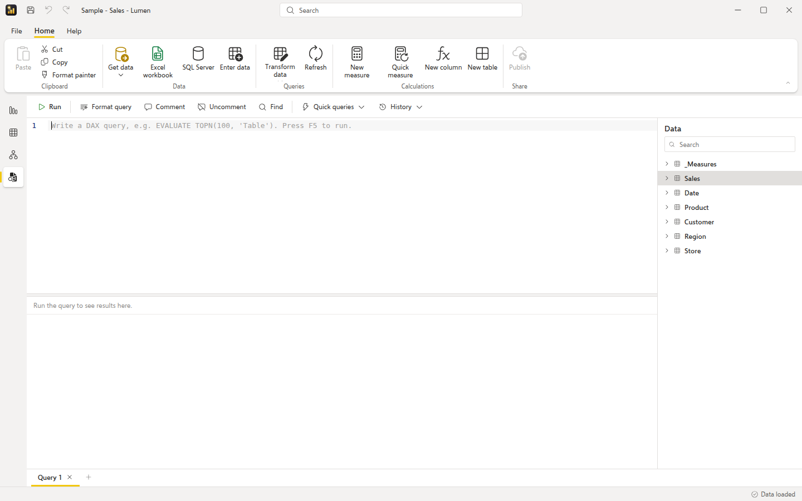
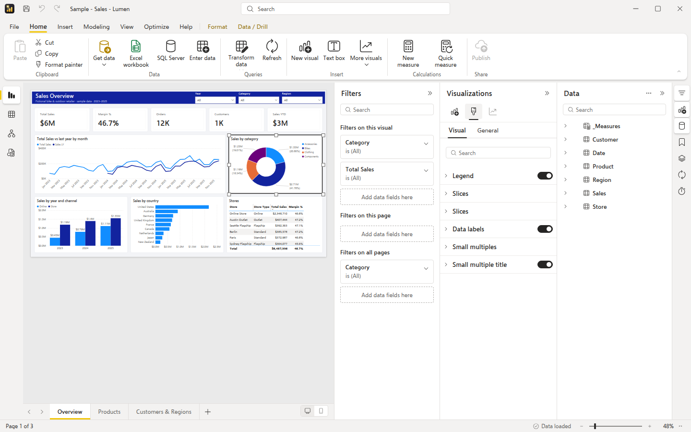
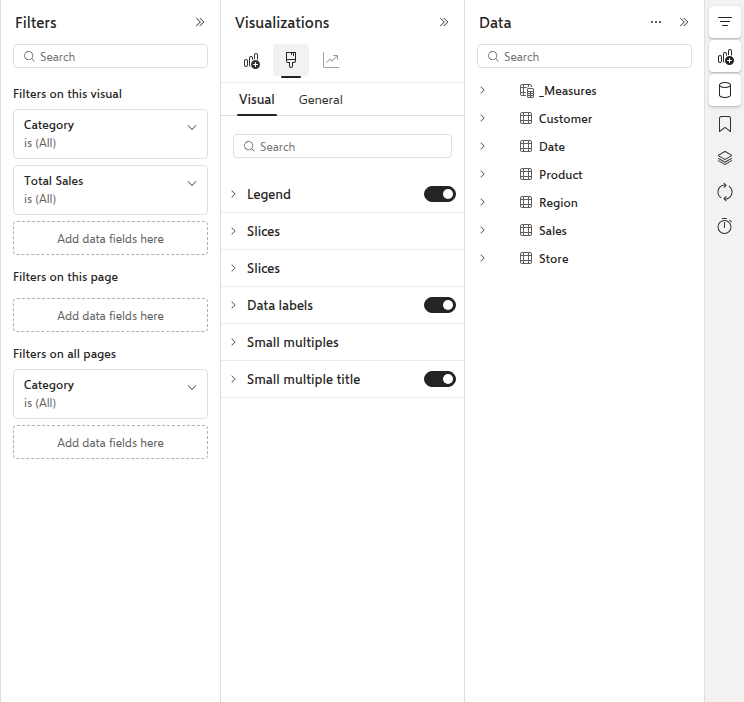
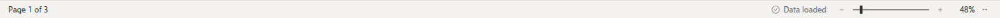
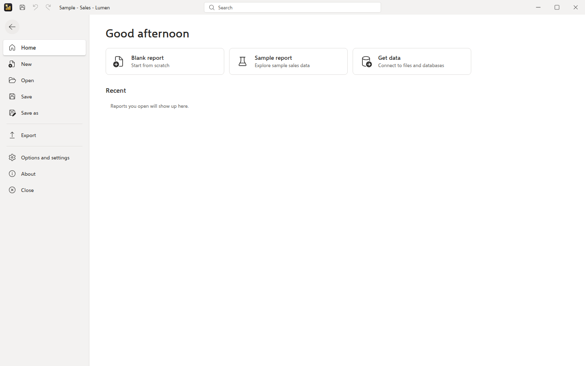

# Tour of the interface

> **Applies to:** Creators · Analysts

This article names the parts of the Lumen window and says what each one is for. If you know Power BI Desktop, most
of it will look familiar; the article points out where Lumen differs.

The screenshots show the built-in sample report (**File > New > Sample report**) in a 1440 x 900 window.

| # | Area | What it is for |
|---|---|---|
| 1 | Title bar and quick access buttons | **Save** (Ctrl+S), **Undo** (Ctrl+Z) and **Redo** (Ctrl+Y), the report name (an asterisk marks unsaved changes) |
| 2 | Search box | Find and run a command by name |
| 3 | Ribbon tabs | **File** and the command tabs for the current view |
| 4 | Ribbon commands | The commands of the selected tab, in named groups |
| 5 | View switcher | **Report view**, **Table view**, **Model view**, **DAX query view** |
| 6 | Report canvas | The current report page, where you add, move and resize visuals |
| 7 | Page tabs | One tab per report page, the **+** button for a new page, and the **Web layout** / **Mobile layout** switch |
| 8 | Filters pane | Filters on this visual, on this page and on all pages |
| 9 | Visualizations pane | Choose a visual type, assign fields, format, add analytics |
| 10 | Data pane | The tables, columns, measures and hierarchies of the model |
| 11 | Pane switcher | Show or hide the panes |
| 12 | Status bar | Page number, data status, zoom |

## Title bar and search

The title bar holds the Lumen logo, three quick access buttons (**Save**, **Undo**, **Redo**), the name of the open
report, a **Search** box and the window buttons. Double-click the title bar to maximize or restore the window.

The **Search** box finds commands by name and keyword: type "measure" to find **New measure**, "pdf" to find
**Export to PDF**, "sample" to find the sample-data commands. Use the Up and Down arrow keys to move through the
results and Enter to run one.

> [!NOTE]
> The search box searches Lumen's commands. Unlike Power BI Desktop's search, it does not search the fields of your
> model or Microsoft's help content.

## Ribbon

The ribbon has these tabs in Report view:

| Tab | Main groups |
|---|---|
| **File** | Opens the File menu (see [below](#file-menu)) |
| **Home** | Clipboard, Data (**Get data**, **Excel workbook**, **SQL Server**, **Enter data**), Queries (**Transform data**, **Refresh**), Insert, Calculations, Share |
| **Insert** | Pages, Visuals, AI visuals, Elements (text box, buttons, shapes, image, icon) |
| **Modeling** | Relationships, Calculations, Parameters, Calculation groups, Security, Date table |
| **View** | Themes, Scale to fit, Page options (gridlines, snap to grid, lock objects), Show panes, Reading view, Mobile layout |
| **Optimize** | Refresh visuals, performance recording, the Performance analyzer pane |
| **Help** | Links to Microsoft Learn and the Power BI community, and **About** |

Contextual tabs appear in a different colour when they apply: **Format** and **Data / Drill** when a visual is
selected, **Table tools**, **Column tools** or **Measure tools** when a table, column or measure is selected in the
Data pane. Table view, Model view and DAX query view show their own set of tabs (**Home**, **Help** and the
contextual ones).

To collapse the ribbon to its tabs, double-click a tab or press Ctrl+F1; do the same to pin it open again.

## Views

The rail on the left switches between the four views. Table, Model and DAX query view need an open model.

| View | Use it to | Screenshot |
|---|---|---|
| **Report view** | Build and read report pages | The annotated screenshot above |
| **Table view** | Browse the rows of a table, add calculated columns and tables |  |
| **Model view** | See tables and relationships as a diagram, edit relationships and properties |  |
| **DAX query view** | Write and run DAX queries against the model |  |

The Power Query editor is a fifth, separate view. Open it with **Home > Transform data**; it replaces the window's
contents (with its own ribbon) until you leave it with **Close & Apply**. See [Connect and transform data](../connect-and-transform/README.md).

## Report canvas and page tabs

The canvas shows the current page. Click a visual to select it: handles appear on its border and the **Format** and
**Data / Drill** tabs appear on the ribbon. Hover over a visual to see its header icons, such as
**Filters and slicers affecting this visual**, **Focus mode** and **More options**.

Below the canvas:

- the **page tabs**; double-click a tab to rename it, drag it to reorder, right-click it for more options;
- the **+** button, which adds a page after the current one;
- the **Web layout** / **Mobile layout** switch at the right, which edits the phone layout of the page.

Press Ctrl+Page Down and Ctrl+Page Up to move to the next and previous page.

## Panes

The panes sit to the right of the canvas. The pane switcher on the far right shows or hides each one: **Filters**,
**Visualizations**, **Data**, **Bookmarks**, **Selection**, **Sync slicers** and **Performance analyzer**. The
**View** ribbon tab has the same toggles under **Show panes**. Each pane collapses to a narrow strip with the
double chevron in its header.

### Filters pane

Lists the filters that apply to the selected visual (**Filters on this visual**), to the page
(**Filters on this page**) and to the whole report (**Filters on all pages**). Drag a field to an
**Add data fields here** box to add a filter.

### Visualizations pane

It has three tabs:

- **Build visual**: the gallery of visual types and, for the selected visual, its field wells (for a column chart:
  **X-axis**, **Y-axis**, **Legend**, **Small multiples**, **Tooltips**), plus drill-through settings.
- **Format visual** (or **Format page** when no visual is selected): the Format pane. Its **Visual** and **General**
  tabs hold the format cards, such as **Legend**, **Data labels**, **Title** and **Effects**. A search box at the top
  finds a setting by name.
- **Add further analyses to your visual**: the Analytics pane (reference lines and similar), for the visual types
  that support it.

### Data pane

Shows the model's tables. Expand a table to see its columns, measures (grouped in display folders when the model
has them) and hierarchies. Tick a field to add it to the selected visual, or to a new visual when none is selected;
drag a field onto a field well or the canvas for more control.

## Status bar

| Part | Meaning |
|---|---|
| Left | In Report view **Page n of m**; in Table view the selected table and its row count; in Model view the number of tables and relationships |
| **Data loaded** | Every table has data |
| **n table(s) without data** | Some tables are empty; see [Reports without data and sample data](../files-and-compatibility/reports-without-data-and-sample-data.md) |
| **Sample data** badge | Some tables hold generated sample rows; select it to regenerate them or refresh from the source |
| **n table errors** / **Engine error** | A refresh failed or the model could not be loaded; hover for the details |
| Zoom | Zoom out, the zoom slider (10% to 400%), zoom in, the percentage and **Fit to page** |

## File menu

**File** opens a full-window menu, as in Power BI Desktop. Press Esc or the back arrow to return to the report.

| Item | What it does |
|---|---|
| **Home** | Blank report, Sample report, Get data, and your recent files |
| **New** | Blank report or Sample report |
| **Open** | **Browse this device** (a file) or **Open a folder** (a PBIP project, `.Report` or `.SemanticModel` folder), and recent files |
| **Save** / **Save as** | See [Save your work and file types](save-and-file-types.md) |
| **Export** | PDF, PowerPoint, PNG images, HTML, and a PBIP copy |
| **Options and settings** | **Options** (data load, regional settings, report settings, security, diagnostics) and **Data source settings** |
| **About** | Version information |
| **Close** | Closes the report (asks to save changes) |

## Differences from Power BI Desktop

- There is no **Publish** to the Power BI service: the button is disabled.
- The title-bar search finds commands only.
- The **Help** tab links to Microsoft's Power BI documentation, which describes Power BI Desktop, not Lumen.
- Table, Model and DAX query view show only the **Home** and **Help** tabs plus contextual tabs; the **Modeling**
  tab exists in Report view.
- The Power Query editor replaces the main window's contents instead of opening a second window.

## Related content

- [Quickstart: open a report](quickstart-open-a-report.md)
- [Tutorial: build your first report](tutorial-build-your-first-report.md)
- [Keyboard shortcuts](../reference/keyboard-shortcuts.md)
- [Create reports](../create-reports/README.md)
- [Coming from Power BI Desktop](coming-from-power-bi-desktop.md)
