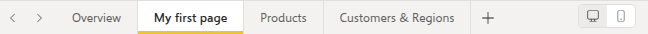
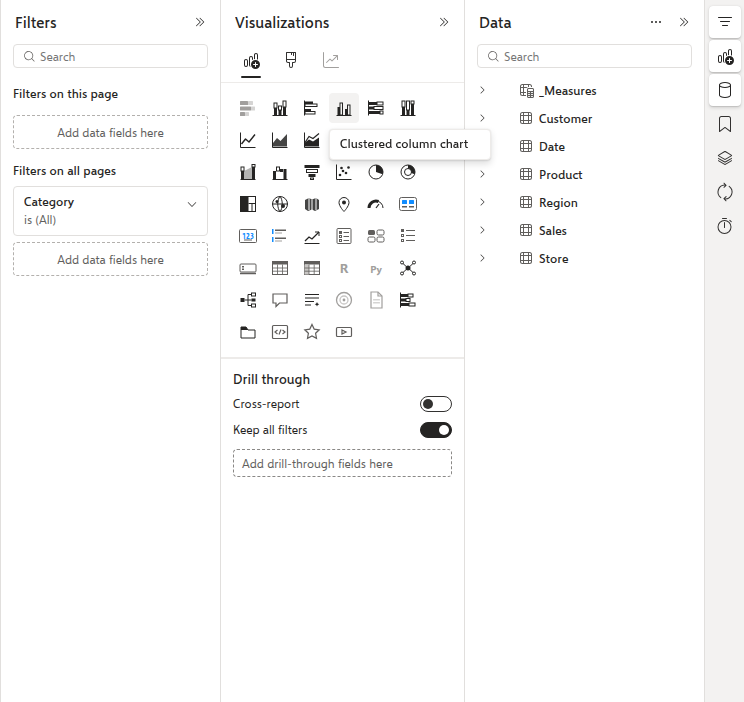
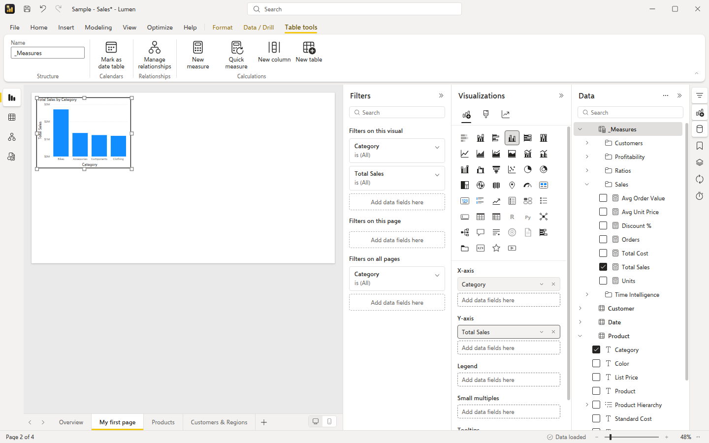
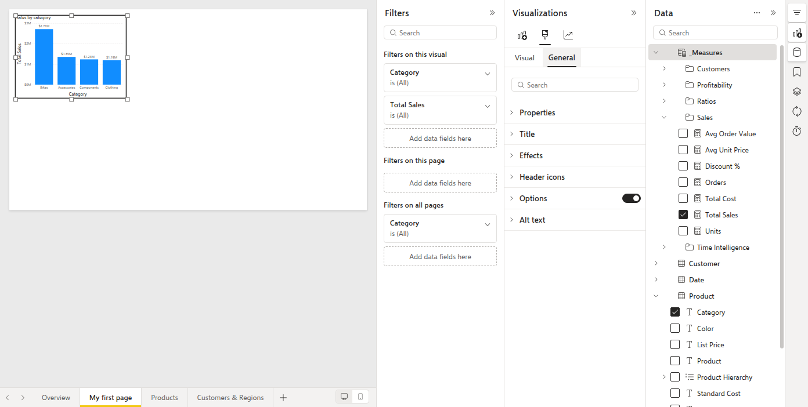
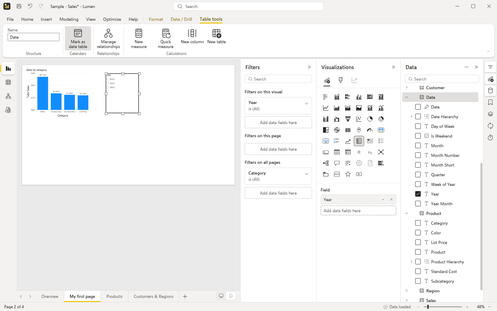
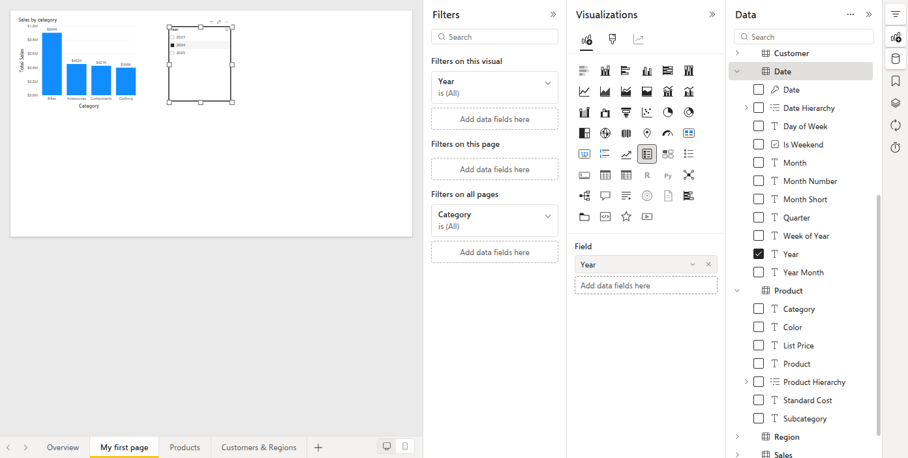

# Tutorial: build your first report

> **Applies to:** Creators

In this tutorial you add a page to the built-in sample report and build it up: a column chart of sales by product
category, a title and data labels, and a slicer that filters the chart by year. Then you save the result as a Power
BI project. It takes about fifteen minutes and uses only the sample's data, so you need no files of your own.

In this tutorial you learn how to:

- add and rename a report page;
- add a visual from the Visualizations pane and assign fields to it;
- format a visual with the Format pane;
- add a slicer and use it;
- save a report as a PBIP project.

## Prerequisites

- Lumen is installed and starts. See [Install Lumen on Linux](install-on-linux.md).
- You know where the panes are. If not, skim the [tour of the interface](tour-of-the-interface.md) first.

## Open the sample report

1. Start Lumen.
2. On the **Welcome to Lumen** screen, select **Try a sample**. (If the welcome screen is closed, select
   **File > New > Sample report**.)

The **Sample - Sales** report opens on its **Overview** page. Its model has a `Sales` fact table, the dimension
tables `Customer`, `Date`, `Product`, `Region` and `Store`, and a `_Measures` table that holds the measures in
display folders.

## Add a page

1. Select the **+** button to the right of the page tabs.

   Lumen adds an empty page named **Page 4** after the current page and switches to it.

2. Double-click the new tab, type `My first page` and press Enter.

## Add a column chart

1. In the **Visualizations** pane, make sure the **Build visual** tab (the first icon) is selected.
2. Select **Clustered column chart** in the gallery. Hover over an icon to see its name.

   

   An empty column chart appears on the page, selected, and the pane shows its field wells: **X-axis**, **Y-axis**,
   **Legend**, **Small multiples** and **Tooltips**.

3. In the **Data** pane, expand **Product** and select the check box next to **Category**. Lumen puts the column on
   the **X-axis** well.
4. Expand **_Measures**, then the **Sales** folder, and drag **Total Sales** onto the **Y-axis** well.

The chart now shows one column per category, sorted by Total Sales from highest to lowest (Bikes, Accessories,
Components, Clothing), with the automatic title **Total Sales by Category**.

> [!TIP]
> To make the chart bigger, drag one of its corner handles. Hold Shift while you drag to keep its proportions.

## Format the chart

1. With the chart still selected, select the **Format visual** tab (the paint brush icon) in the
   **Visualizations** pane.
2. Select the **General** tab, expand **Title**, then expand the inner **Title** card.
3. Select the **Text** box, replace the text with `Sales by category` and press Enter.
4. Select the **Visual** tab and turn on the **Data labels** switch.

The chart's title changes and each column shows its value.

Every change is one undo step: press Ctrl+Z to undo it and Ctrl+Y to redo it.

## Add a slicer

1. Click an empty area of the page to clear the selection. (If the chart stays selected, the next visual type you
   pick replaces the chart's type instead of adding a new visual.)
2. In the **Build visual** gallery, select **Slicer**.
3. In the **Data** pane, expand **Date** and select the check box next to **Year**.

   The slicer lists the years 2023, 2024 and 2025.

4. Drag the slicer by its top edge to the right of the chart so that the two do not overlap.

## Use the slicer

1. Select **2024** in the slicer.

   The chart filters to 2024: the columns and their labels change (Bikes drops from $2.71M for all years to $904K).
   The slicer's selection is shown by its filled check box.

2. To clear the filter, hover over the slicer and select **Clear selections** (the eraser icon).

## Save the report

The sample report was not opened from a file, so the first save asks where to put it.

1. Select **File > Save as** and then **Power BI project (.pbip)**, or press Ctrl+Shift+S.
2. Choose a folder, type the name `My first report` and select **Save**.

Lumen writes `My first report.pbip`, a `My first report.Report` folder and a `My first report.SemanticModel` folder
into the folder you chose, and confirms with "Saved to …". The asterisk disappears from the window title.

> [!IMPORTANT]
> A PBIP project contains the report and the model definition, not the data. When you open
> `My first report.pbip` again, Lumen shows the **No data loaded** notice: the sample's data was generated in memory
> and is not part of the project. Select **Use sample data** to fill it with generated values, or save as a
> `.wbi` bundle instead (**File > Save as > Lumen bundle (.wbi)**), which keeps the data. See
> [Save your work and file types](save-and-file-types.md).

## Clean up

Close the report with **File > Close**. To remove the project, delete the `.pbip` file and the two folders.

## Next steps

- [Create reports](../create-reports/README.md): pages, formatting, themes, interactions and export in depth.
- [Visuals](../visuals/README.md): every visual family.
- [DAX](../dax/README.md): write your own measures.

## Related content

- [Tour of the interface](tour-of-the-interface.md)
- [Save your work and file types](save-and-file-types.md)
- [Working with PBIP projects](../files-and-compatibility/working-with-pbip-projects.md)
- [Keyboard shortcuts](../reference/keyboard-shortcuts.md)
