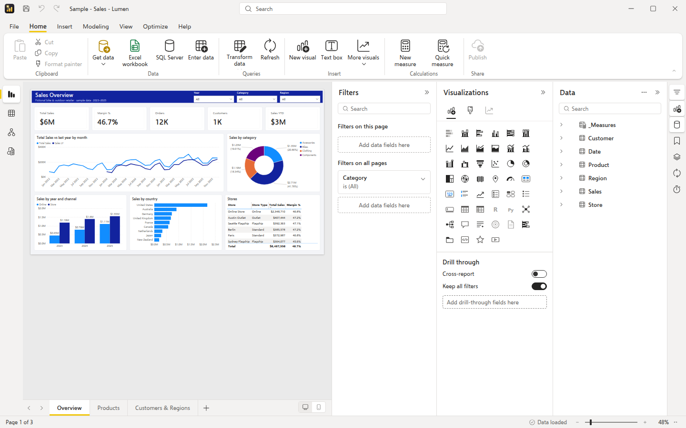

# What is Lumen?

> **Applies to:** Creators · Analysts · Developers

This article describes what Lumen is, who it is for and what it does not do. Read it before you install Lumen or
when you need to explain it to someone else.

Lumen is a desktop application for Linux that works with Power BI files. It opens `.pbix` and `.pbit` files and
Power BI projects (PBIP), shows their reports the way Power BI Desktop draws them, and lets you edit the report,
the data model and the queries, refresh data, and export pages. Everything runs on your computer: Lumen has its own
engine for DAX (the formula language of Power BI measures) and its own engine for Power Query M (the language of
Power BI queries).

## Who Lumen is for

| You are | You use Lumen to |
|---|---|
| A **report creator** on Linux | Open, edit and build Power BI reports: pages, visuals, formatting, themes, slicers, filters, bookmarks, a mobile layout; export pages to PDF, PowerPoint, PNG or HTML. |
| An **analyst** | Connect to files, databases and web APIs, shape data in a Power Query editor, model tables and relationships, write measures and run DAX queries, and check the numbers a report shows. |
| A **developer** | Read a report's definition, keep a report in Git as a PBIP project, or extend Lumen itself: its engines, visuals and file readers are open source TypeScript. |

## What Lumen does

- **Opens Power BI files**: `.pbix` (with the data stored in the file), `.pbit` templates, PBIP projects (a report
  folder in the PBIR format and a semantic model folder in the TMDL format or as `model.bim`), and Lumen's own `.wbi`
  bundles. See [Supported file formats](../files-and-compatibility/supported-file-formats.md).
- **Draws reports like Power BI Desktop**, using the report's own formatting and theme, with renderers for the
  Power BI visual types. See [Visuals](../visuals/README.md).
- **Edits reports** with a ribbon, a Visualizations pane with a Format pane, a Filters pane, a Data pane and the other
  panes Power BI Desktop has. See [Create reports](../create-reports/README.md).
- **Works with data**: Get data, a Power Query editor, refresh. See
  [Connect and transform data](../connect-and-transform/README.md).
- **Models and calculates**: Table view, Model view, relationships, measures, calculated columns and tables,
  calculation groups, roles, and a DAX query view. See [Model data](../model-data/README.md) and [DAX](../dax/README.md).
- **Fills reports that have no data with sample data**, so you can work on a report whose data source you cannot
  reach. See [Reports without data and sample data](../files-and-compatibility/reports-without-data-and-sample-data.md).
- **Saves as a Power BI project (PBIP)** or as a `.wbi` bundle, and **exports** to PDF, PowerPoint, PNG and HTML.
  See [Save your work and file types](save-and-file-types.md).

## What Lumen is not

- **Not a Microsoft product.** Lumen is an independent open-source project. It is not affiliated with or endorsed by
  Microsoft. It does not need Power BI Desktop, a Power BI licence or a Microsoft account to open, edit or save a
  report. (A connector you choose to use, such as SQL Server with Microsoft Entra ID sign-in, talks to that
  service.)
- **Not the Power BI service.** Lumen cannot publish to the Power BI service or to Microsoft Fabric. The **Publish**
  button on the **Home** tab is present, as in Power BI Desktop, but it is disabled; its tooltip suggests saving as
  PBIP and using Fabric Git integration instead. There are no dashboards, apps, workspaces, sharing or scheduled
  refresh.
- **Not a `.pbix` writer.** Lumen reads `.pbix` and `.pbit` files but cannot write them. Work that started in a
  `.pbix` file is saved as a PBIP project or a `.wbi` bundle.
- **Not a byte-for-byte clone of Power BI Desktop.** Lumen reimplements Power BI's behaviour from the published file
  formats and from observation. Some visuals and features are approximations, and some are missing. Each article
  says where; [Coming from Power BI Desktop](coming-from-power-bi-desktop.md) collects the differences.
- **Not a cross-platform release.** Lumen is developed and run on Linux. It has no Windows or macOS build in this
  repository.

## How Lumen relates to Power BI Desktop

Lumen reads and writes the same project format that Power BI Desktop uses for source control (PBIP), so the same
report can move between the two. A PBIP project saved by Lumen is **designed to** open in Power BI Desktop. This
project has not tested that on Windows; read
[Round-trip with Power BI Desktop](../files-and-compatibility/round-trip-with-power-bi-desktop.md) before you rely on
it.

> [!NOTE]
> The interface uses Power BI Desktop's layout, labels and icons on purpose, so that what you know from Power BI
> applies. Where a label or a behaviour differs, the article that covers the feature says so.

## Related content

- [Install Lumen on Linux](install-on-linux.md)
- [Quickstart: open a report](quickstart-open-a-report.md)
- [Tour of the interface](tour-of-the-interface.md)
- [Coming from Power BI Desktop](coming-from-power-bi-desktop.md)
- [Power BI Desktop documentation on Microsoft Learn](https://learn.microsoft.com/power-bi/fundamentals/desktop-what-is-desktop)
