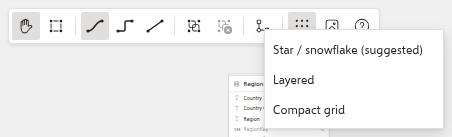
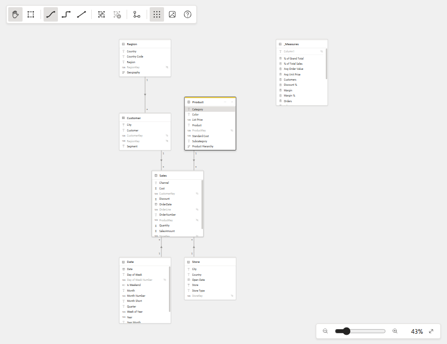
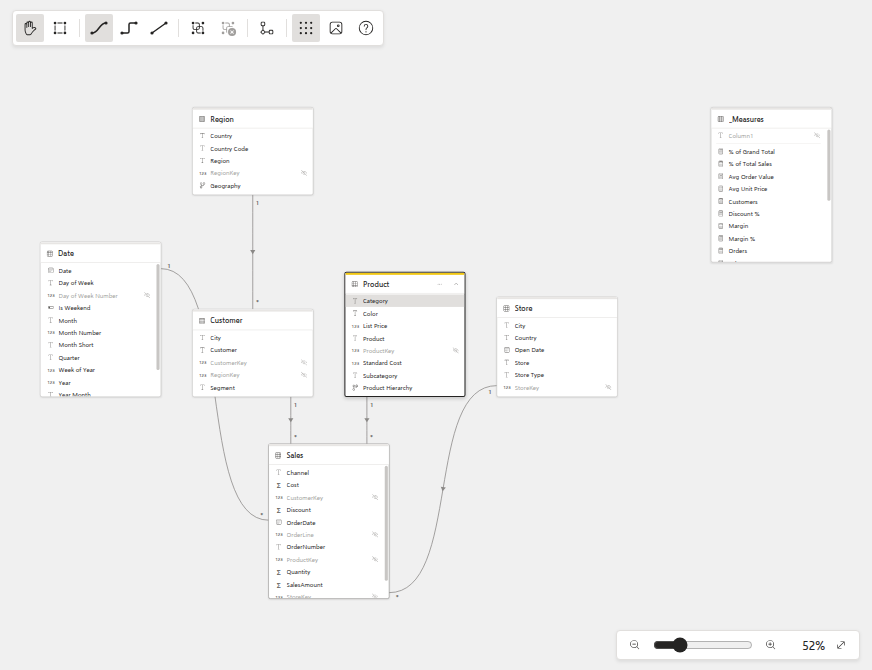
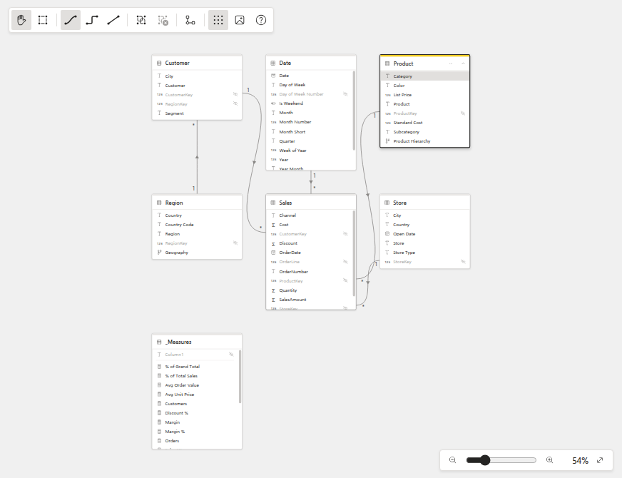
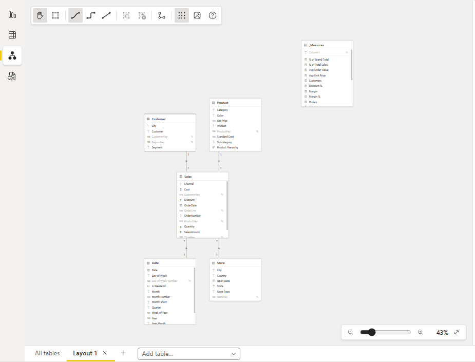

# Arrange the diagram

> **Applies to:** Creators · Analysts

A readable diagram puts fact tables in the middle and their dimension tables around them. This article shows how to let Lumen lay out the tables for you with **Auto arrange**, how to place and size cards yourself, and how to use layouts (tabs) to show a part of a large model.

## Prerequisites

- A model open in **Model view**. The screenshots use the built-in sample.

## Auto arrange the tables

1. On the diagram toolbar, select **Auto arrange** (or right-click the empty canvas and point to **Auto arrange**).
2. Select an arrangement. The one Lumen recommends for your model is marked **(suggested)**.

The cards move to their new places in a short animation, and the view zooms to fit the result. The whole arrangement is one undo step: Ctrl+Z puts every card back.

| Arrangement | Layout | Suggested when |
|---|---|---|
| **Star / snowflake** | Fact tables in a middle row, their dimensions in rows above and below; dimensions shared by several facts sit between them; snowflaked dimensions (a dimension of a dimension, such as `Region` behind `Customer`) go further out on their parent's side. | The model has at least two related tables and at most three fact tables. |
| **Layered** | Dimensions in rows at the top (snowflake levels higher up), fact tables in the bottom row. | More than three fact tables. |
| **Compact grid** | Every table in a compact grid: groups first, then tables in alphabetical order. | Fewer than two related tables. |

For **Star / snowflake** and **Layered**, Lumen orders each row to reduce line crossings and centres each table over its neighbours. Very wide rows wrap into staggered sub-rows. Lumen classifies each table from its relationships: a table only on the many side of relationships is a fact, a table on the one side is a dimension, and a small table between two facts (or with a both-directions filter) is a bridge. Tables without relationships (measure tables, parameters, calculation groups, date and calculated tables) are placed in a block to the right, grouped by kind.

| Star / snowflake | Layered | Compact grid |
|---|---|---|
|  |  |  |

### Arrange only some tables

1. Select two or more cards (Ctrl+click their headers, or Shift+drag a box around them).
2. Select **Auto arrange**, point to **Arrange *N* selected tables**, and select an arrangement.

The selected tables are arranged where they were (from the top-left corner of their current extent); the rest of the diagram does not move, and the zoom is left as it is.

### What Auto arrange changes

- Card positions, in the current layout only.
- Pinch points and manual line ends of every line attached to a moved table are removed, because they would no longer fit (see [Relationship lines and pinch points](relationship-lines-and-pinch-points.md)). Line styles are kept.
- [Table groups](table-groups.md) are arranged as units: the members of a group are packed inside their container and the container takes part in the layout like one table. Selecting one member for **Arrange selected tables** takes its whole group along. Manually resized group containers return to their fitted size.

Nothing is written to disk until you save.

## Place and size cards yourself

- **Move** a card by dragging its header. Select several cards first to move them together.
- **Resize** a card by dragging the handle at its bottom-right corner. A card can be made taller to show all of its fields, or shorter to save space (its field list scrolls).
- **Collapse** a card to its header with the chevron in the header, or **Collapse** on its right-click menu. Collapsed cards are not saved.
- **Fit to screen** (zoom bar, or the canvas right-click menu) zooms and pans so the whole layout is visible.

Positions and sizes are saved in `diagramLayout.json`, the file Power BI Desktop uses for the same purpose.

## Use layouts

A layout is a tab at the bottom of Model view with its own set of cards and positions. **All tables** always shows every table.

1. Select **+** (**New layout**) next to the tabs. A tab named **Layout 1** (then **Layout 2**, …) opens.
2. To add a table, use the **Add table…** box that appears next to the tabs on layouts other than **All tables**.
3. To take a table off the layout, right-click its card and select **Remove from diagram**. The table stays in the model.
4. To delete the layout, select its tab and then the **×** on the tab. Its line styles, pinch points and groups are deleted with it.

Line styles, pinch points and table groups are stored per layout, so the same relationship can be drawn differently on two tabs.

> [!IMPORTANT]
> A new layout currently opens showing every table of the model in an automatic arrangement, not empty, and **Add table…** has nothing to add. **Remove from diagram** has no effect on such a layout until you have moved at least one card on it; after that it works. Move any card slightly, then remove the tables you do not want. This is a known defect.

## Differences from Power BI Desktop

- **Auto arrange** with its three arrangements, arranging a selection, and the suggested arrangement are Lumen features. Power BI Desktop has a single automatic layout command.
- Collapsed cards are not saved.

## Considerations and limitations

- Auto arrange needs at least two tables in the layout.
- The arrangement is deterministic: the same model always gives the same result.
- A model that has no stored card positions is laid out with the suggested arrangement when Model view first shows it.

## Related content

- [Model view overview](model-view-overview.md)
- [Relationship lines and pinch points](relationship-lines-and-pinch-points.md)
- [Table groups](table-groups.md)
- [Export the diagram](export-the-diagram.md)
