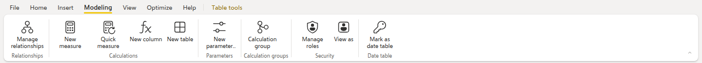
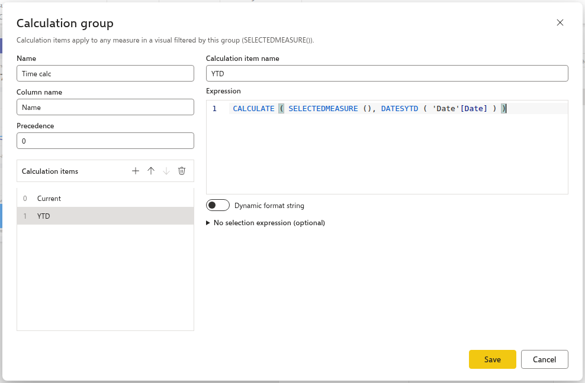
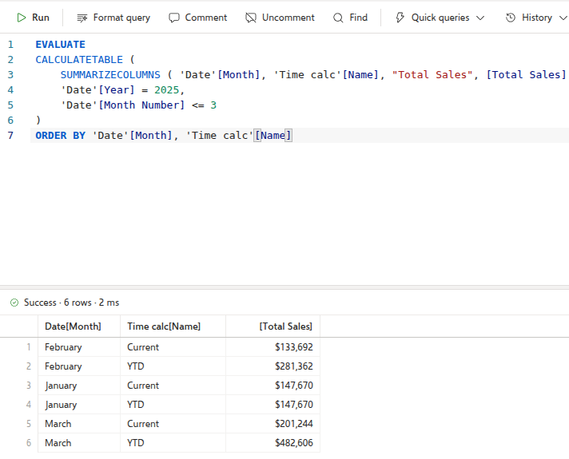

# Calculation groups

> **Applies to:** Analysts

A calculation group is a special table whose rows, called calculation items, rewrite whatever measure a visual shows: for example a `YTD` item turns every measure into its year-to-date value. This article shows how to create and edit a calculation group in Lumen and checks the result with a DAX query on the built-in sample.

## Prerequisites

- A model open in Lumen. The steps use the sample.
- Familiarity with `SELECTEDMEASURE()`; see [Microsoft Learn: Calculation groups](https://learn.microsoft.com/analysis-services/tabular-models/calculation-groups).

## Create a calculation group

1. Switch to **Report view** and open the **Modeling** tab.
2. Select **Calculation group**.
3. If the model does not discourage implicit measures yet, Lumen asks to turn on **Discourage implicit measures**, as Power BI does: visuals will no longer aggregate columns automatically. Select **Yes**.
4. Lumen adds a table named **Calculation group** with one item, **Calculation item** (`SELECTEDMEASURE()`), and opens the **Calculation group** dialog.



## Edit the group and its items

In the **Calculation group** dialog:

| Field | Purpose |
|---|---|
| **Name** | The table's name. |
| **Column name** | The name of the column that lists the items (default **Name**). Visuals and slicers use this column. |
| **Precedence** | Order in which several calculation groups apply (a warning appears when another group has the same value). |
| **Calculation items** | The list of items. **New calculation item** (+) adds one; **Move up**, **Move down** set the order (the hidden `Ordinal` column sorts the items); **Delete calculation item** removes one. |
| **Calculation item name** | The selected item's name. Names must be unique and not empty. |
| **Expression** | The item's DAX, usually built around `SELECTEDMEASURE()`. |
| **Dynamic format string** | Optional format string expression for the item, starting from `SELECTEDMEASUREFORMATSTRING()`. |
| **No selection expression (optional)** | The expression applied when no item is selected. |

Select **Save** to apply. To reopen the dialog later, select the table and choose **Edit calculation group** in the **Properties** pane.

### Example: Current and YTD

1. Set **Name** to `Time calc`.
2. Rename the first item to `Current` and keep its expression `SELECTEDMEASURE()`.
3. Select **New calculation item**, name it `YTD`, and set its expression:

   ```dax
   CALCULATE ( SELECTEDMEASURE (), DATESYTD ( 'Date'[Date] ) )
   ```

4. Select **Save**.



Use `'Time calc'[Name]` on a visual's columns or in a slicer and any measure in the visual shows its current or year-to-date value. The query below, run in DAX query view after these steps, shows `Total Sales` for the first quarter of 2025 under both items:

```dax
EVALUATE
CALCULATETABLE (
    SUMMARIZECOLUMNS ( 'Date'[Month], 'Time calc'[Name], "Total Sales", [Total Sales] ),
    'Date'[Year] = 2025,
    'Date'[Month Number] <= 3
)
ORDER BY 'Date'[Month], 'Time calc'[Name]
```

| Date[Month] | Time calc[Name] | [Total Sales] |
|---|---|---|
| February | Current | $133,692 |
| February | YTD | $281,362 |
| January | Current | $147,670 |
| January | YTD | $147,670 |
| March | Current | $201,244 |
| March | YTD | $482,606 |

`ORDER BY 'Date'[Month]` sorts the month names alphabetically: a DAX query's `ORDER BY` uses the column's own values, not its **Sort by column** setting.



## Differences from Power BI Desktop

- The calculation group editor is a single dialog rather than Power BI's Model explorer and properties.
- Calculation groups are created from the **Modeling** tab in Report view only.

## Considerations and limitations

- A calculation group table has no rows to show in Table view; Table view says so.
- Calculation group tables cannot take part in relationships created in Lumen.
- For how Lumen applies calculation items (precedence, recursion, `SELECTEDMEASURE`, format strings), see [Known differences from the Power BI engine](../dax/known-differences-from-the-power-bi-engine.md).

## Related content

- [Time intelligence](../dax/time-intelligence.md)
- [Create measures](../dax/create-measures.md)
- [DAX query view](../dax/dax-query-view.md)
- [Column and table properties](column-and-table-properties.md)
