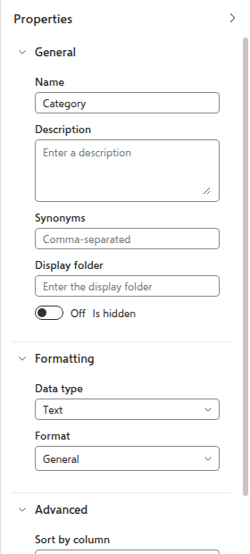
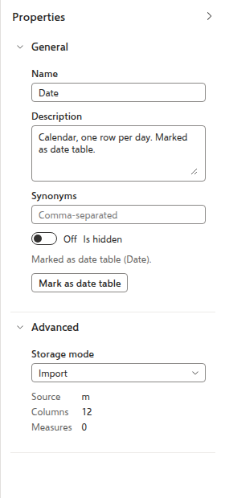
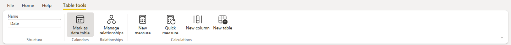
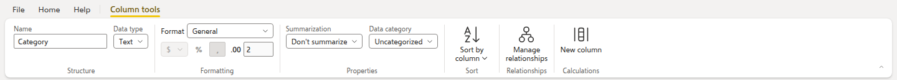

# Column and table properties

> **Applies to:** Creators · Analysts

Properties control how tables, columns and measures appear and behave in reports: their names, descriptions, data types, format strings, default summarization, sort order, data category and visibility. This article lists every property Lumen lets you change, where to find it, and how it differs from Power BI Desktop.

## Where to edit properties

| Place | How to open it | What it offers |
|---|---|---|
| **Properties** pane | Model view, right side. Select a table, column, measure, hierarchy or relationship on the diagram or in the **Data** pane. | Every property in this article, in the cards **General**, **Formatting** and **Advanced** |
| **Table tools**, **Column tools**, **Measure tools** ribbon tabs | Select a table, column or measure in Report, Table or Model view | The most used properties, as in Power BI Desktop |
| Right-click menus | Data pane, table cards, Table view column headers | Rename, hide, delete, display folder (measures), new hierarchy (columns) |

Text boxes in the Properties pane apply when you press Enter or leave the box. Every change is one undo step.

| Column properties | Table properties |
|---|---|
|  |  |

## Table properties

| Property | Where | Notes |
|---|---|---|
| **Name** | Properties ▸ General; **Table tools** ▸ **Name**; Data pane ▸ **Rename** | Renaming updates every DAX expression that refers to the table (measures, calculated columns and tables, calculation items, role filters) and every report visual that uses it. |
| **Description** | Properties ▸ General | Shown as the tooltip of the table in the Data pane. |
| **Synonyms** | Properties ▸ General | Comma-separated. See [Differences](#differences-from-power-bi-desktop). |
| **Is hidden** | Properties ▸ General; card or Data pane menu ▸ **Hide in report view** / **Hide** | Hidden tables are greyed in Model view and hidden from report authors' field lists unless **View hidden** is on. |
| **Mark as date table** | Properties ▸ General; **Table tools** ▸ **Mark as date table**; card menu | See [Date tables](date-tables.md). |
| **Storage mode** | Properties ▸ Advanced | **Import**, **DirectQuery**, **Dual**, **Direct Lake**. Saved to the model only; see [Considerations](#considerations-and-limitations). |
| Source, Columns, Measures | Properties ▸ Advanced | Read-only: the partition's source type (`m` for Power Query, calculated table, calculation group) and counts. |
| **Edit calculation group**, **Edit parameter**, **Edit data** | Properties ▸ General | Shown for calculation groups, field parameters and **Enter data** tables. |

## Column properties

| Property | Where | Notes |
|---|---|---|
| **Name** | Properties ▸ General; **Column tools** ▸ **Name**; Data pane ▸ **Rename** | References in DAX, relationships, hierarchies, sort-by settings and report visuals are updated. The column keeps reading the same source column on refresh. |
| **Description**, **Synonyms** | Properties ▸ General | |
| **Display folder** | Properties ▸ General | Use `\` for subfolders, for example `Prices\List`. |
| **Is hidden** | Properties ▸ General; menus ▸ **Hide in report view** | |
| **Data type** | Properties ▸ Formatting; **Column tools** ▸ **Data type** | **Text**, **Whole number**, **Decimal number**, **Fixed decimal number**, **Date/time**, **True/false** (and **Binary** in the pane). Not available for columns of calculated tables, whose type comes from the expression. |
| **Format** | Properties ▸ Formatting; **Column tools** ▸ **Format** | Depends on the data type; see [Format strings](#format-strings). |
| **Sort by column** | Properties ▸ Advanced; **Column tools** ▸ **Sort by column** | Sort this column's values by another column, for example month names by month number. Choose the column itself to remove the setting. |
| **Data category** | Properties ▸ Advanced; **Column tools** ▸ **Data category** | **Uncategorized**, **Address**, **City**, **Continent**, **Country/Region**, **County**, **Latitude**, **Longitude**, **Place**, **Postal code**, **State or Province**, **Web URL**, **Image URL**, **Barcode**. Map visuals use the geographic categories to place values; visuals that can show images or links use **Image URL** and **Web URL**. |
| **Summarize by** | Properties ▸ Advanced; **Column tools** ▸ **Summarization** | The default aggregation when the column is added to a visual: **Don't summarize**, **Sum**, **Average**, **Minimum**, **Maximum**, **Count**, **Count (Distinct)**. Text, date and true/false columns offer only **Don't summarize**, **Count** and **Count (Distinct)**. |
| **Is nullable** | Properties ▸ Advanced | Saved to the model. |

### Change a data type

Changing **Data type** converts the values already loaded (for example text `"42"` to the number `42`) and adjusts the format: a whole number gets format `0` if it had none, a date/time column gets **General Date**, and text and true/false lose their number format. Aggregations that do not fit the new type (such as **Sum** on text) are reset to **Don't summarize**. The Power Query query is not changed.

## Measure properties

| Property | Where | Notes |
|---|---|---|
| **Name**, **Description**, **Synonyms**, **Display folder**, **Is hidden** | Properties ▸ General | Data pane ▸ **Display folder…** also sets the folder. |
| **Home table** | Properties ▸ General; **Measure tools** ▸ **Home table** | Moves the measure to another table. Its formula does not change. |
| **Format** | Properties ▸ Formatting; **Measure tools** | A measure with a dynamic format string shows *This measure uses a dynamic format string.* and cannot be formatted here. |

## Format strings

The **Format** choices depend on the data type:

- **Numbers**: **General**, **Whole number**, **Decimal number**, **Currency** (symbols `$`, `€`, `£`, `¥`, `₹`, `CHF`, `kr`, `R$`, `₩`, `A$`, `C$`), **Percentage**, **Scientific**, **Custom**; plus **Thousands separator** and **Decimal places** (0 to 15).
- **Date/time**: **Date** formats such as `3/14/2001 (Short Date)` or `2001-03-14 (yyyy-mm-dd)`, **Time** formats such as `1:30:55 PM (Long Time)`, or **Custom**.
- **Text**: **Text** or **Custom**.

**Custom** accepts any .NET / DAX format string, for example `#,0.00;(#,0.00)`. Format strings are applied by Lumen's own formatter with en-US conventions by default; see [Data types and locale](../connect-and-transform/data-types-and-locale.md).

## Differences from Power BI Desktop

- There is a single **Date/time** data type. Power BI's separate **Date** and **Time** types, and **Date/time/timezone**, are not offered; a date-only column is a date/time column with a date format.
- **Synonyms** are stored as a Lumen annotation (`WBI_Synonyms`) on the object, not in the model's linguistic schema, so they are kept by Lumen but are not used by Power BI's Q&A.
- **Sort by column** is not validated: Power BI Desktop refuses a sort column that has more than one value for a value of the sorted column; Lumen accepts it.
- The **Data** pane shows a text icon (T) for numeric columns set to **Don't summarize**, such as `Product[List Price]`; the column is still numeric.

## Considerations and limitations

- **Storage mode** is saved to the model, but Lumen always queries the data loaded in memory; it does not send DirectQuery queries to the source. Lumen shows a notification saying so when you pick **DirectQuery**, **Dual** or **Direct Lake**.
- Deleting a column, measure or table asks for confirmation and can be undone. Visuals that used the object show an error.

## Related content

- [Table view](table-view.md)
- [Model view overview](model-view-overview.md)
- [Date tables](date-tables.md)
- [Hierarchies](hierarchies.md)
- [Create measures](../dax/create-measures.md)
