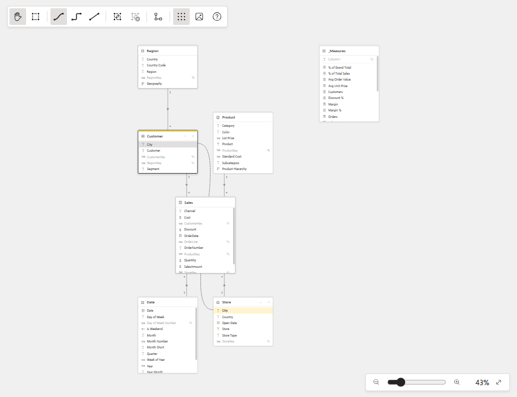
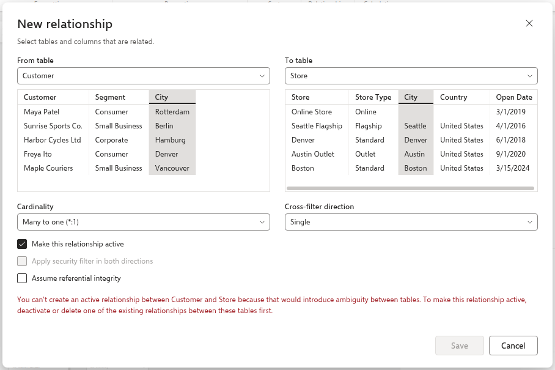
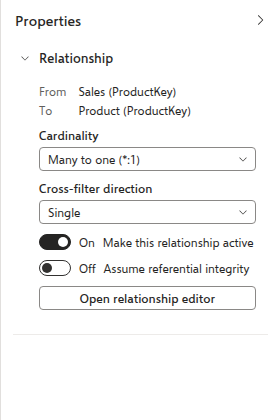
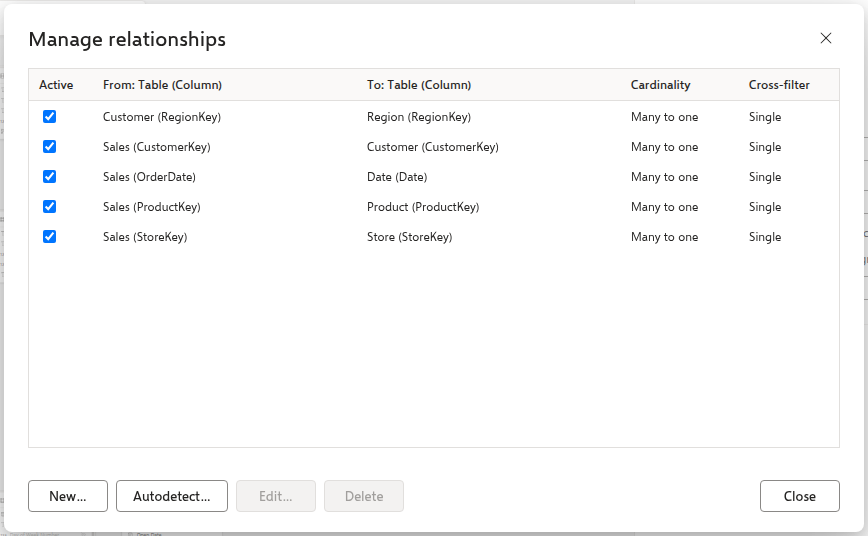

# Create and edit relationships

> **Applies to:** Creators · Analysts

A relationship joins a column of one table to a column of another so that filters on one table reach the other. This article shows the ways to create, edit, activate and delete relationships in Lumen, explains each option of the relationship dialog, and describes how Lumen matches key values, including keys of different data types.

## Prerequisites

- A model with at least two tables. The examples use the built-in sample (**Try a sample** on the start screen), whose `Sales` table is related many-to-one to `Date`, `Product`, `Customer` and `Store`, and `Customer` to `Region`.

## Create a relationship by dragging

1. Open **Model view**.
2. Drag a column from one table card and drop it on a column of another card. While you drag, a line follows the pointer in the layout's line style and the column under the pointer is highlighted.
3. The **New relationship** dialog opens with both tables and columns filled in. Check the options (see [Relationship options](#relationship-options)) and select **Save**.



If you drop on a card but not on a column, only the table is filled in; pick the column in the dialog.

## Create a relationship with the dialog

1. Select **Manage relationships** (on **Home** in Model view, on **Modeling** in Report view, on **Table tools** and **Column tools**, or from a table card's right-click menu).
2. Select **New…**.
3. In **From table**, select a table. A preview of its first five rows appears; select a column header to choose the column.
4. Do the same in **To table**. When both tables have a column with the same name, Lumen pre-selects that pair.
5. Set the options and select **Save**.

**Save** stays disabled while the dialog shows an error in red. Notes in amber are warnings and do not block saving.

## Relationship options


| Option | Values | Notes |
|---|---|---|
| **Cardinality** | **Many to one (\*:1)**, **One to one (1:1)**, **One to many (1:\*)**, **Many to many (\*:\*)** | Detected from the loaded data when both columns are chosen, until you change it yourself: unique values on both sides give one to one, unique on the To side many to one, and so on. A one to many relationship is saved with the tables swapped, so the many side is always the "from" table, as Power BI writes it. |
| **Cross-filter direction** | **Single**, **Both** | Single: filters flow from the one side to the many side. Both: they flow both ways. One to one relationships always use **Both**. Detection picks **Both** for one to one and many to many. |
| **Make this relationship active** | on / off | Only one active filter path may connect two tables. See [Active and inactive relationships](#active-and-inactive-relationships). |
| **Apply security filter in both directions** | on / off | Available with **Both**. Lets row-level security filters travel the relationship both ways. |
| **Assume referential integrity** | on / off | Not available for many to many. Lumen warns when values on the many side have no match on the one side. Lumen's engine does not change how it evaluates the relationship when this is on; the setting is saved for Power BI. |

### Validation

The dialog checks the same rules as Power BI Desktop:

- Both columns must be chosen, in two different tables, and there must not already be a relationship between those two columns.
- A "one" side must not contain duplicate values (blank values are ignored), as long as data is loaded to judge by. Example message: *The cardinality you selected isn't valid for this relationship. The column 'City' contains duplicate values.*
- An active relationship must not create a second filter path between two tables. Example message: *You can't create an active relationship between Customer and Store because that would introduce ambiguity between tables.* Clear **Make this relationship active** to save it as inactive.
- Many to many shows Power BI's warning about the different behaviour of many-many relationships.



An existing relationship that you open and save without changing its columns is never rejected because of the data currently loaded (for example generated sample data). Lumen shows a warning instead, because the relationship was valid on the real data.

## Edit a relationship

Use any of these:

- Double-click the relationship line in Model view.
- Right-click the line and select **Properties**.
- In **Manage relationships**, double-click a row, or select it and select **Edit…**.
- Select the line: the **Properties** pane shows **Cardinality**, **Cross-filter direction**, **Make this relationship active** and **Assume referential integrity**, which you can change directly, and **Open relationship editor**.



## Manage relationships

**Manage relationships** lists every relationship with **Active**, **From: Table (Column)**, **To: Table (Column)**, **Cardinality** and **Cross-filter**. The buttons are **New…**, **Autodetect…**, **Edit…** and **Delete**. Ctrl+click selects several rows to delete together.



**Autodetect…** adds a relationship for each pair of tables that are not yet related and have a column with the same name and data type (not true/false or decimal number) where one side holds unique values. It reports how many it found.

> [!WARNING]
> Autodetect does not check for ambiguous filter paths. On the sample it adds `Customer[City] → Store[City]` and `Store[Country] → Region[Country]` as active relationships, which give `Sales` two paths to `Region`. Review what it added, and press Ctrl+Z to undo it if needed.

## Active and inactive relationships

- In the diagram an inactive relationship is drawn dashed.
- To switch, clear or select the **Active** checkbox in **Manage relationships**, use **Make inactive** / **Make active** on the line's right-click menu, or the toggle in the **Properties** pane. Activating is refused when another active path already connects the tables.
- An inactive relationship is used only by DAX that asks for it with `USERELATIONSHIP`.

## Delete a relationship

Right-click the line and select **Delete**, select the line and press Delete (Lumen asks for confirmation), or select rows in **Manage relationships** and select **Delete**. Ctrl+Z restores it.

## How cross-filter direction affects results

With single direction, filtering `Customer` filters `Sales` but not `Product`. The query below, run in DAX query view on the sample, counts products per customer: with the model's single-direction relationship every customer sees all 65 products; turning on both directions for the `Sales`–`Product` relationship inside `CALCULATE` with `CROSSFILTER` counts only the products the customer bought.

```dax
EVALUATE
TOPN (
    5,
    SUMMARIZECOLUMNS (
        Customer[Customer],
        "Orders", [Orders],
        "Products (single direction)", COUNTROWS ( Product ),
        "Products (both directions)",
            CALCULATE (
                COUNTROWS ( Product ),
                CROSSFILTER ( Sales[ProductKey], Product[ProductKey], BOTH )
            )
    ),
    Customer[Customer], ASC
)
ORDER BY Customer[Customer]
```

| Customer[Customer] | [Orders] | [Products (single direction)] | [Products (both directions)] |
|---|---|---|---|
| Aiko Andersen | 13 | 65 | 14 |
| Aiko Brooks | 3 | 65 | 4 |
| Aiko Dubois | 6 | 65 | 8 |
| Aiko Fischer | 7 | 65 | 13 |
| Aiko Garcia | 2 | 65 | 5 |

For how Lumen's engine propagates filters through relationships, see [Evaluation context in Lumen](../dax/evaluation-context-in-lumen.md).

## How key values are matched

Lumen's DAX engine matches the two key columns the way the Power BI storage engine does:

- **Text** keys match case-insensitively and ignore trailing spaces: `"a"`, `"A"` and `"a "` are one key. Blank (and empty text) keys match nothing.
- **Text and number** keys (for example a text `"42"` and a whole number `42`): the dialog shows a warning that the types differ, but the relationship works. The text side is converted to a number (trimmed, decimal or exponent notation) and compared as a number; text that is not a number matches nothing.
- **Other type pairs** (for example date and text): the dialog warns that values of these types do not match each other, so the relationship would not filter anything. Give both columns the same data type.
- **Whole number and decimal number** keys are both numbers and match by value.
- **Date/time** keys match on the full date and time, unless the relationship was saved by Power BI with the date-part-only join (a Power BI setting that Lumen reads but does not offer in the dialog).
- For a PBIX file, the key matches stored in the file by Power BI are used as they are.

## Differences from Power BI Desktop

- The column preview grids in the relationship dialog do not show hidden columns. Key columns are often hidden (the sample hides `Sales[ProductKey]`), so the selected key column may not appear highlighted in the preview even though it is selected. To pick a hidden column, create the relationship by dragging between cards in Model view, where hidden columns are shown.
- **Autodetect…** can create active relationships that make the model ambiguous (see the warning above). Power BI Desktop avoids that.
- **Assume referential integrity** is stored but does not change Lumen's results.

## Considerations and limitations

- Relationships to calculation group tables cannot be created (those tables are not offered).
- Changes to relationships rebuild the engine's view of the model; visuals re-query automatically.

## Related content

- [Model view overview](model-view-overview.md)
- [Relationship lines and pinch points](relationship-lines-and-pinch-points.md)
- [Row-level security](row-level-security.md)
- [Evaluation context in Lumen](../dax/evaluation-context-in-lumen.md)
- [Microsoft Learn: Model relationships in Power BI Desktop](https://learn.microsoft.com/power-bi/transform-model/desktop-relationships-understand)
