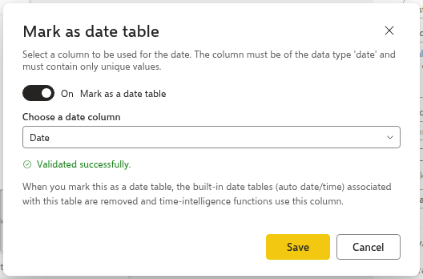
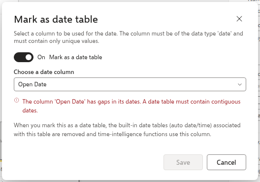

# Date tables

> **Applies to:** Analysts

A date table has one row per day and is related to the date columns of your fact tables. Marking it as the model's date table tells DAX which column holds the dates, which matters for time-intelligence functions and for filters on that column. This article shows how to mark a table and what changes in Lumen's DAX engine.

## Prerequisites

- A table with a column of data type **Date/time** that has one row per day: no blanks, no duplicates, no time part, and no missing days between the first and the last date. The sample's `Date` table (2023-01-01 to 2025-12-31, 1,096 rows) is already marked.

## Mark a table as a date table

1. Select the table: in Model view right-click its card, or select it in the **Data** pane.
2. Select **Mark as date table**: on the card's right-click menu, on the **Table tools** tab, on the **Modeling** tab (Report view), or with the button in the **Properties** pane.
3. In the dialog, keep **Mark as a date table** on and choose the date column in **Choose a date column**.
4. When the dialog shows **Validated successfully.**, select **Save**.



The dialog checks the loaded values and explains a failure: the column must be of data type Date or Date/Time, and must not contain blank values, values that are not dates, time values, duplicates, or gaps. When no data is loaded, it reports *Validated successfully (no data loaded to check).*



To unmark a table, open the dialog, turn **Mark as a date table** off and select **Save**. The **Properties** pane of a marked table shows *Marked as date table (column)*.

Lumen saves the marking the way Power BI writes it in TMDL: the table's data category is `Time` and the date column is its key column.

## What marking changes

When a filter on the date key column is applied in `CALCULATE` (or `CALCULATETABLE`), Lumen removes every other filter on the date table first, as Power BI does. Without this, a filter on a single date combined with a filter on its year would return nothing for every other year.

The query below groups by year and also computes the sales of one fixed day. Because `'Date'[Date]` is the key of the marked date table, the date filter replaces the `Year` filter of each row, so every row shows the same value:

```dax
EVALUATE
SUMMARIZECOLUMNS (
    'Date'[Year],
    "Total Sales", [Total Sales],
    "Sales on 30 June 2024",
        CALCULATE ( [Total Sales], 'Date'[Date] = DATE ( 2024, 6, 30 ) )
)
ORDER BY 'Date'[Year]
```

| Date[Year] | [Total Sales] | [Sales on 30 June 2024] |
|---|---|---|
| 2023 | $1,640,070 | 8195.87 |
| 2024 | $2,181,165 | 8195.87 |
| 2025 | $2,666,761 | 8195.87 |

The last column has no format string because it is defined in the query, so DAX query view shows the raw number.

Lumen applies the same rule to a date/time column on the one side of a relationship even when its table is not marked, which matches Power BI's behaviour for date columns used in relationships.

Time-intelligence functions such as `TOTALYTD` and `SAMEPERIODLASTYEAR` take the date column as an argument. The sample's `Sales YTD` measure, `TOTALYTD ( [Total Sales], 'Date'[Date] )`, gives:

```dax
EVALUATE
CALCULATETABLE (
    SUMMARIZECOLUMNS (
        'Date'[Month Number],
        'Date'[Month],
        "Total Sales", [Total Sales],
        "Sales YTD", [Sales YTD]
    ),
    'Date'[Year] = 2025,
    'Date'[Month Number] <= 4
)
ORDER BY 'Date'[Month Number]
```

| Date[Month Number] | Date[Month] | [Total Sales] | [Sales YTD] |
|---|---|---|---|
| 1 | January | $147,670 | $147,670 |
| 2 | February | $133,692 | $281,362 |
| 3 | March | $201,244 | $482,606 |
| 4 | April | $253,824 | $736,430 |

See [Time intelligence](../dax/time-intelligence.md) for the functions Lumen supports.

## Differences from Power BI Desktop

- The dialog says that marking removes the built-in date tables (auto date/time) associated with the table. Lumen does not remove them; delete such tables yourself if the model has them. (Lumen never creates them.)

## Considerations and limitations

- The validation runs on the data currently loaded. With generated sample data, a column can pass or fail differently than with the real data.
- A date table needs a date/time column; Lumen has no separate Date type (see [Column and table properties](column-and-table-properties.md#differences-from-power-bi-desktop)).

## Related content

- [Time intelligence](../dax/time-intelligence.md)
- [Evaluation context in Lumen](../dax/evaluation-context-in-lumen.md)
- [Create and edit relationships](create-and-edit-relationships.md)
- [Column and table properties](column-and-table-properties.md)
- [Microsoft Learn: Set and use date tables in Power BI Desktop](https://learn.microsoft.com/power-bi/transform-model/desktop-date-tables)
