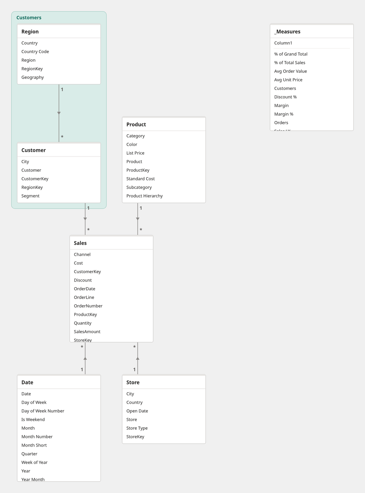

# Export the diagram

> **Applies to:** Creators · Analysts · Developers

You can save the current Model view layout as an image to put in documentation, a wiki or a design review. This article shows how, and what the image contains.

## Prerequisites

- A model open in **Model view**, with at least one table in the current layout.

## Export a layout

1. Select the layout tab you want to export (**All tables** or one of your layouts).
2. On the diagram toolbar, select **Export diagram as image**.
3. In the save dialog, choose a folder and a file name. The suggested name is *model name* - *layout name*`.png`, in the folder that contains the open file (your Documents folder for a project that was never saved, such as the sample).
4. Choose the type:
   - **PNG image** (`.png`): a bitmap at twice the diagram's size, sharp on high-density screens and in slides.
   - **SVG image** (`.svg`): a vector drawing that scales without losing quality and can be edited in a vector editor.
5. Select **Save**. A notification confirms the path: *Diagram exported to …*.

If you type a name without an extension, Lumen adds `.png`.

## What the image contains

The image shows the whole layout, not only the part visible on screen, on a light grey background:

- every table card with its name and its field names (columns, hierarchies, then measures after a separator line), cut off at the card's height as on screen; collapsed cards show only their header;
- relationship lines in their current style and routing, with `1` / `*` cardinality labels, the filter-direction arrow (two arrows for both directions), and dashed lines for inactive relationships;
- table groups in their colours, collapsed groups as chips with their table count.

## Considerations and limitations

- The image is drawn from the layout's data, not captured from the screen: hidden fields are listed like any other field (they are not greyed), data-type icons are not drawn, and long names are shortened with an ellipsis.
- Text uses the Segoe UI font when it is installed, otherwise a similar sans-serif font. An SVG file names the fonts rather than embedding them, so it can look slightly different on another computer.
- An empty layout cannot be exported; Lumen shows *This layout has nothing to export.*
- Exporting does not change the model or the file.

## Related content

- [Model view overview](model-view-overview.md)
- [Arrange the diagram](arrange-the-diagram.md)
- [Table groups](table-groups.md)
- [Relationship lines and pinch points](relationship-lines-and-pinch-points.md)
