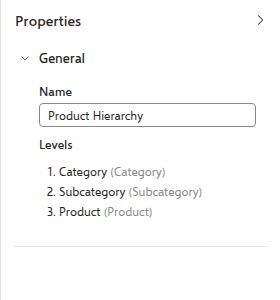

# Hierarchies

> **Applies to:** Creators · Analysts

A hierarchy is an ordered list of columns of one table, such as Category ▸ Subcategory ▸ Product, that report visuals can drill through level by level. Lumen reads, uses and saves hierarchies, and can create simple ones; editing the levels of a hierarchy is not supported yet. This article explains what you can do.

## Prerequisites

- A model with a table that has the columns you want as levels. The sample has three hierarchies: `Date[Date Hierarchy]` (Year ▸ Quarter ▸ Month), `Product[Product Hierarchy]` (Category ▸ Subcategory ▸ Product) and `Region[Geography]` (Region ▸ Country).

## See a hierarchy and its levels

- In the **Data** pane, expand the table, then the hierarchy: its levels are listed in order.
- In Model view, hierarchies are listed on the table card after the columns. Select one to see its **Name** and **Levels** (each level with its column) in the **Properties** pane.



## Use a hierarchy in a visual

Drag the hierarchy, or one of its levels, from the **Data** pane to a visual's field well. Visuals with a hierarchy offer drill-down and expand / collapse like Power BI. See [Create reports](../create-reports/README.md).

The query below, run in DAX query view, groups by two levels of `Product Hierarchy`; it is what a visual drilled to the Subcategory level asks for:

```dax
EVALUATE
TOPN (
    5,
    SUMMARIZECOLUMNS ( Product[Category], Product[Subcategory], "Total Sales", [Total Sales] ),
    [Total Sales], DESC
)
ORDER BY [Total Sales] DESC
```

| Product[Category] | Product[Subcategory] | [Total Sales] |
|---|---|---|
| Bikes | Mountain Bikes | $955,732 |
| Bikes | Road Bikes | $791,066 |
| Accessories | Helmets | $513,664 |
| Bikes | Electric Bikes | $499,868 |
| Components | Drivetrain | $478,079 |

## Create a hierarchy

1. In the **Data** pane, right-click the column that should be the top level.
2. Select **New hierarchy**.

Lumen adds a hierarchy named *column* `Hierarchy` (for example **Country Hierarchy**) with that column as its only level.

## Rename, hide or delete a hierarchy

Right-click the hierarchy in the **Data** pane and select **Rename**, **Hide** or **Delete from model**, or rename it in the **Properties** pane. Deleting a column removes it from every hierarchy that uses it.

## Differences from Power BI Desktop

- You cannot add a level to a hierarchy, remove a level, or change the order of levels in Lumen. Dragging a column onto a hierarchy in the **Data** pane does nothing, and the **Properties** pane shows the levels read-only. A hierarchy you create therefore has one level. Build multi-level hierarchies in Power BI Desktop or by editing the TMDL file; Lumen keeps them when it saves.
- Power BI Desktop's automatic date hierarchy (auto date/time) is not created by Lumen; see [Model data](README.md#not-supported).

## Related content

- [Column and table properties](column-and-table-properties.md)
- [Model view overview](model-view-overview.md)
- [Date tables](date-tables.md)
- [DAX query view](../dax/dax-query-view.md)
