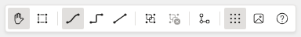
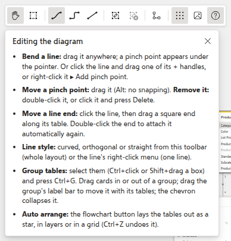
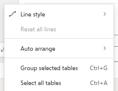

# Model view overview

> **Applies to:** Creators · Analysts

Model view shows your semantic model as a diagram: one card per table and one line per relationship. Use it to see how tables connect, create and edit relationships, set properties of tables, columns and measures, and organize large models into layouts and groups. This article describes the parts of the view; the how-to articles linked at the end cover each task.

## Open Model view

Select the **Model view** icon in the view bar on the left edge of the window (the third icon, below **Report view** and **Table view**). The status bar at the bottom shows the number of tables and relationships, for example `7 tables, 5 relationships` for the sample.

A model that has never been opened in a diagram (for example a model you created with **Enter data**, or a `model.bim` without a `diagramLayout.json`) is laid out automatically the first time, with the arrangement that [Auto arrange](arrange-the-diagram.md) suggests for it.

## Parts of the view

| Part | What it does |
|---|---|
| **Table cards** | One card per table: the table name, then its columns (alphabetical), hierarchies, and, below a separator, its measures. Hidden fields are greyed and show an eye-off icon. Each card header has **More options** (the same menu as a right-click) and **Collapse** / **Expand**. |
| **Relationship lines** | One line per relationship, with `1` or `*` at each end for the cardinality and an arrow in the middle that points in the direction filters flow (two arrows for both directions). Inactive relationships are dashed. |
| **Diagram toolbar** | Floating at the top left of the canvas. See [Diagram toolbar](#diagram-toolbar). |
| **Mini map** | Bottom left. It appears only when part of the diagram is outside the window. Click or drag in it to move the view. |
| **Zoom bar** | Bottom right: **Zoom out**, a zoom slider (10% to 200%), **Zoom in**, the current zoom and **Fit to screen**. |
| **Properties** pane | Properties of the selected table, column, measure, hierarchy or relationship. Collapse it with the arrow in its header; a **Properties** tab stays at the edge to bring it back. See [Column and table properties](column-and-table-properties.md). |
| **Data** pane | The same field list as in Report view. Selecting a field there selects it in the diagram. |
| **Layout tabs** | Bottom: **All tables** and any layouts you add with **+** (**New layout**). See [Arrange the diagram](arrange-the-diagram.md#use-layouts). |
| **Formula bar** | When you select a measure or a calculated column, the formula bar opens over the top of the canvas without moving the diagram. See [The formula bar and DAX editor](../dax/the-formula-bar-and-dax-editor.md). |

Selecting a table highlights the tables related to it. Selecting a relationship line highlights the two key columns it joins.

## Diagram toolbar

From left to right:

| Button | Effect |
|---|---|
| **Pan** | Pointer mode (default): dragging the empty canvas moves the view. Shift+drag draws a selection box. |
| **Select** | Pointer mode: dragging the empty canvas draws a selection box. Hold Space, or drag with the middle mouse button, to pan. |
| **Curved lines**, **Orthogonal lines**, **Straight lines** | Line style for every relationship line of the current layout. See [Relationship lines and pinch points](relationship-lines-and-pinch-points.md). |
| **Group (Ctrl+G)**, **Ungroup (Ctrl+Shift+G)** | Put the selected tables in a labelled container, or remove it. See [Table groups](table-groups.md). |
| **Auto arrange** | Lay the tables out automatically. See [Arrange the diagram](arrange-the-diagram.md). |
| **Snap pinch points** | Snap pinch points to a 10-pixel grid and to alignment with other points and table centres while you drag them. |
| **Export diagram as image** | Save the layout as PNG or SVG. See [Export the diagram](export-the-diagram.md). |
| **Editing tips** | Shows a card that lists every diagram gesture. |

The pointer mode, the snapping switch and your preferred default line style are preferences of your user account on this computer. They are not saved in the report.

## Move around the diagram

| To | Do this |
|---|---|
| Pan | Drag the empty canvas (Pan mode), hold Space and drag, or drag with the middle mouse button. The mouse wheel scrolls vertically; Shift+wheel scrolls horizontally. |
| Zoom | Ctrl+mouse wheel (zooms around the pointer), the zoom slider, or **Zoom in** / **Zoom out**. |
| See everything | **Fit to screen** in the zoom bar, or right-click the canvas and select **Fit to screen**. |
| Select several tables | Ctrl+click or Shift+click card headers, or draw a selection box (see [Considerations and limitations](#considerations-and-limitations)). Ctrl+A selects every table of the layout. |
| Move tables | Drag a card by its header. Dragging one card of a multi-selection moves all selected cards. |
| Resize a card | Drag the handle at its bottom-right corner. |
| Cancel a drag | Press Esc before you release the mouse button. |

## Right-click menus

- **Canvas**: **Line style** (with **Make … my default**), **Reset all lines**, **Auto arrange**, **Group selected tables**, **Select all tables**, **Fit to screen**.
- **Table card**: **New measure**, **New column**, **Collapse** / **Expand**, **Hide in report view**, **Mark as date table**, **Manage relationships**, **Group**, **Remove from group "…"** (when the table is in a group), **Remove from diagram** (in layouts other than **All tables**), **Delete from model**.
- **Field on a card**: **Hide in report view**, **New measure**, **New column**, **Delete from model**.
- **Relationship line**: **Properties**, **Make inactive** / **Make active**, **Line style**, **Add pinch point**, **Reset line**, **Delete**.
- **Group**: **Rename**, **Color**, **Collapse** / **Expand**, **Fit to tables**, **Select tables**, **Ungroup**.

## Ribbon in Model view

The **Home** tab in Model view has **New measure**, **Quick measure**, **New column**, **New table** and **Manage relationships**. Selecting a table, column or measure adds the contextual **Table tools**, **Column tools** or **Measure tools** tab, as in Power BI Desktop. The **Modeling** tab (parameters, calculation groups, roles, **View as**, **Mark as date table**) is shown in Report view only.

## What Lumen saves where

| What | Where | Read by Power BI Desktop |
|---|---|---|
| Card positions and sizes, layouts (tabs) | `diagramLayout.json` in the `*.SemanticModel` folder, Power BI's own format | Designed to be; not verified |
| Line styles, pinch points, manual line ends, table groups | `diagramLayout.lumen.json` beside it | No: Power BI Desktop is expected to ignore the file (not verified) |
| Pointer mode, snapping, preferred default line style | Your user profile on this computer | Not part of the report |
| Collapsed table cards | Not saved | — |

Both diagram files are written when you save a PBIP project or a `.wbi` bundle. `diagramLayout.lumen.json` is written only when you customised something, and is removed again when nothing custom is left, so an untouched model saves exactly as it was opened. A PBIX file cannot be saved by Lumen; saving offers PBIP or `.wbi` instead. The file format is described in [ARCHITECTURE.md](../ARCHITECTURE.md#model-diagram-sidecar-diagramlayoutlumenjson).

Every diagram edit (moving cards, bending lines, grouping, arranging) is one undo step: Ctrl+Z undoes it and Ctrl+Y redoes it.

## Differences from Power BI Desktop

- Editable relationship lines, table groups, **Auto arrange**, the mini map placement, image export and the editing tips card are Lumen additions.
- The **Modeling** ribbon tab is not shown in Model view; use **Home**, the contextual tabs, the right-click menus, or switch to Report view.
- Collapsing a table card lasts only until you leave the view; Power BI Desktop stores it.

## Considerations and limitations

- In **Select** mode, a selection box selects the tables while you drag, but when you release the mouse button the selection is replaced by a single table (observed with the sample: `_Measures`). Use Shift+drag in **Pan** mode, or Ctrl+click card headers, instead. This is a known defect.
- The mini map is hidden when the whole diagram fits in the window.

## Related content

- [Create and edit relationships](create-and-edit-relationships.md)
- [Arrange the diagram](arrange-the-diagram.md)
- [Relationship lines and pinch points](relationship-lines-and-pinch-points.md)
- [Table groups](table-groups.md)
- [Column and table properties](column-and-table-properties.md)
