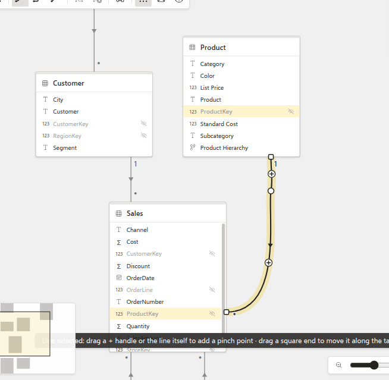
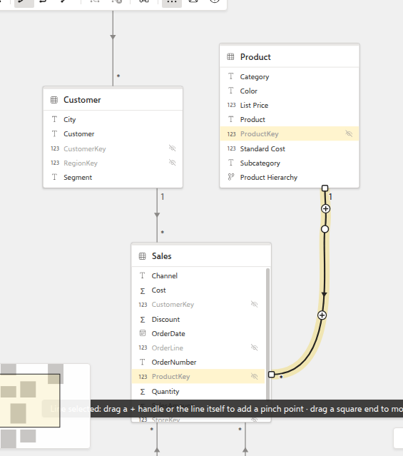
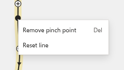
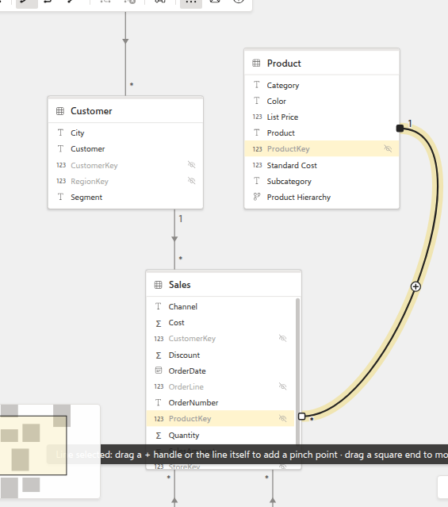
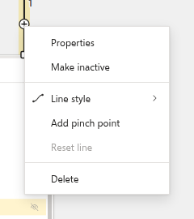
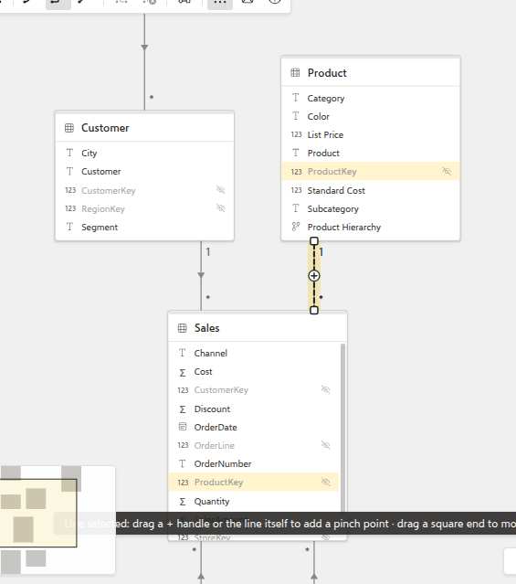

# Relationship lines and pinch points

> **Applies to:** Creators · Analysts

In Lumen you can shape the relationship lines of the model diagram: choose a line style, bend a line around other tables with pinch points, and attach a line end to any side of its table. This is a Lumen feature; Power BI Desktop draws its lines automatically. Read this article to learn every gesture. Each one described here was checked with real mouse input on the built-in sample.

## Terms

- **Pinch point**: a point a line must pass through. A line can have several; they split it into stretches.
- **Line end**: where a line meets a table card. By default each end attaches automatically to the side that faces the other table.
- **Line style**: **Curved**, **Orthogonal** (right angles, the Power BI look) or **Straight**. A layout has one default style; a single line can override it.

## Prerequisites

- A model with relationships, open in **Model view**.
- Optional: zoom in (Ctrl+mouse wheel) so the lines are easy to grab.

## Find out what a line does

Point at a line. It is highlighted, a **+** marker follows the pointer along it, and a status line at the bottom of the canvas says *Drag the line to bend it (adds a pinch point) · double-click to edit the relationship · right-click for more*. Holding the pointer still shows the same hints as a tooltip; on a line that ends on a collapsed group the tooltip adds that you must expand the group to move that end.

Select a line (click it) to see its editing handles:

- a **+** handle in the middle of each stretch,
- a round dot on each pinch point,
- a small square at each line end.

The two key columns are highlighted on their cards, and the **Properties** pane shows the relationship. While the pointer is not over the line, the status line reads *Line selected: drag a + handle or the line itself to add a pinch point · drag a square end to move it along the table*.

## Bend a line

Use any of these:

- **Drag the line** anywhere. A pinch point appears where you grabbed it and follows the pointer. The status line reads *Bending the line: release to drop the pinch point · hold Alt to place it freely · Esc cancels*.
- **Select the line, then drag a + handle.** The new pinch point follows the pointer.
- **Select the line, then click a + handle.** A pinch point is added where the handle is.
- **Right-click the line and select Add pinch point.** The point is added where you right-clicked.

Press Esc before releasing the mouse button to cancel. Each bend is one undo step (Ctrl+Z).

## Move or remove a pinch point

- **Move**: drag the dot. With **Snap pinch points** on (the toolbar's default), the point lands on a 10-pixel grid or lines up with other pinch points, table centres and the line's own ends; guides show the alignment. Hold Alt while dragging to place it freely.
- **Remove**: double-click the dot; or click it (the status line reads *Pinch point selected: drag it to move · Delete or double-click removes it*) and press Delete or Backspace; or right-click it and select **Remove pinch point**.

## Move a line end

1. Select the line.
2. Drag one of its square end handles around the edge of the table card. The status line reads *Moving the line end around its table · release to attach it there · Esc cancels*.
3. Release where you want the line to attach.

The end snaps to the middle of a side and, on the left and right sides, to the row of the joined column (hold Alt to turn snapping off). A moved end stays where you put it when the card moves. Double-click the square end to attach it automatically again.

## Change the line style

- **For the whole layout**: select **Curved lines**, **Orthogonal lines** or **Straight lines** on the diagram toolbar, or right-click the empty canvas and point to **Line style**.
- **For one line**: right-click the line, point to **Line style**, and select **Curved**, **Orthogonal** or **Straight**. **Layout default (…)** removes the override. A line with its own style keeps it when you change the layout's style.
- **Your default for every model**: right-click the empty canvas, point to **Line style**, and select **Make *style* my default**. This preference is stored on your computer, not in the file, and applies to every layout that stores no style of its own. A new installation uses **Curved**.

Pinch points and moved ends are kept when you change the style.

| Orthogonal | Straight |
|---|---|
|  |  |

## Other actions on a line

Right-click a line for **Properties** (the relationship editor), **Make inactive** / **Make active**, **Line style**, **Add pinch point**, **Reset line** and **Delete**.

- **Reset line** removes the line's pinch points, moved ends and own style.
- **Reset all lines** (right-click the empty canvas) does that for every line of the layout.
- Double-click a line to open the relationship editor.
- Select a line and press Delete to delete the relationship (Lumen asks first).
- An inactive relationship is drawn dashed.

## What happens when cards move

- Line ends follow their cards; automatic ends pick the side that faces the other table again.
- Pinch points stay where you put them, unless both tables of the relationship move together (a multi-selection or a group being dragged); then the pinch points travel with them.
- **Auto arrange** removes the pinch points and moved ends of lines whose tables it moves, and keeps their styles.

## Lines to a collapsed group

When a [table group](table-groups.md) is collapsed, the lines of its tables attach to the group's chip, spread along the side they share. They remain editable: you can hover, bend and right-click them as usual. Their pinch points and styles belong to the relationship, so they are kept when you expand the group again. A moved end on a table hidden inside the chip is ignored while the group is collapsed and returns when you expand it.

## Where the routing is saved

Line styles, pinch points and moved ends are saved per layout in `diagramLayout.lumen.json`, next to Power BI's `diagramLayout.json`, when you save a PBIP project or a `.wbi` bundle. Power BI Desktop does not read this file, so it shows its own automatic lines; it is expected to leave the file alone, but that has not been verified. See [Model view overview](model-view-overview.md#what-lumen-saves-where).

## Considerations and limitations

- Where a line runs behind a card, grab it where it is visible. A selected line is repeated faintly above the cards so you can still grab it there.
- Undo (Ctrl+Z) and redo (Ctrl+Y) cover every routing edit; routing edits do not recalculate any data.

## Related content

- [Model view overview](model-view-overview.md)
- [Create and edit relationships](create-and-edit-relationships.md)
- [Arrange the diagram](arrange-the-diagram.md)
- [Table groups](table-groups.md)
- [Export the diagram](export-the-diagram.md)
