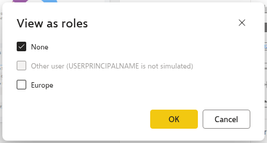
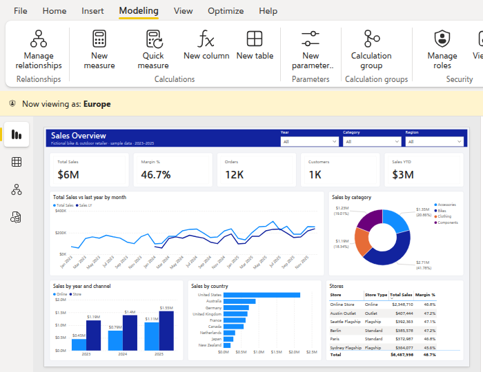

# Row-level security

> **Applies to:** Creators · Analysts

Row-level security (RLS) restricts the rows a user can see with roles: each role has DAX filters on some tables, and members of the role see only the rows those filters keep. In Lumen you can define roles and their filters, save them with the model for the Power BI service, and test a role with **View as**. Read the limitations below before you rely on **View as** in this version.

## Prerequisites

- A report or model open in Lumen. Role membership is managed in the Power BI service, not in the model.

## Create a role

1. Switch to **Report view** and open the **Modeling** tab.
2. Select **Manage roles**. The **Manage security roles** dialog opens.
3. Under **Roles**, select **New** (the **+** button). A role named **Untitled** is added. Select **Rename** (the pencil) to name it, for example `Europe`. **Duplicate** copies a role with its filters; **Delete** removes it.
4. Under **Select tables**, select the table to filter, for example **Region**.
5. Under **Filter data**, type a DAX expression that returns TRUE for the rows members may see, for example:

   ```dax
   [Region] = "Europe"
   ```

   The editor checks the expression as you type and offers completion. A filter icon marks the tables of the role that have a filter.
6. Select **Save**. **Save** is disabled while any filter has an error.

![The Manage security roles dialog: the role Europe, the table list with Region selected, and the filter [Region] = "Europe" with the hint that the expression is evaluated for each row of Region](../images/model-data/row-level-security-manage-roles.png)

The expression is evaluated for each row of the table; rows where it returns TRUE are kept, and the filter propagates along relationships like any other filter. Expressions that use `USERPRINCIPALNAME()` or `USERNAME()` are saved for the service.

### What the filter does to results

A role filter acts like a filter that the user cannot remove. The query below applies the same condition with `CALCULATETABLE` to show what members of the `Europe` role would see. The filter on `Region` reaches `Sales` through `Customer`:

```dax
EVALUATE
CALCULATETABLE (
    SUMMARIZECOLUMNS ( Region[Country], "Total Sales", [Total Sales] ),
    Region[Region] = "Europe"
)
ORDER BY Region[Country]
```

| Region[Country] | [Total Sales] |
|---|---|
| France | $626,576 |
| Germany | $719,211 |
| Netherlands | $330,032 |
| United Kingdom | $679,068 |

In total, `$2,354,887` of the sample's `$6,487,996`.

## Test a role with View as

1. On the **Modeling** tab, select **View as**.
2. In **View as roles**, select one or more roles (or **None**) and select **OK**.



A yellow bar, **Now viewing as: *role***, appears above the canvas in Report, Table and Model view. Select **Stop viewing** to end it. When you select several roles, a row is visible if any of them allows it, as in Power BI.

> [!WARNING]
> In this version **View as** does not reliably change what you see. With the `Europe` role above, Lumen's engine computes the restricted total ($2,354,887) for single values, but the report visuals on the sample's **Overview** page kept showing the unrestricted figures (for example $6M total sales and every country, including the United States), and queries in DAX query view also ignore the role. Do not use **View as** to sign off a security design; check the filters with `CALCULATETABLE` queries as shown above, and test in the Power BI service.



## Differences from Power BI Desktop

- **Other user** (simulating a user name for `USERPRINCIPALNAME()`) is not available.
- Roles have no members in Lumen; you assign members in the Power BI service.
- **Manage roles** and **View as** are on the **Modeling** tab of Report view only.

## Considerations and limitations

- **View as** is not applied consistently in this version (see the warning above).
- Role filters are saved in the model (TMDL roles) when you save a PBIP project or a `.wbi` bundle. Renaming a table or column in Lumen updates the role filters that refer to it.

## Related content

- [Create and edit relationships](create-and-edit-relationships.md)
- [Evaluation context in Lumen](../dax/evaluation-context-in-lumen.md)
- [DAX query view](../dax/dax-query-view.md)
- [Microsoft Learn: Row-level security with Power BI](https://learn.microsoft.com/fabric/security/service-admin-row-level-security)
