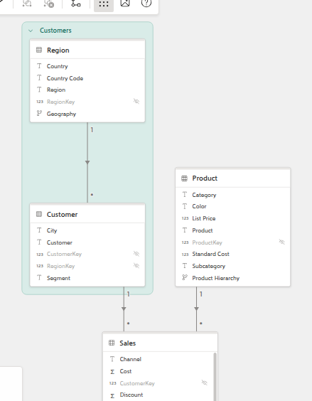
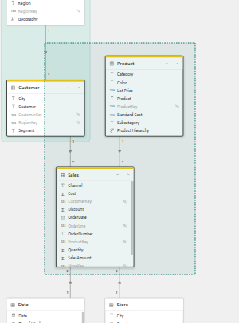
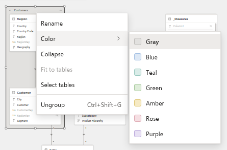
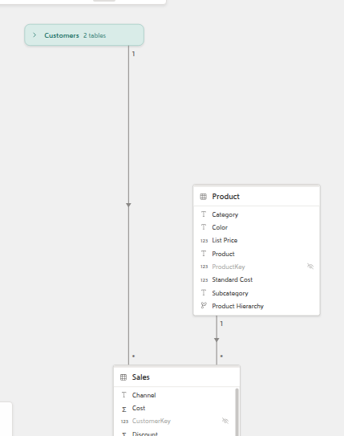

# Table groups

> **Applies to:** Creators · Analysts

A table group is a labelled, tinted container drawn behind some table cards in Model view, for example to keep all customer-related tables together. Groups are a Lumen feature for organizing the diagram; they do not change the model or any result. This article shows how to create, edit, collapse and remove groups.

## Prerequisites

- A model open in **Model view**.

## Create a group

1. Select the tables: Ctrl+click (or Shift+click) their card headers, or hold Shift and drag a box around them on the empty canvas (in **Pan** mode). Any card the box touches is selected.
2. Select **Group (Ctrl+G)** on the diagram toolbar, press Ctrl+G, right-click a selected card and select **Group *N* tables**, or right-click the canvas and select **Group selected tables**.

The new container fits around the cards and is named **Group 1** (then **Group 2**, …). A table belongs to at most one group per layout: grouping a table that is already in a group moves it to the new one.

## Rename, recolour and resize

- **Rename**: double-click the group's label, type the name and press Enter (Esc cancels); or right-click the group and select **Rename**.
- **Colour**: right-click the group, point to **Color** and pick **Gray** (the default), **Blue**, **Teal**, **Green**, **Amber**, **Rose** or **Purple**.
- **Resize**: click the group's label bar to select it, then drag one of the handles on its edges or corners to give it extra room. It never becomes smaller than its tables. **Fit to tables** on the right-click menu shrinks it back.

## Move tables in and out

- Drag the group's **label bar** to move the group with all its tables. Pinch points of lines between two tables of the group travel with them.
- Drag a card **into** a group's container to add it, or **out** of it to remove it. While you drag, the container shows whether the card would join or leave.
- Right-click a card and select **Remove from group "*name*"**.
- **Select tables** on the group's right-click menu selects its member cards.

A group whose last table leaves disappears.

## Collapse a group

Select the chevron on the group's label bar, or **Collapse** on its right-click menu. The group shrinks to a chip that shows its name and the number of tables, for example **Customers · 2 tables**. Relationship lines of the hidden tables attach to the chip and stay editable (see [Relationship lines and pinch points](relationship-lines-and-pinch-points.md#lines-to-a-collapsed-group)). To expand it, select the chevron again or double-click the chip.

Unlike collapsing a single table card, collapsing a group is saved.

## Remove a group

Select the group (click its label bar) and press Delete, Backspace or Ctrl+Shift+G; or select **Ungroup (Ctrl+Shift+G)** on the toolbar (with the group, or any of its tables, selected); or right-click the group and select **Ungroup**. The container goes; the tables stay where they are. Ctrl+Z restores it.

## What is saved

Groups are stored per layout in the Lumen file `diagramLayout.lumen.json`, next to Power BI's `diagramLayout.json` in the `*.SemanticModel` folder, when you save a PBIP project or a `.wbi` bundle. For each group Lumen stores its name, colour, member tables (by name and lineage tag, so a table renamed outside Lumen is still found), whether it is collapsed, and its size if you resized it. Renaming or deleting a table in Lumen updates its group membership in the same undo step.

Power BI Desktop does not read this file and does not show groups. It is expected to ignore the file and leave it in the project folder, but this has not been verified.

## Considerations and limitations

- Groups are per layout: the same table can be in a group on one layout tab and in none on another.
- [Auto arrange](arrange-the-diagram.md) treats each group as a unit and refits manually resized containers.
- [Export the diagram](export-the-diagram.md) includes groups, collapsed or expanded, in their colours.

## Related content

- [Model view overview](model-view-overview.md)
- [Arrange the diagram](arrange-the-diagram.md)
- [Relationship lines and pinch points](relationship-lines-and-pinch-points.md)
- [Export the diagram](export-the-diagram.md)
