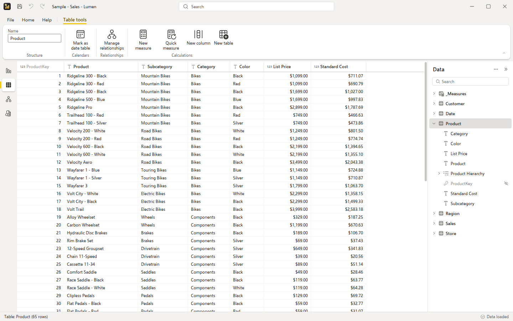
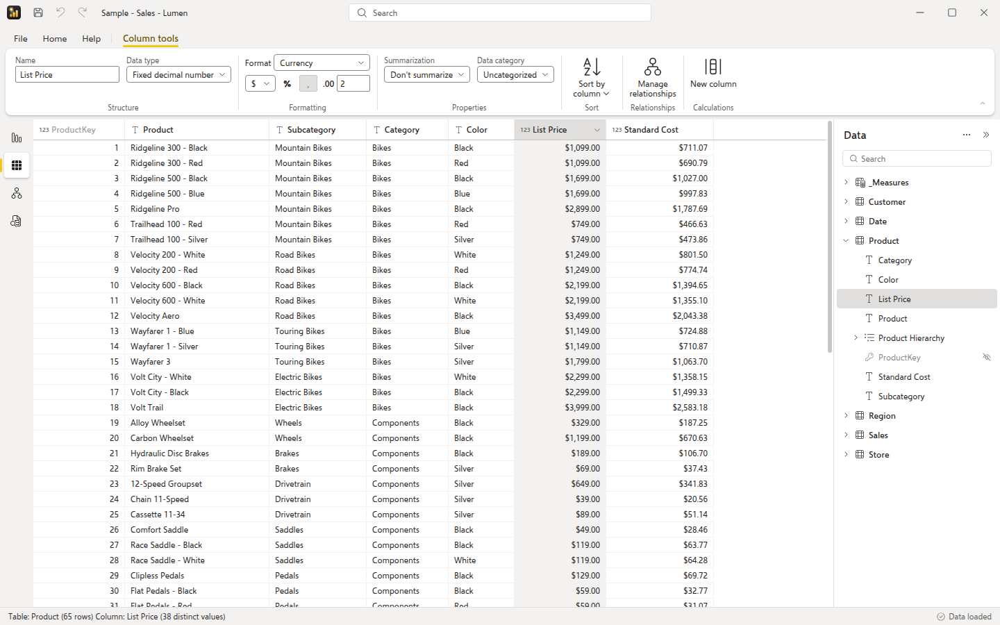
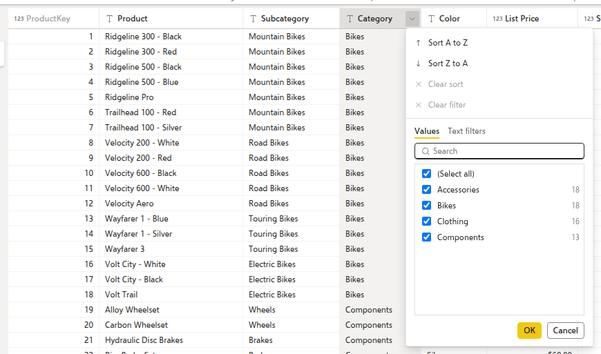

# Table view

> **Applies to:** Creators · Analysts

Table view shows the rows that are loaded into one table of the model, so you can check the data behind your visuals, look at calculated columns, and change column properties. Read this article to learn how to pick a table, sort and filter its rows, and what the view does not do.

## Prerequisites

- A report or semantic model with loaded data. If a table has no rows yet, the grid says why and offers **Use sample data** and **Refresh** where they apply (see [Considerations and limitations](#considerations-and-limitations)).

## Open a table

1. Select the **Table view** icon in the view bar on the left (the second icon).
2. In the **Data** pane, select the table.

The view opens on the table you last selected, otherwise on the first table that has rows; measure-only tables such as the sample's `_Measures` are skipped because they have no rows. The status bar shows the table and its row count, for example **Table: Product (65 rows)**. When you select a column it adds the number of distinct values, for example **Column: List Price (38 distinct values)**.

## Select a column and change its properties

1. Select a column header. The column is highlighted and the **Column tools** ribbon tab opens.
2. Change **Name**, **Data type**, **Format**, **Summarization**, **Data category** or **Sort by column** on the ribbon.

The options are described in [Column and table properties](column-and-table-properties.md). Selecting a table in the **Data** pane opens **Table tools** instead (rename, **Mark as date table**, **Manage relationships**, and the **New measure**, **Quick measure**, **New column** and **New table** commands).

## Sort and filter the rows

1. Point at a column header and select the arrow (**Sort and filter** *column*).
2. Choose a sort order: **Sort A to Z** / **Sort Z to A** for text, **Sort oldest to newest** / **Sort newest to oldest** for dates, **Sort ascending** / **Sort descending** for numbers. **Clear sort** returns to load order.
3. To filter, either:
   - on the **Values** tab, clear the values you do not want (each value shows how many rows have it; search narrows the list), or
   - on the second tab (**Text filters**, **Number filters** or **Date filters**), pick a condition (**Contains**, **Does not contain**, **Equals**, **Begins with**, **Ends with**, **Is blank**, **Is not blank**) and type a value.
4. Select **OK**.

A sorted column shows an arrow in its header and a filtered column a filter icon. Right-click a header for **Sort ascending**, **Sort descending**, **Clear sort**, **Clear filter**, **Clear all filters**, **Copy** (the column's name and values, one per line), **Copy table** (all columns, tab-separated), **New column**, **Delete**, **Hide in report view** / **Unhide in report view**, and, for tables created with **Enter data**, **Edit data**.

Sorting and filtering here only changes what you see in Table view. It does not filter the report and is not saved.

## Other things you can do

- **Resize a column**: drag the right edge of its header; double-click the edge to return to the automatic width. Widths are not saved.
- **Add a calculated column**: right-click a header and select **New column**, or select **New column** on the ribbon. The formula bar opens; see [Calculated columns](../dax/calculated-columns.md).
- **Edit an Enter data table**: right-click a header and select **Edit data**.

## Differences from Power BI Desktop

- The filter conditions on the **Number filters** and **Date filters** tabs are text conditions applied to the value as displayed (for example **Contains** `2024` on a date column). There are no *greater than*, *less than* or *between* conditions.
- Lumen shows calculated columns that are not stored with the data by evaluating them with its own DAX engine when the table opens. If that fails, a yellow bar above the grid names the column and the error.
- Column widths, sort and filter are not kept when you leave the view.

## Considerations and limitations

- A table without rows shows a message instead of the grid. The message tells you why: a measure-only table, a calculation group, a calculated table whose expression returned no rows, a table that failed to load (with the error), or a table with no data loaded yet. In the last two cases you can select **Use sample data** or **Refresh**. See [Sample data](../connect-and-transform/sample-data.md) and [Refresh data](../connect-and-transform/refresh-data.md).
- Values are shown with the column's format string (for example `$1,099.00` for `List Price`). Copy and **Copy table** copy the displayed text, not the raw values.

## Related content

- [Column and table properties](column-and-table-properties.md)
- [Model view overview](model-view-overview.md)
- [Calculated columns](../dax/calculated-columns.md)
- [Sample data](../connect-and-transform/sample-data.md)
- [Data types and locale](../connect-and-transform/data-types-and-locale.md)
