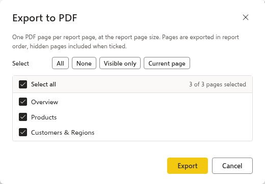

# Export problems

> **Applies to:** Creators

This article helps when an export of report pages (PDF, PowerPoint, PNG, HTML) or of a visual's data (Excel, CSV)
does not produce what you expected.

## How page export works

**File > Export** offers **Export to PDF**, **Export to PowerPoint**, **Export pages as images** and
**Export to HTML**. Each opens a dialog where you choose the pages:

- The default selection is every page except tooltip pages; hidden pages are included. Use **Visible only** to leave
  hidden pages out, or **Current page** for one page.
- Pages are exported in report order.
- Lumen draws each page again, off screen, at the report's page size, waits until every visual on it has finished
  rendering, and then captures it. The pages do not have to be opened first.

| Format | Result |
|---|---|
| PDF | One PDF page per report page, at the page size, with text as text |
| PowerPoint | A title slide, then one slide per page with the page as an image; the slide notes list the filters that applied |
| PNG | One image per page in the folder you choose, named `<n> - <page name>.png`; **Resolution** 1× (page size), 2× or 3× |
| HTML | One self-contained web page with every exported page as an image and page navigation (arrow keys or Page Up / Page Down) |

PowerPoint and HTML embed the pages as images at 2× resolution.

## "Export complete, but some pages were not fully rendered"

Lumen does not wait forever for a page. If a visual is still loading after the page's time limit (about 12 seconds
for the page to report that it is ready, with a 20-second safety limit per render job above that: one job per page for
images, PowerPoint and HTML, one job for all pages of a PDF), the page is exported
as far as it was drawn and Lumen says so. It never drops a page silently. The warning stays on screen until you close
it and reads, for example:

> Export complete, but some pages were not fully rendered. These pages were exported before every visual finished
> drawing: Overview (2 visuals still loading), Details. /home/you/Reports/Sales.pdf

The number in parentheses is how many visuals were still loading; a page without a number timed out at the safety
limit. What to do:

1. Open the named page in Lumen and wait until all its visuals show data. Slow visuals usually run heavy measures
   over large tables.
2. Use the **Performance analyzer** (**View > Show panes > Performance analyzer**) to find the slow visual.
3. Export only the slow page (**Current page**) to give it the whole time limit without the others.

## The export is empty or shows "No data available"

The report has no data. Export draws what the canvas shows: refresh or use sample data first. See
[Reports without data and sample data](../files-and-compatibility/reports-without-data-and-sample-data.md).

## "Open a report to export it"

Page export needs an open report with at least one page. A model opened on its own (a `*.SemanticModel` folder or a
`model.bim`) has no report pages.

## "Export failed"

Writing the file failed, typically because the folder is not writable or the file is open in another program. The
message gives the reason. Choose another folder or close the file and try again.

## Export data from a visual: rows are missing

**Export data** (in a visual's **More options** menu or **Data / Drill > Export data**) writes the data of one visual
as `.xlsx` or `.csv`. The row limits follow Power BI's limits for summarized data: **150,000 rows** for Excel and
**30,000 rows** for CSV. When a visual has more rows, only the first ones are exported and Lumen says
"Only the first n rows were exported (XLSX limit)". A visual without exportable data shows
"This visual doesn't have data that can be exported."

## Differences from Power BI Desktop

- Power BI Desktop's own **Export to PDF** leaves hidden pages out; Lumen includes them by default and lets you
  choose.
- PowerPoint export in Lumen places page images on slides; the charts are not editable in PowerPoint.
- Lumen adds PNG and HTML export, which Power BI Desktop does not have.

## Related content

- [Create reports](../create-reports/README.md)
- [A report opens with errors or empty visuals](a-report-opens-with-errors-or-empty-visuals.md)
- [Reports without data and sample data](../files-and-compatibility/reports-without-data-and-sample-data.md)
- [Frequently asked questions](faq.md)
