# Visuals in Lumen

> **Applies to:** Creators · Analysts

This section describes each family of visuals Lumen can draw: what each one is for, the field wells it takes, the formatting options that matter, how it interacts with the rest of the page, and where it differs from Power BI Desktop. Start with the gallery below to pick a visual, then open its article.

Every screenshot in this section was taken in Lumen from the built-in sample report (**Try a sample** on the start screen, or **File > New > Sample report**; the data is fictional). For the status of every visual type ID, including the ones Lumen only shows as a placeholder, see the [visual support reference](../reference/visual-support.md).

## Visual gallery

| Preview | Visual | Use it to | Article |
|---|---|---|---|
| 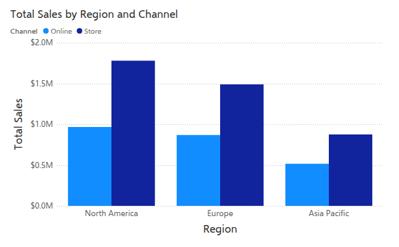 | Bar and column charts (stacked, clustered, 100% stacked) | Compare values across categories. | [Bar and column charts](bar-and-column-charts.md) |
| 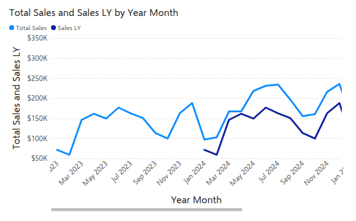 | Line and area charts (area, stacked area, 100% stacked area) | Show a trend over time or another ordered axis. | [Line and area charts](line-and-area-charts.md) |
| 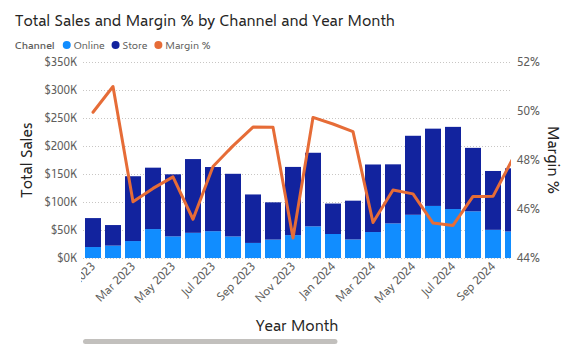 | Line and column (combo) charts | Show two measures with different scales on one axis. | [Combo charts](combo-charts.md) |
| 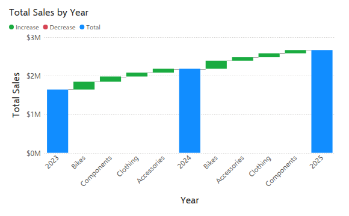 | Ribbon, waterfall and funnel | Show rank changes, running changes or stages. | [Ribbon, waterfall and funnel charts](ribbon-waterfall-funnel.md) |
| 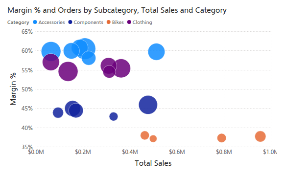 | Scatter and bubble charts | Show the relationship between two or three measures. | [Scatter charts](scatter-charts.md) |
| 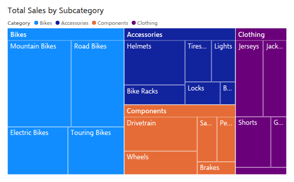 | Pie, donut and treemap | Show parts of a whole. | [Pie, donut and treemap](pie-donut-treemap.md) |
| 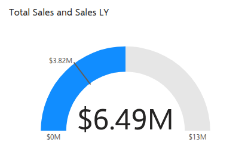 | Gauge and KPI | Show one value against a target. | [Gauge and KPI](gauge-and-kpi.md) |
| 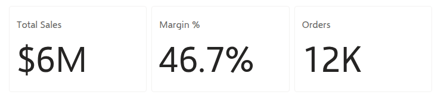 | Card, card (legacy) and multi-row card | Show headline numbers. | [Cards](cards.md) |
| 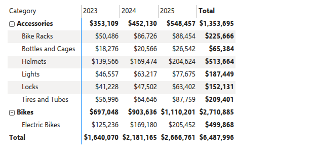 | Table and matrix | Show detailed numbers in rows and columns. | [Tables and matrices](tables-and-matrices.md) |
| 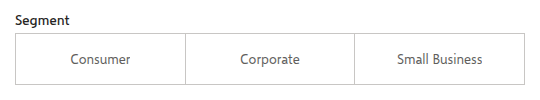 | Slicer, button slicer, list slicer, text slicer | Let readers filter the page. | [Slicers](slicers.md) |
| 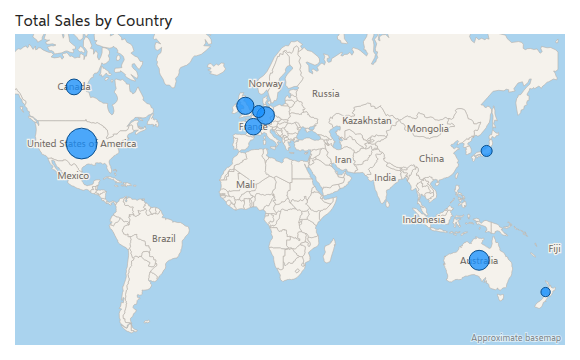 | Map, filled map, Azure map, shape map | Show values by location. | [Maps](maps.md) |
| 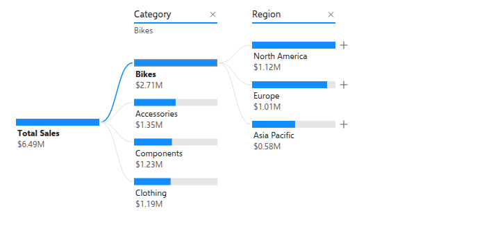 | Decomposition tree, key influencers, narrative, Q&A | Explore what drives a number. | [AI visuals](ai-visuals.md) |
|  | Text box, shape, image, button, navigators | Add text, decoration and navigation. | [Elements](elements.md) |
| 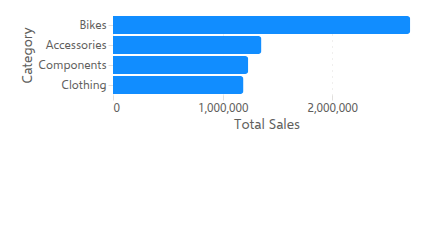 | HTML Content, Deneb, Power Automate, R and Python visuals | Use the custom and script visuals Lumen knows. | [Custom and script visuals](custom-visuals.md) |

## How visuals work in Lumen

- **Adding a visual.** Select a tile in **Visualizations > Build visual** (the gallery) with no visual selected; with a visual selected, the same click changes that visual's type and keeps its fields. See [Add and arrange visuals](../create-reports/add-and-arrange-visuals.md).
- **Fields.** Drag fields from the **Data** pane into the field wells under the gallery, or select a field's check box. See [The Data pane and field wells](../create-reports/the-data-pane-and-field-wells.md).
- **Formatting.** The **Format visual** tab has a **Visual** tab (the visual's own cards) and a **General** tab (title, effects, header icons, tooltips, alt text) that is the same for every visual. Every format card and property is listed in the [format properties reference](../reference/format-properties.md).
- **Default sort.** When you add fields, bar, column, pie, donut, funnel and treemap charts sort by their first value, descending; line, area and combo charts sort by their axis, ascending. This is the order Power BI Desktop writes. Sorting from the visual's **More options** menu replaces it.
- **Interactions.** Selecting data points cross-filters or cross-highlights the other visuals on the page; right-click a visual for **Show as a table**, **Include**, **Exclude**, drill, **Copy**, sort, **Export data** and **Spotlight**. See [Visual interactions](../create-reports/visual-interactions.md) and [Keyboard and context menus](../create-reports/keyboard-and-context-menus.md).

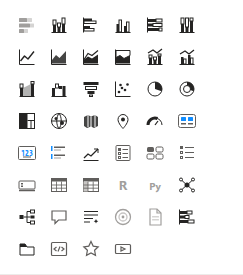

## Visuals Lumen does not render

Some types appear in the gallery but draw a hatched placeholder on the canvas: **R script visual**, **Python visual**, **Metrics** and **Paginated report**. Any AppSource or organizational custom visual other than HTML Content, Deneb and Power Automate also shows a placeholder. The report keeps these visuals unchanged when you save. See [Custom and script visuals](custom-visuals.md) and the [visual support reference](../reference/visual-support.md).

> [!WARNING]
> The gallery shows **Stacked bar chart** twice. The first tile (top left) inserts a visual type that Lumen does not render, so the canvas shows "This visual type isn't supported yet". Use the second **Stacked bar chart** tile, near the end of the gallery, which inserts Power BI's stacked bar chart (`barChart`).

## Articles in this section

| Type | Article |
|---|---|
| Overview | [Bar and column charts](bar-and-column-charts.md) |
| Overview | [Line and area charts](line-and-area-charts.md) |
| Overview | [Combo charts](combo-charts.md) |
| Overview | [Ribbon, waterfall and funnel charts](ribbon-waterfall-funnel.md) |
| Overview | [Scatter charts](scatter-charts.md) |
| Overview | [Pie, donut and treemap](pie-donut-treemap.md) |
| Overview | [Gauge and KPI](gauge-and-kpi.md) |
| Overview | [Cards](cards.md) |
| Overview | [Tables and matrices](tables-and-matrices.md) |
| Overview | [Slicers](slicers.md) |
| Overview | [Maps](maps.md) |
| Overview | [AI visuals](ai-visuals.md) |
| Overview | [Elements](elements.md) |
| Overview | [Custom and script visuals](custom-visuals.md) |
| Reference | [Visual support](../reference/visual-support.md) |
| Reference | [Format properties](../reference/format-properties.md) |

## Related content

- [Create reports](../create-reports/README.md)
- [Format a visual](../create-reports/format-a-visual.md)
- [Visual support reference](../reference/visual-support.md)
- [Format properties reference](../reference/format-properties.md)
