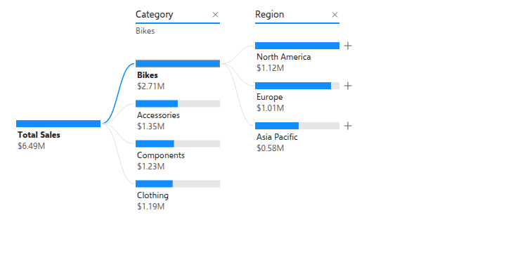
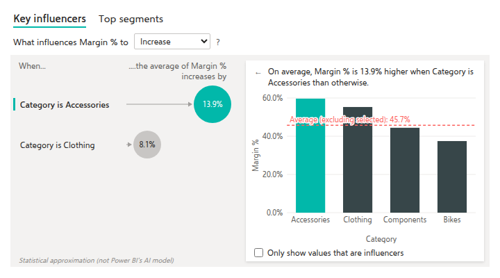
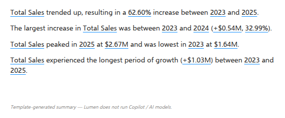
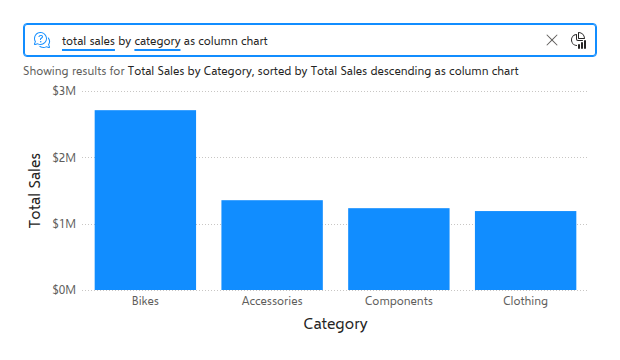

# AI visuals

> **Applies to:** Creators · Analysts

Power BI's AI visuals rely on Microsoft's machine-learning models and cloud services. Lumen runs offline and does not call those services: it re-implements four of these visuals with transparent rules and statistics, and each one says so. This article describes exactly what the **Decomposition tree**, **Key influencers**, **Narrative** and **Q&A** visuals do in Lumen and what they do not do.

Insert them from the Visualizations pane gallery, or from **Insert > AI visuals** (**Key influencers**, **Decomposition tree**, **Q&A**).

## Decomposition tree

The decomposition tree (`decompositionTreeVisual`) starts from a measure and lets you split it, level by level, by the fields in **Explain by**.

- Select **+** next to the last node on the path to add a level. The menu offers **High value** and **Low value** (AI splits, marked with a light bulb: the next level is the field whose value is highest or lowest) and every **Explain by** field not used on the path yet.
- Select a node of an earlier level to move the path; select a node of the last level to cross-filter the page (Ctrl+click adds to the selection).
- Each level header shows the field name and the selected node; select **×** to remove the level and the levels after it, the light bulb to turn an AI level into a normal level, and the lock (when editing) to pin a level.
- Long levels show a set number of bars with scroll arrows ("+*n*" above and below).
- The levels, the path, the AI method and the locks are saved in the report, as Power BI does.

| Well | Takes |
|---|---|
| Analyze | One measure |
| Explain by | Columns |
| Tooltips | Measures |

**Format options** (Visual tab): **Analysis**, **Tree**, **Data bars**, **Data labels**, **Category labels**, **Level header**.

**Difference from Power BI Desktop:** Power BI hides AI splits for "complex measures"; Lumen offers them for every measure.

## Key influencers

The key influencers visual (`keyDriversVisual`) shows which values of the **Explain by** fields go with a higher or lower value of the field you analyse.

- **Analyze** can be a categorical column ("What influences *X* to be *value*"), a numeric column or a measure ("What influences *X* to **Increase** / **Decrease**").
- The **Key influencers** tab lists the influencers with a bubble that shows the effect (a lift such as "1.53x", or a difference of the average). Select one to see its field as bars against the dotted "Average (excluding selected)" line.
- The **Top segments** tab lists the best single segments and pairs of segments.
- The analysis settings are saved in the report.

| Well | Takes |
|---|---|
| Analyze | One column or measure |
| Explain by | Columns or measures |
| Expand by | Columns |

**Format options** (Visual tab): **Analysis** (analysis type, which tabs to show, sort), **Key influencers** (colors), **Influencer details** (bubble color, average line color).

**Difference from Power BI Desktop:** this is a statistical approximation, not Power BI's model. Each **Explain by** field is tested on its own (Welch t-test at 95%); numeric fields are binned into quantile ranges; top segments are grown from single conditions and pairs instead of a decision tree. The visual shows "Statistical approximation (not Power BI's AI model)" in its footer and explains the method in its **?** help. Expect different influencers from Power BI Desktop on the same data, especially when fields are correlated.

## Narrative

The **Narrative** visual (`aiNarratives`) writes a short summary of the data: trends over time, highest and lowest categories, shares, the longest period of growth or decline, and measures that diverge. Dynamic values are underlined.

- With **Summary scope > Summarize all visuals on the page** on (the default), it summarizes the page's charts and cards. Each visual contributes its first category field and up to three measures; tables, matrices, slicers, text boxes, shapes, buttons and the AI visuals are skipped, as in Power BI.
- With fields in its own **Category** and **Values** wells, it can summarize those.
- **Format options**: **Text** (font, size, color, alignment) and **Summary scope**.

**Difference from Power BI Desktop:** the sentences come from fixed templates over the visuals' aggregated data, not from Copilot or a language model; the visual's footer says "Template-generated summary — Lumen does not run Copilot / AI models". Legend and small-multiple splits are not narrated. The ribbon's **Insert > AI visuals > Narrative** button is disabled ("Smart narrative isn't available in Lumen"); insert the visual from the gallery instead.

## Q&A

The Q&A visual (`qnaVisual`) turns a typed question into a visual drawn inside the Q&A box.

1. Insert the visual and select the box that reads **Ask a question about your data**, or one of the suggestions under **Try one of these to get started**.
2. Type a question such as `total sales by category as column chart` and press Enter.
3. Lumen underlines the terms it recognized in blue and the words it did not understand with a red squiggle, and shows how it read the question ("Showing results for ...").
4. When editing, select **Turn this Q&A result into a standard visual** to replace the Q&A visual with the generated visual, including its filters.

The question is saved in the report. The Q&A visual has no field wells.

**What it understands:** table, column and measure names (also "table column" phrases and measure names without prefixes such as "Total"), approved synonyms from the model's linguistic schema, aggregations, grouping ("by"), top and bottom *N* ("top 5 product by total cost"; "top products" without a number uses 5), sorting, value and numeric filters, and explicit visual types ("as line chart").

**Difference from Power BI Desktop:** Lumen uses a small rule-based grammar instead of the Power BI Q&A service. It reads approved synonyms from the model's linguistic schema but has no Q&A setup or teaching, and it can fail on a model whose names it cannot map: it is known to fail on at least one of Microsoft's public sample reports. When it does not understand a word, it says so instead of guessing.

## Related content

- [Visual support reference](../reference/visual-support.md)
- [Visual interactions](../create-reports/visual-interactions.md)
- [Tables and matrices](tables-and-matrices.md)
- [Format properties: AI visuals](../reference/format-properties/ai-visuals.md)
