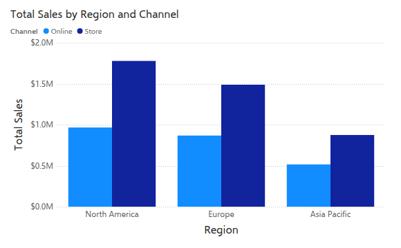
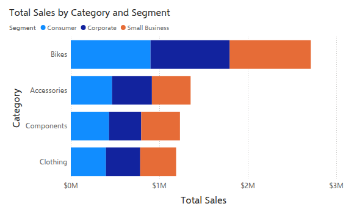
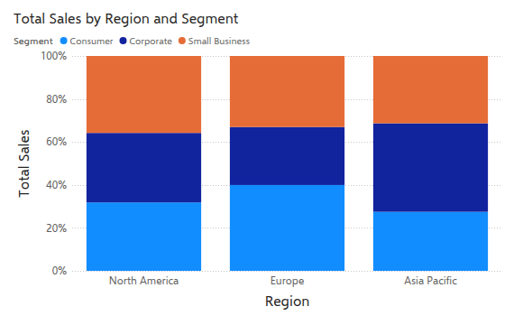
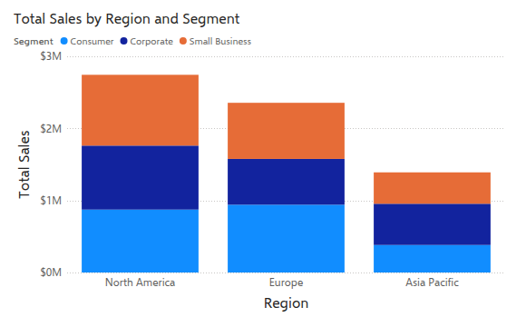
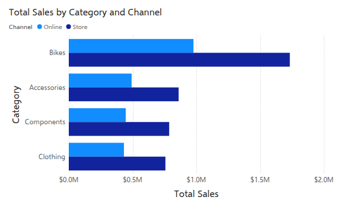
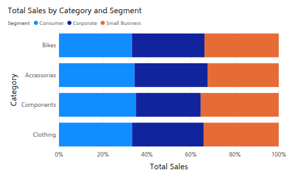

# Bar and column charts

> **Applies to:** Creators · Analysts

Bar and column charts compare a measure across the values of a category. This article covers the six types Lumen offers: clustered, stacked and 100% stacked, each as columns (vertical) or bars (horizontal).

| Visual | Type ID | What it shows |
|---|---|---|
| Clustered column chart | `clusteredColumnChart` | One column per legend value, side by side. |
| Stacked column chart | `columnChart` | Legend values stacked into one column per category. |
| 100% stacked column chart | `hundredPercentStackedColumnChart` | Each column stacks to 100%: the share of each legend value. |
| Clustered bar chart | `clusteredBarChart` | As clustered column, horizontal. |
| Stacked bar chart | `barChart` | As stacked column, horizontal. |
| 100% stacked bar chart | `hundredPercentStackedBarChart` | As 100% stacked column, horizontal. |

## When to use

- Use **columns** for a small number of categories or for time (years, quarters), and **bars** for long category names or many categories: bars leave room for the labels.
- Use **clustered** to compare legend values with each other inside each category, **stacked** to show a total and its parts, and **100% stacked** when only the shares matter.
- For a trend over many time points, a [line chart](line-and-area-charts.md) is easier to read.

## Field wells

Column charts take the category on the **X-axis** and the values on the **Y-axis**; bar charts swap the two names (category on the **Y-axis**, values on the **X-axis**).

| Well | Takes | Notes |
|---|---|---|
| X-axis (columns) / Y-axis (bars) | Columns or hierarchies | The category. Several fields or a hierarchy enable drill down. |
| Y-axis (columns) / X-axis (bars) | Measures | One or more values. |
| Legend | One column | Splits each value into series. |
| Small multiples | Column | Draws one small chart per value of this field. |
| Tooltips | Measures | Extra values in the default tooltip. |

When you add fields, these charts sort by their first value, descending, as Power BI Desktop does. Change the sort from the visual's **More options (...)** menu > **Sort axis**.

## Format options

The **Visual** tab of **Format visual** groups the options as follows; the [format properties reference](../reference/format-properties/bar-and-column-charts.md) lists every property.

- **Legend**: show, position, title, font.
- **Small multiples** and **Small multiple title**: grid layout (rows, columns, padding), gridlines and background of the panels.
- **X-axis** and **Y-axis**: type, range, scale, font, display units, title, gridlines.
- **Columns** or **Bars**: **Default color**, a color per series (**Show all**), **Transparency**.
- **Data labels**: show, position, font, display units, decimal places, background; per series with **Show for this series**.
- **Total labels** (stacked column and stacked bar only): the total above each stack.
- **Plot area background** and **Zoom slider**.

The **Analytics** tab ("Add further analyses to your visual") adds a constant line, min, max, average, median and percentile lines, a trend line and error bars.

## Interactions

- Select a column or bar to cross-filter or cross-highlight the other visuals; Ctrl+click adds to the selection. These charts can themselves be cross-highlighted.
- With several fields or a hierarchy on the category well, use the drill buttons in the visual header, or right-click > **Drill down**, **Drill up**, **Show next level**, **Expand to next level**.
- Right-click a data point for **Show data point as a table**, **Include**, **Exclude** and **Drill through** (when the report has a drill-through page for the field).

## Differences from Power BI Desktop

- The Visualizations pane gallery shows **Stacked bar chart** twice. The first tile inserts an unsupported type and the canvas shows "This visual type isn't supported yet"; the second tile, near the end of the gallery, inserts the real stacked bar chart (`barChart`).
- In this version, adding a third field to a chart that already has a category and a value (for example a **Legend** after the X-axis and the Y-axis) can be ignored: the field does not appear in the well. Add the fields in this order instead: category, legend, then the value last. If a field does not stick, remove the value and add it again last.
- Text measurement uses a Segoe UI-like approximation, so label truncation and axis spacing can differ by a few pixels from Power BI Desktop.

## Related content

- [Line and area charts](line-and-area-charts.md)
- [Combo charts](combo-charts.md)
- [Format a visual](../create-reports/format-a-visual.md)
- [Drill down and drill through](../create-reports/drill-down-and-drillthrough.md)
- [Format properties: bar and column charts](../reference/format-properties/bar-and-column-charts.md)
