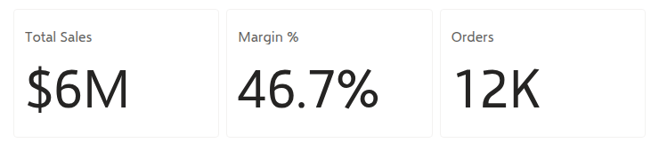
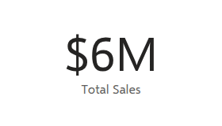
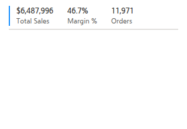

# Cards

> **Applies to:** Creators · Analysts

Cards show headline numbers. Lumen has the three card visuals of Power BI Desktop: the **Card** (`cardVisual`, the "new card" that can show several values and images), the **Card (legacy)** (`card`, one value) and the **Multi-row card** (`multiRowCard`).

## When to use

- Use the **Card** for a row of key numbers: one visual can show several measures as separate cards, each with a label, an image or icon, and its own styling.
- Use the **Card (legacy)** for one number, or to keep the look of older reports.
- Use the **Multi-row card** for a compact list of several values in one block.

## Field wells

| Visual | Well | Takes | Notes |
|---|---|---|---|
| Card | Value | Measures or columns | One card per field. |
| Card | Categories | One column | Repeats the cards for each value of the column. |
| Card (legacy) | Fields | One measure or column | |
| Multi-row card | Fields | Measures or columns | |

A column added to a card well is summarized (for example **Count of Category**). To change the aggregation, open the field's menu in the well (the arrow on the field) and pick another one, or **Don't summarize**.

## Format options

The [format properties reference](../reference/format-properties/cards.md) lists every property; the card has more than 200.

**Card** (Visual tab), in the order the Format pane shows them:

- **Multi-card layout** (arrangement, **Max cards shown**, **Fit to space**, fixed card size, columns and rows, spacing, style) and **Overflow** (continuous scroll or pages).
- **Callout value** (font, alignment, **Wrap text**, display units, decimal places, **Format code**, **Show blank as**), **Category label** (text, position above or below the value), **Callout spacing**.
- Reference labels: **Reference labels layout**, **Reference label title**, **Reference label value**, **Reference label detail**, **Reference labels area**.
- Card styling: **Card background**, **Card border**, **Card shape** (rounded corners, individual corners), **Accent bar**, **Card shadow**, **Card glow**, **Divider**, **Card padding**, **Callout area**.
- Images: **Callout image** and **Image**. An image slot can show a URL image or a built-in icon; see [Icons](../create-reports/icons.md).
- With **Categories**: **Multi-category layout**, **Category header**, **Multi-category overflow**, **Category border**, **Category gridlines**.

**Card (legacy)**: **Callout value**, **Category label**, **Word wrap**.

**Multi-row card**: **Callout values**, **Category labels**, **Card title**, **Card** (the block's background, outline and bar).

Text defaults come from the report theme's text classes: the callout value uses the theme's `callout` class and the labels its `label` class, so a theme that changes those classes restyles every card. See [Themes](../create-reports/themes.md).

## Interactions

- A Card with **Categories** cross-filters the page when you select one of its cards; Ctrl+click adds to the selection.
- Cards are cross-filtered (not cross-highlighted) by selections in other visuals.

## Differences from Power BI Desktop

- Some of the Card's default sizes are not published by Microsoft and were measured from screenshots: the category label's size, the reference labels' size, the **Narrow** and **Wide** padding presets (4 and 20 px), and how the card shares its height between the image and the text. Small differences from Power BI Desktop are possible.
- Reference labels saved in a report render, but Lumen has no field well to add them: the Card's wells are **Value** and **Categories** only.
- A Card with a **Categories** field in a short visual can clip its values: with four categories in a visual about 220 px high, the values were cut off and the category names were drawn vertically. Give such a card enough height, or use **Multi-card layout > Max cards shown** and **Overflow** to page through the categories.
- A large value in a narrow card is truncated with an ellipsis ("46....") instead of shrinking; widen the visual or lower the callout font size.

## Related content

- [Gauge and KPI](gauge-and-kpi.md)
- [Icons](../create-reports/icons.md)
- [Conditional formatting](../create-reports/conditional-formatting.md)
- [Themes](../create-reports/themes.md)
- [Format properties: cards](../reference/format-properties/cards.md)
