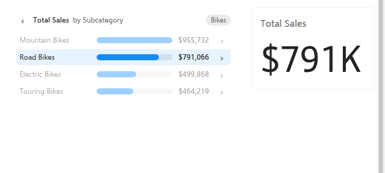

# Code visual

> **Applies to:** Creators · Analysts

The **Code visual** is a Lumen visual you design yourself with HTML, CSS and, when you need logic, JSX. It reads the
fields in its wells like any native visual, and it takes part in the page like one: **click a row to cross-filter or
cross-highlight the other visuals, drill down and up through a hierarchy, and react when other visuals, slicers and
filters change**. Measure values reach your CSS directly as variables, and the visual knows its own size, so layouts
can adapt with container queries. Power BI Desktop has no equivalent.


## Cross-filtering and drill-down

These two features make a code visual part of the report rather than a picture on it.

- **Cross-filtering, both ways.** Mark an element with `data-select` and a click on it selects that row: the other
  visuals on the page filter or highlight to it, exactly as when you click a bar of a column chart. **Ctrl+click** adds
  rows, a click on empty space clears the selection, and the report's saved interactions (filter, highlight or none
  for each target) apply as for native visuals. In the other direction, a selection in another visual or a slicer filters the code visual, or
  highlights it: each row then knows whether it is highlighted (`data-highlighted`, `--highlight-value`), so your CSS
  can dim the rest. Selections are saved in bookmarks like a native visual's.
- **Drill-down on the Rows hierarchy.** Put two or more fields (or a hierarchy) in **Rows** and the visual gets the
  native drill controls in its header: **Drill up**, **Drill down** mode, **Go to the next level** and **Expand all
  down one level**, plus **Drill down** / **Drill up** in the right-click menu. Your code can drill too: `data-drill`
  on an element drills into its row, `data-drill-up` goes back, and the template knows the current level, its name,
  the breadcrumb ("Bikes > Road Bikes") and which rows can drill. The drill state is saved with the visual, in
  bookmarks, and covered by **Undo**.

The **Bar list** starter template does both: a click on a bar cross-filters the page, the arrow on a bar drills into
it, and a back arrow and a breadcrumb appear in its header. [Tutorial: build a drillable bar list](../create-reports/tutorial-build-a-drillable-bar-list.md)
walks through it.



## When to use

- A KPI tile, scorecard, progress ring, timeline or other graphic the native visuals cannot draw, without building and
  packaging a custom visual.
- A visual whose colours, sizes or widths come straight from measures: `width: calc(var(--pct-of-max) * 100%)`, with no
  measures that build SVG text or colour codes.
- A layout that changes with the visual's size (container queries, `cqmin` units).

Use a native visual when one does what you need: it renders faster, and it opens in Power BI Desktop.

## Field wells

| Well | Takes | Notes |
|---|---|---|
| Rows | Columns or a hierarchy | One row of data per value. Two or more levels form a drill hierarchy. Optional: without Rows, the visual has one row (the totals). |
| Values | Measures or columns | Columns are summarized. The first is the row's `--value`. |
| Tooltips | Measures or columns | Extra fields in the data and in the default row tooltip. |

The visual queries its fields with the same engine and filters as native visuals: page, report and visual filters,
slicers, other visuals' selections, row-level security when you view as a role, and **Top N** filters. Rows are limited
to 1,000 by default (**Format > Code > Row limit**, up to 30,000); a notice appears when rows were cut.

## Code

Select the visual and then **Edit code** (in **Build visual**, in the right-click menu, or by double-clicking the
visual in edit mode). The editor has tabs for **HTML**, **CSS** and **JSX**, a **Parameters** tab, a **Data** tab that lists every
value and variable your code can use, and a live preview at the visual's size and at preset sizes. See
[Use the code visual](../create-reports/code-visual.md) and the [code visual API reference](../reference/code-visual-api.md).

A short example: a list of rows with a bar sized by each row's share of the largest value.

```html
<ul class="list">
  {{#each rows}}
  <li class="row" data-select>
    <span>{{category}}</span>
    <span class="bar"></span>
    <b>{{value1}}</b>
  </li>
  {{/each}}
</ul>
```

```css
.row { display: grid; grid-template-columns: 8em 1fr auto; gap: 8px; align-items: center; cursor: pointer; }
.bar { height: 8px; width: calc(var(--pct-of-max) * 100%); background: var(--theme-color-1); border-radius: 4px; }
[data-highlighted="false"], [data-has-selection="true"] [data-selected="false"] { opacity: .4; }
```

## Format options

The [format properties reference](../reference/format-properties/code-visual.md) lists every property.

- **Code**: **Overflow** (**Hidden**, **Visible** or **Scroll**), **Default row order** (by first value, descending,
  or by rows, ascending), **Row limit**, **Row tooltips** (the default tooltip on hover of a row).
- **Parameters**: one control per parameter the code declares (colour, number, text or toggle), so a report author can
  restyle the visual without editing code. Themes can set them.
- The **General** tab is the same as for any visual: title, subtitle, background, border, shadow, padding, header icons,
  tooltips, alt text.

## Interactions

- **Selection** (`data-select`, or `select(row)` in JSX) cross-filters or cross-highlights the page; **Ctrl+click**
  adds rows; a click on empty space clears. Selected rows have `data-selected="true"`.
- **Incoming filter or highlight**: the visual re-renders with the filtered data, or with each row's highlighted value
  (`data-highlighted`, `--highlight-value`, `--highlight-pct-of-max`).
- **Drill** (`data-drill`, `data-drill-up`, `data-expand`, `data-next-level`, header icons, right-click menu) as
  described above.
- **Tooltips**: hovering a row element shows the default tooltip with its fields.
- **Right-click**: **Show as a table**, **Include**, **Exclude** (on a row), drill, **Copy**, **Export data**,
  **Spotlight**, **Edit code**.
- **Keyboard**: elements with `data-select` or the drill attributes are focusable; **Enter** or **Space** activates them.

Copy and paste, duplicate, **Format painter** (the container and the parameters), **Undo**, bookmarks, the mobile
layout, **Export to PDF**, **Export to PowerPoint** and image export all work as for native visuals; export waits until
every code visual has drawn.

## Differences from Power BI Desktop

Power BI Desktop has no code visual. Lumen saves it as a visual with a Lumen-only type and its code in separate files
(see [Considerations and limitations](#considerations-and-limitations)). Power BI Desktop is expected to show an empty
frame with a message that the visual can't be displayed; **this is designed for, not verified**. The visual's container
(title, border, size, position) and its fields stay intact when Power BI Desktop saves the report, unless it drops
visuals it cannot display.

## Considerations and limitations

- **No network.** Code runs in a sandbox with no network, no access to the report or the app, and no storage. Images
  must be registered images of the report, `data:` URIs or fields that hold them. Links and forms do nothing.
- **One process per JSX visual.** A visual with JSX runs in its own renderer process so that a runaway script stalls
  only itself (a watchdog stops it after a few seconds and offers **Run again**). HTML-only code visuals share one
  process. Opening a page with many code visuals takes about 0.3 to 0.7 seconds longer than with the same number of
  cards; cross-filtering is as fast.
- **Edit mode.** In edit mode, pointer events reach the visual through an overlay: `:hover` rules still apply (Lumen
  rewrites them to also match the forwarded hover), and keyboard focus inside the visual works only in reading view.
- **Bookmarks and drill.** A bookmark restores the drill state; the restored state is not written into the visual's
  saved drill state until you drill again.
- **Saving.** In a PBIP folder, the code is saved as `code.html`, `code.css` and `code.jsx` beside the visual's
  `visual.json`; in a `.wbi` bundle, inside the visual's JSON. Power BI Desktop is not expected to render the visual; Lumen does not save a static picture of it.
- **Not implemented.** Report-page tooltips for a row, drillthrough from a row, and a request from the code to change
  the visual's own size.

## Related content

- [Use the code visual](../create-reports/code-visual.md)
- [Tutorial: build a KPI tile with HTML and CSS](../create-reports/tutorial-build-a-kpi-tile-with-html-and-css.md)
- [Tutorial: build a drillable bar list](../create-reports/tutorial-build-a-drillable-bar-list.md)
- [Code visual API reference](../reference/code-visual-api.md)
- [Visual interactions](../create-reports/visual-interactions.md)
- [Drill down and drillthrough](../create-reports/drill-down-and-drillthrough.md)
